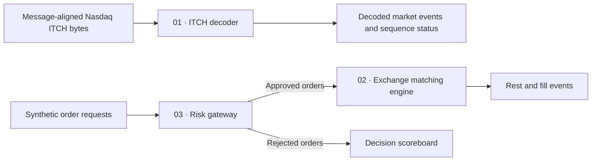

# Ultra Low Latency Trading RTL

Three original SystemVerilog designs for latency-sensitive trading hardware. Each project includes synthesizable RTL, an interface specification, and a self-checking simulation. The repository also includes a shared FPGA timing flow and a risk-to-matcher simulation.

| Project | Design | Unstalled behavior |
| --- | --- | --- |
| [01 · Nasdaq ITCH market data](projects/01-market-data) | Decode seven TotalView-ITCH 5.0 order lifecycle messages from a 64-bit byte stream. Check framing and message sequence, then queue typed events and diagnostics. | One input beat per clock with capacity. An empty result queue can transfer the result on the rising edge after the final beat. |
| [02 · Price-time matching engine](projects/02-matching-engine) | Maintain a bounded bid and ask book with per-price FIFO order, direct ID cancels, and partial and multi-order fills. | One cycle from command transfer to the first event, then one event per cycle during an unstalled sweep. |
| [03 · Pre-trade risk gateway](projects/03-risk-gateway) | Enforce configurable instrument, price, size, notional and side credit limits with ordered reservations and a latched emergency halt. | One request per clock. Accept at edge `n`, present the decision after `n+2`, and transfer it on `n+3` with a ready sink. |

## Try it

Run from the repository root. The simulators use Icarus Verilog and Python 3. Mapping uses Yosys. Routing additionally uses nextpnr with ECP5 support.

```sh
make test      # Three scoreboards and the integration test
make synth     # Default-parameter generic synthesis and structural checks
make route     # ECP5 mapping, out-of-context route, timing and utilization summary
make demo      # Risk decisions and exchange-side matching under backpressure
```

Override `YOSYS` and `NEXTPNR` with executable paths if needed. The [OSS CAD Suite](https://github.com/YosysHQ/oss-cad-suite-build) provides both. Simulation does not require an FPGA board or exchange data.

## System boundary



The decoder is a market-data subscriber. The matcher represents an exchange-side book that processes new orders and cancels. The integration runs the risk gate and matcher using synthetic orders on a single clock and checks that rejected orders cannot reach the book. The RTL boundary starts at framed feed data or normalized orders. A physical deployment would require transport, clock and reset integration, and implementation for the chosen board or ASIC process.

## Evidence

- [Performance and reproducibility](docs/performance.md) documents cycle definitions, simulation counts, routed frequency and resource use for a shared ECP5 configuration.
- [Research notes](docs/research.md) summarize 30 papers and preprints and link design decisions to primary sources and the Nasdaq specification.
- [Role alignment](docs/role-alignment.md) connects the work to FPGA and ASIC role requirements from Citadel Securities, Optiver, and Jane Street.
