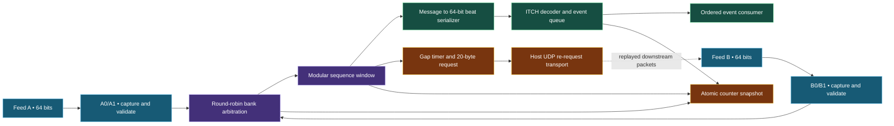
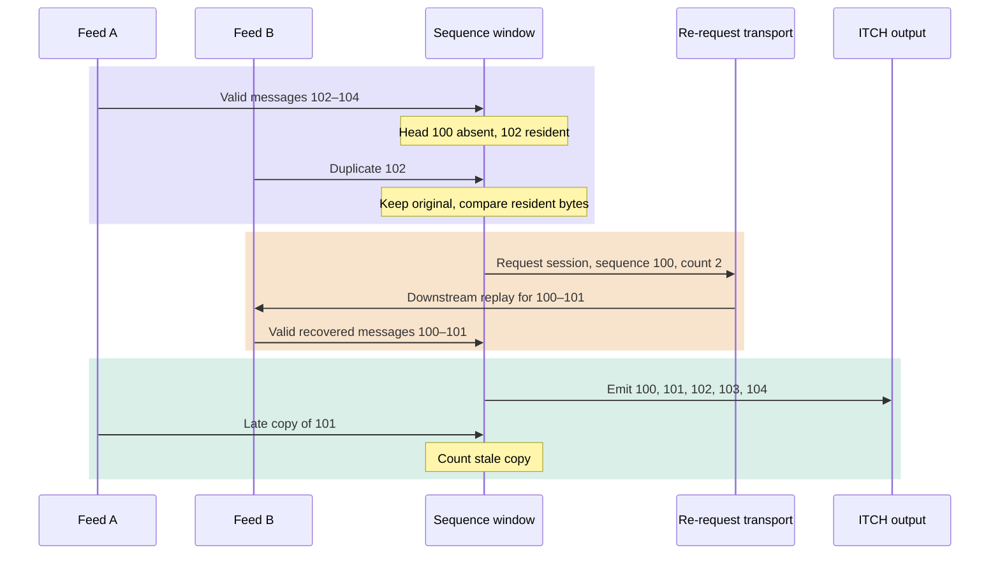

# Day 01 · Redundant market data receiver

A dual-feed Nasdaq MoldUDP64 receiver that turns UDP payload bytes into one ordered stream of TotalView-ITCH 5.0 order events. Two capture banks per feed validate each datagram in full. A bounded message window merges overlapping copies, detects missing messages, and generates the 20-byte Nasdaq re-request payload.

The top level is [`redundant_market_data.sv`](redundant_market_data.sv). [`rtl.f`](rtl.f) lists the synthesizable sources in dependency order.

## Run

```sh
make test
make test-default
make regress
make lint
make synth
```

Simulation uses Icarus Verilog and the Python standard library. Use Verilator for RTL lint and Yosys for generic synthesis and structural checks. The build directory holds generated vectors, the simulator and synthesis output. The generic netlist expands memories into registers. Use the repository's device mapping flow for FPGA resources and timing.

## Data path



1. **Capture.** Each lane writes the original 64-bit words into one of two independently controlled banks. A selected bank owns the packet from its first accepted beat through its last. Receiving into a free bank can overlap validation or replay in its peer bank.
2. **Validate.** The bank checks the 20-byte header, session and exact number of blocks. Each block advances the byte cursor by its big-endian 16-bit length plus two. Validation checks the full packet before releasing any block, so a truncated final block cannot leak earlier blocks into the reorder window. A zero-length block is legal MoldUDP64 and later produces one malformed ITCH record. [Nasdaq MoldUDP64 specification, pp. 3–5](https://www.nasdaqtrader.com/content/technicalsupport/specifications/dataproducts/moldudp64.pdf)
3. **Replay.** Validation stores each verified offset and length as a descriptor. Two synchronous parity memories return adjacent words, so an unaligned length field or payload can cross a word boundary. Once a payload's first read completes, the gather stage consumes one aligned word per cycle and zeros invalid final lanes.
4. **Merge.** A round-robin transaction arbiter forwards one candidate per cycle. A power-of-two circular window inserts by message sequence and releases only its expected head. Messages from different packet boundaries can overlap. The first admitted copy wins. A second copy while the entry is resident increments the duplicate counter and compares its length and payload. A copy after release counts as stale.
5. **Decode.** An elastic serializer feeds a message-aligned ITCH parser that registers a normalized event and holds it under backpressure.

### Sequence window and recovery

Let `E` be the next sequence the reorder window will release, and form the unsigned modulo 2⁶⁴ distance `d = message_sequence - E`. Distances below the window depth can be stored. Different sequences in this range cannot alias the same low-bit index. Distances from the depth through 2⁶³−1 are ahead but outside the window, so the receiver records their existence and drops their payload. Distances of 2⁶³ and above are stale. The head remains in place until the serializer accepts it.

`high_water` is an exclusive sequence watermark learned from validated messages and from heartbeat and end-of-session headers. A data message at distance 2⁶³−1 proves an exclusive watermark at distance 2⁶³. A bare heartbeat or end-of-session header at distance 2⁶³ is ambiguous and leaves the watermark unchanged. A gap exists when the head is absent and the watermark lies ahead. After `GAP_TICKS` clocks of that condition, the receiver requests from the missing head up to the earliest buffered message, or up to the watermark if there is no buffered message, capped at `REQUEST_MAX` messages. It holds the request until transfer and repeats after the timeout if the gap remains. If the missing copy arrives while the request is stalled, the pending request still transfers once. Duplicate suppression makes the eventual retransmitted copies safe to admit.



The system never advances across a missing head. A host can recover by injecting ordinary downstream MoldUDP64 response packets on either input or by coordinating a new epoch with a freshly recovered order book and sequence. End-of-session is a sticky advisory per epoch. The receiver can continue accepting replay traffic for that session.

## Interfaces

All transfers use the rising edge of `clk`. On each ready/valid interface, the sender holds valid and all payload signals through a stall. Synchronous active-high `rst` clears the epoch and pending transfers.

| Interface | Signals | Contract |
| --- | --- | --- |
| Epoch | `cfg_valid`, `cfg_ready`, `cfg_session[79:0]`, `cfg_sequence[63:0]` | Session is the ten wire bytes, most significant byte first. An accepted command discards all old packet, reorder, event, request and counter state and sets the next expected sequence. Quiesce the upstream streams and discard any partial old datagrams during an epoch change. |
| Ingress | `feed_valid[1:0]`, `feed_ready[1:0]`, `feed_data[127:0]`, `feed_keep[15:0]`, `feed_first[1:0]`, `feed_last[1:0]` | Lane 0 is A and lane 1 is B. Lane `i` owns `feed_data[64*i +: 64]`. The lowest byte carries the first wire byte. Mark one UDP payload per packet. Keep is full on non-final beats and a nonempty low-bit prefix on the final beat. |
| Event | `event_valid`, `event_ready`, `event_data[587:0]` | One completion per ordered message. Stalled events retain all 588 bits. |
| Recovery | `request_valid`, `request_ready`, `request_data[159:0]` | Atomic big-endian payload. Bits `[159:80]` carry session, `[79:16]` first requested sequence and `[15:0]` count. A host or UDP transmit path adds network headers. |
| Status | `expected_sequence`, `high_water`, `gap_pending`, `session_end_seen`, `reorder_occupancy` | Expected tracks release to the ITCH serialization path. Events already in that path may still be waiting for the sink. |
| Snapshot | `stats_snapshot`, `stats_index[3:0]`, `stats_data[31:0]`, `stats_peak[5:0]` | A snapshot copies live counters and the occupancy peak as of the previous edge. Read the frozen bank by index until the next snapshot. Clear on reset and epoch changes. |

The decoder covers Add `A/F`, Execute `E/C`, Cancel `X`, Delete `D` and Replace `U`. The wire values remain integer prices in 1/10,000 dollar units with nanosecond timestamps. A supported type with invalid length or a bad side/printable field gets result 2. An unsupported type gets result 1 and consumes its sequence. Result 0 carries decoded order fields. [Nasdaq TotalView-ITCH 5.0 specification, §§3, 4.3–4.4](https://www.nasdaqtrader.com/content/technicalsupport/specifications/dataproducts/NQTVITCHSpecification_5.0.pdf)

| Event bits | Field | Event bits | Field |
| --- | --- | --- | --- |
| 587:586 | Result | 585:584 | Sequence disposition, 0 for the ordered stream |
| 583:520 | Sequence | 519:456 | Expected sequence from ITCH decoder |
| 455:448 | Raw type | 447:432 | Stock locate |
| 431:416 | Tracking | 415:368 | Timestamp |
| 367:304 | Order reference | 303:240 | Replacement reference |
| 239:232 | Side | 231:200 | Shares |
| 199:136 | Stock symbol | 135:104 | Price |
| 103:40 | Match number | 39:32 | Printable flag |
| 31:0 | MPID | | |

### Counter map

| Index | Counter | Index | Counter |
| ---: | --- | ---: | --- |
| 0 | New window entries | 8 | Valid heartbeat packets |
| 1 | Resident duplicates | 9 | Valid end-of-session packets |
| 2 | Resident duplicates with conflicting bytes | 10 | Transferred re-requests |
| 3 | Old messages | 11 | Transferred decoded events |
| 4 | Ahead messages outside the window | 12 | Transferred unsupported ITCH events |
| 5 | Invalid datagrams | 13 | Transferred malformed ITCH events |
| 6 | Datagrams rejected by implementation limits | 14 | Validated A message candidates |
| 7 | Wrong-session datagrams or no configured epoch | 15 | Validated B message candidates |

Counters saturate at 2³²−1. Index 2 is a subset of index 1. The winner remains valid if a conflicting duplicate arrives. No copy comparison is possible once the original has left the window.

## Measured cycle budget

At small test geometry, the Icarus benchmark injected identical 41-byte one-Delete datagrams on both lanes for **six consecutive simultaneous input beats** and saw the event transfer **15 clocks after both last beats**, or 20 clocks from the first beats. Sources and sink ran without bubbles. While a free bank is assigned, each lane accepts up to one 64-bit beat per clock, and both lane interfaces can operate in the same cycle.

For the measured path the final-to-event stages were three clocks for header and block validation, seven for descriptor and RAM replay through bank acceptance, one for handing off the reorder head, three for the ITCH input beats and one for event transfer. Longer packets require two validation clocks per block after the header. Ingress must wait when both banks are busy. Sustained throughput depends on block length and count, arbitration occupancy, recovery, and downstream stalls. The isolated burst test does not establish a sustained Ethernet line rate.

## Verification and replay

[`scenarios.py`](scenarios.py) builds binary packets and injections. [`wire_codec.py`](wire_codec.py) independently parses and normalizes reference records. [`tb_redundant_market_data.sv`](tb_redundant_market_data.sv) consumes two independently paced streams, compares all 588 output bits, and checks requests, status, snapshots, flow control and cycle budgets.

| Check | Coverage |
| --- | --- |
| Datagram bounds | Incomplete headers, excessive counts/lengths, injected keep and first errors, wrong session, chained lengths through lane boundaries |
| Packet atomicity | A packet whose final block is truncated or whose last block leaves trailing bytes emits no earlier event |
| Sequence | Overlap, conflicting duplicate, stale copy, modulo wrap, half-range stale convention, exclusive watermark at the forward boundary, full input banks and future distance beyond the window |
| Recovery | Heartbeat/EOS hints, count cap, continuous retry after timeout, backpressure with eventual gap repair, epoch reset during capture |
| End-to-end | Two seeds with 628 exact events, 4 request transfers, 114 status checks, and 21 input stall cycles per run |
| Default geometry | 84 exact events, including exact 1,536-byte and 64-block limits, 64-byte body support, and distances 15 and 16 around the default window edge |

The default randomized stream covers 600 ITCH messages over 100 short bursts with independent feed skew, optional overlapping copies and sink stalls. The testbench uses a 256-byte packet bound, 16 blocks, 8 reorder entries, a 48-cycle timeout and request cap 4. The separate default-geometry test runs the synthesis top's default parameters.

For offline traffic preparation, [`pcap_replay.py`](pcap_replay.py) extracts matching UDP packets from classic Ethernet/IPv4 PCAP, including up to two VLAN tags. It accepts optional IPv4 header checksum validation and rejects fragments. Scheduling uses original capture timestamps and orders both lanes by their earliest available clock edge. [`test_pcap_replay.py`](test_pcap_replay.py) checks the container formats, parsing and independent lane schedules.

```sh
python3 pcap_replay.py capture.pcap \
  --lane-a 239.1.2.3:12000 --lane-b 239.1.2.4:12001 \
  --output build/replay.txt
python3 -m unittest -v test_pcap_replay
```

Schedule rows are `cycle lane data_hex keep_hex first last`. A transactor may use the first column as the earliest requested edge. It must continue observing each lane's ready until each beat actually transfers.

## Integration bounds

- The default block accepts packets of up to 1,536 bytes, up to 64 blocks per packet and ITCH bodies up to 64 bytes. Default window depth is 16, timeout is 64 clocks, and cap is 32 messages. Keep packet sizes at least 64 bytes, message storage a multiple of eight bytes of at least 16, at least two descriptor entries, window a power of two from 2 through 32, and a positive timeout and request count when reconfiguring synthesis parameters.
- Provide lane alignment, Ethernet/IP/UDP processing, clock crossing, integrity checks and packet-drop accounting outside this core. Both feed inputs can backpressure. A live MAC needs an ingress buffering and drop policy. An input that loses its last marker stays attached to its bank until a last marker or an epoch reset.
- The design tracks one configured session at a time. It generates a standard recovery payload and accepts retransmitted downstream messages. Server discovery, rate limiting across sessions, packet transmission and book snapshot recovery belong to the integration.
- Atomic validation adds a full receive pass and a block-length walk. The tradeoff is that malformed datagrams can be discarded before any event reaches the consumer.
- A/B path selection and the recovery window have different timing objectives. The original design uses sequence-level windowing and separates the transport parser from the ITCH decoder. Compare this with Denholm et al.'s packet arbitration modes and their analysis of sequence comparison cost. [Low Latency FPGA Acceleration of Market Data Feed Arbitration, ASAP 2014](https://www.doc.ic.ac.uk/~wl/papers/14/asap14sd.pdf)

The implementation exercises network datapaths, buffering, timing analysis and transaction-level verification relevant to trading hardware work. [Optiver FPGA Engineer](https://www.optiver.com/join-us/jobs/technology/chicago/fpga-engineer/), [Jane Street ASIC Engineer](https://www.janestreet.com/join-jane-street/position/8233259002/)

The [common characterization report](../docs/performance.md) records the comparable default-geometry route, verification scope, and source inventory for all three designs.
