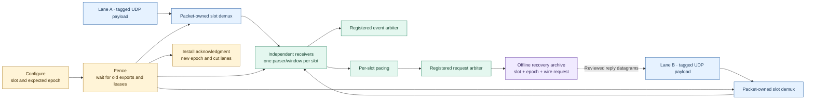
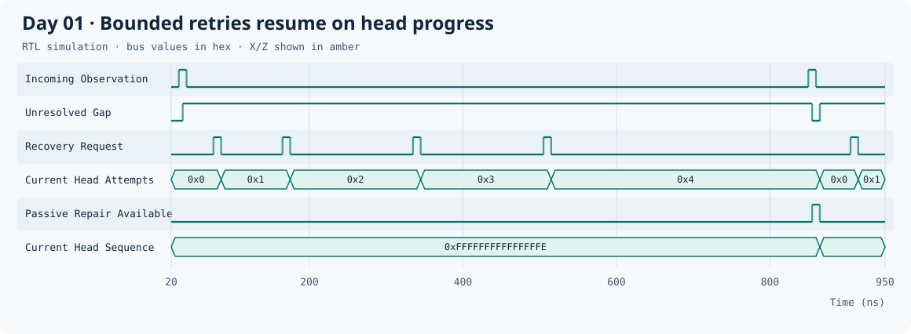
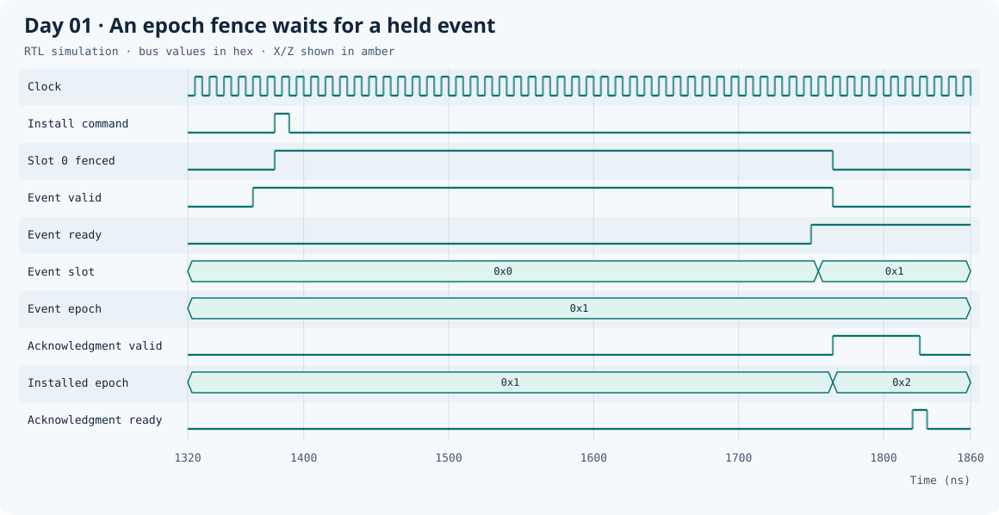

# Day 01 · Multi-session receiver and recovery archive

[`multisession_market_data`](../multisession_market_data.sv) runs one copy of the
tested MoldUDP64/ITCH receiver per configured slot. A network adapter selects the
slot on the first beat of each UDP payload based on its destination, feed
subscription or descriptor. Two independently controlled physical lanes can
interleave packets from unrelated slots and still deliver redundant copies to
the same receiver. An optional offline [recovery archive](../mold_recovery_store.py)
keeps first-arrival raw messages and builds wire replies for requests it can
answer.

## Where it fits

- A colocated gateway may subscribe to different exchange channels in the same
  enclosure. One stalled or missing capture can block that session's release
  while unrelated sessions continue accepting packets and generating requests.
  The shared output needs policy and capacity for traffic from all active slots.
- A maintenance application can replace an affected feed subscription while
  other slots continue to operate. The acknowledgment gives a precise epoch
  boundary for deduplication, telemetry and downstream book rebuild.
- An offline lab can replay an A/B capture into a persisted recovery archive,
  inject a gap in the hardware test stream, and feed exact archived reply bytes
  back into the receiver. A sequence reused in another slot or generation has
  a separate archive identity.

Nasdaq's transport specifies per-session sequence numbers and a binary request
for consecutive messages. The slot and epoch are local metadata that an
adapter carries alongside the 20-byte wire request. [MoldUDP64 specification](https://www.nasdaqtrader.com/content/technicalsupport/specifications/dataproducts/moldudp64.pdf)

## Data and control paths



The default geometry is three slots with independent 256-byte packet storage,
16 block descriptors, an eight-message reorder window, a 32-cycle gap timeout,
and at most eight requested messages per pulse. Positive slot geometry may
include a singleton or a non-power-of-two slot count. The compile lists are
[`rtl.f`](../rtl.f) and [`multisession.f`](../multisession.f).

### Packet ownership

Each accepted first beat resolves one immutable slot lease on that lane.
Continue providing all packet beats through `feed_last`. Only the first beat's
`feed_slots` key is used. A starting beat for a fenced slot stalls. A starting
beat naming a disabled or invalid slot enters discard until the final beat.
A beat that arrives outside a packet with `feed_first=0` joins the discard path
until its last marker. Counters record discarded packets per physical lane.
The underlying receiver validates the full datagram and checks the ten on-wire
session bytes before publishing any message.

### Epoch transactions

The command interface accepts a slot, the expected current epoch, the next
enabled flag, force flag, session token, initial sequence and request spacing.
After the command edge, the chosen slot stops accepting new packet leases and
stops exporting new candidates to the shared buffers. A graceful command waits
for leases that already accepted a first beat to end. A force command cuts
those leases, discloses the cut mask in the eventual acknowledgment, and
continues dropping the physical tail until its last marker. An adapter must
finish that tail before starting a new packet on the same physical lane.

In both modes, any event or request already copied into the shared output
register must transfer before installation. Old candidates still inside the
legacy receiver are discarded on the install edge. The next epoch is
installed and acknowledged together. Wait for that acknowledgment before
switching upstream route metadata. The acknowledgment reports the installed
epoch rather than the requested old one.

| Code | Meaning | Epoch field |
| ---: | --- | --- |
| 0 | Install completed | Newly installed epoch |
| 1 | Slot key out of range | Zero |
| 2 | Expected epoch was stale | Current epoch for that slot |
| 3 | All-one epoch is exhausted | Current epoch for that slot |

Commands and acknowledgments use ready/valid. A pending command holds off new
commands globally while unrelated packet paths keep operating. Each successful
install increments the unsigned epoch, even when disabling a slot. A stale
command has no side effects. The all-one terminal epoch cannot wrap. Reset
clears the epochs and abandons the physical leases and exported offers, so
coordinate reset with both packet lanes and both output consumers. An
unbounded stall in an already exported event or request also stalls the
affected reconfiguration until the corresponding sink takes it.

### Output and telemetry

`event_slot` and `event_epoch` identify the owner of the existing 588-bit
normalized event. `request_slot`, `request_epoch` and the 160-bit MoldUDP64
request travel together. Each output register holds the selected owner and
payload while `valid && !ready`. The event and request paths arbitrate
independently. Round-robin priority advances when the arbiter takes an input.
The relative order between different slots is the accepted arbiter order.

An accepted request transfer loads its slot's cooldown. A later request from
the same slot can enter the shared buffer after that cooldown reaches zero.
The transport sees at least the configured number of intervening cycles
between two transfers for a slot. The internal gap wait, arbitration and
backpressure may increase that spacing. A held request can survive repair of
the gap, so downstream replay still uses ordinary duplicate suppression.

`monitor_slot` and `monitor_index` select a context and its legacy counter
index. The current active/fenced flags, epoch, session and window metrics are
live. Pulse `monitor_snapshot` to capture ingress packet totals by physical
lane, transferred events and requests, the legacy counter bank and peak
occupancy. All counts represent state before that rising edge. Snapshot
and live counters saturate; a successful install resets the selected slot's
counts. The two global discard counters persist until coordinated reset.
An invalid monitor key returns zeroed state with `monitor_valid=0`.

### Optional per-head retry limits

The default keep-retrying behavior remains appropriate for offline replay.
For bounded recovery traffic, pack one unsigned 16-bit
`MAX_REQUESTS_PER_HEAD` and one unsigned 4-bit `RETRY_BACKOFF_SHIFT` per
slot, with slot zero in the least significant field. A zero limit keeps
retrying indefinitely. A zero shift preserves the original fixed native
gap wait. For example, `MAX_REQUESTS_PER_HEAD={16'd0,16'd3,16'd2}` and
`RETRY_BACKOFF_SHIFT={4'd0,4'd2,4'd1}` give slots one and zero different
limits and capped waits, while slot two uses the original behavior.

The first attempt waits `GAP_TICKS` active idle edges. After `n` admitted
attempts for the same missing head, the native wait is
`GAP_TICKS << min(n, RETRY_BACKOFF_SHIFT)`. An admission is the transfer
into the shared request register. Its output can be delayed by the sink,
and the existing per-slot cooldown starts on external transfer. The
native wait and output cooldown can overlap. A previously offered
request stays stable and drains once. If it is still pending after the
head advanced, its transfer does not charge the new head's budget.

Reaching the limit suppresses further requests for that missing head.
`monitor_gap` and `monitor_expected` continue to show the unresolved gap.
The A/B inputs and ordered event path keep running. If the missing
message arrives later, its ordered release moves the head and starts
a new budget. Installing a new epoch also clears the attempt count.
With a bounded configuration, a persistent gap after the last request
can therefore be escalated to a host-operated snapshot or epoch reset.
An operator should confirm the epoch and expected head when comparing
monitor readings to the transferred request log.



The native four-cycle policy offers requests at 75, 165, 335, and 505 ns.
No further request is offered until a passive repair advances the head
at 865 ns. The clock period in this test is 10 ns. The integration bench
also verifies that one slot can renew its budget while an exhausted
neighbor remains unchanged. Run `make test-retry-policy` or
`make waveform-retry-policy` to reproduce these cases.

## Checked waveform



While the slot-0 event from epoch 1 is stalled, a new configuration command
transfers at 1,385 ns. The duration from 1,380 through 1,765 ns shows the
slot fence. The old event transfers at 1,755 ns, and the independent
slot-1 event can transfer on the next edge. The slot-0 acknowledgment
becomes valid at 1,765 ns with installed epoch two. This is a simulation
using a 10 ns testbench clock.

Run `make waveform-multisession` to reproduce the diagram. The raw capture is
`build/multisession-market-data.vcd`.

## Offline archive

Register an archive context by slot, epoch, ten-byte session token and
initial 64-bit sequence. Contexts keep modular positions as signed SQLite
integers relative to that declared seed. This preserves order across wire
sequence rollover. Each epoch must fit inside the forward half of the ring.
An observed heartbeat records an exclusive watermark. An observed end marker
can still be followed in the capture by delayed packets inside its known
boundary. Contradictory evidence is rejected.

Packet intake validates all message blocks before committing anything.
Identical duplicates increment a counter. A conflicting duplicate retains
the first body and, for diagnostics, the first conflicting body. Capacity
failure rolls back all modifications for that datagram. The recorder
preserves up to the configured message limit and one conflict sample per
archived position. A separate retention operation moves the permitted
replay floor forward and removes older positions and their conflict samples.

Reply accepts the original 20-byte MoldUDP64 request plus its sideband slot
and epoch. It emits a contiguous available prefix and stops at the first
hole. Packets split on output datagram and block limits. Archive reads can
be reopened with SQLite read-only access. The CLI accepts JSON lines with
`slot`, `epoch`, `source` and `wire` keys, with `wire` containing raw UDP
payload hex. Intake is transactional per datagram, so preceding valid lines
remain committed if a subsequent line fails. Audit reports gap runs, counters
and database consistency.

```sh
mkdir -p build
python3 mold_recovery_cli.py build/recovery.sqlite register \
  --slot 0 --epoch 2 --session-hex 52454e414d4530303034 --seed 900
python3 mold_recovery_cli.py build/recovery.sqlite ingest capture.jsonl
python3 mold_recovery_cli.py build/recovery.sqlite audit --slot 0 --epoch 2
python3 mold_recovery_cli.py build/recovery.sqlite reply \
  --slot 0 --epoch 2 52454e414d453030303400000000000003850002
```

The database and console tools process offline captures and fixture datagrams.
A live deployment supplies venue-specific transports, network filters,
durability policies and an explicit budget for recovery traffic.

## Verify

```sh
make regress
make test-multisession SEED=98741
make test-recovery-loop
make lint
make synth-multisession
make formal
```

| Check | Measured results |
| --- | --- |
| Multi-session scoreboards | Two seeds compare 775 and 778 decoded events independently by slot, plus 433 and 417 correctly tagged and paced request transfers. Directed tests cover hold stability, epoch exhaustion, stale commands, natural sequence wrap and a forced continuation discard. |
| Closed loop | The simulator captures two actual 20-byte requests. The Python archive returns four bounded wire datagrams. A second simulator run feeds those exact bytes back in and checks all four recovered events and the two buffered future events. |
| Archive tests | 14 Python tests, including transaction rollback, wrapped recovery, conflicting duplicate handling, request and packet limits, pruning, corrupted metadata and 100 seeded reply comparisons. |
| Formal | 18-cycle BMC on configuration and arbitration and four cover witnesses for arbitration replacement, stale epoch, exhausted epoch and forced cuts. |
| Synthesis | Structural checks synthesize the default wrapper through generic Yosys cells. The independent contexts duplicate the existing payload memories and decoding resources, so FPGA area and maximum frequency require a device-specific map and route. |

The multi-session bench is [`tb_multisession_market_data.sv`](../tb_multisession_market_data.sv),
the independent wire fixture is [`session_vectors.py`](../session_vectors.py),
and [`session_repair_example.py`](../session_repair_example.py) converts the
captured requests into archive-backed ready/valid replay fixtures.
