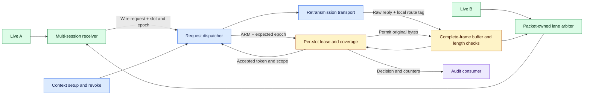
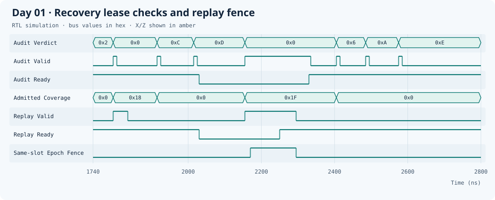

# MoldUDP64 recovery admission

A live A/B receiver already accepts unsolicited exchange multicast. The retransmission return path can have a different lifecycle. Its adapter knows which request initiated the traffic, when that request expires, and which receiver epoch should consume the reply. The [recovery guard](../mold_recovery_guard.sv) checks that context and the full UDP payload before forwarding the original bytes. The [dispatcher](../mold_recovery_dispatch.sv) connects the receiver's request stream to the guard and exposes ready/valid transport and command interfaces. The [packet arbiter](../mold_repair_lane_mux.sv) can share a receiver lane between live feed traffic and approved replies.

A market-data gateway can use this boundary while switching between exchange sessions or rebuilding an order book. A delayed reply addressed to a retired local epoch, a packet that overreaches a requested range, or a repeated returned fragment is reported without entering the receiver. A valid split reply can arrive out of order. The guard accounts for the authorized span and preserves wire bytes. The existing receiver and reorder window assemble the ordered sequence and apply normal A/B duplicate suppression.



## Request and epoch control

Start with the acknowledged receiver slot, epoch, session token, and enabled state. Submit SYNC before routing requests to the guard for that epoch. The dispatcher accepts an ordinary 20-byte MoldUDP64 request as a big-endian 160-bit word, with the ten-byte session at the most significant end. Zero-extend the receiver slot to `KEY_W` if the receiver's slot output is narrower. All control and stream inputs use the same clock. Keep valid and all associated fields stable through ready/valid stalls.

| Opcode | Inputs and state change |
| ---: | --- |
| 0 SYNC | Slot, acknowledged nonzero epoch, enable, and session in `cmd_request[159:80]`. A greater epoch clears the previous lease. Repeating the installed epoch and its matching configuration is idempotent. Lower epochs and conflicting equal-epoch configurations fail. |
| 1 ARM | Slot, installed epoch, full request and relative nonzero `cmd_ttl`. The session must match. Count must be between one and `WINDOW`. At most one request span per slot can be live. |
| 2 CANCEL | Slot, installed epoch, current token. Revokes one live lease and retains its progress for inspection. |
| 3 INSPECT | Slot. Returns the current installed state and any retained lease fields. |

| Reply status | Meaning |
| ---: | --- |
| 0 | Operation accepted |
| 1 | Slot outside implemented geometry |
| 2 | Epoch stale, unset, or conflict on equal-epoch SYNC |
| 3 | ARM for a disabled context |
| 4 | Session, count, or TTL invalid |
| 5 | A different span already owns the live lease |
| 6 | The exact span already owns the live lease. Coverage, token and expiry are retained. |
| 7 | CANCEL token differs from the live token |
| 8 | Token counter reached its all-one value |
| 9 | CANCEL has no live lease |

The registered response echoes opcode and slot. It includes installed epoch, enable, token, phase, full request, coverage, and remaining TTL. A fresh ARM response carries the newly assigned nonzero token. Tokens increment within an epoch and never wrap. Installing a greater epoch restarts the token sequence. State codes are 0 idle, 1 live, 2 complete, 3 expired, and 4 revoked. Completion retains the last span and coverage so a duplicate can be identified until the next ARM or SYNC. Corresponding arm and cancel replies carry the resulting state. Other replies describe state sampled on the acceptance edge.

The dispatcher accepts requests on `source_*` and configuration commands on `admin_*`. It queues one of each and retains the selected guard command until transfer. Existing outstanding `tx_*`, decision, and admin reply words each hold independently. An ARM grants permission to send a new network request only when the reply echoes its full bytes and route and returns a nonzero live token with remaining time. Enable `source_resend` to retransmit an identical live request on status 6. That retransmission keeps the same token and expiry. With resend disabled, status 6 produces a suppressed decision. A failed ARM produces a rejected decision. Actions 0, 1, 2, and 3 describe rejection, new send, retry, and suppression. Status 15 indicates a corrupted or mismatched local guard reply. Counters distinguish transmitted requests, transmitted retries, duplicates suppressed, rejections, and bad replies.

The dispatcher holds same-slot SYNC or CANCEL until an offered transport request transfers. When that mutation and a queued request for the same slot are both eligible, the mutation runs first. The guard separately holds a fresh same-slot SYNC while approved raw bytes remain in its replay slot. A newly staged verdict takes precedence over a simultaneous configuration request. An unrelated slot can continue accepting commands. A reply stalled at the audit boundary is eligible on the edge where the audit register refills. Configure the receiver's own epoch boundary after the guard and transport have drained approved old work for that slot. The receiver then fences its own internal exports and packet leases. Coordinate reset across both modules and transport, or use a separate system-level epoch if the transport survives reset.

The TTL begins at ARM acceptance. A live lease with one remaining tick can admit on that edge. Completion wins over expiration. Partial admission on the last live tick is forwarded and the unfilled portion expires. A raw reply that finishes validation after expiry receives an expired verdict even if its first beat arrived earlier. Budget time for the local command path, network, packet validation, and expected backpressure. A stall while the request or audit is held can consume that budget. Admission does not depend on the replay sink being ready.

## Raw return and statistics

Drive `rx_slot`, `rx_epoch` and `rx_token` with the first beat. They belong to the local transport descriptor and are not extra bytes within the MoldUDP64 datagram. The guard retains them through the final beat, validation, and replay. A transport adapter must preserve the mapping from its outbound request to returned packets. Approved data and their metadata are emitted once with the original framing, little-endian byte lanes, and ignored lanes zeroed.

The frame buffer validates first/last placement, contiguous keep, packet and block bounds, then scans all network-order length fields. A malformed final block or trailing byte rejects the complete frame. Heartbeats and end-of-session notices get an empty-control verdict on this recovery-specific port. Keep sending the physical packet through its final marker even after an overlength or framing fault. One frame can be captured, checked, or replayed at a time. Validation uses one header step and two clock edges per inspected length. Buffered replay can transfer one 64-bit beat per clock after approval when the sink is ready.

The coverage bitmap uses bit zero for the first requested sequence. A packet's start and count must lie wholly within the request. Modular subtraction handles the 64-bit wire wrap. The lease accepts disjoint chunks in any order. An entirely covered chunk is a duplicate. A packet combining covered and new positions is rejected as an overlap. Its verdict does not change coverage. This policy preserves a whole-packet accept or reject boundary. Have the sender retransmit missing positions as disjoint chunks if it needs to repair an overlap.

| Audit code | Result |
| ---: | --- |
| 0 | Valid approved block interval |
| 1 | Malformed beat, incomplete structure, or trailing bytes |
| 2 | Packet, block count, or message size exceeds capture limits |
| 3 | Valid header-only heartbeat or end marker |
| 4 | Slot outside configured geometry |
| 5 | Slot has no enabled context |
| 6 | Reply epoch differs from installed epoch |
| 7 | MoldUDP64 session differs from the installed token |
| 8 | Epoch has no armed or retained lease |
| 9 | Local token differs from the lease token |
| 10 | Lease expired before the verdict |
| 11 | Reply falls outside the authorized sequence interval |
| 12 | All replied positions were already admitted |
| 13 | Reply mixes covered and new positions |
| 14 | Lease revoked |

The audit contains echoed route identity, verdict, parsed first sequence and count, observed byte count, post-admission coverage, and completion. Rejected records report zero coverage and no completion. For malformed input, parsed fields describe the captured prefix and may contain zeros. The audit and replay channels have independent ready/valid flow control. An accepted descriptor can begin replay while its audit waits. A subsequent descriptor must wait for audit capacity. On ports 0–14 the statistic word counts classifications for that slot. Index 15 counts admitted messages. Indices 16–20 count armed leases, explicit cancels, timeouts, duplicate arm commands, and installed epochs respectively. Counts and global frame totals saturate to 32 bits. They accumulate across epoch changes until reset. Read `stat_valid` before consuming `stat_value`; invalid keys return zero.

Defaults are three slots, 256 bytes per packet, 64 bytes per message, 16 blocks, and a 16-message lease window with 16-bit epoch and token widths. Set the guard geometry to accommodate the configured recovery request size and the receiver's transport limits. The small regression uses a 72-byte packet limit, a seven-message lease window and three-bit tokens. FPGA timing and bus integration require device-specific measurement. The checked architecture uses parity-bank synchronous packet memory and runs on one clock.

## Reproduce

```sh
make test-recovery-guard
make test-guarded-recovery-loop
make lint-recovery-guard synth-recovery-guard formal-recovery-guard
make waveform-recovery-guard
```

The [cycle reference](../recovery_guard_model.py) parses bytes independently and uses a set of admitted sequences per lease. The model and RTL compare ready/valid and complete output payloads every cycle in two seeded campaigns totalling 11,686 cycles. The campaigns exercise all 15 verdicts, overlength frames, partial and zero-length blocks, 64-bit wire wrap, token exhaustion, independently stalled audit and replay, and reset with active work. Four real archive-built reply datagrams are admitted in the integration bench and five independently injected frames are rejected. The four accepted datagrams resolve two actual captured receiver requests. A third session's live duplicates contend for the physical lane while the bench checks ordered event data. The dispatch bench exercises stale queued requests, a held admin fence, suppressed and permitted retries, malformed local replies and reset. The formal lease harness checks output hold and atomic decision/command arbitration for 16 edges and covers completion, duplicate, overlap, expiry, revocation and fencing.



At 1,795 ns, a disjoint tail is approved and coverage becomes binary `11000`. The next two audits identify a duplicate at 1,915 ns and a partial overlap at 2,015 ns. Neither emits replay. The head chunk completes coverage at 2,155 ns while both sinks are stalled. The same-slot epoch update waits from 2,170 ns through the last replay transfer at 2,295 ns. The audit remains stable until its independent sink accepts it at 2,335 ns. This figure comes from the same pin-checked directed run.
