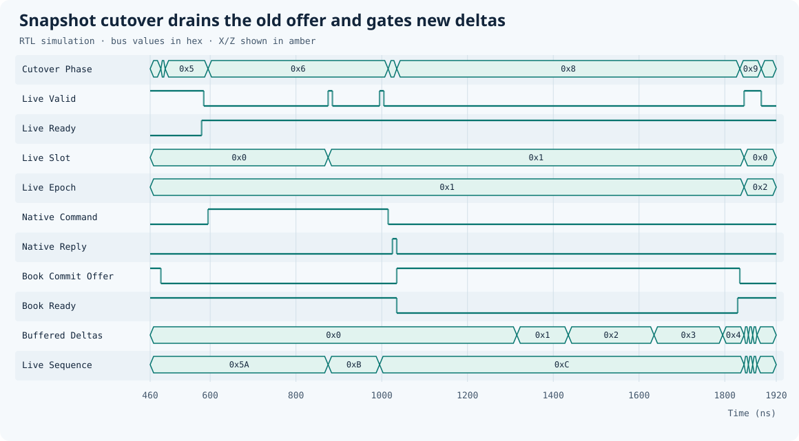

# Transactional order-book snapshot cutover

The cutover coordinator restores a verified snapshot and rolls one slot of the existing multi-session receiver to a new epoch. A separate delta router retains a held old event, buffers an exact new-epoch sequence interval, and releases it after the staged book commits. The original receiver and recovery guard interfaces remain usable on their own. [Cutover coordinator](../mold_snapshot_cutover.sv) · [Delta router](../mold_snapshot_router.sv)

A feed gateway can use the coordinator after a persistent gap makes an incremental book unusable. The snapshot provider supplies a book image and the first feed sequence whose updates belong after that image. The book consumer prepares the new state while the current epoch keeps flowing. After the snapshot is ready, the coordinator drains any already-visible old event, configures the selected receiver slot, and commits the staged book. A neighboring slot can continue forwarding through the existing receiver stream.

```mermaid
flowchart LR
    F["Checked order snapshot<br/>slot, epoch, next sequence"] --> U["Complete rows and CRC"]
    U --> P["Prepare staged book"]
    P --> Q["Drain old output and fence this slot"]
    Q --> C["Native receiver configuration<br/>wait for exact epoch reply"]
    C --> K["Commit staged book"]
    L["Existing receiver events"] --> R["Epoch and next-sequence router"]
    C --> R
    R --> B["Bounded delta FIFO"]
    B --> K
    K --> O["Ordered live updates"]
    R -->|"Unaffected slots"| O
    classDef source fill:#dbeafe,stroke:#2563eb,color:#172554
    classDef state fill:#ede9fe,stroke:#6d28d9,color:#2e1065
    classDef control fill:#ffedd5,stroke:#c2410c,color:#431407
    classDef output fill:#dcfce7,stroke:#15803d,color:#052e16
    class F,L source
    class U,P,B state
    class Q,C,K control
    class R,O output
```



## Snapshot transaction

All ports use the receiver reference clock. Keep fields stable while valid is held and the consumer has lowered ready. The coordinator controls one native configuration exchange at a time. Connect its command and reply ports to the matching native ports. Arbitrate native commands and replies by transaction ownership if another controller initializes other slots. Route all subsequent epoch installations for a managed slot through this coordinator so its epoch and sequence tracking stay aligned with the receiver.

| Step | Contract |
| --- | --- |
| BEGIN | Provide nonzero increasing ID, slot, expected receiver epoch, new session token, first incremental sequence, row count, CRC, and native force and spacing options. An accepted valid header consumes the ID even if its upload fails. A later ID must be larger. |
| UPLOAD | Send opaque 128-bit rows with the accepted ID. The final row carries `row_last`. The coordinator checks count and CRC after the complete upload. Empty snapshots require CRC zero. Foreign rows are consumed and counted while the current upload stays open. |
| RESTORE | The consumer receives a header and ordered indexed rows. It stages those rows without making them visible to live processing. Each record carries the snapshot ID, slot, next epoch, first incremental sequence, row count and CRC. |
| PREPARE | Return the matching ID and an accepting or rejecting acknowledgment after all rows have transferred and the staged state is ready. A foreign acknowledgment is counted and leaves the pending transaction in place. |
| FENCE | A positive acknowledgment fences the target slot and drains its previously offered output. Older target events admitted during this fence are counted as stale and consumed locally. Other slots retain routing. |
| NATIVE | The coordinator sends the captured receiver command with enable asserted. Acceptance is followed by a native acknowledgment. Successful installation requires status OK, matching slot, expected epoch plus one, and active state. |
| FINALIZE | The consumer receives COMMIT or ABORT. Transfer of COMMIT is the book visibility boundary. A native rejection or an early verified delta gap yields ABORT. |
| DRAIN | On a clean commit, replay buffered target deltas before direct events for that target. A held downstream live word retains its full payload and route. New transactions wait until the buffered queue has drained. |

The restore kinds are 0 HEADER, 1 ROW, 2 COMMIT and 3 ABORT. A HEADER or terminal record carries a zero data word and index. A ROW uses a zero-based index. Commands rejected before the restore header do not have a staged book to abort.

A delta is eligible to enter the FIFO once the native command has transferred and the router is expecting the next epoch. Each exact successive 64-bit sequence increments the candidate cursor modulo 2⁶⁴. A bounded full queue stalls the matching next-epoch input. No delta reaches the consumer before the book commit transfer. During drain an unrelated ready input and a queued delta alternate when both are available. The upstream receiver still has one shared event stream, so a target event stalled at its head can delay delivery of a peer event behind it.

A same-epoch discontinuity makes the affected book slot unavailable. If it occurs before COMMIT can be offered, the consumer receives ABORT. If it occurs while an already offered COMMIT is stalled, that COMMIT remains stable and may transfer, but the delta FIFO is discarded and the slot stays quarantined. A failed native reconfiguration also quarantines the target because older events may have been consumed at the fence. Use the returned native epoch and a new checked snapshot to recover. A rejected upload or book prepare precedes the fence, so the current target book and direct routing remain in place.

| Completion status | Result |
| ---: | --- |
| 0 | Snapshot committed and contiguous delta replay approved |
| 1 | Slot outside the hardware geometry |
| 2 | Transaction ID zero or insufficiently new |
| 3 | Expected epoch is exhausted |
| 4 | Declared or observed row count invalid |
| 5 | Snapshot row CRC disagrees |
| 6 | Book sink rejected staged restore |
| 7 | Native receiver command failed validation |
| 8 | Candidate delta stream has a sequence gap |

Read `done_native_installed` and `done_book_committed` with the status. They identify effects before a failed complete cutover. The response also includes echoed ID and slot, the observed receiver epoch when available, complete-image CRC, and the buffered delta count at the finalization edge. That count can include discarded entries on failure. A completion word holds under sink backpressure. Reset abandons in-flight transactions and ends the ID and epoch tracking interval.

Known slots use their latest native epoch and expected direct sequence. A wrongly tagged epoch is counted as stale. A same-epoch sequence discontinuity quarantines that slot. Untracked slots pass transparently until their first cutover. The monitor exposes current epoch, expected sequence, statistics and quarantine state. The coordinator checks the receiver slot, epoch, and normalized sequence number. The downstream book consumer interprets the ITCH result and operation fields.

## Image format and reproduction

The datapath carries opaque 16-byte rows. The host format gives a concrete order-level encoding over those rows. Each canonical order consists of one key row and one value row in little-endian order. The key holds the 64-bit order reference, 16-bit stock locate, ASCII side and zeroed reserved bytes. The value carries 32-bit price, 32-bit shares and a zeroed 64-bit field. References are distinct and stored in ascending order. The file header carries magic `MSN1`, version, slot, expected epoch, first incremental sequence, ten-byte session token, order count, reserved field, payload CRC and header CRC. The parser checks the original file's exact length and both checksums before the host issues any control transfer. The hardware checks the row count and reflected ISO-HDLC CRC-32 over each row's low-byte-first lanes. [Host format and compiler](../mold_snapshot_image.py)

```sh
make test-snapshot
make lint-snapshot synth-snapshot formal-snapshot waveform-snapshot
python3 mold_snapshot_image.py inspect build/snapshot-demo/order-book.msn
python3 mold_snapshot_image.py control build/snapshot-demo/order-book.msn \
    --transaction 31 --epoch-width 3 --capacity 8 --spacing 7
```

The compiler converts a JSON descriptor with `slot`, `expected_epoch`, `session`, `sequence`, and `orders` into that checked file. Every order contains `reference`, `locate`, `side`, `price`, and `shares`. The next sequence is the first event after the snapshot's state. The `control` command emits the BEGIN word and ordered rows for a supported hardware geometry.

The live bench starts with two genuinely configured receiver slots and uploads a checked two-order image. It buffers four real ITCH events across 64-bit sequence wrap, commits the staged image, and checks a fifth direct event. Two events from the other slot pass while the target's native command is held. The independent host audit compares each physical decoder output and the exact restored rows, then applies the actual decoded events to recover the expected order table. The final audited order book is written to `build/snapshot-demo/restored-book.json`. [Live bench](../tb_snapshot_receiver_demo.sv) · [Host audit](../snapshot_cutover_demo.py)

Default geometry is three slots, 16 snapshot rows, eight buffered deltas and 16-bit receiver epochs. The verified profiles include a one-entry delta FIFO, a non-power-of-two three-entry FIFO, and the default geometry. The independent cycle checker compares all ten control phases, all four restore kinds, and all nine completion statuses. It injects bad CRC, missing rows, receiver rejection, sequence gaps before and after COMMIT offer, stale IDs, and independent backpressure. The bounded formal target checks output hold and fence ordering for 11 edges and covers four cutover outcomes.



At 585 ns the held epoch-one event transfers. The target's native configuration offer stays valid from 595 to 1,015 ns while slot one continues receiving events. The new epoch acknowledgment arrives at 1,025 ns. The book commit is offered at 1,035 ns, and the next four deltas accumulate while the book consumer is stalled. When it accepts COMMIT at 1,835 ns, the buffered stream begins releasing the next epoch. The first two sequence values are all ones minus one and all ones, followed by zero and one.
