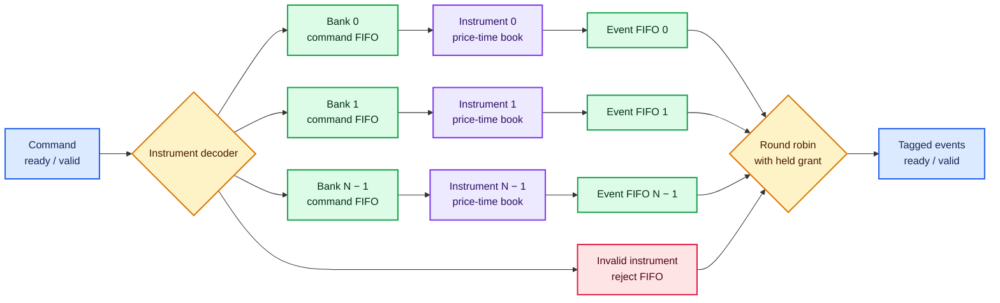
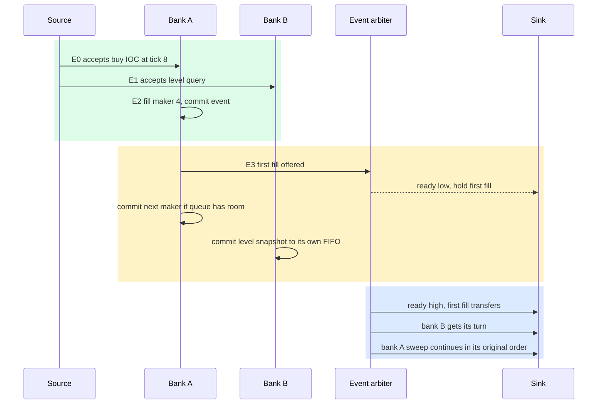
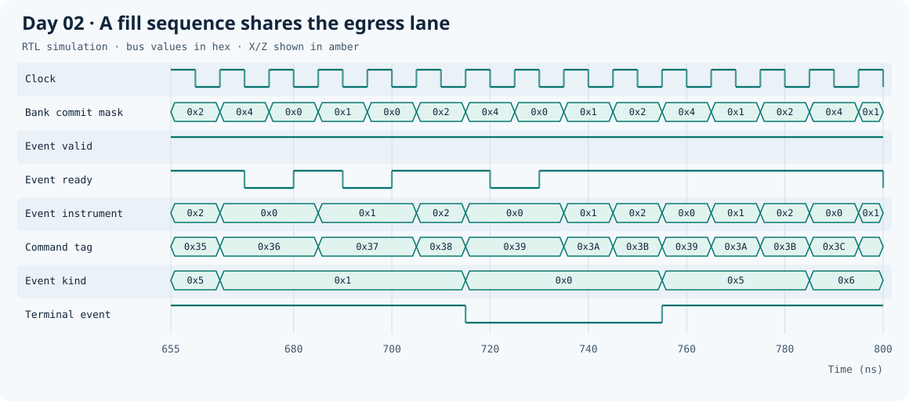

# Day 02 · Banked price-time matching engine

An FPGA RTL engine for independently matching multiple instruments on bounded tick grids. It accepts a single command stream, executes independent books concurrently, and publishes tagged events through a shared round-robin arbiter. The executable verification checks the transaction semantics, cycle-level flow control, queue invariants, and measured throughput.

The project also includes a [reserve-order and checkpoint engine](docs/reserve_matcher.md) with iceberg replenishment, self-trade prevention, fill-or-kill, and atomic per-instrument restore. Its [simulation waveform](docs/reserve_waveform.svg) shows a replenished maker losing priority to an older order at the same price.

The reserve top also supports [owner-scoped order management](docs/order_management.md), including atomic post-only replace, read-only withdrawal preview, and mass cancel.

The [call-auction engine](docs/call_auction.md) handles collared opening and reopening crosses. Its checked handoff transfers eligible auction residuals into a continuous reserve book through a verified checkpoint.

| Default hardware | Value |
| --- | ---: |
| Independent instruments | 3 |
| Tick indices per side per instrument | 12 |
| Resting order ID slots per instrument, shared between sides | 12 |
| Quantity width | 16 bits |
| Command and event queues per instrument | 4 entries each |
| Client tag and each local sequence | 16 bits |
| First event for an unloaded legal instrument | 3 cycles from accepted command |
| Peak lane commit rate while matching | 1 event/cycle per bank |
| Shared output rate with three balanced query streams | 1 event/cycle in simulation |

## Hardware architecture



Each bank implements a bid bitmap, an ask bitmap, and a balanced selection tree per side. The tree carries both the price and FIFO head through the same selection stages. Occupancy determines priority, so the design does not compare every pair of live orders. Padding leaves are invalid for non-power-of-two grids. The selected price is the highest bid or lowest ask.

Each price queue stores oldest and newest order IDs. A direct indexed slot table stores quantity, side, price, and neighbor pointers. Removing a middle order touches its neighbors in constant algorithmic time. A trade against the head advances that head on depletion. A partial trade or a quantity reduction updates the slot in place. Per-level counters maintain open size and live order count as the book changes. The request to query a level follows the same bank command stream, giving an ordered view of one level.

The bank's book state commits when its event enters its local egress FIFO. The event sequence increments at that same edge. If the FIFO fills, the bank holds the pending event and does not advance the book. Other banks continue committing while their own output queues have room. The shared arbiter rotates after each transfer, so a long sweep from one instrument cannot monopolize a ready sink. A stalled selection holds valid, its complete payload, and its grant even when a different lane becomes nonempty.



## Top-level interface

Instantiate `banked_matching_engine.sv` with sources in [rtl.f](rtl.f). Transfers occur on rising edges with both valid and ready high. The source must hold payload constant while stalled. The synchronous active-high reset suppresses interface transfers and clears all books, queued commands and events, and sequence counters at a rising edge.

| Parameter | Default | Meaning |
| --- | ---: | --- |
| `BANKS` | 3 | Valid instrument indices are 0 through `BANKS-1`. One bank per instrument |
| `PRICE_LEVELS` | 12 | Valid prices are 0 through `PRICE_LEVELS-1`. Prices are tick indices |
| `ORDER_SLOTS` | 12 | Valid order IDs are 0 through `ORDER_SLOTS-1`. IDs are local to an instrument |
| `QTY_W` | 16 | Size width for individual orders and events |
| `TAG_W`, `SEQ_W` | 16, 16 | Tag and modulo sequence widths |
| `CMD_DEPTH`, `EVENT_DEPTH` | 4, 4 | Capacity of each command FIFO and each event FIFO, including the reject FIFO |

Size and width parameters must be positive. Instrument, price and ID field widths are `$clog2(n+1)` with the corresponding dimension, including space to represent an invalid key. The level quantity width is `QTY_W + ID_W`, enough for every legal slot to hold the largest order at one price.

| Input | Meaning |
| --- | --- |
| `s_instrument` | Selects an instrument. Invalid keys enter their own reject FIFO |
| `s_opcode` | 0 new, 1 cancel, 2 reduce remaining quantity, 3 query price level |
| `s_tif` | For new orders, 0 GTC, 1 IOC, 2 post-only, 3 invalid |
| `s_is_ask` | 0 bid, 1 ask. Used by new and query |
| `s_order_id` | Slot to allocate or modify. Echoed as correlation data for a query |
| `s_price` | Limit price for new, tick index for query |
| `s_qty` | Positive size for new, new absolute open size for reduce |
| `s_tag` | Correlation tag echoed on every event for this command |

New orders need a currently free ID even when the order would execute immediately. New GTC orders leave any unmatched quantity resting. IOC publishes fills and expires any remainder. A post-only order rejects before mutation if it would trade. Trades occur at maker price and resolve equal-price orders in insertion order. Reduce requires a positive quantity strictly below the existing open size and preserves the original position. Use cancel to remove the remaining order.

Each event carries `m_instrument`, `m_order_id`, `m_tag`, `m_cmd_seq`, `m_event_seq` and `m_last`. Both sequence counters start at zero and wrap at `2**SEQ_W`. Command sequence advances on accepted input and repeats across all resulting events. Event sequence advances at local commit. Invalid input keys share one error sequence and retain the original key. Per-bank input and output ordering is strict. Different banks may interleave their events.

| `m_kind` | Event | Meaningful event-specific fields |
| ---: | --- | --- |
| 0 | Fill | Incoming `m_is_ask`, resting `m_maker_id` and `m_price`, matched `m_qty`, open incoming `m_remaining`. Terminal when the incoming order is filled |
| 1 | Rest | Requested side and price, inserted quantity in both `m_qty` and `m_remaining`. Terminal |
| 2 | Cancel | Stored side and price, removed quantity in `m_qty`. Terminal |
| 3 | Reject | `m_reject` gives the reason. Terminal |
| 4 | Reduce | Stored side and price, amount removed in `m_qty`, new open size in `m_remaining`. Terminal |
| 5 | Expire | Requested side and price, expired IOC size in `m_qty`. Terminal |
| 6 | Level | Queried side and price, total resting `m_level_qty` and `m_level_count`. Terminal |

Event-specific fields that do not apply are zero. When valid is low, the receiving design ignores the payload.

| Reject | Reason |
| ---: | --- |
| 1 | ID outside allocated range |
| 2 | Price outside tick grid |
| 3 | Zero quantity for new |
| 4 | New ID already live |
| 5 | Cancel or reduce target absent |
| 6 | Unsupported time in force |
| 7 | Post-only would execute |
| 8 | Reduce target size is zero or at least existing size |
| 9 | Instrument key out of range |

Validation priority is instrument before all other fields. Within a bank, query checks price only. The other commands check ID before operation-specific checks. New orders then check price, nonzero quantity, time in force, existing ID and the post-only cross, in that order. Cancel and reduce first check that the ID is live. On rejection the book state is unchanged.

## Cycle and capacity budgets

| Cycle from input acceptance | Unloaded legal instrument |
| ---: | --- |
| 0 | The decoded bank enqueues the command and its command sequence |
| 1 | The local book accepts its queued command |
| 2 | The book emits a result into its event FIFO and commits the update |
| 3 | The selected event transfers on the shared output |

Invalid instrument rejects bypass a book and have an unloaded one-cycle interface latency. A ready bank emits one event per cycle during a sweep. Every nonterminal fill exhausts a distinct maker. Since the incoming ID needs a free slot, one command emits at most `ORDER_SLOTS` events, including any terminal rest or expiry. One bank starts at most one single-event command every two cycles. Several banks can commit in the same cycle. The shared output transfers a maximum of one event per cycle.

Each FIFO uses registered occupancy for ready, with storage read at the current head pointer. A full FIFO accepts no new word in its pop cycle. This removes a speculative ready path through the arbiter and introduces a flow-control bubble for a saturated depth-one queue. An offered command to a full bank blocks the shared input until that bank has room. Commands already enqueued in other banks continue independently. With the sink taking events, a continuously valid lane can be bypassed by at most `BANKS` transfers because the reject queue is a separate participant.

Default three-bank cycle measurements using seed 7201 and 4,000 randomized commands plus directed traffic:

| Scenario | Commands | Events | Latency p50 / p95 | Events per active output cycle window |
| --- | ---: | ---: | ---: | ---: |
| Balanced three-bank queries, sink always ready | 384 | 384 | 3 / 3 cycles | 1.0000 |
| Single-bank queries, sink always ready | 384 | 384 | 9 / 9 cycles | 0.5007 |
| Directed plus randomized trading commands and stalls | 4,326 | 4,605 | 24 / 57 cycles | 0.6320 |

The active window includes intervening idle and stalled cycles from first through last accepted output. Single-bank queue wait explains the nine-cycle loaded median. The stress trace observed 532 cycles with simultaneous bank commits, 846 cycles with another bank committing during a held output, and a sweep of 11 fills. The checker verified all seven event kinds and all nine reject reasons.

On an out-of-context ECP5 LFE5U-85F/CABGA381 speed grade 8 route with Yosys 0.71+77 and nextpnr, seed 1, the default configuration used 5,521 TRELLIS_COMB and 954 TRELLIS_FF cells, with a reported 68.94 MHz maximum clock. This missed the 100 MHz characterization target. The routed path began at book occupancy and passed through maker selection, quantity calculation and the event FIFO. There are no I/O pin constraints in this core benchmark. A board-level implementation includes additional link, CDC, and timing paths.

## Verification and tools

From this directory, use Icarus Verilog and Python 3.9 or later. The reference model uses a dictionary of orders and sorts eligible makers by price and arrival age, independently from the hardware's priority trees and linked lists.

```sh
make test
make regress
make lint
make synth
make route
make report
```

`make unit` runs 11 known-answer oracle tests and a standalone FIFO/arbiter bench with depths 1, 2 and 3. `make test` generates transaction vectors, drives RTL with scheduled stalls and resets, and compares every presented event to the software oracle. The testbench walks queue pointers and reconstructs per-level counters. The trace checker validates per-lane order, sequence wrap, FIFO capacity, stalled-payload stability, arbitration fairness, cross-bank progress, and expected reset flushes. Each profile's trace and JSON and Markdown measurements are stored under `build/<profile>/`.

`make regress` runs two default seeds and exercises a four-bank configuration with unequal non-power-of-two queues and a one-bank, one-level, two-slot configuration with depth-one queues. For a short run use `make test PROFILE=tiny COMMANDS=250`. The benches use an eight-bit sequence width to reach wraparound during stress. `make lint` uses Verilator. `make synth` uses Yosys and structural checks to write a generic netlist. `make route` uses Yosys and nextpnr-ecp5 and retains a JSON timing report even when the characterization target is missed.

The [formal](formal/) harnesses exercise FIFO ordering and arbiter safety and fairness with SymbiYosys. Run from that directory with `sby -f fifo.sby` and `sby -f arbiter.sby`. Set `YOSYS`, `VERILATOR`, `NEXTPNR`, `IVERILOG`, or `PYTHON` on the Make command line to select explicit tool binaries.

The indexed limit model has no participant identity, self-trade prevention, peg logic, external exchange session, or persistent recovery. Price, ID and depth capacity are compile-time choices. Matching state is held in a single clock domain. Larger deployments would need a wider instrument map and a plan for RAM banking, software recovery, and timing closure.

The [common characterization report](../docs/performance.md) records the comparable default-geometry route, verification scope, and source inventory for all three designs.

## Checked RTL waveform



Event kind `0x0` is a fill. The fill records around 715–755 ns carry low `m_last`, and the following event raises it to mark command completion. Other instruments can publish between records because the output arbiter serves per-instrument queues. The Python scoreboard checks the local order of events, including fills, while allowing legal interleaving between instruments.

Run `make waveform` in this directory to regenerate the SVG. The raw VCD stays in the ignored build directory.
