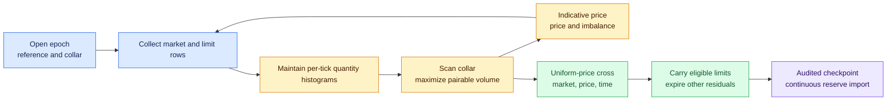
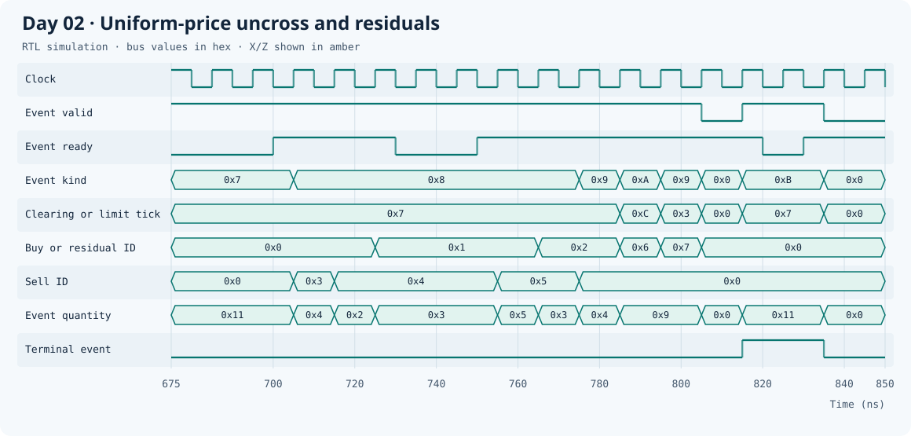

# Collared call auction and continuous-book handoff

[call_auction_engine.sv](../call_auction_engine.sv) implements a single-instrument auction that collects orders, publishes indicative price and imbalance, and clears at one uniform tick. An opening-cross simulator can use it to reconstruct execution and carry remaining limit orders into a continuous book. A pre-open risk dashboard can run indication repeatedly to observe how order changes affect the candidate price. The scoring follows common exchange concepts. Nasdaq describes an executable-volume, imbalance and reference-distance ordering. NYSE publishes indicative auction prices subject to auction collars. [Nasdaq cross FAQ](https://www.nasdaqtrader.com/content/productsservices/Trading/Crosses/openclose_faqs.pdf), [NYSE auction definitions](https://www.nyse.com/trade/auctions)



## Price and allocation

Market orders contribute to supply or demand at every candidate tick. At a candidate tick, a limit buy contributes when its limit is at or above the tick, and a limit sell contributes when its limit is at or below it. The paired volume is the smaller of eligible buy and sell quantities.

The winner maximizes paired volume, then minimizes the absolute imbalance, then minimizes distance from the supplied reference, then chooses the lower tick. The reference supports an exact half-tick bit, so a midpoint of 3.5 compares equidistant ticks without rounding. A zero-volume result still reports the selected candidate and its quantities. The result produces no trade.

The hardware keeps the total buy quantity, market sell quantity and separate limit quantity bins. During a scan, rolling buy volume removes the preceding bid bin and rolling sell volume adds the current ask bin. This takes one cycle per tick from zero through the upper collar. The maximum/default scan is 16 ticks. Price and quantity widths carry the maximum supported per-book totals.

At the chosen tick, each side gives market orders priority, then the more aggressive limit, then the oldest order. Each accepted trade debits both selected orders by the same amount. Trade messages identify both IDs and owners. Residual rows follow in original time order. A carry flag is only valid for a limit order. The done event gives the aggregate paired quantity and counts of trades, carries and expirations. The model checks conservation per order. In a deployment, venue-specific self-match, special order restrictions, inventory conversion and surveillance policies would be applied by the surrounding system.

## Ready/valid interface

Instantiate with [rtl_auction.f](../rtl_auction.f). The default has 16 order slots and 16 valid ticks with 16-bit quantities, tags and epochs, and 8-bit owners. Use positive dimensions. Tick and order ID widths are `clog2(dimension+1)`, leaving a representable invalid encoding. Aggregate quantity width is `QTY_W + ID_W`.

The engine accepts a single command when idle. Hold the offer until its rising edge handshake. Keep reset low during operation. The complete result stays valid and stable through sink stalls. The next input may be accepted after the previous terminal result transfers. A normal command first offers its acknowledgment on the edge following acceptance. A clean indicative or close command first offers a summary `upper_collar + 3` cycles after acceptance. Transfers then proceed at up to one result per cycle. One internal edge separates the last actual row from the completion if the residual scan finds no more rows.

An active-high synchronous reset suppresses handshakes, discards the epoch and clears outstanding work. Opening uses the next modulo epoch after the current code, starting at one after reset. All other commands use the current code. Frame tags and epoch codes echo on every event. Integrations must separate reset generations and bound old buffered requests so an earlier tag or epoch cannot reappear after its wrap.

| Opcode | Command | Nonzero fields allowed beyond tag and epoch |
| ---: | --- | --- |
| 0 | Open a fresh epoch | Reference price in `s_price`, optional `s_reference_half`, inclusive `s_low` and `s_high` ticks |
| 1 | Add a market or limit row | ID, owner, side, price, positive quantity, market and carry flags. Market orders use zero price and carry |
| 2 | Cancel a live row | ID and owner |
| 3 | Reduce and retain priority | ID, owner and smaller positive absolute quantity |
| 4 | Indicate | No additional fields |
| 5 | Close and execute | No additional fields |
| 6 | Abort and discard | No additional fields |
| 7 | Inspect a live row | ID and owner |

Successful OPEN and ABORT are terminal. ADD, CANCEL, REDUCE and INSPECT report the affected order metadata. A rejection is terminal and mutation free. [auction_codes.svh](../auction_codes.svh) specifies the reason values.

| Event | Field interpretation |
| --- | --- |
| Indicative or clearing | Uniform tick, original reference half-bit, paired quantity, eligible buy/sell quantities in `m_buys` and `m_sells`, live row count |
| Trade | Buyer and seller IDs and owner IDs, clearing tick and paired quantity. These beats are nonterminal |
| Carry or expire | Remnant order ID, owner, side, original limit tick, market/carry flags and quantity. These beats are nonterminal |
| Done | Clearing tick, aggregate paired quantity, trade count, carry count and expiry count. This beat is terminal |

## Auction output to continuous-book input

```sh
make auction-bridge
python3 -B auction_bridge.py build/auction/example/capture.txt build/auction/carry.rsv \
    --bank 1 --restore-tape build/auction/carry.tape
```

The bridge audits the entire captured ready/valid trace, recognizes only fully acknowledged closes, and exports that close's carries to the existing [RSV1 checkpoint format](reserve_matcher.md). A capture with multiple completed closes requires an explicit zero-based close index. Every exported row uses its original limit and owner, with its entire residual visible. The converter rejects duplicate IDs, unrepresentable fields and crossed books. A restrictive auction collar can leave orders crossing outside the clearing tick. Those rows require a venue-specific disposition before they can be imported safely.

The worked test reads two carries from the actual auction RTL capture and imports them into bank 1 in a fresh continuous-matcher simulation. A post-import snapshot verifies the exact rows. A subsequent incoming sell fills four at tick 7 before filling one at tick 3.

## Waveform and reproducibility



The worked cross publishes tick 7 and paired quantity 17 at 705 ns. Five trades run from 715 ns through 775 ns. A ready stall holds the third pairing unchanged. Carry ID 2, expire ID 6 and carry ID 7 transfer at 785, 795 and 805 ns respectively. The done beat transfers at 835 ns.

```sh
make auction-test
make auction-lint auction-synth formal-auction
make waveform-auction
```

Four geometries compare complete cycle-level offers against an independent full-book model. They cover 36,435 sampled cycles, 10,274 accepted commands, 12,992 accepted results, 3,632 result stall cycles, 156 results flushed by reset, and all event and rejection classes. The bounded formal configuration reconstructs eligible quantities without the histogram recurrence, checks clearing optimality, enforces price-time order and proves amount conservation across pairing steps. Generic synthesis reports 16,857 cells and zero structural problems for the default geometry. Latency values here refer to logical clock cycles. Physical timing and resource use depend on placement, device and configuration.
