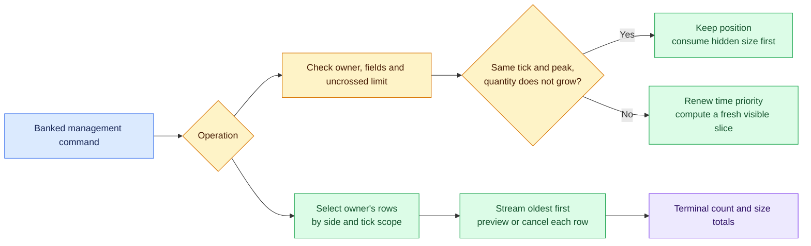
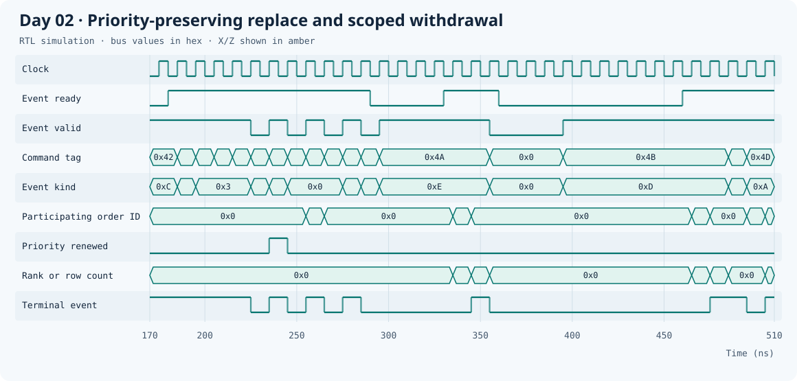

# Reserve order replacement and owner-scoped withdrawal

The [reserve-order matcher](reserve_matcher.md) accepts atomic post-only amendments and scoped bulk operations through its existing command stream. A strategy gateway can shrink a live order without surrendering its place in the queue. A risk process can preview affected orders, then withdraw one owner's orders on an instrument during a stale-data or connectivity event. The gateway supplies the authenticated owner code used by the RTL. Nasdaq's exchange rules give an example of size reductions maintaining priority. CME publishes a mass-cancel scenario by instrument. [Nasdaq Equity 4](https://listingcenter.nasdaq.com/rulebook/nasdaq/rules/Nasdaq%20Equity%204), [CME iLink mass action](https://www.cmegroup.com/tools-information/webhelp/autocert-ilink-3/Content/OrdMassActReqInst.html)



## Packed fields

Use opcode 7. The original port widths, bank selection, correlation tag, command sequence and event sequence are unchanged. The former second policy field carries the filter for a bulk operation.

| TIF value | Operation | Fields beyond bank and tag |
| ---: | --- | --- |
| 0 | Replace | Existing order ID, owner, side, proposed tick, new absolute remaining size and display peak. STP and restore-visible are zero |
| 1 | Mass cancel | Owner and scope in STP. Side and tick are required only for filters that use them. ID and all quantity fields are zero |
| 2 | Mass preview | Same canonical fields as mass cancel |
| 3 | Reserved | Reject opcode |

Replacement validates the live ID, owner, unchanged side, legal tick, positive size, display policy and an uncrossed limit. The result of a failure is a terminal reject without a book change. A same-tick amendment with an unchanged peak and unchanged or smaller size preserves time priority. It caps the new visible quantity at the previous visible quantity, so a reduction never reopens the hidden portion of a partially filled slice. A size increase, reprice or peak change makes the order youngest and recomputes the visible slice. A previously configured peak may exceed the amended remainder. A newly introduced peak must fit the new remaining quantity.

Event kind 12 is terminal and carries the order ID, side, owner, amended price, new total, visible size and peak. `quantity` and `remaining` carry the previous total and previous visible quantities. `refill` indicates that time priority was renewed and `level_count` gives the previous zero-based age rank.

| STP value | Owner-scoped filter |
| ---: | --- |
| 0 | Both sides and all ticks. Set side and tick to zero |
| 1 | Specified side across all ticks. Set tick to zero |
| 2 | Specified side and exact tick |
| 3 | Specified side at the supplied tick or more aggressive. Bids are at or above it, asks at or below it |

Bulk cancel uses kind 13 and preview uses kind 14. Each nonterminal result includes the selected ID, side, tick, total, visible quantity, peak and owner, with the preceding row count in `level_count`. The terminal result provides the full count, total quantity and visible quantity. An empty selection produces one terminal result with zero count and quantities. The engine scans every live order to find the oldest match. A cancel removes each row as its result enters the bank event FIFO. Remaining orders keep their relative priority as age ranks close. A preview preserves all book rows.

Within a bank, a bulk command occupies the processor through its terminal result. Each row commits at its local event-FIFO handshake and the command can pause between rows if the sink stalls. Other banks progress as credits permit. A preview and a later cancel are separate commands and can see intervening requests. The terminal result and sequenced row acknowledgements identify the actual cancel; coordinated reset starts a new sequence and invalidates pending events along with book state. Management operations are blocked while that bank is staging an import.

## Waveform and verification



Tag `0x42` at 185 ns reduces maker 0's size and preserves its priority. Maker 0 fills next at 195 ns. Tag `0x47` increases its size at 245 ns and renews its position, so maker 1 fills at 265 ns. Preview tag `0x4a` streams owner 1's IDs 0 and 2 and ends at 355 ns. Cancel tag `0x4b` holds its first row through a ready stall and transfers the same two IDs at 465 ns and 475 ns before the terminal result at 485 ns. The next order query and snapshot confirm the other owner's row survives.

```sh
make reserve-regress
make formal-reserve
make waveform-management
```

The RTL regression compares every bit of each presented result against an independent model across three geometries. It includes owner mismatch, malformed amendments, a rejected crossing reprice, all filter types, checkpoint isolation, held events and management results flushed by reset. The bounded formal run checks full row stability for rejected commands and previews, actual removal of reported cancel IDs, youngest-rank renewal, retained priority and owner-scoped traversal.
