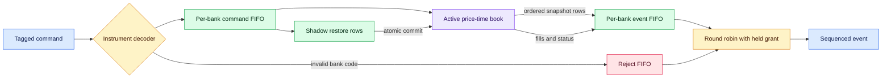
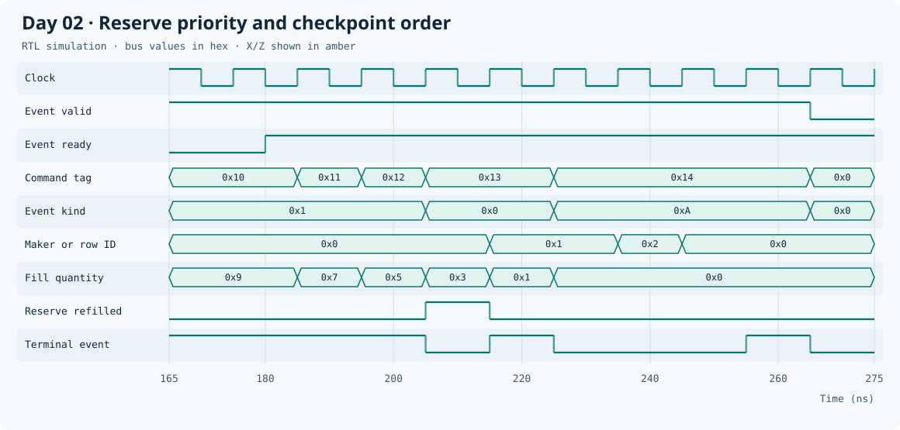

# Reserve-order matching and checkpoint recovery

`reserve_matching_engine` models a continuous price-time book for each instrument. It adds iceberg reserve orders, owner-based self-trade prevention, fill-or-kill, and bank-local checkpoint recovery. Instantiate it with the sources in [rtl_reserve.f](../rtl_reserve.f). The [original Day 02 top](../README.md) remains available to callers that need its smaller interface.

An exchange gateway could use the reserve rules to display a small working quantity while holding more size at the same price. A matching-engine simulator could use the policies to reproduce an owner interaction or assess whether a fill-or-kill would execute. A shadow venue or deterministic incident replay could use the ordered checkpoint rows to start from a recorded book. The policies are explicit design choices. NYSE National's reserve-order filing describes a venue example of displayed interest and replenishment. CME's FAQ documents self-match-prevention actions based on participant-supplied identifiers. [NYSE National reserve order filing](https://www.federalregister.gov/documents/2020/05/18/2020-10529/self-regulatory-organizations-nyse-national-inc-notice-of-filing-and-immediate-effectiveness-of), [CME Globex Self-Match Prevention FAQ](https://www.cmegroup.com/solutions/market-access/globex/trade-on-globex/faq-self-match.html)



## Matching semantics

- Highest bid and lowest ask take precedence. At a given price the smallest live age rank wins. Removing an order closes its age-rank gap. Replenishment gives the maker a new youngest rank so another maker at the same tick can fill first.
- A nonzero display peak limits each visible slice. A depleted slice refreshes from hidden reserve in the same commit as the fill. A zero peak means fully displayed. Cancel removes total quantity. Reduce sets a smaller positive total, consumes hidden quantity before displayed quantity, and preserves time priority.
- GTC rests an unmatched remainder. IOC expires it. Post-only rejects a crossing order before changing the book. FOK preflights the full executable size before changing the book and counts hidden reserve on eligible makers. An insufficient FOK produces one reject. FOK combined with cancel-taker is an unsupported policy.
- The two self-trade policies apply when a crossing maker has the same owner ID. Cancel-maker removes that maker and continues. Cancel-taker terminates with the incoming remainder. An FOK with cancel-maker excludes same-owner liquidity from its preflight. Owner zero is an ordinary ID.
- An order query returns the live row only for the matching owner. A level query returns aggregate visible quantity, total quantity and order count. These commands and snapshots are internal diagnostics. Exposure of hidden size or owner data in a deployed system would require an access-control layer.

Each lane executes one dequeued command at a time. Book changes commit when the event enters that lane's output FIFO. Backpressure freezes the pending event and its mutation once the lane FIFO fills. Other lanes execute independently subject to the shared arbiter. The implementation scans bounded on-chip slot arrays in parallel. Generic synthesis establishes structural validity, and place-and-route timing is a separate hardware measurement.

## Command and event interface

Transfers occur on a rising clock edge with both ready and valid held high. Synchronous active-high reset clears live and staged data, queues and sequence counters. The default instance uses three banks, 12 prices, 12 order slots, 16-bit quantities, 8-bit owners, 16-bit tags and sequences, and four-entry command and event FIFOs per lane. Positive geometry parameters set bank, tick and ID field widths to `clog2(dimension + 1)`. The aggregate quantity width is `QTY_W + ID_W`.

```text
s_command (MSB → LSB)
opcode[3] tif[2] stp[2] side[1] order_id[ID_W] price[PRICE_W]
quantity[QTY_W] display_peak[QTY_W] restore_visible[QTY_W] owner[OWNER_W]

m_result (MSB → LSB)
kind[4] last[1] side[1] maker_id[ID_W] price[PRICE_W] quantity[QTY_W]
remaining[QTY_W] total[QTY_W] visible[QTY_W] display_peak[QTY_W]
owner[OWNER_W] refill[1] level_total[SUM_W] level_visible[SUM_W]
level_count[ID_W] reason[4]
```

Commands carry a bank and client tag outside the packed word. Results carry the original bank, tag and order ID plus independent modulo command and event sequences. Every command produces one or more events with one terminal event. Event order is strict within a bank. An out-of-range bank code enters a separate reject lane. For detailed encodings see [reserve_codes.svh](../reserve_codes.svh) and the independent [host model](../reserve_model.py).

| Opcode | Valid fields and behavior |
| ---: | --- |
| 0 | New order. TIF, STP, side, ID, price, size, peak and owner |
| 1 | Cancel by ID and owner |
| 2 | Reduce by ID, owner and new absolute quantity |
| 3 | Internal level query by side and price |
| 4 | Internal order query by ID and owner |
| 5 | Stream an ordered per-bank snapshot |
| 6 | Restore control. TIF selects begin (0), row (1), commit (2) or abort (3) |

Fill events report the maker ID, maker price, executed size and incoming remainder. The refill bit says whether the maker refreshed its visible quantity during this fill. Rest, reduce and order-query events report book row details. Cancel and cancel-maker report removed maker size. Cancel-taker and expiry report discarded incoming size. Snapshot, restore and rejection fields are documented with the [RTL encoder](../reserve_order_book.sv).

## Capture and atomic restore

Every snapshot row is kind 10 with `last=0`. Its `level_count` is the zero-based rank, `maker_id` is the live ID, and the payload contains side, price, owner, total, visible and peak. The terminal event has `last=1` and the number of rows in `level_count`. Each bank locks its command processor through its terminal snapshot event. The same command can capture an empty book.

1. Send restore begin, using `order_id` as the expected row count.
2. Send each row oldest first with its original ID, owner, side, tick, total, visible and peak. Row arrival order sets priority. The book validates geometry, quantities, ID uniqueness and absence of crossed prices.
3. Send commit after all declared rows are accepted. The active book changes only with acknowledgment of the commit. An invalid operation or an early commit is rejected. Send abort to discard staged rows.

The command stream can query and snapshot the old active book while a restore is open. Trading mutations to that bank are rejected until commit or abort. Other banks keep their normal access. The restore preserves rows and matching priority. Interface queues, in-flight commands, tags and link sequence counters belong to the surrounding application and are outside the image.

The [checkpoint utility](../reserve_checkpoint.py) extracts one complete bank snapshot from a simulator trace and writes a versioned `RSV1` image. The little-endian header includes the geometry, bank and row count. Rows hold packed order ID, side, price, quantities and owner. A CRC-32 covers header and contents. The reader validates size, CRC, geometry, reserved bit padding and row constraints. The CLI can inspect the image or prepare a simulator restore tape, including a bank remap.

```sh
make reserve-demo
python3 reserve_checkpoint.py inspect build/reserve/example/example-checkpoint.rsv
python3 reserve_checkpoint.py restore build/reserve/example/example-checkpoint.rsv build/restore.tape --bank 1 --snapshot
```

## Simulation waveform



At 215 ns command `0x13` fills three units from maker 0 and replenishes its visible slice. The next beat, at 225 ns, fills one unit from maker 1 at the same price. At 235, 245 and 255 ns snapshot tag `0x14` reports IDs 1, 2 and 0 from oldest to youngest. Its terminal count transfers at 265 ns. Regenerate the image from the RTL VCD with `make waveform-reserve`.

## Verification and scope

| Command | Coverage |
| --- | --- |
| `make test` | Original matcher regression, reserve unit tests, hardware checkpoint round trip and default geometry simulation |
| `make reserve-regress` | Default, five-bank odd geometry, and single-bank single-price geometry with depth-one queues |
| `make formal-reserve` | 22-cycle bounded safety check on a three-slot bank and eight bounded reachability goals |
| `make lint-reserve synth-reserve` | Strict Verilator lint and generic Yosys netlist checks |

The reference uses a dictionary sorted by price and unbounded ages. The RTL uses direct ID slots and packed ages. The verifier compares all observed event fields while checking bank sequences, held ingress and egress, arbiter grants and reset flushes cycle by cycle. The checkpoint demo captures a populated bank, restores it into another bank in a fresh simulation, compares the snapshot rows, and proves the next same-price fills retain priority by checking the resulting event sequence. FPGA frequency, throughput under a particular network stack and compliance with a particular market's rulebook remain outside this test scope.
