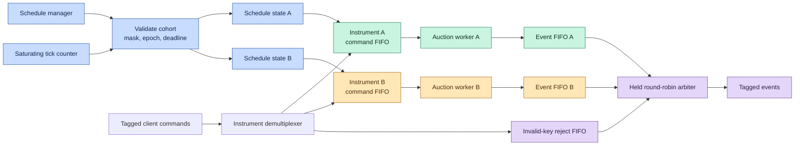
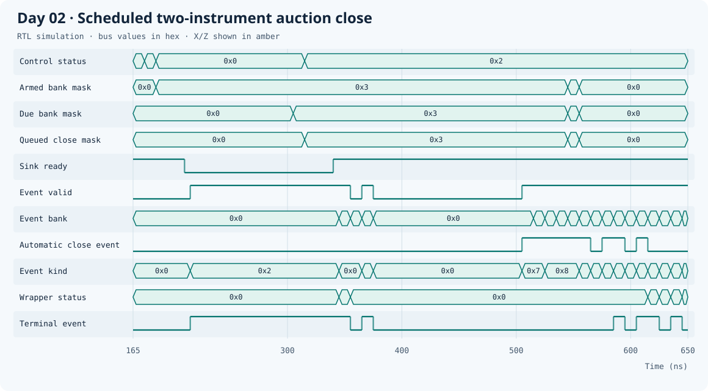

# Scheduled cohort call auctions

The `banked_call_auction` top in `rtl_auction_banked.f` gives each instrument a [collared call-auction worker](call_auction.md), a command FIFO and an event FIFO. A separate control channel schedules a shared admission cutoff for a selected cohort of instruments. Each instrument calculates its own uniform clearing price and allocates its own fills.

A venue gateway could use this arrangement for scheduled opening or closing crosses across several symbols, or to coordinate a reopening group while other instruments continue accepting orders. For example, a scheduled deadline can seal two related listings even when a burst fills one command FIFO and a temporary market-data stall backs up its event FIFO. Both listings stop admitting orders on the same cycle, while the congested instrument can take longer to publish the cross. This design uses an FPGA-local tick. Venue timestamps and the translation from a calendar schedule to clock ticks belong to the surrounding integration.

## Control channel

Drive `ctl_valid` until a rising edge with `ctl_ready`. Each request selects one or more bank indices through `ctl_mask`. Lane `i` of `ctl_epochs` starts at bit `i*EPOCH_W`. The response echoes the opcode, mask and tag. The per-bank detail and cutoff snapshot use the same low-bank-first packing. The armed bitmap and cutoff snapshot cover the selected banks and read as zero elsewhere.

| Opcode | Operation | Conditions on the selected banks |
| --- | --- | --- |
| 0 | `ARM` | The common cutoff is strictly greater than the current tick. Each worker is collecting with the expected epoch and is idle with an empty command FIFO. Each schedule is unarmed. |
| 1 | `CANCEL` | Each bank has a schedule for the expected epoch and has yet to reach its cutoff. Set `ctl_cutoff` to zero. |
| 2 | `QUERY` | Sample the selected schedules without modifying them. Set `ctl_cutoff` to zero. The expected epochs are ignored. |

| `ctl_report_status` | Meaning |
| ---: | --- |
| 0 | Accepted. ARM and CANCEL update every selected bank together. |
| 1 | Field error. The request used an empty mask, an unknown opcode, or a nonzero cutoff for CANCEL or QUERY. |
| 2 | Cohort rollback. At least one bank rejected the operation. |

Each `ctl_report_detail` lane encodes ready (0), inactive collection (1), epoch mismatch (2), outstanding work (3), already armed (4), unarmed (5) or deadline in the past or present (6). A failed or read-only operation reports schedules sampled at the request edge. The response can wait for `ctl_report_ready` while the instrument FIFOs continue processing. A held response stays stable even if a deadline passes. All operations take effect on the request edge. A newly armed bank blocks simultaneous client ingress on that edge.

## Cutoff and event ordering

At any request edge whose sampled `clock_tick` equals or exceeds the schedule cutoff, that bank is due. Every bank sharing the cutoff becomes due together. A CANCEL sampled at that edge rolls back. The tick counter starts at zero after reset and saturates at its maximum representable value. An ARM at saturation always fails the future deadline check. Global reset clears all books, schedules, FIFOs, held output state and sequence counters.

1. Before cutoff, a scheduled bank processes adds, cancels, reductions and queries through the worker. A client CLOSE or ABORT receives a terminal `LOCKED` event in the same stream. A successful schedule CANCEL re-enables native CLOSE and ABORT.
2. At cutoff, the bank reserves its next available command credit for an automatic CLOSE with the armed epoch and the ARM tag. Even if an external command has already asserted valid, it can transfer only under the ready/valid handshake. If it was still waiting at cutoff, it becomes late.
3. After the marker is queued, later handshakes enter as terminal `CUTOFF` rejections behind it. The worker executes all earlier accepted commands before the marker takes effect.
4. Each auto CLOSE has one command sequence and emits clearing, trades, residuals and terminal DONE using that sequence. The bank releases its schedule once the terminal event enters its local output FIFO. Any late rejection already queued retains its classification. Later commands again follow the native worker protocol, including its inactive-epoch checks.

The result stream adds the bank key, a modulo-`2^SEQ_W` command sequence, a modulo-`2^SEQ_W` event sequence, and one bit marking automatic CLOSE results. Command sequences count client handshakes and inserted markers. Event sequences count events committed to the bank FIFO. The shared arbiter preserves each bank's order and holds its selected word while the receiver is stalled. Output may interleave across banks, so reconciliation should key a command by its bank and sequence within a known capture epoch. Invalid bank keys share an independent reject queue and sequence namespace.

| `m_wrapper_status` | Meaning |
| ---: | --- |
| 0 | Worker result. Decode its native event kind and reason, including worker rejections. |
| 1 | Invalid bank key. |
| 2 | Client CLOSE or ABORT blocked while a schedule is armed. |
| 3 | Client command reached its bank after cutoff while the schedule was sealed. |

Wrapper rejections have native kind REJECT, the supplied epoch and tag, terminal bit set and unused fields zero. For integration, the declarations in [the RTL](../banked_call_auction.sv) give the packed widths derived from PRICES, SLOTS and the configurable quantity, owner, epoch and tag widths. The MSB-first command and result field orders are shared with [the worker](../call_auction_engine.sv) and have matching encoders in [the Python oracle](../banked_auction_model.py).

## Worked simulation

The first arm rolls back on a bank 1 epoch mismatch. The corrected arm selects mask `0x3` at 185 ns. Both selected banks become due at 305 ns while the sink is held, and both automatic CLOSE markers enter their queues at 315 ns. A CANCEL accepted on that edge reports rollback. Bank 0 clears seven units and bank 1 clears four, both at tick 5. The shared receiver accepts their DONE events at 615 ns and 595 ns respectively, followed by their late rejects at 645 ns and 625 ns. The third bank remains unarmed and takes a native CLOSE independently. In the separate depth-one pressure fixture, an empty bank inserts its marker on the cutoff edge even though the other bank must wait for command FIFO space. A timely reduction in that full FIFO is applied before the latter bank clears.

Run `make banked-auction-test` for nine Python tests, the four cycle-by-cycle Icarus profiles and the two deterministic fixtures. The default random seed checks 12,365 edges, including 87 automatic terminals, 166 cutoff rejects, 274 sequence wraps and 3,774 edges with stalled event output. `make formal-banked-auction` checks atomic schedule updates, marker and cutoff invariants, and held channels for 17 steps on a reduced two-bank geometry. The 22-step cover task reaches all four witnesses. `make banked-auction-lint banked-auction-synth` runs Verilator and generic Yosys checks. The default three-bank wrapper maps to 63,471 generic cells inclusive of its workers. `make waveform-banked-auction` regenerates the tracked SVG from the testbench VCD.
