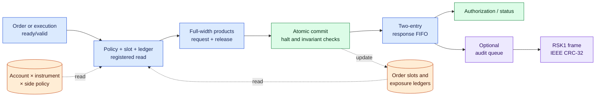
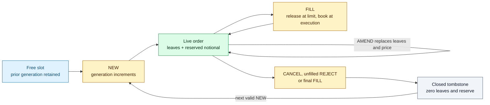
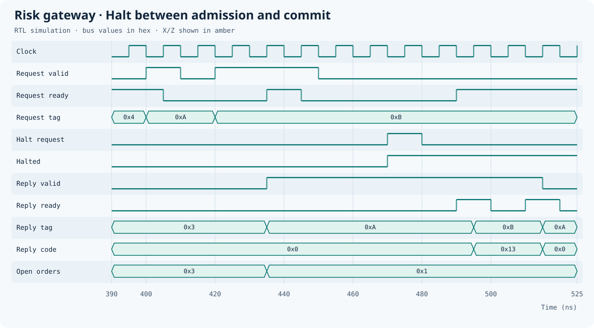

# Day 03 · Order Risk Gateway

**SystemVerilog RTL · Transactional order reservations · Execution reconciliation**

An FPGA order gate reserves exposure before accepting a normalized order. The same engine applies fills, cancellations, venue rejects, and amendments to the reservation throughout its lifetime. A dedicated ledger for each account, instrument, and side tracks open orders, reserved notional, and executed notional. The response FIFO decouples backpressure from commit timing. An optional audit adapter can mirror decisions to an integrity checked 32-bit stream.

## Architecture



An input transfers at rising edge `n`. The engine captures the table reads at `n+1`, the full-width products at `n+2`, and commits into the response FIFO at `n+3`. With an empty response FIFO, `m_valid` appears immediately after `n+3` and the earliest transfer is `n+4`. The initiation interval is four clocks with space in the FIFO. The engine accepts a request only when it can reserve a response entry. A full FIFO can accept a new request on the same edge as a response dequeue. A stalled head may delay visibility of a later reply. It cannot delay or repeat a committed state update.

A single in-flight operation gives all keys a total commit order. In particular, the next operation on a slot or risk key sees the previous commit with no forwarding guess. Both slot and ledger writes happen on the same edge. Rejected operations leave those tables unchanged, including when a fault also latches the halt.

### Order lifecycle



The upstream adapter selects a free slot. `NEW` takes zero generation and event inputs and returns the new generation with event sequence zero. Subsequent operations reference the same owner key and generation. The first event uses sequence one and each accepted event increases it by one. A failed operation does not consume a sequence value. A full-width generation counter retires that slot until reset. A full-width event value is reserved for a terminal event, so an order can still close when its sequence space runs low.

| `s_op` | Operation | Required payload and effects |
| --- | --- | --- |
| 0 | `NEW` | Positive limit price and quantity. Apply policy and halt. Create a fresh slot generation and reserve `limit_price × qty`. |
| 1 | `FILL` | Positive execution price and incremental quantity up to leaves. Release `limit_price × fill_qty` and add `execution_price × fill_qty` to executed notional. Zero remaining leaves closes the slot. |
| 2 | `CANCEL` | Zero price and quantity. Close the order and release the entire remaining reservation. |
| 3 | `REJECT` | Zero price and quantity. Close an order with no recorded fill. Use cancel for a partially filled order that will not continue. |
| 4 | `AMEND` | Positive new limit price and **new remaining quantity**. Apply policy to the replacement and resulting aggregate amount. Keep the same generation and prior fill history. |
| 5 | `SNAPSHOT` | Validate key and slot indices and return current metrics without a write. The other request fields are ignored. |

For a live order, `reserved = limit_price × leaves`. Open notional for a key is the sum of its live reservations. The two full-width products preserve every bit of the price and quantity operands. Admissions compare an extended sum with a fixed-width ceiling before storing it. Execution accumulation similarly checks its carry bit. A reported fill always reconciles its actual positive execution price. Its reservation releases at the order limit, and its execution value can differ from the release.

## Interfaces

**Full design top** `hft_order_risk_gateway` in [hft_order_risk_gateway.sv](hft_order_risk_gateway.sv). The synthesizable sources appear in [rtl.f](rtl.f). The optional [audit tap](risk_audit_tap.sv) and [serializer](risk_audit_serializer.sv) have separate top modules. The main testbench connects all three.

All interfaces share `clk`. The rising edge transfers a channel when its valid and ready signals are both high. The producer holds valid and payload through a stall. Default parameters are two accounts, two instruments, eight global order slots, a 24-bit price, a 16-bit quantity, a 16-bit tag, an 8-bit generation, and a 12-bit event sequence. These dimensions are compile-time parameters and must be positive integers. Price and quantity use unsigned integer units selected by the application.

| Parameter or width | Rule |
| --- | --- |
| `NUM_ACCOUNTS`, `NUM_INSTRUMENTS`, `ORDER_SLOTS` | Address counts. Each index width is `max(1, ceil(log2(count)))`. Unused encodings reject. |
| `TAG_W`, `GEN_W`, `EVENT_W` | Caller tag, slot generation, and per-order event sequence widths. Tags are echoed. |
| `PRICE_W`, `QTY_W`, `NOTIONAL_W` | Price, quantity, and sum of the two widths. Both open and executed notional use `NOTIONAL_W`. |
| `COUNT_W` | `ceil(log2(ORDER_SLOTS+1))`. Counts live orders per key. |

| Port group | Contract |
| --- | --- |
| `rst`, `halt_req`, `halted` | Active-high synchronous reset and sticky admission halt. Level `halt_req` applies on the commit edge itself. |
| `cfg_valid`, `cfg_ready`, `cfg_account`, `cfg_instrument`, `cfg_sell` | Configuration write. Holding configuration valid blocks new input while pending operations and their responses drain. Side 0 is buy, side 1 is sell. |
| `cfg_enable`, `cfg_min_price`, `cfg_max_price`, `cfg_max_order_qty`, `cfg_max_open_notional`, `cfg_max_open_orders` | Inclusive admission caps for one risk key. A disabled or malformed policy disarms that key. An out-of-range key leaves every policy unchanged. |
| `s_valid`, `s_ready`, `s_op`, `s_tag`, `s_account`, `s_instrument`, `s_sell`, `s_slot`, `s_generation`, `s_event_seq`, `s_price`, `s_qty` | Normalized request or execution notification. A reconciliation command includes the original owner key. |
| `m_valid`, `m_ready`, `m_op`, `m_tag`, `m_account`, `m_instrument`, `m_sell`, `m_slot`, `m_code` | Ordered response. Gate outgoing order actions on transferred `NEW` or `AMEND` responses with status 0. Other status 0 responses acknowledge operations or reads. |
| `m_generation`, `m_event_seq`, `m_slot_live`, `m_leaves`, `m_limit_price`, `m_reserved` | Slot view after the decision for its current owner. Unused and other-owner slots return zero in these fields. Closed slots preserve generation, last accepted sequence, and limit price until reuse. |
| `m_open_notional`, `m_executed_notional`, `m_open_orders` | Ledger after the decision for the requested key. An invalid key returns zero in all three fields. |

A policy is active when enabled, the minimum price is positive and at most the maximum, quantity and notional caps are nonzero, and the open-order cap is in `1..ORDER_SLOTS`. Policy writes keep existing reservations. Lowering caps affects later admissions. Reconciliation continues when policy is disabled or the halt is latched.

The first applicable rejection wins. Invalid operation, address, and payload fields are checked before slot state. Admission then checks halt, policy, quantity, price, open notional, and open count. A partial fill on the final event sequence is rejected before checking its proposed executed notional. A fault on a reconciliation request returns a diagnostic and latches the admission halt.

| Code | Status | Meaning |
| ---: | --- | --- |
| 0 | `OK` | Operation applied or snapshot completed. |
| 1 | `BAD_OP` | Reserved operation code. |
| 2 | `BAD_KEY` | Account or instrument index is out of range. |
| 3 | `BAD_SLOT` | Slot index is out of range. |
| 4 | `BAD_FIELDS` | Operation uses illegal generation, sequence, price, or quantity fields. |
| 5 | `SLOT_BUSY` | The requested NEW slot is already live. |
| 6 | `GENERATION_EXHAUSTED` | Reusing this slot would wrap its generation. |
| 7 | `NOT_LIVE` | Reconciliation references a slot without a live order. |
| 8 | `WRONG_OWNER` | A live slot belongs to another key. |
| 9 | `STALE_GENERATION` | Event handle generation does not match the active slot. |
| 10 | `EVENT_SEQUENCE` | The event is duplicate, late, or skips the next sequence. |
| 11 | `DISABLED` | No active admission policy. |
| 12 | `QTY_LIMIT` | Order quantity exceeds its cap. |
| 13 | `PRICE_LIMIT` | Order price falls outside its collar. |
| 14 | `OPEN_NOTIONAL` | Resulting reservation exceeds the key cap. |
| 15 | `OPEN_COUNT` | Resulting live order count exceeds the key cap. |
| 16 | `OVERFILL` | Reported fill quantity exceeds leaves. |
| 17 | `REJECT_AFTER_FILL` | An entry reject follows a recorded fill. |
| 18 | `EXEC_OVERFLOW` | Executed counter would overflow. Synthesized arithmetic fails closed and latches halt. |
| 19 | `HALTED` | Emergency halt prevents this admission or amendment. |
| 20 | `LEDGER_INVARIANT` | Reservation and ledger relation failed. The admission halt latches and no write occurs. |
| 21 | `EVENT_EXHAUSTED` | A nonterminal event would use the last available sequence value. |

### Example

Configure buy key `(account=0, instrument=0, side=0)` with a collar of 10–50, quantity cap 20, open cap 1,000, and count cap 4. A NEW in slot 0 at price 25 and qty 12 returns generation 1 and reserves 300. Fill 5 at price 24 with generation 1 and event sequence 1. The reply reports 7 leaves, 175 reserved, and 120 executed. Then CANCEL with the same generation and sequence 2. Its reply shows zero open notional, zero open orders, and 120 executed. A later NEW on slot 0 returns generation 2. Late events for generation 1 are rejected.

## Audit adapter

`risk_audit_tap` copies primary **transfers** to a bounded observation queue. The default lossless mode pauses the primary stream while the audit queue is full, even on the cycle the sink frees an entry. Best-effort mode leaves primary ready independent of the audit sink and can copy a record into an entry freed on that same cycle. A full best-effort queue counts discarded copies with a saturating counter and a sticky overflow indicator. Host readers can use that counter to detect drops even when the serializer's frame IDs are contiguous.

`risk_audit_serializer` emits one 32-bit word per handshake. The frame begins with `32'h314b5352` (ASCII `RSK1` in little-endian byte lanes), then an 8-bit version and 24-bit payload bit count, a 32-bit wrapping frame ID, and the payload in least-significant-word-first order, padded with zero high bits. The final word is IEEE CRC-32 over the preceding little-endian bytes. A stalled word holds data and both boundary flags. Serializer reset drops a partial frame and starts the next ID at zero.

For [audit_trace.py](audit_trace.py), the testbench packs the reply fields in the order listed by `Decision` in [risk_model.py](risk_model.py). The capture uses one eight-digit hexadecimal word per line. The host verifies CRC, payload width, sequence, and optional expected decisions. It also accepts binary little-endian captures.

## Run

Use Icarus Verilog and Python 3 for the regression and audit reader. Use Verilator and Yosys for lint and synthesis.

```sh
make test
make lint synth
make test-gate
python3 audit_trace.py check --profile narrow --capture build/narrow/audit.hex --expected build/narrow/expected.txt
```

- The default differential test runs 3,720 checked transactions in each of the 8×8 and 24×16 price-by-quantity profiles. The Python oracle recomputes open exposure by scanning its live orders. RTL maintains its counters incrementally. The test checks deterministic internal commit deadlines and captures every response through the lossless tap and serializer under stalls. It also covers the saturated-ledger case where a partial fill at the terminal sequence is rejected without latching halt or consuming that sequence.
- The protocol bench verifies full-FIFO behavior, configuration priority, a halt on the commit edge, reset during in-flight work, and an injected accounting error. The separate audit tap bench exercises drop saturation, depth-one queue reuse, and simultaneous refill while full.
- The [formal harness](formal/formal_gateway.sv) checks ordered responses, stalled payload stability, reservation consistency, configuration exclusion, and sticky halt for a one-account, one-instrument, one-slot instance with 3-bit prices and quantities. The repository's `make formal` runs the [18-step bounded check and 26-step cover](formal/gateway.sby). The cover goals include a terminal fill after admission, a stale generation reject, a held reply that transfers, and a cancel after halt.
- The netlist regression synthesizes the narrow gateway and feeds it the directed orders plus 100 randomized transactions. The checking path uses the synthesized transaction engine and RTL audit adapters. `make synth` also checks the three independent module tops and saves the generic gate report and gateway JSON in `build/`.
- The vector generator supports `SEED` and `OPERATIONS` Make overrides. The default seed produces all outcomes reachable without fault injection.

## Integration trade-offs

The one-operation engine saves scoreboard and forwarding logic in exchange for lower issue bandwidth than a pipelined multi-bank architecture. Scaling it requires bank arbitration and bypass for simultaneously admitted commands that share a risk key or slot. Stored state uses indexed memory words of explicit widths. Small prototype configurations can map to flip-flops or distributed memory. The synthesis mapping depends on the target and reset strategy.

This design begins at the normalized event boundary. The caller owns symbol mapping, key authorization, slot allocation, replay recovery, and trusted execution sequence assignment. Halt allows the engine to drain reconciliation and blocks newly committed admissions. The sending adapter needs its own halt check if it must suppress authorizations already committed to the response queue. Reset invalidates all policies, orders, ledger, pending work, and replay history, so use it at a reconciled session boundary. Board-level timing, network transport, venue connectivity, and exchange-wide risk remain outside this RTL core.

The [common characterization report](../docs/performance.md) records the comparable default-geometry route, verification scope, and source inventory for all three designs.

## Checked simulation waveform



The boundary test admits requests `0x0a` and `0x0b` on the 405 ns and 445 ns rising edges. The first decision commits before halt and holds its `OK` reply (`0x0`) under backpressure. At 470 ns the bench asserts `halt_req` ahead of the second commit. The second reply is `HALTED` (`0x13`), and open orders stays at one. The reply handshakes occur at 495 ns and 515 ns.

Run `make waveform` in this directory to rerun the checked bench and regenerate this cropped SVG. The full VCD is saved under `build/`.
