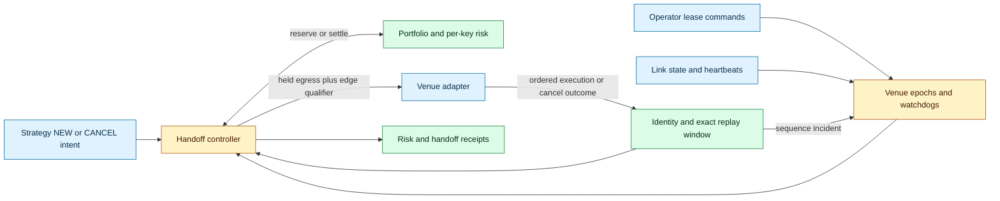
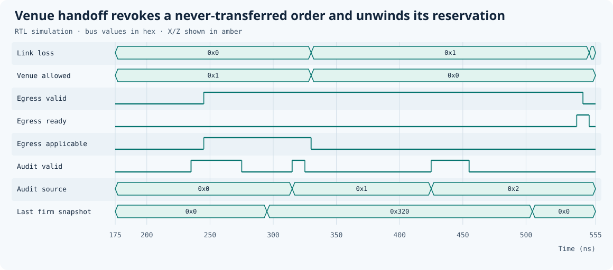

# Supervised venue handoff

[risk_venue_handoff.sv](risk_venue_handoff.sv) joins the original account and firm portfolio gateway with per-venue leases and an independently reconciled order lifecycle. Use it between a strategy and a venue adapter that can retain a normalized order identity across reconnects. For example, a gateway that loses its venue socket can reclaim a stalled order that never reached that adapter. A 100-share order the adapter already accepted stays on the risk ledger even if the socket drops before its outcome is known. A later execution reduces its open leaves, using the execution price for turnover and the order limit for the amount released.



## Lease and dispatch

All channels use the same rising-edge clock and synchronous active-high reset. The adapter supplies one supervised lease per venue. Management commands use `g_valid/g_ready` and return a held post-edge result. A positive `g_timeout` is counted in external `time_tick` pulses. A matching heartbeat reloads the countdown even on the expiry edge. Link loss, accepted fencing control, report conflict, or expiry closes the current lease. Venue identity and the strictly increasing epoch remain available for monitoring. The policy must use a fresh nonzero lease at startup.

| Management command | Payload and effect |
| --- | --- |
| 0 · ARM | Valid venue, epoch greater than the last installed epoch, positive timeout. A concurrent link loss or report trip prevents activation. |
| 1 · FENCE | Valid venue and its installed epoch, zero timeout. Revoke egress permission and retain existing sent exposure. |
| 2 · READ | Valid venue, zero epoch and timeout. Return epoch, remaining ticks and permission. |

Management status 0 is success. Codes 1–5 report invalid venue, invalid opcode, invalid fields, stale epoch, or link/fault conflict. `venue_epochs` packs venue zero at the low end. `venue_allowed` shows current edge eligibility, including withdrawal on an expiry, replacement, or loss edge. `ignored_heartbeats` and `lease_expirations` are saturating 32-bit counters. Link state is synchronous. Supply one sample of link loss to close a lease that has lost transport.

- A strategy NEW supplies its account, instrument, side, slot, tag, venue, current lease epoch, positive price and quantity, and generation zero. Successful reservation returns the allocated native generation. The wrapper then offers the order with fixed egress identity and fields.
- On `tx_valid && tx_ready`, the adapter acts only if `tx_applicable` is high. The data bundle holds while stalled. The qualification can fall while the payload remains held. Accept waived offers as discarded work so the scheduler can present later orders. Once a particular held offer loses qualification, it cannot revive.
- The qualified transfer is the handoff boundary. Track the order as potentially sent from that edge, including adapter restart or transport failure before a visible acknowledgment. Send any venue outcome on a subsequent edge.
- A strategy CANCEL supplies the original venue, order epoch, owner key, slot and generation with zero price and quantity. A cancel against a reservation that has never left the gateway revokes it and triggers an internal native cancel. An already submitted order queues a venue cancel. Its exposure holds until a terminal fill, expiration, or valid cancel confirmation.
- A queued cancellation carries the original `tx_order_epoch` and the currently installed `tx_session_epoch`. It can dispatch through a later eligible connection and while the global admission halt is latched. Each applicable cancellation consumes a strictly increasing `tx_action` token within that slot generation. A waived offer leaves the token free for reissue. A submitted cancel with unknown outcome waits for its matching report or other qualified terminal settlement.

The dispatcher chooses queued cancellations before NEWs and rotates within each class. It can hold one offer while risk reports reconcile for another slot. Native risk mutations are serialized. The input controller prioritizes compensating rollback, venue reports, native policy writes, portfolio controls, then strategy intents. Valid data stays asserted until its channel accepts. A stalled audit receipt delays further ledger mutations. The lease watchdog and pending egress qualifier still operate independently.

## Venue report identity and evidence

Report identity binds venue, original order epoch, slot and generation. The same canonical sequence must identify the same normalized event across redelivery and reconnects. Start reporting at sequence 1 and advance by one for each accepted event. Native risk sequences are separate. ACK and cancel rejection consume a venue sequence and leave the native risk sequence intact.

| `r_kind` | Payload and effect |
| ---: | --- |
| 0 · entry acknowledgment | Zero price, quantity, match and action token. Marks the submitted entry acknowledged. |
| 1 · incremental fill | Positive execution price, quantity, and nonzero match ID. Action token zero. |
| 2 · cancel confirmed | Zero price, quantity and match. Supply the outstanding cancellation's nonzero action token. Releases remaining exposure. |
| 3 · entry rejection | Zero price, quantity, match and action token. Applies only before entry acknowledgment and before a recorded fill. |
| 4 · cancel rejected | Zero price, quantity and match. Supply the outstanding cancellation's action token. Clears the cancel attempt while the order stays live. |
| 5 · venue expiration | Zero price, quantity, match and action token. Closes a still-live submitted order. |

Each slot retains the most recent `HISTORY` accepted reports by byte-exact normalized fields. Report tags correlate diagnostics and are outside identity. An identical retained report, including a terminal replay, yields an idempotent diagnostic. A changed report at a retained sequence, forward sequence gap, or retained match ID reused at a different sequence closes the currently installed lease for that venue. Evicted older sequences are harmless stale diagnostics. To retain a match ID beyond the window, deduplicate upstream and preserve event numbering. Hardware slot reuse clears previous report evidence and allocates a new native generation. The largest venue report sequence is reserved for a closing event. A cancellation token cannot wrap. A still-live order with exhausted cancel tokens may reconcile a legitimate fill or terminal venue event.

| Handoff status | Meaning |
| --- | --- |
| 0 · APPLIED | Native risk accepted the reservation or venue report. |
| 1 · RISK_REFUSED | Native policy, portfolio, lifecycle or invariant check refused the requested operation. Inspect the attached native receipt. |
| 2–6 | Lease closed, invalid address, invalid fields, wrong order, or venue response to a never-submitted order. |
| 7–11 | Exact replay, older report outside retained evidence, forward gap, changed report, or reused match ID. |
| 12–15 | Wrong lifecycle phase, cancel queued, entry acknowledged, or cancel rejected. |
| 16–19 | Proven-unsent rollback succeeded, terminal report sequence required, wrong cancel token, or exhausted cancel tokens. |

An admitted reservation can be forwarded before the audit sink accepts its copy. Use the egress transfer and current qualifier as the adapter's submission boundary. Audit results include the source, tag, venue, original epoch, slot, generation, and sequence. `m_native_valid` qualifies the native receipt and all aggregate data fields. The independent portfolio control path can capture coherent exposure before or after an operation. The other top-level risk policies and cap controls retain their original meanings.

An unexpected native refusal during automatic rollback retains the reservation, raises sticky `handoff_fault`, and avoids retrying the same failed unwind indefinitely. New submissions stop and other submitted orders can continue to reconcile. Reset clears this module's leases, report history, and risk state. Reconstruct persisted venue exposure before using a reset hardware image for submissions. Use the lower-level risk gateway entry point for workflows that need amendments.

## Checked waveform



At 235 ns the reservation result records 800 units of open risk. The NEW becomes applicable at 245 ns and waits because the adapter is stalled. The independent firm read captures 800 at 295 ns. Link loss at 330 ns removes the egress qualification. The held payload persists while the native risk gateway cancels the proven-unsent reservation. At 425 ns a recovery receipt confirms the rollback, and the next firm read captures zero at 505 ns. The adapter accepts the waived offer at 545 ns.

```sh
make test-handoff lint-handoff synth-handoff formal-handoff handoff-waveform
```

The independent test model uses logical route objects, a deque of normalized evidence, and the portfolio oracle for exposure. The three RTL configurations compare 1,690 ordered audit replies, 395 lease replies, 431 portfolio replies, 537 egress transfers, and 392 monitor snapshots. Coverage includes simultaneous cancellation or deadline expiry on the egress acceptance edge, scope isolation across three slots, duplicate and changed fills from an older connection, stale cancel actions, counter exhaustion, and ledger-read fault injection. Both default and singleton geometries lint. Generic synthesis checks structure. Reduced SAT checks cover 12 lease edges and 15 integrated handoff edges.
