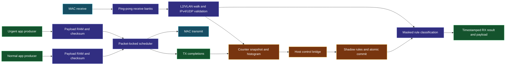
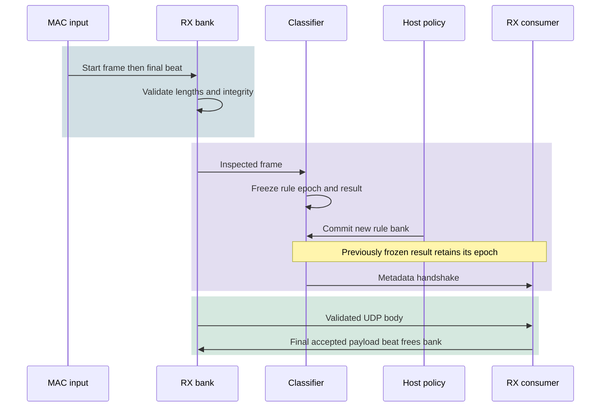
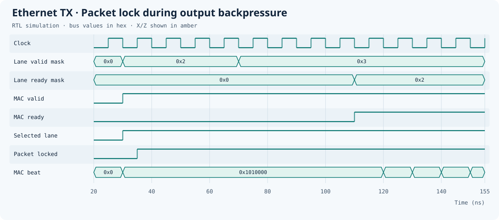

# Day 04 · Ethernet and UDP frontend

A synthesizable, full-duplex MAC client endpoint for FPGA trading systems. It verifies Ethernet II, VLAN, IPv4 and UDP headers before releasing receive payloads. Independent transmit engines collect application datagrams, build checksummed packets, and share a packet-locked MAC scheduler. It includes a programmable queue classifier, timestamped results, a control register bridge, and capture-driven simulation.

The data-plane top is [`ethernet_udp_frontend.sv`](ethernet_udp_frontend.sv). The optional [`eth_config_csr.sv`](eth_config_csr.sv) bridge translates a 32-bit host transaction stream into its native rule and statistics ports. [`rtl.f`](rtl.f) lists synthesizable files.

## Run

```sh
make test
make lint
make synth
```

Use Python 3.9+, Icarus Verilog, Verilator and Yosys. Optional variables are `PYTHON`, `IVERILOG`, `VVP`, `VERILATOR` and `YOSYS`. `build/` holds transient fixtures, simulator files, logs and netlists. Synthesis performs generic structural checks for the endpoint and CSR bridge.

## Data and control paths



### Receive

Each accepted last beat advances the fill-bank pointer. An independent retirement pointer keeps results and bodies in original MAC arrival order, even when the second bank validates first. The frame stays in the bank through metadata and payload backpressure. Pair RAM stores even and odd 64-bit words separately and can fetch two adjacent words in one clock. Its aligner handles headers and payloads starting away from lane zero. After the initial fetch, checksum scans and accepted payload replay use one aligned word per clock.

Validation walks up to two VLAN tags, checks IPv4 version, header size, lengths, fragment flags and TTL, then verifies the header checksum with options included. UDP length must equal the IPv4 payload length. A present UDP checksum covers the UDP header, body and IPv4 pseudo-header, including the odd-byte zero extension. `ALLOW_ZERO_UDP` selects whether an all-zero received checksum field is accepted. Ethernet padding may extend a short packet to 60 bytes and is excluded from the UDP payload. [RFC 791](https://www.rfc-editor.org/rfc/rfc791.html), [RFC 768](https://www.rfc-editor.org/rfc/rfc768.html), [RFC 1071](https://www.rfc-editor.org/rfc/rfc1071.html), [Intel Ethernet MAC frame format](https://cdrdv2-public.intel.com/847388/ug-741328-847388.pdf)

The MAC boundary excludes preamble, SFD and FCS. Assert `rx_mac_bad` on any accepted beat of a frame with a MAC-reported error. Each completed capture produces one RX result. Accepted results with nonzero UDP bodies are followed by exactly those body bytes. Errors and accepted zero-length UDP datagrams have no payload transfer.

### Classifier and timestamps

Eight ordered rules compare masked IPv4 source and destination, UDP source and destination, outer TCI and VLAN depth. Lowest matching index wins. A rule permits a queue or rejects the packet. When no rule matches, the frontend reports a miss.

Host writes target the shadow table. Commit swaps tables and increments an 8-bit epoch. The old active table becomes shadow, so replace all entries before a full policy swap. Each RX decision captures the epoch when the inspected bank reaches dispatch. A result already waiting for the sink stays unchanged across commits.

The free-running clock stamps the first accepted RX frame beat, including dropped frames. It also stamps the first transmitted beat of successful TX requests and the accepted descriptor edge of rejected requests.



### Transmit

Lane 0 is urgent. Lane 1 is normal. Each input has its own descriptor state, payload RAM and checksum accumulator. For a positive descriptor length, submit one separately framed body even if the descriptor will be rejected. A zero length has no body beats. A frame becomes eligible only after descriptor, body length and body framing are checked. IPv4 output uses a 20-byte header. The sender inserts zero Ethernet padding to reach 60 bytes, computes IPv4 and UDP checksums and encodes computed UDP zero as `0xffff`. A descriptor may request IPv4 UDP checksum omission.

The scheduler locks on the first presented beat until the last transfer. When both producers are pending at a packet boundary, at most three urgent packets run before a normal grant with the default parameter. End-of-packet counts drive the credit. The completion stream is independently arbitrated and can backpressure a producer after its frame finishes.

## Wire interfaces

All interfaces share `clk` and synchronous active-high `rst`. Every ready/valid sender holds the payload and markers while stalled. Lane zero is the low byte of each 64-bit beat. A nonfinal beat has `keep=0xff`. A final beat has a nonempty contiguous mask starting at bit zero. Pack multi-lane interfaces at lane-index multiples of the documented word width.

| Interface | Payload |
| --- | --- |
| `rx_mac_*` | 64-bit data, 8 keep, first, last and MAC bad. Delimits one Ethernet frame. |
| `rx_info_*` | One 384-bit result per received frame. Status and arrival tick always qualify. Other parse fields describe the parser progress for rejects. |
| `rx_payload_*` | 64-bit data, 8 keep, first and last. Transfers after the accepted metadata and carries UDP body only. |
| `tx_desc_*` | Two independent 320-bit descriptors with lane 0 in bits 319:0. |
| `tx_payload_*` | Two independent 64-bit body streams with per-lane keep, first and last. |
| `tx_mac_*` | One 64-bit MAC frame stream with keep, first, last and winning lane. |
| `tx_status_*` | 128-bit accepted or rejected completion for each TX descriptor. |
| `rule_write_*` and `rule_commit_*` | Native shadow rule writes by index and explicit atomic activation. |
| `stats_*` | Save a whole counter snapshot, select one 64-bit counter and optionally clear live counters. |

### Packet metadata and TX options

| RX bits | Field | RX bits | Field |
| --- | --- | --- | --- |
| 383:376 | Result | 375:368 | Queue |
| 367:360 | Rule epoch | 359:352 | L2 header bytes |
| 351:288 | Arrival tick | 287:240 | Destination MAC |
| 239:192 | Source MAC | 191:160 | Source IPv4 |
| 159:128 | Destination IPv4 | 127:112 | Source UDP port |
| 111:96 | Destination UDP port | 95:80 | Payload bytes |
| 79:64 | Frame bytes bounded by the RX capture limit | 63:48 | Outer TCI |
| 47:32 | Inner TCI | 31:16 | IPv4 ID |
| 15:8 | TTL | 7:6 | VLAN depth |
| 5 | UDP omitted | 4 | DF |
| 3:0 | IPv4 IHL | | |

In a TX descriptor, bits `[319:288]` are the application cookie. The next fields in descending order are destination and source MAC addresses (48 bits each), source and destination IPv4 (32 each), source and destination UDP ports (16 each), body byte count (16), outer and inner TCI (16 each), IPv4 ID (16), TTL and TOS (8 each). Bits `[15:8]` and `[3:0]` are reserved zero. Bits `[7:6]` hold VLAN depth, bit `5` disables UDP checksum, and bit `4` sets DF.

TX status is `{code[7:0], lane[7:0], cookie[31:0], frame_bytes[15:0], tick[63:0]}`. Result zero is success. Named RX and TX result constants are in [`frontend_codes.svh`](frontend_codes.svh). RX does framing, MAC and capture-size checks first, then layered validation followed by classification. For TX, descriptor errors take precedence over axis framing and declared-length mismatches.

### Rule and CSR layout

| Rule bit range | Fields |
| --- | --- |
| 255:224, 223:192 | Source IPv4 value and mask |
| 191, 190, 189:187 | Enabled, drop and queue |
| 186:185, 184:183 | VLAN depth value and mask |
| 175:144, 143:112 | Destination IPv4 value and mask |
| 111:96, 95:80 | Destination UDP port value and mask |
| 79:64, 63:48 | Outer TCI value and mask |
| 47:32, 31:16 | Source UDP port value and mask |

CSR replies use statuses 0 success, 1 address error, 2 access error and 3 value error. Commands are byte enabled. Write value 1 with byte 0 enabled for a pulse CSR.

| Byte address | Purpose |
| --- | --- |
| 0x00 / 0x04 / 0x08 | Device ID, ABI, active rule epoch |
| 0x10 | Shadow rule row |
| 0x20–0x3c | Eight rule words, low bits first |
| 0x40 / 0x44 | Push selected rule / commit table |
| 0x48 / 0x4c | Capture statistics / clear live counters |
| 0x50 / 0x54 / 0x58 / 0x5c | Counter selector, low word, high word, snapshot ID |

Counter indexes 0–5 measure MAC RX frames, kept bytes, passed results, rejects, ingress stalls and released bytes. Indexes 6–15 cover framing, MAC and checksum errors, rule misses and drops, accepted unchecked UDP, metadata and body stalls and frame limits. Indexes 16–24 cover per-lane TX frames, MAC TX bytes and stalls, rejected descriptors and completion stalls. Indexes 25 and 26 count one- and two-tag RX results. Indexes 27–31 record RX first-beat-to-result transfer latency buckets with ceilings 32, 64, 128, 256 and infinity. Counters saturate and each snapshot is coherent before the snapshot edge's increments.

## Verification results

| Run | Evidence |
| --- | --- |
| End to end, seed 4101 | 323 RX results, 2,384 validated body beats, 4,647 TX wire beats, 303 completions |
| End to end, seed 9717 | 413 RX results including 90 directed cross-layer faults, 2,369 body beats, 4,775 TX wire beats, 303 completions |
| Strict receive checksum | 195 RX results and 175 completions, including rejected zero UDP checksums |
| Default geometry | 221 RX results and 199 completions, exact 1,536-byte capture and 1,472-byte TX body ceilings, all final keep widths |
| PCAPng into RTL | 144 packet replays across three interfaces and two byte orders in both checksum modes, with 64 rejects and 4,341 delivered bytes in permissive mode and 68 rejects and 4,100 delivered bytes in strict mode |
| Focused checks | 362 arbiter packets, 2,720 paired RAM reads, counter saturation, CSR readback/commit/strobes and reset with partially captured or stalled frames |
| Software tests | 64 Python tests covering capture readers, rule and CSR tools, transport wire model, replay bundles, input/output path collisions, and the fault matrix |

In the directed simulation, an untagged minimum frame took **26 cycles** from first accepted RX beat to metadata transfer, or **19 cycles** after the final MAC beat. An empty-body TX descriptor began transmitting after **2 cycles**. Its frames transferred one beat per cycle with six simultaneous RX and TX beats in that scenario. Full bank occupancy, packet validation and sink backpressure affect sustained throughput. These cycle measurements apply to RTL simulation. Generic synthesis does not establish a device clock or sustained Ethernet line rate.

## Offline workstation tools

[`capture_study.py`](capture_study.py) converts classic pcap or pcapng into scheduled MAC beats and reference results, and reports per-interface dispositions, queues and VLANs. Its FCS policy can preserve the MAC-client boundary using capture metadata or verify a captured CRC and set the bad sideband. It skips truncated capture records and unsupported link-layer types. `capture_replay.py` bundles rules, timed transfers and exact expected body bytes for [`tb_eth_capture_replay.sv`](tb_eth_capture_replay.sv).

```sh
python3 -B capture_study.py exchange.pcapng --policy local-rules.json --output build/mac.txt
python3 -B capture_replay.py --synthetic --directory build/replay
python3 -B rule_control.py rules local-rules.json --epoch 0
python3 -B rule_control.py snapshot 0 1 2 3 16 17
```

Rule JSON is an object with a `rules` array. For example, `{"rules":[{"dst_ip":"239.1.2.0/24","dst_port":18000,"queue":3}]}`. A field accepts exact numbers, a wildcard, a value/mask object or an IPv4 prefix for address fields. The CSR plan writes all shadow entries, verifies the staging words by default and issues a single commit. The driver checks snapshot IDs before combining low and high words. A replay schedule gives the earliest requested cycle. The transactor holds beats through hardware backpressure.

## Integration bounds

The default RX limit is 1,536 bytes and default TX body limit is 1,472 bytes. IPv4 fragments, non-UDP IP traffic and non-IPv4 EtherTypes receive explicit reject results. RX treats IP options as checksummed opaque bytes. TX emits no IP options. ARP, VLAN membership management, PHY/MAC, clock crossings and queue consumers sit outside this block. A dropped last marker requires the upstream path or reset policy to restore framing. Same-address read/write in the paired RAM is avoided by packet-bank ownership.

Trading network engineering work calls for high-speed datapaths, timing and resource analysis, reproducible diagnostics and self-checking verification. This project exercises those tasks at a wire-protocol boundary suitable for preceding a market-data parser or following an execution engine. [Optiver FPGA Engineer](https://www.optiver.com/join-us/jobs/technology/chicago/fpga-engineer/), [Jane Street ASIC Engineer](https://www.janestreet.com/join-jane-street/position/8233259002/)

## Checked simulation waveform



Lane 1 presents the first beat at 30 ns. The MAC is stalled, and the arbiter locks its offer at 35 ns. Lane 0 becomes valid at 70 ns. The selected lane and beat stay stable through the initial stall. The first transfer is at 115 ns, and subsequent transfers continue on lane 1 as its packet advances.

Run `make waveform` in this directory to rerun the checked bench and regenerate this cropped SVG. The full VCD is saved under `build/`.
