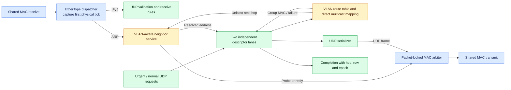
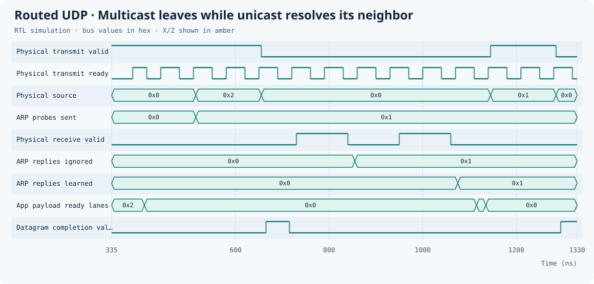

# Routed UDP endpoint on one Ethernet MAC

[The routed endpoint](eth_routed_udp_frontend.sv) combines the existing UDP
parser and serializer with a shared MAC, route lookup, and neighbor
resolution. An FPGA feed handler can send a unicast recovery request to a
remote gateway while sending a multicast status datagram on its other
application lane. An inbound recovery-feed frame and an ARP reply can
arrive on the same physical port. Inserting this design in front of a feed
decoder preserves the first physical receive tick even though the header
dispatcher buffers the first beats.

## Shared MAC and ingress

RX uses `{bad, first, last, keep[7:0], data[63:0]}`. TX uses
`{first, last, keep[7:0], data[63:0]}`. Lane zero holds the first byte.
The clock samples all transfers with ready and valid asserted on a
rising edge. The MAC client interface excludes preamble and FCS. The
producer holds each stalled offer. A synchronous reset invalidates all
lookup, frame, and report state and suppresses transfers while asserted.

[The dispatcher](eth_mac_dispatch.sv) inspects EtherType after zero, one,
or two recognized VLAN headers. IPv4 proceeds to the existing parser.
ARP proceeds to the existing endpoint when untagged or singly 0x8100
tagged. Other EtherTypes and unsupported VLAN forms are counted and
drained through their last beat. Prefix-shape faults, truncated headers,
and three tags take the malformed-prefix path. The dispatcher preserves
the MAC bad flag and all accepted beats on forwarded frames. The IPv4
parser validates the rest of each frame. ARP and IPv4 each have an
independent result path. Since ingress is one physical stream, an
already selected receive client can backpressure later packets on that
same link.

On transmit, `mac_tx_source` is 0 for ARP, 1 for urgent UDP, and 2 for
normal UDP while `mac_tx_valid` is high. The arbiter retains the source
from its first held or accepted beat through the final transfer. ARP
gets priority for at most `ARP_BURST` consecutive frames when UDP
is waiting. The native urgent/normal arbiter still governs UDP.

## Route and transmit behavior

Program and commit the routing table independently of the receive rule
table. The standalone [next-hop pipeline](eth_next_hop_pipeline.sv) can
have multiple unicast resolutions outstanding, using a private slot
identifier when calling the ARP endpoint. Each result reports the
caller tag, normalized VLAN, original destination, next hop, MAC,
table row, route epoch, acceptance tick, completion tick, and status.
Results can finish out of order. The caller does not need unique tags
for transport correctness, though it must be able to associate its
own completions. A caller that attaches an alternative ARP service
must receive one response per accepted slot and reset the service and
pipeline together.

The endpoint accepts one native 320-bit descriptor per application lane.
It resolves the destination MAC and uses the configured `LOCAL_MAC`
and `LOCAL_IP` for transmitted datagrams. Application-supplied values
for those three address fields are ignored. The original IPv4
destination remains in the transmitted header when the route points to
a gateway. The companion accepts untagged and singly customer-tagged
outgoing descriptors. Double VLAN descriptors fail before a lookup.
Applications can still use the original UDP top for caller-managed
MAC and IP identities and double-tagged transmission.

A multicast destination is permitted only if the descriptor's lane
asserts `tx_allow_multicast` on acceptance. That path maps the lower
23 address bits to an Ethernet multicast MAC and sends without ARP.
Limited broadcast and invalid VLAN IDs fail closed. The bit should
come from the application's multicast policy. IGMP membership and
upstream switch configuration are outside this endpoint.
[RFC 1112, section 6.4](https://www.rfc-editor.org/rfc/rfc1112.html#section-6.4)

A route lookup uses the table active at its acceptance edge. When
`tx_require_current_epoch` is asserted, a commit on that edge or
before native UDP handoff invalidates the pending descriptor, even if
the epoch counter has wrapped. A commit after native handoff leaves
the accepted datagram intact. The lower-level planner returns the
original route epoch for applications implementing their own policy.
Use the next-hop result only when its status is zero.

A rejected descriptor with nonzero declared length must still be
followed by a ready/valid body ending at the real `tx_payload_last`.
The adapter drains that body before publishing its completion. The
other lane can route, transmit, and complete independently subject
to shared port and result backpressure. The upstream source must
terminate each nonzero-length body. It can hold the first body beat
while routing runs.

The 128-bit completion keeps the original status, lane, cookie, wire
length and tick layout. The hop, row, and epoch signals extend it on
the same transfer. A routing failure uses zero frame bytes and the
tick at which the failure was identified. Native UDP errors and
successful statuses retain the native tick semantics. A held result
has stable fields.

| Code | Result |
| ---: | --- |
| 0 | Native UDP transmission completed |
| 1, 17, 18 | Bad body framing, invalid descriptor, or declared body length mismatch |
| 33, 34, 35 | Missing route, rejected route, or unusable destination/VLAN |
| 36, 37, 38 | ARP timeout, neighbor request capacity, or invalid neighbor response status |
| 39, 40 | Multicast disabled for this descriptor, or route epoch invalidated before UDP handoff |

## Atomic link statistics

Pulse `status_snapshot` to freeze the pre-edge counter set and
increment the snapshot ID. Read successive rows through `status_index`
without racing live traffic. Counters saturate at their native widths.
The occupancy and epoch rows are gauges.

| Rows | Values in order |
| --- | --- |
| 0–2 | Unexpected neighbor result, good lookup, failed lookup |
| 3–6 | Forwarded IPv4 RX, forwarded ARP RX, other RX, malformed prefix |
| 7–13 | ARP cache hits, misses, joined waiters, probes sent, replies learned, replies ignored, timeouts |
| 14–16 | ARP receive rejections, recognized replies, replies transmitted |
| 17–19 | Occupied route slots, active route epoch, active UDP receive rule epoch |
| 20–22 | Physical frames sent from ARP, urgent UDP, and normal UDP |

## Verified simulation

The captured probe completes before 515 ns. The physical source switches
to normal UDP at 515 ns and the multicast status appears at 665 ns.
A reply for the wrong VLAN increments the ignored counter at 855 ns.
The matching reply is learned at 1,075 ns, and urgent UDP gets the
MAC at 1,145 ns. The fixture then wraps a two-bit route epoch while a
different ARP probe is outstanding and verifies the old route cannot
emit a datagram.

| Command | Verification |
| --- | --- |
| `make test-routed` | Full MAC integration against exact independent Ethernet, ARP and IPv4/UDP encoders. Tests eight wire frames, 11 completions, QinQ UDP receive, wrong VLAN, timeout, cache reuse, held outputs, and a route-epoch wrap. |
| `make test-next-hop` | 1,800 lookup results across one, three and five slots, with 668 paused or reordered mock neighbor responses and checks of every reported field and timestamp. |
| `make formal-routed` | 18-step bounded assertions and covers for ingress dispatch and the three-slot lookup pipeline. |
| `make waveform-routed lint-routed synth-routed` | Replay the checked capture, regenerate the SVG, run strict lint, and check a generic synthesized netlist. |

The current synthesis and formal flows use Yosys with the slang
frontend. The waveform and test results measure simulation cycles.
