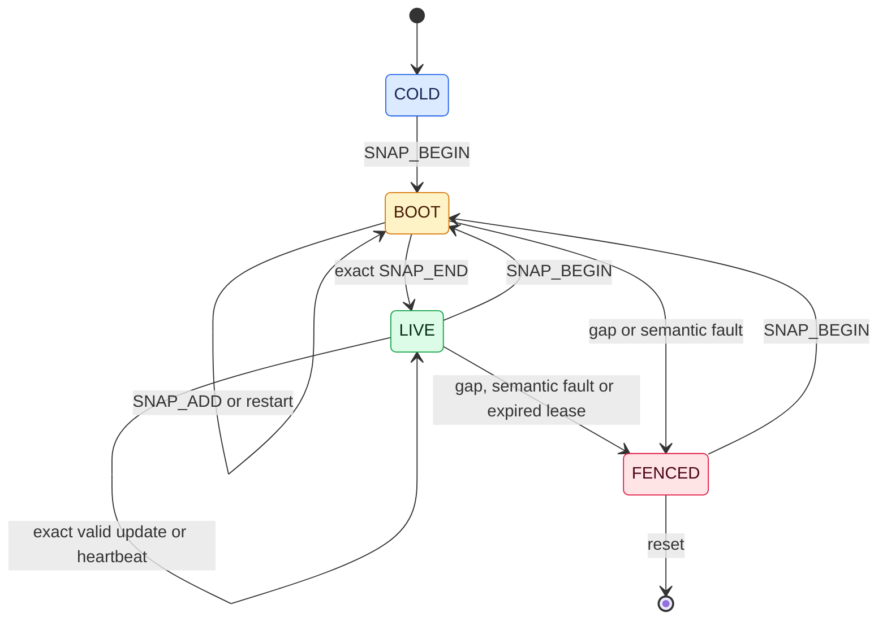
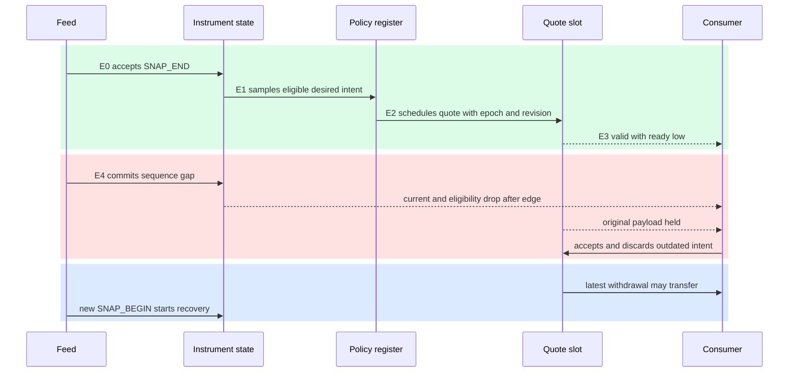
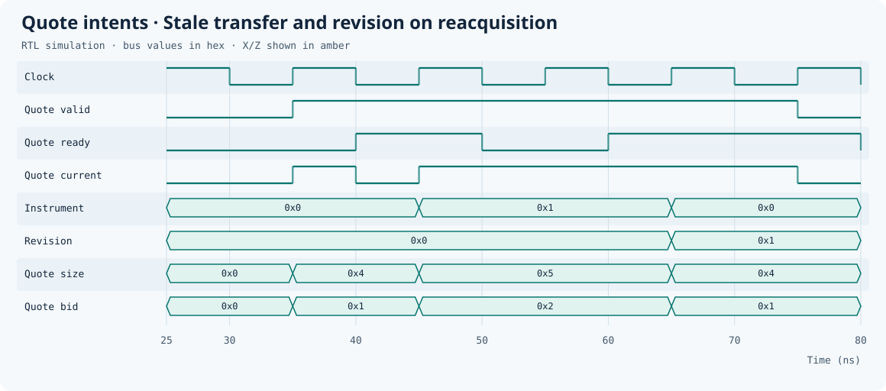

# Day 05 · Market state and passive quote intent engine

A synthesizable SystemVerilog market-by-order subscriber for a normalized synthetic feed. The engine reconstructs each instrument's order table and price depths, checks sequence and freshness, and publishes deterministic passive quote intents. Exchange execution messages reduce displayed size. This core models the subscriber side of a market feed and leaves order entry and risk to the surrounding system.

| Default configuration | Value |
| --- | ---: |
| Instruments | 2 |
| Tick levels per side per instrument | 16 |
| Direct order ID slots per instrument | 16 |
| Individual and aggregate quantity widths | 12 and 17 bits |
| Expected sequence and snapshot epoch | 16 and 8 bits |
| Freshness threshold | 16 external tick pulses |
| Diagnostic response latency, unloaded | 1 cycle |
| Quote intent latency, unloaded | 3 cycles from the book update |
| Demonstrated sustained market input | 1 command/cycle with a ready diagnostic sink |


The optional [quote-to-order bridge](order-bridge.md) turns a quote intent
into acknowledged adds and cancels. It rejects stale adds and waits for a
confirmed cancel before placing a replacement that would cross an old order.
The optional [inventory-aware planner](inventory-quote.md) composes with
the market intent stream and qualifies each side against confirmed signed
inventory, working leaves, and instrument-specific quote caps.

## Architecture

```mermaid
flowchart LR
    S["Normalized<br/>feed and probes"] --> I{"Instrument<br/>slot decode"}
    T["Freshness tick"] --> A["Per-instrument<br/>sequence and watchdog"]
    I --> A
    A -->|validated mutation| B["Market-by-order<br/>slot table"]
    B --> D["Side and price<br/>depth/count tables"]
    D --> O["Balanced BBO<br/>selection"]
    A --> R["One-entry<br/>diagnostic register"]
    B --> R
    D --> R
    O --> R
    R --> OUT["Diagnostic and<br/>observability stream"]
    O --> P["Fixed-point<br/>passive policy"]
    A --> P
    P --> ST["Registered<br/>desired intent"]
    ST --> Q["Round robin and<br/>coalescing"]
    Q --> OUTQ["Immutable<br/>quote stream"]
    P --> C{"Current key<br/>comparison"}
    OUTQ --> C
    C --> G["Live applicability<br/>and epoch gate"]

    classDef input fill:#dbeafe,stroke:#2563eb,color:#172554
    classDef state fill:#dcfce7,stroke:#16a34a,color:#052e16
    classDef compute fill:#ede9fe,stroke:#7c3aed,color:#2e1065
    classDef render fill:#ffedd5,stroke:#ea580c,color:#431407
    classDef guard fill:#ffe4e6,stroke:#e11d48,color:#4c0519
    class S,T input
    class A,B,D state
    class O,P,ST compute
    class R,OUT,Q,OUTQ render
    class I,C,G guard
```



The slot table carries an occupied bit, side, price and open quantity for each ID. Separate side and price tables store aggregate size and order count. A replace atomically moves the ID and inherited side. When levels differ it subtracts from the source and adds to the destination at the same accepting edge. A replace at one level preserves the count and applies just one quantity change. Removing the final order clears the occupancy bit. Occupancy determines idle read data, so reset and snapshot start clear only validity metadata. The best bid and ask use separate balanced priority trees padded to the next power of two.

Each instrument has its own sequence counter, freshness age, epoch, mode and inventory. A shared one-entry diagnostic register provides ordered acknowledgements with simultaneous pop and refill. All validated updates commit at input acceptance. Saturating freshness behavior remains independent of diagnostic and quote sink readiness. The explicit tick input permits different clock-to-time ratios in a testbench or a surrounding timer.

## Market data and recovery



`SNAP_BEGIN` is the explicit rebase operation. It accepts any encoded sequence, clears the selected instrument, advances its modulo epoch, and expects the next sequence. The following `SNAP_ADD` and `SNAP_END` must arrive in exact order. Sequence and epoch wrap naturally. During BOOT, queries can inspect staged orders and depths while quote eligibility stays low. A complete snapshot becomes LIVE at the `SNAP_END` accepting edge.

In LIVE, valid updates and heartbeats advance the sequence and refresh the age to zero. Every external tick without a refresh increases the live age; the threshold pulse fences the instrument and increments the timeout counter. A valid update or heartbeat on the same edge wins over the tick. A gap or semantic fault fences the instrument and preserves the pre-fault inventory and expected sequence for diagnosis. A query on the timeout edge samples pre-edge state. Clock edges that accept no input can still expire any instrument.

| `s_op` | Name | Payload and effect |
| ---: | --- | --- |
| 0 | ADD | Insert a free ID, side, price, positive quantity in LIVE |
| 1 | CANCEL | Subtract a positive quantity strictly below open quantity |
| 2 | EXECUTE | Subtract a positive quantity up to open quantity. Equality retires the ID |
| 3 | DELETE | Remove a live ID. Side, price and quantity are ignored |
| 4 | REPLACE | Move a live ID to a distinct free `s_new_id`, with a new price and positive quantity. Original side is retained |
| 5 | HEARTBEAT | Consume a LIVE sequence and refresh age |
| 6 | SNAP_BEGIN | Clear the selected book and start a new epoch |
| 7 | SNAP_ADD | Insert an order in BOOT |
| 8 | SNAP_END | Publish the complete snapshot and enter LIVE |
| 9 | LEVEL | Read selected side and tick aggregate |
| 10 | ORDER | Read a direct indexed order slot |
| 11 | BBO | Read best prices, aggregate quantities and order counts per side |
| 12 | STAT | Read one counter specified by `s_stat_index` |
| 13–15 | Reserved | Return CODE and fence an instrument that is LIVE or BOOT |

Unsequenced reads are available in all modes and do not refresh age. An absent legal ORDER returns success with `r_present=0`. In LEVEL reads, the requested side and price are echoed for a legal empty level. The remaining payload fields are zero when unused.

## Port contract

`market_state_quote_engine` exposes one ready/valid input and two independent ready/valid outputs. Transfers occur at a rising edge with both ready and valid asserted. Sources hold valid and the payload while stalled. The active-high synchronous reset clears all books, epochs, counters, and output slots at its sampling edge. Interface transfer flags are suppressed while reset is high.

| Port group | Fields |
| --- | --- |
| Market input | `s_instrument`, `s_op`, `s_seq`, `s_id`, `s_new_id`, `s_side`, `s_price`, `s_qty`, `s_stat_index`, `s_tag` |
| Response echo | `r_instrument`, `r_op`, `r_seq`, `r_id`, `r_tag` |
| Response control | `r_status`, `r_mode`, `r_next_seq`, `r_epoch` |
| ORDER / LEVEL / STAT | `r_present`, `r_side`, `r_price`, `r_qty`, `r_count`, `r_stat` |
| BBO | `r_bid_present`, `r_ask_present`, `r_bid`, `r_ask`, `r_bid_qty`, `r_ask_qty`, `r_bid_count`, `r_ask_count` |
| Quote payload | `q_instrument`, `q_active`, `q_epoch`, `q_revision`, `q_bid`, `q_ask`, `q_size`, `q_reason` |
| Live sidebands | `q_current`, `o_live`, `o_eligible`, `o_epoch`, `o_up_pressure`, `o_down_pressure` |

Use `$clog2(n+1)` for price, ID and instrument fields with the corresponding dimension. Legal prices and IDs are zero based. The larger encoding reserves testable out-of-range values. `r_qty` and BBO quantities are `QTY_W + ID_W` wide. `o_epoch` uses adjacent `EPOCH_W` slices with instrument 0 in the least significant bits. `r_mode` encoding is COLD=0, BOOT=1, LIVE=2 and FENCED=3.

When probing, response mode, next sequence, and epoch describe the pre-edge instrument. For sequenced commands the mode, sequence and epoch fields describe the result of that accepted command. Bank decode is validated before any command semantics. Mode precedes sequence for known stream operations. A sequence gap takes precedence over payload validation. The order table checks ID and existence plus the operation-specific fields. A reserved opcode signals CODE regardless of its sequence.

| `r_status` | Meaning | `s_stat_index` | Counter |
| ---: | --- | ---: | --- |
| 0 | OK | 0 | Accepted commands including reads, before current read |
| 1 | Instrument out of range | 1 | Successful book mutations |
| 2 | Operation disallowed in current mode | 2 | Sequence gaps |
| 3 | Unexpected stream sequence | 3 | Stream semantic faults |
| 4 | Reserved opcode | 4 | Freshness timeouts |
| 5 | Order ID out of range | 5 | Completed snapshots |
| 6 | Tick price outside grid | 6 | Current live order count |
| 7 | Invalid quantity | 7 | Freshness age |
| 8 | Duplicate live ID | 8–15 | Reserved |
| 9 | Required order absent | | |
| 10 | Replace destination equals source ID | | |
| 11 | Unknown statistic index | | |

Six historical counters wrap modulo `STAT_W`; snapshot restarts preserve them, and reset clears them. Mode requests rejected as out-of-mode are included in the command count and leave the stream fault counters unchanged.

## Quote policy and publication

For a LIVE noncrossed BBO, policy starts from the bid/ask midpoint. Bid midpoint rounds down and ask midpoint rounds up. Each leg is set `HALF_SPREAD` ticks away from its midpoint and shifted by the qualified imbalance sign times `SKEW_TICKS`. The Q0.8 imbalance threshold is inclusive, with `abs(bid_qty - ask_qty) * 256 >= (bid_qty + ask_qty) * IMBALANCE_Q8`. Equal depths produce zero skew. The implementation rearranges this inequality into two parallel weighted-depth comparisons and divides both coefficients by their constant common divisor. For the default threshold 64, the comparison reduces to weights 3 and 5.

The policy clamps legs to the tick grid; the bid remains below best ask and the ask above best bid. Size is the minimum of the two displayed top-level quantities and `QUOTE_SIZE`. Missing sides, locked or crossed books, spreads below `MIN_MARKET_SPREAD`, invalid passive results and zero size disable the intent. Quote reason codes are 0 quoting, 1 inactive instrument, 2 missing side, 3 locked or crossed, 4 spread, and 5 zero size.

A register separates the policy from publication. The publisher compares each staged output key with its last scheduled key. It selects a changed bank round-robin when the output slot is available and advances that bank's modulo revision. An active key can be sent again when its previous transfer was stale or its eligibility or epoch gate closed. The scheduler captures each consumed active key and compares it with the policy stage's sample of that same edge. This preserves recovery after a transient interruption even if a different instrument occupies the output when the intermediate key could have been published. Inactive-to-inactive changes are suppressed. A quote held under backpressure preserves its fields, and changes behind it coalesce. Separate diagnostics provide exactly one response per accepted command.



`q_current` is an applicability sideband and may change while the quote payload is stalled. It exact-compares the output key to the selected bank's current desired key, including current epoch and price/size. A consumer on the same clock samples it alongside the quote handshake, checks eligibility and epoch for an active intent, and discards a superseded or fenced offer. A same-edge market mutation changes applicability just after its accepting edge. Reset and state changes are synchronous; clock-domain boundaries require an explicit accompanying bridge.

Positive parameters include dimensions, data widths and `MAX_IDLE_TICKS`. The price policy assumes tick-size parameters between zero and `LEVELS`, `QUOTE_SIZE` fitting the order quantity width, and `IMBALANCE_Q8` between 0 and 256. A quote size of zero intentionally disables quoting. Slot IDs and instrument keys are local compile-time dimensions.

## Measurements

Figures below come from the reproducible Icarus differential runs with seed 7201 at default dimensions. ACK latency is input accepting edge to output accepting edge. Throughput is transfers divided by the inclusive window from first to last ACK.

| Workload | Accepted commands | ACKs | Quote transfers | ACK latency p50/p95 | ACKs/cycle |
| --- | ---: | ---: | ---: | ---: | ---: |
| Interleaved probes and heartbeats | 520 | 520 | 2 | 1 / 1 cycles | 1.0000 |
| Same-bank consecutive writes and readback | 679 | 679 | 181 | 1 / 1 cycles | 1.0000 |
| Directed recovery and fault tape | 326 | 326 | 54 | 1 / 1 cycles | 1.0000 |
| Seeded mixed updates, faults and stalls | 7,751 | 7,751 | 752 | 1 / 2 cycles | 0.7523 |

The write benchmark performs 672 consecutive order mutations reusing three slot IDs and varies destination tick levels without input bubbles. A first quote under no contention takes three cycles from a book mutation. The one-entry diagnostic path makes command throughput sink-dependent. Under backpressure the hold register does not permit any new command when full and blocked. Quote stalls are independent of command pacing.

Yosys generic synthesis reported 17,662 cells and passed `check -assert`. Default out-of-context mapping and routing on LFE5U-85F/CABGA381 speed grade 8, seed 1, used 11,319 TRELLIS_COMB and 2,405 TRELLIS_FF. nextpnr reported **43.84 MHz**, below the 100 MHz characterization target. The critical path runs from book occupancy through the price and size policy into the publication stage. The benchmark includes no board pin or external sideband timing constraints. Physical closure needs a target platform and the actual interfaces. Larger grids would need banked storage, a tighter BBO implementation, or extra pipeline stages measured against latency.

## Verify and replay

From this directory, with Icarus Verilog 13, Python 3.9 or above, Verilator and Yosys on PATH:

```sh
make test
make regress
make lint
make synth
make report
make route
make formal
```

`make test` runs the standalone MBO, policy and publisher benches, 69 known-answer and corruption fixtures, the default differential suite, and a synthetic CSV-to-RTL recovery replay. The book bench checks all 50 source/destination-price and side replacements on a small grid, including 40 operations where both levels already hold other orders. The policy benches check 27,475 vectors. The publisher benches check rotation, modulo revision, stalled snapshots and recovery after a stale transfer or transient eligibility loss behind another bank's held output. SymbiYosys policy and publisher proofs exercise passive-price and threshold invariants, stalled payload stability, suppression and revision accounting. Both cover suites produce witnesses.

`make regress` adds asymmetric three-instrument, tiny one-instrument, and disabled-quote profiles. Together four stress tapes check 24,232 accepted commands and ACKs, plus bounded throughput, watchdog, reset, snapshot restart and coalescing scenarios. The SV bench independently rebuilds depth/count tables from active slot data every running cycle. The Python checker scans its own dictionary of orders and compares every diagnostic, quote and live sideband. The default stress seed is 7201. Use `ITERATIONS=100 PROFILE=edge` for a smaller differential run.

`make replay-demo` demonstrates the host tools on an offline synthetic feed. [market_replay.py](market_replay.py) validates a normalized CSV and emits a cycle journal and inventory. [market_trace_tools.py](market_trace_tools.py) audits ordered acknowledgements, stalls, revision continuity, epoch and current gates, and exports time windows. [market_cosim.py](market_cosim.py) compiles every journal cycle into exact RTL input vectors and compares all observable output pins. [market_checkpoint.py](market_checkpoint.py) generates and validates a deterministic restore tape from the recorded order inventory and explicitly supplied per-instrument sequence anchors. Its digest checks tape and manifest integrity for offline replay. The checked-in flow exercises sequence wrap during restoration.

Build products, JSONL, CSV, traces, solver witnesses, and synthesis reports are under `build/`. The core's synthetic protocol assumes a coherent normalized ID/price mapping and trusts the source of a snapshot rebase. Network framing, exchange certification, risk limits, connectivity, authentication and persistent state are integration concerns.

## Checked simulation waveform



Instrument 0 first offers size four at 35 ns while the sink is stalled. A book change deasserts `q_current` at 40 ns without changing the held offer. The sink consumes that stale transfer at 45 ns. Instrument 1 takes the next offer, and instrument 0 returns at 65 ns with revision one. The test checks the same-cycle handshake, invalidation, and revision behavior.

Run `make waveform` in this directory to rerun the checked bench and regenerate this cropped SVG. The full VCD is saved under `build/`.
