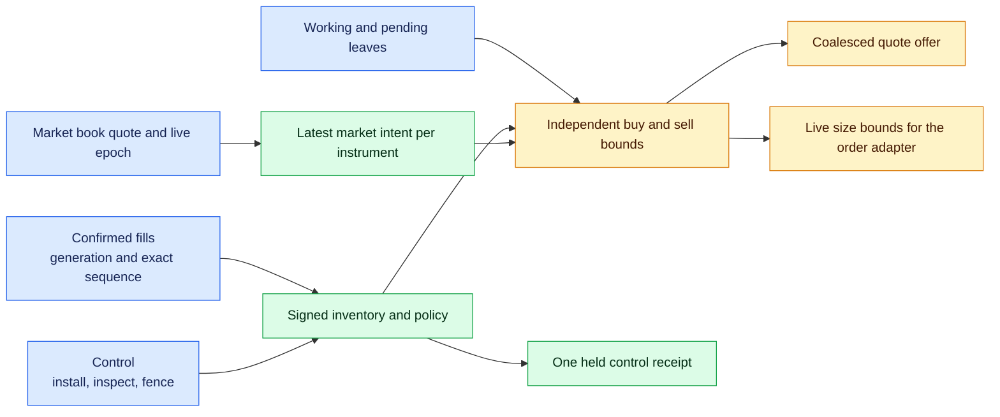
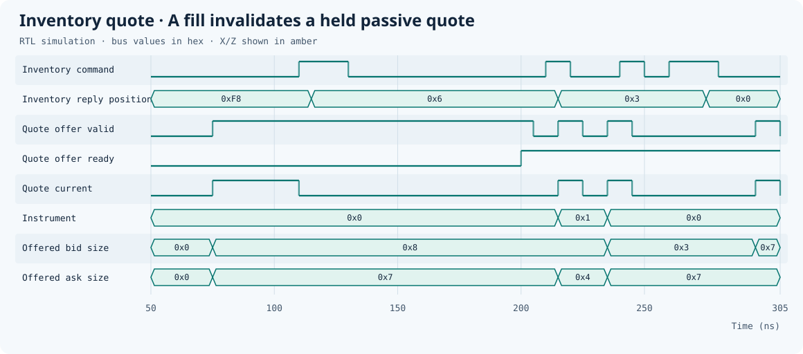

# Inventory-aware passive quote planning

[The inventory manager](quote_inventory_manager.sv) combines a qualified
signed inventory ledger and an asymmetric quote planner. Plug the market
engine's published quote and its current eligibility and epoch into the
planner. The strategy's execution adapter supplies confirmed fills and
its remaining working or pending buy and sell quantities. In a market
maker, the planner can reduce or withdraw one quote side as exposure
accumulates while continuing to offer liquidity on the side that would
reduce the position.



## Ledger and recovery

The control channel transfers on a rising edge with `c_valid && c_ready`.
Each accepted command returns one ordered response. The response fields
describe the resulting armed state, revision, next expected sequence,
signed position, and saturating fill and fault counters.

| Command | Meaning |
| --- | --- |
| 0 INSTALL | Compare the expected policy revision, then install authoritative signed position, next fill sequence, inventory bounds, per-side size caps, and skew settings. Increase the revision on acceptance and arm the instrument. |
| 1 FILL | Compare the revision and sequenced fill. Buy quantities add to position. Sell quantities subtract. |
| 2 INSPECT | Read one instrument without checking the expected revision or changing accounting. |
| 3 FENCE | Compare the revision and suspend quoting until an authoritative install. Retain the last position for diagnosis. |

The floor must be at or below zero and the ceiling at or above zero.
A restored position may already lie outside its configured limits. The
planner can still quote in the direction that reduces it. Caps of zero
disable the corresponding sides. A nonzero skew trigger moves only the
inventory-increasing quote away from the market, by the configured tick
count within the instrument's price grid.

The feed adapter supplies one ordered fill sequence per instrument
within each installed revision. The last accepted sequence, side, and
quantity identify its exact retry in this normalized interface. An exact
retry changes nothing. A different side or amount at the last sequence
fences the ledger. Earlier sequences are rejected as old. A gap, zero
quantity at the next sequence, or arithmetic overflow fences the
instrument and leaves the previous position visible. The last
representable sequence applies once and fences before overflow or
reassignment. Revisions also stop at their highest representable value.
Initialize an installed ledger with authoritative inventory. Coordinate
hardware reset with execution accounting and discard old context
before using a new revision sequence after reset.

| Response status | Meaning |
| ---: | --- |
| 0 | Operation accepted |
| 1–4 | Invalid instrument, stale revision, invalid policy, exhausted revision |
| 5–8 | Fenced context, exact duplicate, conflicting duplicate, old sequence |
| 9–11 | Sequence gap, zero fill, signed position overflow |

## Position bounds and publication

```text
buy room  = ceiling - confirmed position - remaining buy leaves
sell room = confirmed position - floor - remaining sell leaves
side size = max(0, min(room, market quote size, per-side cap))
```

For example, with a ceiling of ten, position of six, and four
outstanding buy units, the bid size is zero. Working sell orders only
reduce available sell size. The risk calculation uses widened signed
arithmetic and treats outstanding leaves as nonnegative. The execution
adapter supplies complete reservations, including uncertain working
orders after reconnect, and must account for accepted new work before
another decision can spend the same capacity. The hardware publishes
incremental headroom for additional orders.

The input `market_eligible` and the current market epoch must come from
the same synchronous context as the original quote. On an epoch change
or eligibility loss the previous market quote expires and a new one is
required. Stale, out-of-range, and non-current offers leave the
retained market quote alone. Invalid active quote shapes produce a
disabled result for the instrument.

Zero size withdraws that side. The combined offer carries the market
epoch, position ledger revision, position, bid/ask tick and bid/ask size.
Reason codes 0–5 indicate two sides, one side, market off, inventory
fenced, invalid quote, or no capacity. One pending offer holds its
fields under backpressure. The sink applies it only when
`m_valid && m_ready && m_current`. A same-edge fill, fence, install, or
changed market quote for the held instrument can invalidate an offer
at the transfer edge. A waived transfer leaves the newest request
eligible for publication. Other instruments continue in round-robin
order. The live sizes zero on an invalidating edge and expose
the current limits on subsequent edges.

The application consumes the side sizes with its own venue order
adapter and revalidates its allocation against current headroom at
order handoff. The existing symmetric quote-order bridge keeps its
original ABI. It can consume the minimum of the two sizes for a
strategy that requires paired quotes. This manager tracks confirmed
position and additional quote capacity, while existing orders and
cancel acknowledgments belong to the surrounding order ledger.

## Checked simulation



The held offer begins at 75 ns with bid/ask sizes 8 and 7. The fill
input invalidates its applicability at 110 ns and the position reply
shows +6 at 115 ns. The stale offer's fields hold until the 205 ns
transfer. The next current offers reflect the other instrument and
then the updated inventory on instrument zero.

Run `make inventory-test inventory-formal inventory-lint inventory-synth
inventory-waveform`. The independent integer model compares 5,100
cycles and 2,846 commands at one, three and five instruments. The
test checks all twelve ledger statuses, six quote reasons, 477
current transfers and 531 waived transfers. The 15-edge reduced
formal check covers reserve bounds and outward price skew, retained
offers, same-edge invalidation and ledger arithmetic.
