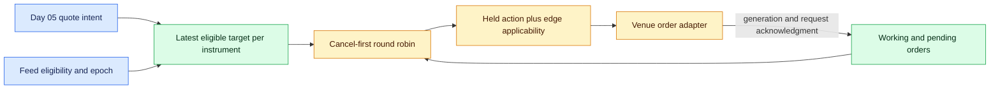
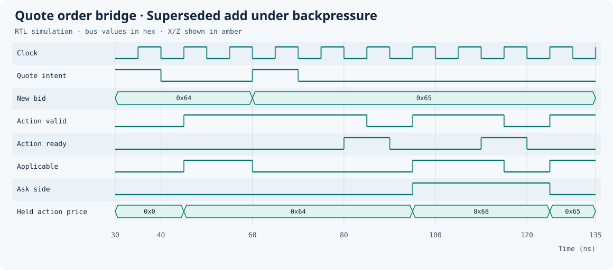

# Quote-to-order bridge

[quote_order_bridge.sv](quote_order_bridge.sv) converts a market maker’s
desired quote into one outstanding venue action per instrument and side.
It tracks the last working order until the downstream adapter confirms which
action succeeded. A trading system can place this block between Day 05’s
market-state policy and its order-entry gateway to avoid sending stale prices
or crossing its own orders during cancel and replace.

## Interfaces and state

Each instrument has two side slots, indexed by twice the instrument plus
one for the ask. On `s_valid && s_ready`, an intent marked `s_current`
qualifies if its instrument index and epoch match the input context.
An explicit withdrawal or a malformed active quote clears the target. A
stale intent leaves the target alone. Feed ineligibility or an epoch
change revokes the previous target and initiates cancellation of any live
order. Feed eligibility returning requires a fresh intent. `eligible`
and `epoch` are synchronous to the bridge clock. Instrument zero occupies
the least significant bit and least significant epoch field.

| Side state | Outputs or accepted transitions |
| --- | --- |
| Empty | Offers an add when the target is current and its price clears any opposite live or pending order |
| Add pending | Waits for the matching acknowledgment. Acceptance makes the order live and rejection leaves the side empty |
| Live | Cancels the working order when its target is withdrawn or its epoch, size or price changes |
| Cancel pending | Waits for confirmation. A rejected cancel retains the working order and its crossing constraint |

A single output holds action fields while stalled. On the transfer edge
the downstream adapter must send the action only if `m_applicable` is
high. This is a live qualifier, and may change while the payload waits.
A feed change or a new intent arriving on the same edge can invalidate a
held add. An invalidated transfer does not consume an action ID. Cancels
remain applicable to their particular working order regardless of feed
eligibility. The scheduler gives pending cancels priority over new adds.

The adapter returns instrument, side, generation, action kind, request ID,
and a success bit no earlier than the cycle after accepting the action.
Generations identify successive orders in a side slot. The request ID
distinguishes separate actions against the same order, including cancel
retries. The adapter must map full fills and unsolicited venue cancels into
its own reconciliation before choosing this interface. The bridge expects
an acknowledgment that definitively identifies how the submitted action
affected the working order. Ambiguous network failures require external
reconciliation before acknowledging or resetting. Reset reinitializes
both action counters, so its use must be coordinated with the adapter and
all open orders.

A rejected action sets its side's `rejected` bit and pauses new offers
for that side. Provide an updated current intent or pulse `rearm_valid`
to retry. A retry authorization sampled on the rejection edge also counts. Only a successful cancel removes the old price constraint.
Generation and request counters saturate and `exhausted` marks a side
unavailable for new orders. Each accepted add leaves at least one usable
cancel request ID. When failed cancels also exhaust that counter, the
adapter must reconcile outstanding orders before a coordinated reset.
The status counters saturate at 32 bits and report stale intents, malformed
intents, waived adds, and acknowledgments that failed identity checks.

## Simulation waveform

The first action offers an add for the bid at 100 with `m_ready=0`. The
next quote changes the bid to 101. The action payload holds 100 throughout
the stall, with applicability low until the waived transfer. The next
offer is the still-current ask at 104. Recreate the trace with
`make order-bridge-waveform`.

Run `make order-bridge-test` to exercise rejection and explicit retry,
wrong request IDs, a late duplicate acknowledgment, same-edge intent
withdrawal, feed loss, epoch changes, and saturated generations. The
directed bench checks full action identity, held payloads, and fault
counters. Standard `test`, `regress`, `lint` and `synth` also include the
bridge. Synthesis checks report generic netlist structure.
