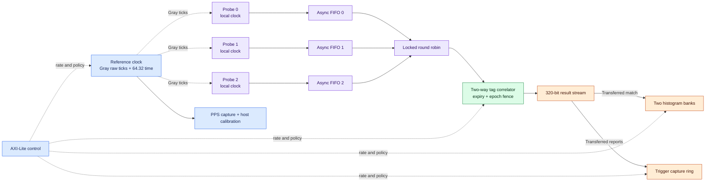

# Day 06 · Multiclock latency telemetry

Timestamp two observations of the same logical operation even when the endpoints use different clocks. The fabric keeps the first endpoint in a bounded correlation table, computes the interval when the other endpoint arrives, and exports three views. The primary stream is an exact per-event report. A double-buffered histogram supplies bucket counts and raw extrema. A trigger trace preserves records around a delay or fault.

The design is intended for offline capture, FPGA bring-up, and analysis of a trading datapath. A typical use is to pair a decoded tick, identified by a class and tag, with a later order-intent or egress observation bearing the same key. The measurement starts when the probe accepts its local ready/valid record, so any earlier admission wait needs a separate probe or counter.

## Datapath



### Follow an operation

```mermaid
sequenceDiagram
    participant A as Probe A
    participant B as Probe B
    participant T as Tag table
    participant H as Histogram
    rect rgba(37,99,235,0.12)
    A->>A: Accept START for class 1, tag 61
    B->>B: Accept STOP for class 1, tag 61
    end
    rect rgba(109,40,217,0.12)
    B->>T: STOP reaches the manager first
    T-->>T: Store STOP with manager arrival tick
    A->>T: START reaches the manager
    T-->>T: Compute STOP minus START in raw ticks
    end
    rect rgba(21,128,61,0.12)
    T->>H: Add delay when MATCH transfers
    H-->>H: Snapshot closes old bank; new samples continue
    end
```

1. `latency_timebase` increments a 64-bit raw tick counter and publishes its registered Gray code. Its separate 64.32 time accumulator adds a programmable positive unsigned 32.32 period. A new period applies to the interval after the update edge. The nanosecond accumulator saturates on overflow. Raw ticks continue to wrap and are used for correlation.
2. Each `latency_probe` synchronizes Gray ticks and Gray epoch through two stages and registers the decoded tick. The probe captures that estimated reference tick on **its own acceptance edge** and pushes one record through a dual-clock queue. The sampled tick can lag the true reference because of the synchronizer and the clock ratio. Clock-domain paths require implementation-specific Gray bus skew and max-delay constraints; digital simulation cannot measure metastability or physical skew.
3. `latency_rr` merges complete records. It retains its selected lane during downstream stalls. The table XOR-folds class and tag to a set and looks up two ways. Either endpoint can arrive first. Duplicate same-direction events preserve the original row. A half-range compare rejects an ambiguous or reversed raw interval.
4. Clean accepted records process at one per reference edge except one maintenance edge every `2**SCAN_LOG` unblocked cycles. Maintenance scans one slot. When the output holds a report, intake and maintenance both stall. An expired row discovered during allocation is counted separately from a scanned expiry report.
5. A flush clears the table and report slot and increments a saturating epoch. Old queued probe data reach the manager as disarmed diagnostics and cannot populate the new table. Events captured before a probe has synchronized a new epoch may be discarded across that boundary. After the final epoch, another flush disables correlation until a shared reset.
6. A successful report transfers into the active histogram bank. The snapshot edge closes that bank **including a match transferred on that edge** and switches to the other bank. The closed bank is read under backpressure and scrubbed one bin per edge after its final word transfers. The trace ring can independently retain recent observations around a selected status or latency threshold, then freeze after the configured number of subsequent reports.

PPS is optional. A synchronized rising edge captures raw ticks and local integer nanoseconds in a one-entry monitor. Another pulse while that entry is held increments the missed count. Host calibration uses an independent external time reference and can propose a new period. It does not write phase into the live accumulator. Probe intervals remain raw ticks until an application supplies a clock model.

## Reproduce

```sh
make test
make lint
make synth
python3 latency_capture.py histogram build/histogram.hex --classes 4 --detailed
python3 latency_capture.py trace build/trace.hex
python3 latency_profile.py build/events.hex --percentile 95 --window 128
```

Icarus and Python 3 run the scoreboard and host tests. The synth target uses Slang/Yosys and checks the full top. Lint suppresses the expected mixed synchronous/asynchronous reset warning at clock-domain boundaries. RTL file order is in [rtl.f](rtl.f). Every result in the tests is generated from synthetic stimulus.

## Interface and capacities

| Group | Contract |
| --- | --- |
| Reset | `power_reset` asserts across all domains. Each clock releases its own reset after two edges. Clocks must be running for the FIFOs to open the local/peer readiness gates. A shared reset is the recovery boundary for the whole subsystem. |
| Probes | `probe_clk[i]`, `probe_valid[i]`, `probe_ready[i]`, `probe_tags[i*TAG_W+:TAG_W]`, `probe_classes[i*CLASS_W+:CLASS_W]`, `probe_end[i]`. `probe_end=0` starts an interval. Hold input stable when valid is high and ready is low. |
| Result | `event_valid/ready/data[319:0]`. Payload is stable under stall. A shared reset or explicit flush can cancel an untransferred reply. |
| Histogram | `hist_valid/ready/word[127:0]/first/last`. A frame is one header followed by two summary words and all buckets for each class in order. |
| Trace | `trace_valid/ready/word[319:0]/first/last`. One header followed by the ordered retained records. The ring stops capturing during drain, so a slow trace reader cannot delay the primary egress. |
| Time and PPS | `now_tick`, `now_ns`, and `pps_valid/ready/ticks/nanoseconds`. These ports are in the reference domain. `pps_async` is synchronized. `epoch_exhausted` stays high until shared reset. |
| Control | AXI-Lite AW/W/AR are captured independently. The register bank issues one operation at a time. R and B can be held independently. Write strobes merge shadow fields by byte. |

Defaults are 3 probes, a 16-bit tag, 4 classes, 8 RAM entries plus one read slot per probe, 16 two-way sets, 24 histogram bins per class, 32-bit saturated counts, and a 16-entry trace. Use `PROBES=1..8`, `TAG_W=1..16`, `CLASS_W=1..4`, positive queue/index/scan widths, `HIST_BINS=5..64`, `HIST_COUNTER_W=1..32`, and `TRACE_ADDRESS_W=1..7`. Parameters change table sizes and hardware costs. The supported wrap horizon for correlation is less than half the raw counter range.

### Control registers

| Byte offset | Name and behavior |
| --- | --- |
| `000,004` | ID `LAT1` and version/probe/class geometry, read-only |
| `008` | Command bits: 0 arm state, 1 request histogram snapshot, 2 clear transfer counters, 3 flush correlation, 4 commit period shadows, 5 commit timeout shadows, 6 arm trace, 7 latch clock values. Every strobed command-byte write sets the arm state. Disarming an armed fabric also flushes. |
| `00c` | Status bits: 0 armed, 1 time saturated, 2 invalid rate, 3 histogram busy, 4 trace armed, 5 trace frozen, 6 rate write pending, 7 histogram request pending. |
| `010,014` | Period integer and fractional shadows. Nonzero 32.32 required on commit. |
| `018,01c` | Timeout shadow low/high. Requires a positive timeout below 2⁶³. |
| `020,024` | Trace latency threshold low/high. Zero disables comparison. For live retuning, stop trace capture before changing both halves. |
| `028` | Trace trigger status mask in bits 7:0, post-count in 15:8, enable in 16. Post-count must fit the ring and leave room for the trigger. |
| `030..040` | Latched tick low/high, nanoseconds low/high, fractional nanoseconds. Latch before reading multiple words. |
| `044..05c` | Active table entries, expired entries replaced on touch, PPS misses, completed snapshot frames, completed trace frames, active timeout low/high. |
| `080..09c` | Per-status transferred report counts by status code, 32-bit saturating. |

Reads from unknown or misaligned offsets return DECERR. Writes to read-only registers or invalid operations return SLVERR. A bad command applies none of its command bits. The register-program generator [latency_config.py](latency_config.py) emits a self-contained transaction plan with identification checks and ordered shadow commits. The host must provide any platform-specific AXI access and time out its polls.

### Result words

The control dword pair in bits 319:256 consists of status (3), class (8), tag (16), start probe (8), stop probe (8), and 21 reserved zero bits. Four following 64-bit fields hold start tick, stop tick, duration, and processing tick in that order. A single-endpoint record places its data on the corresponding side and zeros the other. The independent Python decoder validates reserved bits and modular differences.

| Code | Meaning |
| ---: | --- |
| 0 | Endpoint stored |
| 1 | Pair completed, duration reliable within documented clock uncertainty |
| 2 | Duplicate direction on an existing key |
| 3 | Both ways in the matching set occupied |
| 4 | Pair retired with negative or ambiguous delta |
| 5 | A maintenance sweep expired an endpoint |
| 6 | Disarmed, old epoch, or exhausted epoch |
| 7 | Observation timestamp apparently from the future |

The histogram header uses magic `LTS1`, a 32-bit sequence, and the 64-bit closing tick. Each class carries number, bin count, counter width, saturation flag, exact sum and sample count. The next word has full minimum and high maximum bits, with the remaining maximum bits in the first bucket. Bins 0 through 3 are exact; bin 4 is 4–7 ticks, bin 5 is 8–15, and the last covers all larger values. The decoder reports percentile **intervals** and suppresses percentile estimates if counts or sums saturate. The [decoder implementation](latency_capture.py) defines all field offsets and checks complete frames.

The trace header zeroes bits 319:160. Bits 159:128 hold `LTR1`; 127:96 sequence; 95:32 trigger tick; 31:24 retained record count; 23:16 the zero-based trigger offset; 15:13 trigger status; 12 denotes a latency-threshold trigger. Follow it with the retained result words. Reset abandons any partial frame. Snapshot and trace exports are ready/valid records rather than a PCIe, network, or storage protocol.

## Verification evidence

| Test | Reproduced behavior |
| --- | --- |
| Correlator vs independent model | Two geometries and seeds. The primary case compares 2,998 cycles, 1,864 replies, and 465 held cycles. Both exercise all eight statuses, near-wrap arithmetic, collisions, and clearing pending work. |
| Capacity | 4,096 observations in 4,681 active offered cycles with 585 sweep bubbles. The unstalled unit returns each result one clock after acceptance. |
| CDC FIFO | Two skewed clock ratios, opposite producer/consumer speed, 3,400 total words, reset while full and held egress. |
| Four-probe burst | 3,600 ordered observations under multi-lane arbitration and 2,755 report stall cycles. Simulated maximum raw-tick lag by lane was 2, 5, 5, and 8 ticks. |
| Control | 361 writes, 397 reads, disordered AW/W arrival, and 718 edges with both responses valid. The integrated bench also checks fractional rate change, PPS overrun, and old-epoch discard. |
| Exports | Four exact histogram snapshots with 276 samples, concurrent bank-swap/scrub coverage, two standalone triggered frames, and cross-validation of primary, histogram, and trace frames on the integrated test. |
| Host tools | 26 unit tests covering fixed-point rounding, invalid encodings, CDF and path budgets, histogram censoring, robust PPS estimation, and 450 independently integrated rate-change intervals. |

The [cycle model](latency_reference.py) and [vector generator](gen_latency_vectors.py) are independent of the RTL storage implementation. [verify_latency_capture.py](verify_latency_capture.py) reconstructs histogram statistics from accepted report ticks and verifies each trace as a contiguous subsequence of the primary stream.

[pps_calibrate.py](pps_calibrate.py) estimates a period from CSV `second,tick[,reference_ns]` using consistent time windows and limits the accepted frequency error. [latency_units.py](latency_units.py) integrates raw intervals across recorded period changes in exact fixed-point units. Its epoch tick is the beginning of the interval that first uses that period. [latency_profile.py](latency_profile.py) compares matched sample distributions for one or more class/probe paths and applies explicit percentile budgets with sample floors. The host code neither assumes evenly sampled input nor interpolates within hardware histogram buckets.

Structural synthesis completed with 74,935 generic cells on the default geometry. This is a portable logical-cell count. The CDC synchronization lag, logical cycles, physical clock frequency, and on-board end-to-end latency are separate measurements. The observed simulation lacks board clocks, physical I/O, noise, and implementation skew.

## Role and reference links

- Optiver describes precision timestamping and hardware execution work in its [technology roles](https://prod-www.optiver.com/join-us/students/internships/technology/).
- Jane Street lists low latency hardware, test tooling, and FPGA/ASIC design experience. [Hardware engineer](https://www.janestreet.com/join-jane-street/position/8651405002/)
- The Gray pointer CDC pattern uses independent pointer state and two-stage synchronization. [Cummings, asynchronous FIFO design](https://www.cliffcummings.com/papers/CummingsSNUG2002SJ_FIFO1.pdf)
