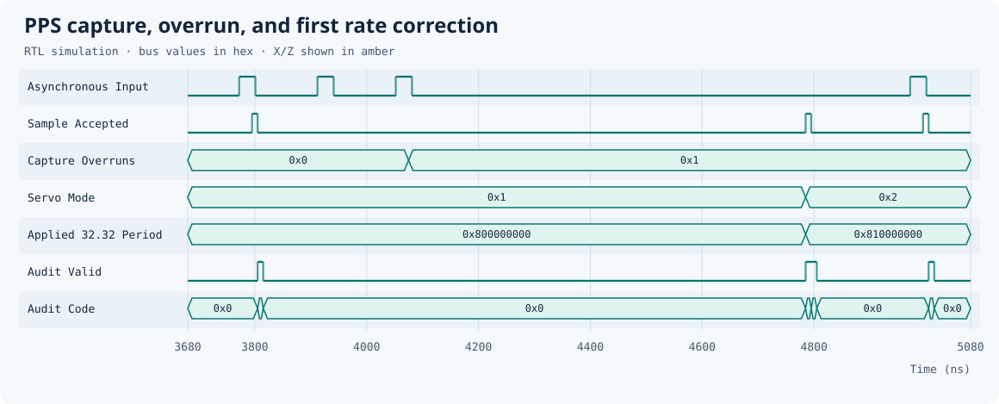
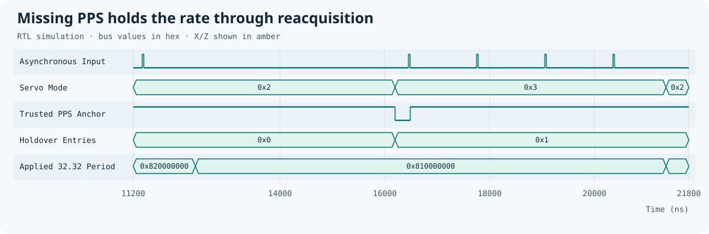

# Hardware PPS frequency discipline

[The optional disciplined timebase](latency_disciplined_timebase.sv) uses the original asynchronous PPS capture and 64.32 accumulator. It estimates a replacement 32.32 period from trusted raw tick intervals. The controller changes the accumulator's increment when a rate word transfers. Raw reference ticks, Gray-code progression, and stored time continue across that edge.

A trading capture appliance may compare pipeline latency over several hours while its oscillator drifts. Keep raw tick observations from the existing instrumented probes and record the frequency controller's audit stream for the same capture. The audit gives the exact rate epochs needed to convert intervals across a correction. Use a common external PPS source for frequency discipline and a separately measured phase offset if timestamps must share a civil-time origin.


## Inputs and policy

The [controller](latency_pps_discipline.sv) has a synchronous raw tick input, a sampled PPS interface and one ready/valid rate output. Connect `now_tick` to the current raw count in the controller's reference clock domain. Hold `sample_tick` with `sample_valid` until it transfers. The wrapper supplies that interface from the original timebase. It also exposes the native captured pulse and overrun statistics. Accepted pulse observations usually need a nonzero allowed sample age to cover the native PPS capture slot.

| Configuration pins | Meaning |
| --- | --- |
| `cfg_enable` | A PROGRAM can turn discipline on or off. Disabled operation keeps the current active period. |
| `cfg_reference_ns` | Integer reference nanoseconds between adjacent pulses. Use 1,000,000,000 for pulses one second apart. |
| `cfg_min_ticks, cfg_max_ticks` | Inclusive elapsed tick bounds for a usable interval. Set both positive and keep the maximum below half the raw tick range. |
| `cfg_timeout` | Watchdog threshold in raw ticks since the most recent trusted observation. It must exceed the maximum useful tick interval and be below half the raw range. |
| `cfg_max_age` | Latest acceptable age of a delivered observation. It may be zero and must be at most `cfg_timeout`. |
| `cfg_jitter` | Largest allowed difference between the minimum and maximum of the latest three usable intervals. |
| `cfg_lock_windows` | Positive count of consecutive consistent rolling windows required before requesting a correction. |
| `cfg_min_period, cfg_max_period` | Inclusive positive period bounds in 32.32. The active period must lie within the new policy's bounds. |
| `cfg_max_step` | Positive largest period correction per applied update, in the same fixed-point units. |

The control channel returns one held response per command. Operation 0 PROGRAM compares the caller's expected revision and installs a policy. Operation 1 INSPECT returns state for the installed revision. Operation 2 RESEED keeps the policy and clears the anchor, history, and lock streak. Operation 3 CLEAR resets statistics. PROGRAM and RESEED increment the revision, clear the measurement history, and wait for in-flight arithmetic and held rate offers to finish. An all-ones revision cannot advance until reset. PROGRAM completes without a policy geometry check when disabling. An accepted configuration boundary takes priority over a simultaneous new sample, so the sample must keep its valid and data until ready.

The response echoes the opcode and reports status, revision, active period, and resulting mode for an accepted boundary. Other responses report the pre-edge mode and active period. Status codes are 0 OK, 1 stale revision, 2 invalid enabled policy, and 3 revision exhausted. INSPECT ignores the expected revision. CLEAR requires it and counts any simultaneous sample or other event in the new counter interval. The audit queue and sequence cursor survive control changes.

## Frequency estimator and holdover

The first fresh observation seeds the modular raw tick anchor. A repeated or backwards timestamp and pulses closer than the configured minimum leave that anchor untouched. A stale or future-dated delivery does the same. A fresh pulse arriving beyond the allowed maximum becomes a new anchor and restarts acquisition. Tick differences are calculated modulo 2⁶⁴ and require an unambiguous interval shorter than half the range.

The last three usable intervals form a candidate window. A window wider than the jitter limit resets the consecutive-window streak. Consecutive consistent windows eventually reach the configured quorum. The median interval supplies the divisor for `(reference_ns << 32) / median_ticks`. The divider performs 96 restoring steps and rounds to nearest even using the remainder. Out-of-range results leave the active period intact. A valid estimate equal to the already applied period marks lock without sending a redundant update. Other valid estimates offer a correction limited to one configured step in either direction. The wrapper's timebase accepts this positive word on the next available edge.

A measurement slot stays busy through arithmetic and any held rate exchange. During that time the native PPS slot can hold one observation, then counts subsequent overrun pulses. The audit sink can stall independently and does not prevent sampling or correction. Size PPS cadence, age, and watchdog bounds for the expected local queue delay and arithmetic pipeline.

| Mode | Observable meaning |
| ---: | --- |
| 0 OFF | Disabled frequency controller |
| 1 ACQUIRE | Seeking a consistent set of intervals or a valid in-range estimate |
| 2 LOCKED | An estimate equal to the active period has qualified, or a qualified update has transferred |
| 3 HOLDOVER | The trusted anchor has expired. The filter starts again when fresh samples return. |

On watchdog expiry the anchor, active window count, and consistency streak clear. The timebase continues with the last applied rate. A finite calculation that loses its trusted anchor is abandoned when the divider finishes. An already-offered update retains its valid and payload through a stall, even if the clock enters holdover. It can transfer in holdover and remains observable in the audit. A new successful estimate after reacquisition returns the controller to LOCKED. The wrapper normally accepts rate words immediately.

## Audit capture and rate history

`audit_rev` and the zero-based `audit_sequence` accompany the retained 326-bit word. The packed fields, high to low, are verdict (4 bits), pre-edge mode (2 bits), local raw tick (64 bits), sampled pulse tick (64 bits), measured interval (64 bits), target period (64 bits), and active or newly applied period (64 bits). The estimated median is attached to arithmetic and application records. A sample record describes its individual interval when available.

| Verdict | Event |
| ---: | --- |
| 0 | Sample consumed while disabled |
| 1 | Report arrived beyond the allowed age or appears future-dated |
| 2 | Trusted pulse seeded a fresh anchor |
| 3 | Repeated, reversed or ambiguous interval |
| 4 | Early pulse left the previous anchor intact |
| 5 | Long interval caused reseeding |
| 6 | Warmup interval advanced the rolling history |
| 7 | Window exceeded its jitter bound |
| 8 | Consistent window waiting for quorum |
| 9 | Qualified window started arithmetic |
| 10 | Estimator overflowed or the positive period lay outside configured bounds |
| 11 | Estimate equaled the current period |
| 12 | Rate word transferred |
| 13 | Watchdog made a queued calculation obsolete |

The effective tick in verdict 12 is the first raw tick of the new period interval. With a rate transfer at pre-edge tick `t`, the accumulator adds the old period through tick `t+1` and uses the new period for the next increment. The application audit therefore reports `t+1`. The other verdicts report the raw tick at classification.

If the audit FIFO is full, the next record is dropped and the loss counter increments. A simultaneous pop frees room for a producer. The 64-bit cursor counts attempted records across control updates and counter clears. The counter saturates rather than reusing an old sequence. The CLI requires a sequence-complete capture and the final cursor written after the FIFO drains. This detects gaps at the beginning, interior, and tail of the file. Reset ends the capture's recording epoch. Keep pre-reset and post-reset streams separate.

```sh
make test-discipline
make lint-discipline synth-discipline waveform-discipline
python3 pps_discipline_audit.py decode build/pps-discipline-audits.txt
python3 pps_discipline_audit.py epochs build/pps-discipline-audits.txt \
    --initial-period 0x0000000800000000 --lost-audits 0 --audit-cursor 22
```

Each audit line contains decimal sequence, decimal revision, and hexadecimal payload. The testbench writes final loss count and cursor to `build/pps-discipline-audit-meta.txt`. Save the corresponding live capture metadata in a deployment. The `epochs` output matches the [piecewise time conversion tool](latency_units.py) and its integer/fraction fields.

## Checked waveform and evidence



The qualifying PPS window begins arithmetic at 3,805 ns. The next pulse arrives during division, and the pulse after that increments the native overrun counter at 4,075 ns. At 4,785 ns the first correction raises the active period from 8 to 8.0625 ns per raw tick. The held PPS observation is then rejected as stale. All timestamps here come from a scaled simulation with a 10 ns reference clock.



The watchdog enters holdover at 16,195 ns. The active period remains fixed as a returning pulse seeds a new anchor and the next three usable intervals rebuild the rolling window. The accepted correction at 21,365 ns returns the mode to LOCKED.

Three oracle runs compare 37,056 cycles across one-, three-, and eight-entry audit FIFOs and reduced and default revision widths. They exercise 71 rate commits, all 14 audit verdicts, wrap, stale policy versions, period overflow, resets, held rate, and loss. The separate divider test compares 219 ratios including both ties and full-width overflow against exact rational arithmetic. The live wrapper produces six positive and negative slew corrections, one capture overrun, and a holdover/reacquisition. The host verifies all 2,186 accumulator ticks from the seven audited rate epochs. The wrapper passes generic synthesis. Hardware clock constraints, residual timestamp error, and oscillator measurements require board verification.
