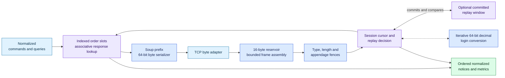
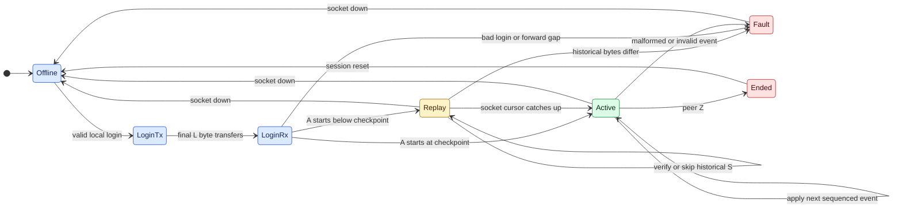
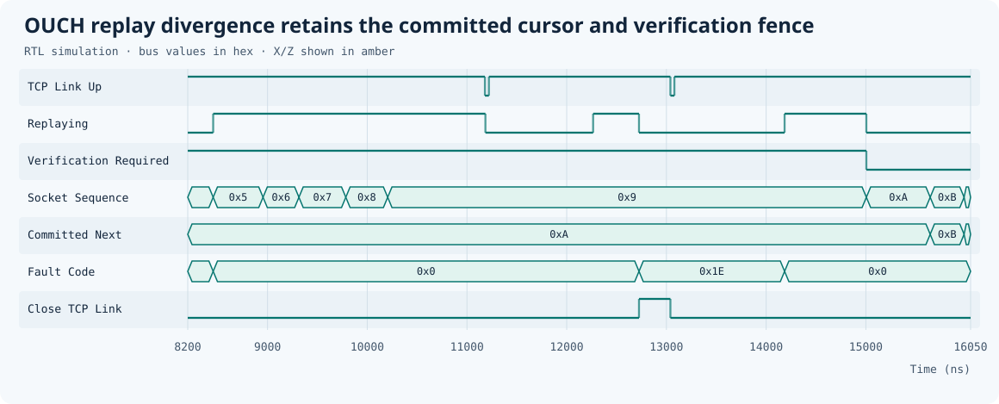
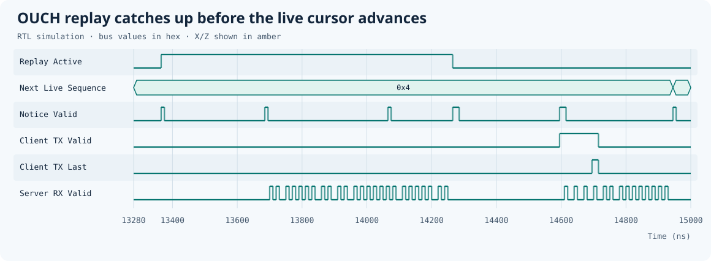

# Day 07 · OUCH Order Session

**SystemVerilog RTL · OUCH 5.0 order entry · SoupBinTCP 4.10 framing · replay checkpoint**

This core accepts normalized orders and emits exact SoupBinTCP frames for a single logical OUCH account. It validates and reconciles replies, tracks partially filled order chains, and retains the session cursor and unresolved command journal when the TCP adapter drops a socket. The network boundary is a ready/valid byte stream after TCP. The simulations use a synthetic peer.

Wire layouts follow Nasdaq's [OUCH 5.0 Order Entry Specification](https://www.nasdaqtrader.com/content/technicalsupport/specifications/TradingProducts/Ouch5.0.pdf), sections 1–3, and [SoupBinTCP 4.10](https://www.nasdaqtrader.com/content/technicalsupport/specifications/tradingproducts/SoupBinTCP41.pdf), sections 1–2.

## Architecture



The RX reservoir keeps up to 16 bytes and consumes up to eight bytes on a body assembly clock. Multiple Soup packets may share an input beat or span any number of short beats. Each input lane with `keep[lane]` high contributes `data[8*lane +: 8]`; selected lanes must be nonempty and contiguous from lane zero. The serialized TX stream starts each frame in lane zero, drives `m_tx_last` on the final beat, and holds the beat under backpressure. A frame's big-endian 16-bit length counts its Soup type byte plus payload. The prefix itself is outside that count.

A complete validated peer packet gets priority over local management and commands. A decoded order update commits atomically with its normalized notice and sequence change. A stalled notice blocks further commits. No header, body fragment, or partial decimal field can mutate order state. Slot occupancy, command journal, and replay checkpoint remain in registers when the transport flushes.

### Login and replay



The initial request starts at sequence 1 and can specify a blank session ID. The first accepted login pins the peer's session. A reconnect specifies that same ID and a sequence no greater than the committed next sequence. The accept packet's decimal sequence sets the new socket cursor. Earlier same-session positions receive a replay notice and advance only the socket cursor. The decoder checks their framing and type before skipping them. The default position-only mode relies on the peer to supply the same history for each session and position.

A forward jump, wrong session ID, invalid decimal text, or 64-bit cursor overflow closes the transport and retains the committed state. When caught up, the next valid sequenced event advances both cursors by one. Debug and heartbeat packets do not change either cursor. A peer end-of-session packet stops admission until reset. An operator logout emits a complete `O` frame before raising `close_transport` and retains eligibility to reconnect to the same session.

The separate decimal converter takes 64 clocks for binary-to-ASCII and 20 clocks for checked ASCII-to-binary. Login traffic is off the active order update path. A valid `time_tick` advances client and server idle counters, with one unit selected by the integration. With millisecond ticks, the defaults request a client heartbeat after 1,000 idle ticks and declare peer inactivity after 5,000. A zero parameter disables its timer. A due heartbeat can use an idle serializer even while the application notice channel is held. RX holds off timeout while input bytes or a completed frame are pending.

### Exact reconnect replay and recovery fence

Set `REPLAY_HISTORY_DEPTH` to a positive number of rows to verify the overlap when a socket reconnects behind the committed cursor. The default value of zero selects position-only replay. Each committed live `S` packet writes its length and original body bytes to a bounded ring on the same edge as the notice and cursor commit. The ring holds the most recent accepted sequenced packets, including market-state events. Rejected live events, replay, heartbeats and debug packets leave it untouched. A login that starts behind the committed cursor prefetches the first expected record. Subsequent matches prefetch the next record. The comparison uses every wire byte, including timestamps, match IDs, and omitted versus explicit zero-length appendages. TCP fragmentation and unselected stream lanes do not affect it.

The available range starts at `next_sequence - min(committed_event_count, REPLAY_HISTORY_DEPTH)`. The host can request any covered position through `next_sequence`. For an overlapping request, the earliest unverified position becomes a reconnect ceiling as soon as the command transfers. A server may start earlier within the window. Each exact comparison advances that ceiling. The ceiling survives faults and any number of socket cuts, including a cut before Login Accepted or halfway through a replay packet. Once verified replay reaches the next live sequence, normal command admission remains subject to the usual market and kill controls.

| Status | Local request | Peer message |
| --- | --- | --- |
| `REPLAY_WINDOW` (29) | Login rejected before serialization when the requested position is older than retained history. The notice includes that position. | Login acceptance with an expired start faults the socket and reports the offered position. |
| `REPLAY_DIVERGED` (30) | | A well-formed historical frame differs from its stored bytes. The socket faults, the notice identifies the mismatched position, and the order ledger and both cursors stay at their prior values. |
| `REPLAY_FENCE` (31) | Login rejected before serialization when the request would skip the oldest still-unverified position. | Login acceptance beyond the requested overlap or the pending ceiling faults the socket and reports the offered position. A start beyond the committed next sequence still reports `SEQUENCE_GAP`. |

A protocol decoder error takes precedence over byte comparison. Equality on a replay packet advances only the socket cursor, including when the original event was a fill or an acknowledgment. The replay window and fence survive loss of TCP and clear on hardware reset. Use transport link state to flush a failed socket, then reconnect at or before the reported divergent position. The verified simulation uses a 583-bit record per row (7 length bits and 72 bytes), plus pointers and one registered read. Actual FPGA placement depends on the chosen device and synthesis. Depth should cover the largest requested diagnostic rewind. Soup sequence values are implied by position in the stream. [Nasdaq SoupBinTCP specification, sections 1.2 and 2](https://nasdaqtrader.com/content/technicalsupport/specifications/dataproducts/soupbintcp.pdf)

A practical use is recovery for an order-entry adapter with primary and standby TCP endpoints. During incident triage, an integrator can request an overlap containing the last fills and pending-replace acknowledgments, compare the standby's replay, and keep new order traffic gated if the overlap disagrees. The offline audit provides a repeatable diagnosis from a capture that begins at login and includes the original committed frames.

```sh
make test-replay
make formal-replay
make replay-waveform
python3 -B ouch_audit.py audit fixtures/audit_example.jsonl --replay-depth 5 --details --fail-on-fault
```



The five-row capture starts with committed next sequence 10. An interrupted replay verifies through sequence 8 at 10,205 ns. The replayed execution at sequence 9 differs at 12,725 ns, raising code `0x1E` while the committed cursor stays at 10. The next socket supplies the original bytes and clears the verification fence at 15,005 ns. Its first new sequenced event then advances the committed next sequence to 11 at 15,645 ns.

## Wire subset

Lengths below are the Soup length field. OUCH integers are network-endian. Fixed-width text is transmitted in its specified byte order. Prices use four implied decimal places. The supported positive limit range ends at 1,999,999,900 integer units.

| Direction | Soup | OUCH or control | Length | Supported encoding |
| --- | --- | --- | ---: | --- |
| Client to peer | `L` | Login | 52 | User 6 bytes, password 10, requested session 10, decimal cursor 20, timeout milliseconds 5 |
| Client to peer | `U` | Enter `O` | 48 | Buy/sell, positive limit, fixed principal capacity, non-ISO, continuous market, zero appendage |
| Client to peer | `U` | Replace `U` | 41 | Original and replacement references, whole-chain liability, inherited side and symbol, zero appendage |
| Client to peer | `U` | Cancel `X` | 10 | Current reference and intended total shares, optional appendage absent |
| Client to peer | `R`, `O` | Heartbeat, logout | 1 | No payload |
| Peer to client | `A`, `J` | Login accept, reject | 31, 2 | Session and starting cursor, or one-byte reason |
| Peer to client | `H`, `Z`, `+` | Heartbeat, end, debug | 1, 1, variable | Debug bytes ignored within the 72-byte body cap |
| Peer to client | `S` | System `S`, accepted `A`, replaced `U` | 11, 65, 69 | Start/end of day and exact base order acknowledgments |
| Peer to client | `S` | Executed `E`, canceled `C` | 37, 19 or 21 | Incremental execution or cancellation |
| Peer to client | `S` | Rejected `J`, cancel pending/reject `P`/`I` | 30 or 32, 14 or 16 | Ref-specific rejects and cancel status |

Nonempty OUCH appendages fail closed. The decoder handles the exact mandatory fixed fields and the explicitly allowed omitted or zero-length forms. Other OUCH responses, additional options, multiplexed UserRefIdx, broken trades, short-sale modes, and unsequenced peer application data lie outside this subset. Peer input is bounded to 72 body bytes. A malformed keep mask stops further ingress immediately, lets complete frames from the earlier buffered prefix drain in order, and raises a framing fault. Recovery starts at a new connection boundary.

## Lifecycle and application contract

An upstream strategy chooses a free slot. The default table has eight entries. `ORDER_SLOTS` can be set from 1 to 255, with 255 reserved as the no-slot encoding. A newly queued enter or replace consumes its strictly increasing 32-bit `order_ref` even if a later peer outcome rejects it. A cancel targets the slot's current `order_ref`. A replace also supplies `previous_order_ref`, so a stale producer cannot accidentally replace a reused slot.

| Command | Operands and result |
| --- | --- |
| `CMD_ENTER` (0) | Supply a new ref, legal symbol, B/S side, price, and 1–999,999 shares. Tags echo in notices. |
| `CMD_REPLACE` (1) | Supply current ref as `previous_order_ref`, a higher new ref, price, and desired total quantity across the whole chain. The outstanding amount is distinct from chain fills. |
| `CMD_CANCEL` (2) | Supply current ref and zero for all remaining shares, or the reduced intended total for a partial cancel. |
| `CMD_RETRY` (3) | Supply the pending command's ref. If accepted, re-emit its original bytes without allocating a new ref or changing slot state. |
| `CMD_QUERY` (4) | Return the slot's state without wire traffic. The query is available offline. |

Order acknowledgments validate slot phase, reference, client ID where present, and echo fields. Buy acknowledgments may improve the price down and sell acknowledgments may improve it up. A live acknowledgment has positive leaves. A dead acknowledgment or a full fill/cancel leaves a tombstone view with zero leaves. The engine allows fills on the old reference while replacement is pending. A replacement ack supplies remaining shares, while `filled` records prior execution over the chain. A replace reject clears the journal entry while preserving the old live order. A terminal fill or cancel also retires any in-flight request on that chain. Cancel-pending leaves its journal live and cancel-reject clears it.

A successful local notice means the packet was queued for serialization. An exchange event is a separate notice. A transport cut may invalidate a partially serialized packet while retaining its journal entry. After replay catches up, the upstream adapter chooses which unresolved slots to retry. The last match number on each chain catches a repeated execution presented at a new position. Replayed older Soup positions are suppressed independently before lifecycle mutation.

`kill_req` is sticky until reset and blocks new enters, replaces, and their retries. Cancels, cancel retries, and sequenced replies still run. End of day applies the same admission fence until the next session. An in-flight TX packet can finish while a kill or fault is raised. Transport loss is the byte-stream flush boundary. Reset clears orders, references, counters, and the pinned cursor and is reserved for a reconciled new hardware session.

## Top-level channels

The top is `ouch_order_session` in [ouch_order_session.sv](ouch_order_session.sv), with type definitions in [ouch_wire_pkg.sv](ouch_wire_pkg.sv) and dependency order in [rtl.f](rtl.f). All ports use `clk`. A channel transfers on a rising edge when valid and ready are high. Keep valid and payload stable while stalled. `rst` is synchronous active high. The transport must assert `transport_up` only on the current socket and drop it for at least one sampled edge before signaling a new one.

| Port group | Contract |
| --- | --- |
| `s_login_valid/ready`, `s_login` | Typed login request. Credentials are fixed-width right-space-padded alphanumerics, session is left-space-padded, heartbeat timeout is five nonzero decimal digits. |
| `s_logout_valid/ready`, `transport_up`, `close_transport`, `kill_req`, `kill_latched`, `time_tick` | Socket and operational controls. Close stays asserted until the transport drops. |
| `s_rx_valid/ready`, `s_rx_data`, `s_rx_keep` | TCP receive stream. Beat and frame boundaries are independent. |
| `m_tx_valid/ready`, `m_tx_data`, `m_tx_keep`, `m_tx_last` | TX stream with packet boundary marker. Each packet begins on a fresh output beat. |
| `s_cmd_valid/ready`, `s_cmd` | Typed command with slot, kind, tag, order refs, quantity, price, and applicable text/order attributes. |
| `m_notice_valid/ready`, `m_notice` | Held notice with kind, status, sequence, reference(s), tag, slot, time, delta, leaves, filled, price, venue identifier and reason. |
| `query_slot`, `query_view`, `metrics` | Same-clock combinational table observation and saturating counters. Out-of-range query returns zero. |
| `session_state`, `session_id`, `next_sequence`, `replaying`, `market_open`, `highest_order_ref`, `live_count`, `pending_count`, `last_fault` | Control state and checkpoints for recovery and monitoring. |

`status_t` names are the wire codes for the normalized notice. Errors from command validation have kinds `N_COMMAND` or `N_LOGIN_REJECT` and do not alter the order table. A peer inconsistency raises `N_FAULT` with the offending sequence retained. Transport errors and login failures carry the current checkpoint. Successful notices distinguish every supported response, replay skip, and session transition.

## Run the project

Use Python 3, Icarus Verilog, Verilator, and Yosys with Slang. OSS CAD Suite includes the HDL tools. The ECP5 timing target additionally uses nextpnr.

```sh
make test
make lint synth
make timing
python3 ouch_audit.py audit fixtures/audit_example.jsonl --details --fail-on-fault
```

- [The Python codec](ouch_protocol.py) uses structured binary layouts. [The lifecycle oracle](ouch_model.py) tracks orders in keyed objects and computes output expectations independently of the RTL.
- [The integrated scoreboard](tb_ouch_order_session.sv) verifies full TX bytes, parsed lifecycle results, every status/slot/cursor checkpoint, output holds, and exact abandoned TX prefixes on a cut. The default target uses three seeds and table depths 4, 8, and 12. A directed case keeps a second query blocked by an unconsumed notice while requiring a client heartbeat to complete.
- [The replay scoreboard stimuli](gen_replay_vectors.py) cover one-, five-, and eight-row windows, expiry, peer cursor regression, incomplete frames, changed execution bytes, equivalent decoded messages with different wire encodings, and retry gating. Sixty seeded reconnect rounds per geometry walk the ring repeatedly. The separate 12-edge SAT check compares one- and three-row RTL rings with a shift-register reference and verifies range and data selection. [Offline replay tests](test_ouch_replay.py) also check fail-closed reporting and recovery.
- [The framing bench](tb_ouch_framing.sv) checks 651 complete messages in each direction, 73 truncated socket lengths, and all 256 `keep` masks. The ordering check holds one complete frame and buffers a second before sending a malformed mask. [The decimal bench](tb_ouch_decimal64.sv) checks 649 conversions and six partial conversion flushes.
- [The offline auditor](ouch_audit.py) reads local timestamped JSONL `link`, `rx`, `tx`, and `mark` entries. It reports replay, pending refs, cut fragments, latency between captured attempts and replies, and credential-free decoded records. It also independently decodes and compares the hardware test's TX capture against the oracle.
- `make synth` records a generic structural check and gate netlist. `make timing` maps the default gateway to ECP5 LFE5U-85F / CABGA381 / speed 8 with out-of-context routing and a 100 MHz constraint. The routing command preserves the measured result if it misses the target.

## Integration and performance boundaries

The audited ECP5 build routed at **27.49 MHz**, below the 100 MHz constraint, with 38,178 combinational cells and 10,391 flip-flops. Its 36.374 ns critical path runs from assembled RX bytes through decode and order-state update into the order table. Generic synthesis reported 61,527 cells and zero structural findings. Run `make timing` to reproduce the ECP5 timing report in `build/session-route.json`.

The 64-bit ready/valid ports accept eight selected bytes in a handshake. Header and frame retirement consume additional clocks. Worst-case packet rate depends on message size, fragmentation, notice backpressure, and the CAM and barrel-shift paths. The raw port width is therefore separate from an achieved payload throughput number. The order table scans for peer refs and should use a banked or indexed lookup when scaled. The timing target excludes TCP, packet I/O, and board routes.

The core operates on synthetic bytes or an adapter supplied by the integrator. It does not open external connections or provision accounts. A production integration would need a durable checkpoint and journal, venue certification, system-level safety limits, and a separately validated TCP/network path. Hardware reset clears this project's retained session and replay history.

## From the RTL simulation



The directed reconnect requests replay from sequence 2 while the saved live cursor is 4. A retry made during replay yields a local notice at 13685 ns. The server replays earlier messages while the live cursor stays at 4. Replay clears at 14265 ns, the retried command can transmit, and its next live server message advances the cursor to 5 at 14945 ns. The test checks parsed state, notices and transmitted wire bytes.

Run `make waveform` to rerun the checked scenario and regenerate both figures. The full capture is available at `build/wave/session.vcd`.
