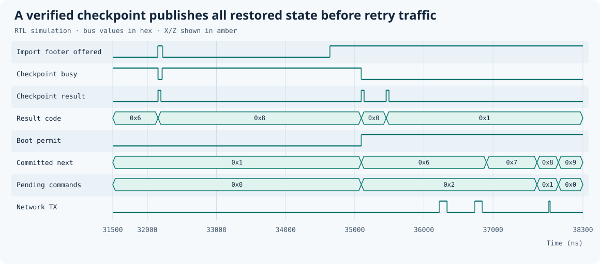

# Durable OUCH session checkpoint

An accepted local command can remain unresolved after the client socket or FPGA resets. For example, the client starts serializing a replace and the TCP adapter delivers only a prefix before the link drops. The gateway has already allocated the replacement reference while the original order remains live. A cold restore must retain both identities and the unresolved command fields so the next reconnect can reconcile the old order and, when appropriate, retry the same replacement bytes.

[ouch_recoverable_session.sv](ouch_recoverable_session.sv) exposes the normal typed session channels plus a paced checkpoint command and 32-bit data interface. Its on-chip archive engine works with [the independent Python codec](ouch_checkpoint.py) and [the transactional host store](ouch_checkpoint_store.py). Power-on blocks the transport and hides unpublished order state until a permitted cold start or a verified image.


## Hardware commands and ordering

Drive `cp_cmd_valid` with the operation and image ID and hold both until `cp_cmd_ready` transfers. Each accepted command produces one held `cp_result_*` record. The physical `transport_up` must be low when issuing an accepted maintenance operation. The wrapper waits for a sampled low socket after maintenance before exposing a new link to the native session. Hardware reset closes the boot gate and clears its staged data state.

| `cp_cmd_op` | Preconditions and effect |
| ---: | --- |
| 0 · export | A booted, pinned session is offline or ended with no held native notice or unverified replay obligation. A nonzero image ID labels the output. Stream the captured state through `cp_out_valid/ready`. |
| 1 · import | Boot remains closed, the native instance is virgin, and the command carries the expected nonzero image ID. Transfer the image through `cp_in_valid/ready`. The complete fixed-length image must validate before installation. |
| 2 · fresh | Boot remains closed, the instance is virgin, and the image ID is zero. Explicitly permit startup for a clean logical session. |

Export holds data and `cp_out_last` during backpressure. Import presents `cp_in_last` on the footer. An early last produces a framing error. Excess input after the expected footer drains to an explicit last. `cp_abort_import` cancels a partial receive or drain. Once the whole image enters validation, complete the transaction or reset the instance.

| `cp_result_status` | Meaning |
| ---: | --- |
| 0 | Operation completed |
| 1–2 | Unsafe current state or malformed command |
| 3–5 | Bad image framing, incompatible format or padding, failed CRC |
| 6 | Invalid pinned session, corrupt order state, or conflicting order references |
| 7–8 | Interrupted import or image ID mismatch |

The result echoes operation and image ID. A row error identifies its zero-based slot in `cp_bad_slot`. Other outcomes carry `0xff`. The loader checks slot invariants and cross-slot reference uniqueness before opening any native write port. Native rows are written with session admission blocked. The last commit installs the reference high-water mark and pinned cursor and makes all restored state visible together. A malformed image leaves the instance fenced for a later valid import.

A restored instance starts with one exact resume point at the saved next sequence. Older positions are outside its retained byte coverage and are refused. New accepted events refill the existing exact replay window. The logical session, market state, kill latch and end-of-session state persist. Socket-level TX/RX bytes, inactivity timers, and diagnostic counters initialize afresh. Pending order references and full normalized commands persist. Restore itself emits no order or login packets.

## OCP1 wire layout

The checkpoint is a sequence of unsigned 32-bit little-endian words. Multiword integer fields put their least significant word first. Text from the original OUCH fields retains its normal byte order inside its packed field. The binary contains no login credentials.

| Word region | Content |
| --- | --- |
| 0 | Magic `0x3150434f` |
| 1 | Bits 31:16 are slot words, 15:8 are metadata words, and 7:0 are slot count |
| 2–3 | 64-bit image ID |
| 4–9 | 179-bit metadata, zero padded at the high end. The packed MSB-first fields are ended, killed, market open, the 32-bit highest order reference, the 64-bit next sequence, and the 80-bit pinned session |
| 10 onward | One 911-bit `order_state_t` per slot index, in allocation-table order. Each record occupies 29 words with zero high padding. It contains the slot view, complete pending command, and the prior match-valid bit |
| Final | CRC-32C over every preceding word as little-endian bytes |

A matching CRC detects corruption in transport and storage. The host additionally checks SHA-256 against the stored image and, when supplied, a separately trusted generation and digest. Use one database per pinned session and table geometry. The archive preserves the most recently published image and advances its pointer in the same SQLite WAL transaction that stores the new bytes. Publishing identical bytes at the current generation can be retried. Reusing a generation for different bytes, moving the cursor or reference fence backward, or losing the durable kill latch is rejected.

```sh
make test-checkpoint
python3 -B ouch_checkpoint_store.py publish build/ouchtape.sqlite build/checkpoint-8/hardware_archive.ocp
python3 -B ouch_checkpoint_store.py inspect build/ouchtape.sqlite
python3 -B ouch_checkpoint_store.py extract build/ouchtape.sqlite build/restore.ocp
```

Retain the printed anchor independently and supply `--trusted-anchor` on a cold extraction when the restore must match that exact committed image. A deployment must also retain order intents and transport outcomes after the exported checkpoint, reconcile those with the venue, and choose which unresolved commands to retry. The checkpoint stores the FPGA's current evidence of pending commands. A physical deployment still depends on the adapter's durable capture and the host platform's persistence guarantees.

## Checked recovery waveform



At 32,155 ns an import with the wrong image ID returns code 8 and leaves the boot gate closed. The valid archive's footer is offered from 34,640 ns. Once the staged validation and installation finish at 35,095 ns, the boot gate opens, the committed next sequence changes from 1 to 6, and both pending commands become visible together. Network TX resumes after a fresh reconnect. New peer events subsequently advance the saved sequence.

`make test-checkpoint` compares 769 exported words, 40 exact TX packets, 89 ordered notices, and 124 full state barriers across one, four, eight, and twelve slots. Each run exports RTL state after an interrupted replacement, rejects corrupt and partial images, resets during import, restores and settles the retained order state, and verifies the restored kill latch. The eight-slot trace retains a pending replacement and cancel. The independent host tests also cut a process between the image write and SQLite commit, then verify that recovery reopens the previous complete image. `make formal-checkpoint` runs a reduced 15-edge check of held archive output, held replies, and the boot and restore interlocks. `make checkpoint-waveform` regenerates the checked figure.
