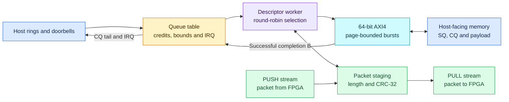
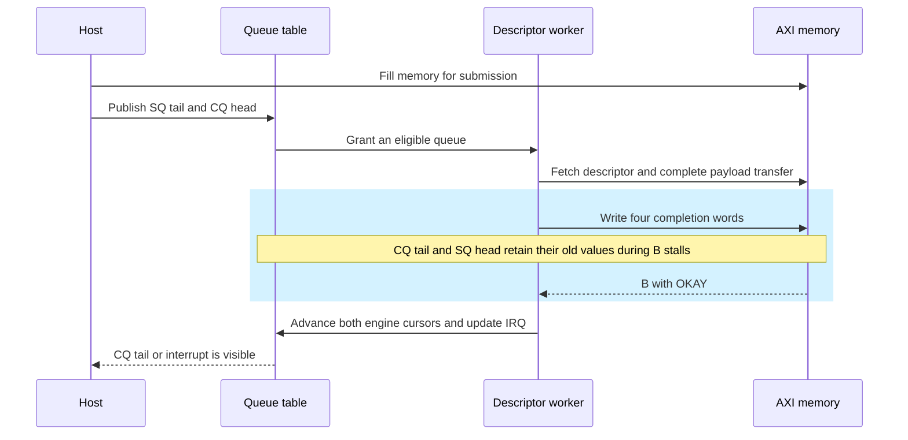
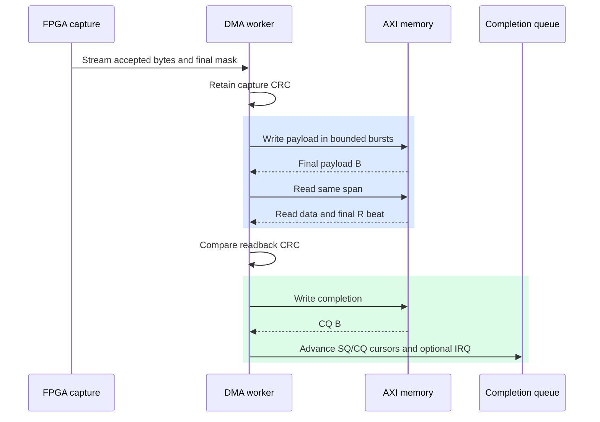
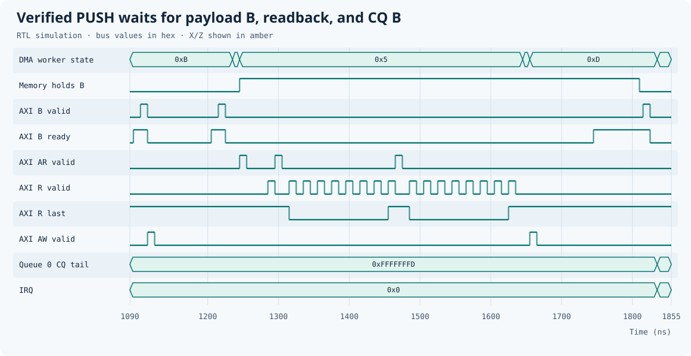
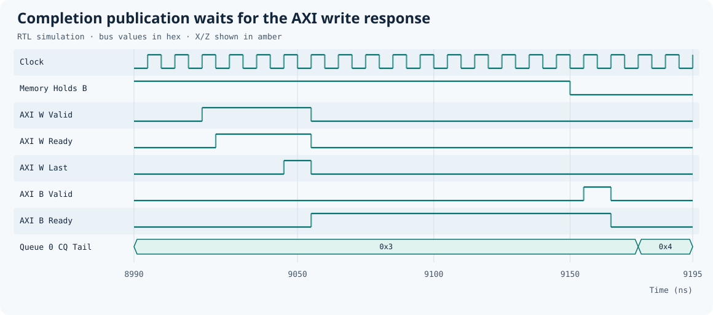

# Day 08 · Host/FPGA DMA queues

A bidirectional DMA core for moving small packets, control messages and captures between a host-facing memory aperture and an FPGA datapath. The host posts a 32-byte submission to a ring. The core validates the request, copies or captures the packet, and writes a 32-byte completion. The completion tail and interrupt become visible only after the AXI memory endpoint accepts the completion write.

The default core has two queues of eight entries, a 512-byte packet buffer, 64-bit memory and stream interfaces, and a 16-beat memory burst cap. The design is useful for studying where descriptor fetching, integrity checks, queue credits and write acknowledgements add latency to a host/FPGA boundary.

The [memory integrity path](#memory-readback-and-verified-capture) adds digest-only READBACK and optional PUSH readback verification for host-buffer captures. The [queue-isolation mode](#optional-queue-address-isolation) prevents overlapping memory claims across enabled queues.



## Queue ownership and ordering

- Configure a queue while the engine is idle. An enabled queue can be replaced or disabled once both rings are empty. A successful configuration loads all four cursors with the same 32-bit seed and clears its interrupt state.
- SQ and CQ bases are 32-byte aligned. The payload interval is nonempty, 8-byte aligned and half-open. The three regions in a single queue must be disjoint. Cross-queue isolation can be enforced by the core. The host allocator owns the physical memory mappings.
- The host publishes an absolute SQ tail and CQ head in one doorbell. Both updates are accepted together when they fit the currently observed credits. SQ free space is ring depth minus the unsigned `SQ tail − SQ head` distance. The host can release at most `CQ tail − CQ head` records. Cursor arithmetic wraps at 32 bits, while memory addresses use only the low `RING_LOG` bits.
- A queue is eligible when enabled, its SQ has work, and its CQ has credit. The scheduler rotates after each grant. With three continuously eligible queues and no external stalls, two other grants can precede service. A full CQ only excludes its own queue from selection. An active descriptor can still block all queues on memory or packet backpressure.
- Finish posting descriptor and payload bytes before the submission doorbell. Read the committed CQ tail before consuming records and release those CQ slots afterward. The adapter and host driver provide the required memory barriers and visibility across their actual PCIe or coherent interconnect. [Linux DMA mapping guide](https://docs.kernel.org/core-api/dma-api-howto.html)



## Descriptor and completion formats

Each row is one little-endian 64-bit word. Fields separated by vertical bars are shown from the most significant to least significant bit within the word. The Python [ABI](dma_protocol.py) packs words into explicit bytes.

| Byte offset | Submission | Completion |
| ---: | --- | --- |
| 0 | opcode[8] · flags[8] · tag[16] · length[32] | status[8] · opcode[8] · tag[16] · transferred bytes[32] |
| 8 | byte address[64] | host cookie[64] |
| 16 | host cookie[64] | computed CRC[32] · queue[8] · zero[24] |
| 24 | reserved[32] · expected CRC[32] | worker disposition cycle[64] |

| Opcode | Operation |
| ---: | --- |
| 1 | **PULL.** Read all payload beats, accumulate CRC, then send the staged packet to the FPGA sink. Completion follows the accepted final packet beat. |
| 2 | **PUSH.** Offer a tagged capture request, collect the associated frame, validate its shape and CRC, then write payload memory. Completion follows the last payload write response. |
| 3 | **FENCE.** Publish an in-order completion for the queue after prior work has retired. Length, address, CRC flag and expected CRC must be zero. |
| 4 | **READBACK.** Read an aligned byte range and return its CRC-32 in the completion. The packet and capture ports remain idle. The CRC flag enables an expected-digest comparison. |

Flag bit 0 requests an immediate interrupt after retirement. Flag bit 1 compares the payload against the expected IEEE CRC-32. Flag bit 2 enables write verification and is valid for PUSH only. CRC counts only valid bytes in wire order, starts with all ones and uses final complement. The 64-bit cookie is application-defined and is copied into the completion. Reserved flags and the reserved word must be zero. The expected CRC field must be zero when comparison is disabled.

An address must be 8-byte aligned and the entire rounded memory footprint must fall inside the configured payload interval without carry. Packets can end in a partial beat. The bus uses a final write strobe to protect surrounding bytes and the packet output zeroes unselected lanes.

| Status | Meaning and effect |
| ---: | --- |
| 0 | Success. The CQ reports the processed length for PULL, PUSH and READBACK and zero for FENCE. |
| 1 | Unsupported operation. |
| 2 | Reserved bits, CRC request format or FENCE arguments invalid. |
| 3 | Payload length or rounded address range invalid. |
| 4 | Descriptor, payload or verification read received an unsuccessful AXI response. A failed descriptor read zeroes opcode, tag and cookie. A failed PULL produces no packet. A failed PUSH verification read can follow a successful payload write. |
| 5 | Payload write received an unsuccessful AXI response. Earlier writes can already be visible, so the host must treat the destination as tainted. |
| 6 | Computed CRC differs from the expected value. PULL emits no packet and PUSH leaves its destination untouched. |
| 7 | Capture frame has invalid first/last markers, lanes or length. The core drains through a final marker when present within the drain budget. |
| 8 | Capture timed out after the offer was accepted. The capture adapter uses `capture_abort` to abandon that request. |
| 9 | Verified PUSH received bytes whose digest differs from the captured frame. The completion carries the observed readback digest. Treat the destination as unverified. |

Errors report zero transferred bytes. CRC mismatch, payload write failure and verification mismatch retain a computed digest. Other errors report zero CRC. The timestamp is the free-running engine cycle when the worker decided the result, before it issues completion writeback. Unsigned subtraction handles bounded intervals across the 64-bit cycle wrap.

## Memory readback and verified capture

Use READBACK to check a capture log or a host-written replay buffer before handing the region to another queue or process. It processes the returned AXI beats directly through the CRC accumulator and leaves the packet buffer and device stream idle. It does not increment `pull_bytes` or `push_bytes`. The completion gives the exact verified or sampled length, with neighboring bytes beyond the requested length excluded from the digest.

Use verified PUSH for captures whose host buffer must be checked before software consumes the completion, such as an order-gateway incident trace or a loss-monitoring ring. The worker validates the capture and optional expected CRC first. After the final successful payload B response, it reads the same byte span, compares its digest against the retained capture digest, and writes the completion. A failed payload B prevents readback. A failed read or mismatched digest can leave payload bytes in memory. Identify the result by queue, tag and cookie, and examine status before consuming the payload. The Arm AXI ordering model specifies the ordering of a same-location read received after a write completion response. Host cache maintenance, PCIe posted-write flush semantics and durability belong to the platform adapter and host driver. CRC-32 detects common data corruption. [Arm AXI ordering model](https://developer.arm.com/-/media/Arm%20Developer%20Community/PDF/IHI0022H_amba_axi_protocol_spec.pdf), [Linux bus-independent device access](https://docs.kernel.org/driver-api/device-io.html)





For tag `0x0100`, the final payload response transfers at 1225 ns, the verification read starts at 1255 ns and its last beat transfers at 1635 ns. The completion B transfers at 1825 ns. The queue tail changes from `0xfffffffd` to `0xfffffffe` and IRQ asserts at 1835 ns. Run `make waveform-readback` to rerun the checked fixture and rebuild the figure.

## Optional queue address isolation

Instantiate `host_dma_queues` with `ENFORCE_QUEUE_ISOLATION=1` to protect separately provisioned FPGA DMA queues from overlapping address claims. An example is giving one strategy queue ownership of its quote updates while a capture queue records independent data in another host region. The guard rejects a proposed submission ring, completion ring or payload interval if any byte intersects one of those three regions in another enabled queue. Adjacent half-open intervals may share an endpoint. A configuration rejected for overlap asserts `cfg_ack` with `cfg_ok=0` and preserves the previous layout, ring cursors and interrupt state.

An enabled queue keeps its entire layout while its SQ or CQ holds entries. Once both rings are empty and the worker is idle, changing or disabling the queue releases its previous claims. Replacing the same queue may overlap its own previous layout. Detaching a queue or changing mappings still requires the host to coordinate its software, adapter and DMA memory lifetime. The hardware guard compares addresses in the configured AXI address space and depends on that space's mapping for isolation. Its default setting is zero to preserve deployments with intentionally shared payload regions.

`make test-isolation` checks all nine region pairs in hardware, legal adjacency, ownership retention with outstanding ring entries and reassignment after a successful disable. A top-level fixture rejects a payload claim on another queue's SQ, rejects a cross-queue READBACK before payload AR, and reads the same bytes successfully through their owner. The full memory integrity fixture also runs with isolation enabled.

## Interface and implementation

| Interface | Contract |
| --- | --- |
| `cfg_*` | Ready/valid for enable, descriptor and completion bases, payload interval, cursor seed, batch size and timer. `cfg_ack` reports that a request was sampled and `cfg_ok` shows acceptance. A configuration handshake takes priority over a simultaneous doorbell. |
| `host_*` | Ready/valid absolute doorbell. `host_ack` reports sampling and `host_ok` shows acceptance. A bad SQ advance or CQ release preserves the entire prior host state. |
| `inspect_*`, `irq`, `irq_ack` | Select a queue to read its four cursors and saturating 8-bit interrupt backlog. An enabled batch or timer, or a forced completion, asserts its interrupt level. Ack clears prior contributions while keeping a coincident completion. Zero disables the corresponding threshold. Releasing CQ capacity is a separate doorbell. |
| `packet_*` | Ready/valid PULL packet with 64-bit data, byte keep, first, last, tag, queue and cookie. Identity stays constant through the packet and all signals hold while blocked. |
| `capture_*`, `s_packet_*` | Ready/valid offer includes tag, queue and requested length. After accepting, the producer sends one packet with full continuation beats and a low-lane contiguous final keep. The collection watchdog counts gaps between accepted beats. The malformed-frame drain has a bounded budget. The offer itself can wait indefinitely for its consumer. |
| AXI memory | 64-bit address and data with INCR transfers. The transport allows one in-flight read and one in-flight write with fixed ordering. The integration executes one descriptor at a time. Burst selection uses remaining length, configured burst cap and distance to the next 4 KiB boundary. The AXI engine rejects requests whose rounded footprint would wrap the address space before issuing AR or AW. The platform adapter supplies any ID and sideband pins it needs. [Arm AMBA AXI specification](https://documentation-service.arm.com/static/651c285c15583d1bff972f94) |
| `busy`, `fatal_code`, counters | A malformed RLAST latches fatal code 1. An unsuccessful CQ write latches code 2. Both hold the queue cursors at the current request and require a coordinated reset of the core and its memory adapter. A reset clears the counters and disables queues. |

The [queue table](dma_queue_table.sv) computes eligibility and manages generation changes. [The transfer worker](host_dma_queues.sv) owns the active descriptor and its staging buffer. [The AXI engine](dma_axi64.sv) tracks each accepted beat and response. [The interrupt block](dma_interrupts.sv) batches committed records independently for each queue. [The CRC block](dma_crc32.sv) processes selected lanes on each accepted data beat.

## Reproduce the verification

```sh
make test
make lint
make synth
```

| Check | Observed result |
| --- | --- |
| End-to-end | 14 completions and 11 error results under randomized stalls. Includes a byte-exact 139-byte PULL and 129-byte PUSH across page boundaries, neighboring-byte checks, bad request formats, no-credit updates, CRC mismatches and capture abort. A bad CQ response and malformed RLAST both produce a fail-stop with no retirement. |
| External capture audit | Python independently packs 14 expected records with `struct`, checks payload CRCs using `zlib`, and compares the complete AXI-memory CQ bytes and 139 captured stream bytes. The auditor checks sideband stability inside a packet, in-queue order and timestamp progression. |
| Three-queue contention | 127 completed FENCEs split 43/42/42, four 32-bit cursor wraps, 31 physical ring wraps, 287 CQ-credit blocked cycles and 521 held completion responses. At most two eligible grants were bypassed. |
| AXI transport | Two burst caps, 5 and 16, each with 265 duplex cases covering all five channel stalls, partial masks, page splitting, error responses, malformed last and transfers at the top of the 64-bit address space. |
| Queue and interrupt units | 1,073 retired entries across three queues, concurrent retirement and doorbell updates, modulo wrap, full CQ and invalid configuration. Interrupt tests cover batch, timer, saturation and coincident acknowledge/retire. |
| CRC | 4,845 accepted beats, 19,348 selected bytes, every keep mask, the standard `123456789` check and a separate bit-oriented oracle. |
| Memory integrity | An RTL run checks 29 completions, nine error responses, 677 verified PUSH bytes, every partial final lane count, and the 512-byte maximum. It covers a corrupted readback, held responses, failed payload and verification responses, and fail-stop after malformed verification RLAST. An independent Python audit checks all CQ payload fields and confirms zero stream packets. |
| Host reference | 50 unit tests and a seeded run with 192 descriptors across two queues. The run exercises all ten statuses, verifies the AXI transaction ledger and intentionally holds CQ write responses. |
| Structural checks | Strict Verilator lint and zero Yosys structural findings in both modes. Default generic synthesis produced 32,057 cells with shared layouts allowed and 44,500 cells with address isolation enabled. |

The regression writes `build/completions.hex` and `build/packets.txt` from the RTL. Run `python3 audit_directed_capture.py build` to compare those files again. For the host model, `python3 dma_workload.py --seed 8088 --requests 96 --depth 8 --output build/ledger.json` produces a separate expected workload. `dma_audit.py LEDGER COMPLETIONS PACKETS` accepts one 32-byte completion per hex row and one `queue tag cookie data keep first last` record per accepted stream beat. Completion order is compared per queue by default. An optional strict mode also compares the global schedule.

The packet staging buffer provides a clear validation boundary and costs a whole-packet delay. The single worker and response-ordered writeback cap concurrency. Generic synthesis establishes connectivity and logical area. A production host path would also require a target memory or PCIe adapter, interrupt delivery, a driver, board clock constraints and measured end-to-end latency.

## From the RTL simulation



The final completion entry write beat transfers on the 9055 ns rising edge. The test memory withholds the write response, keeping queue 0 completion tail at 3. The B response transfers at 9165 ns and the DMA publishes tail 4 at 9175 ns. The bench checks the submission head and completion counters throughout the stall.

Run `make waveform` to rerun the checked scenario and regenerate the figure. The full capture is available at `build/wave/dma.vcd`.
