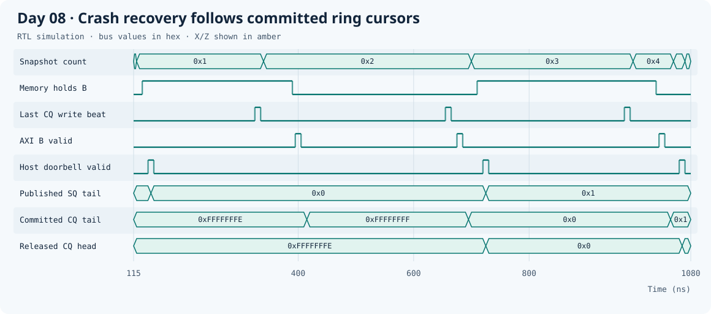

# Restarting a host DMA queue

The host journal in `dma_queue_journal.py` lets a restarted owner reattach to an active Day 08 queue while the device and ring memory stay live. It records exact SQ descriptors before publication, reads the committed CQ prefix after restart, and saves those records before returning the matching CQ release doorbell. Recovery keeps the existing hardware cursor and binary ring formats.

A host process serving FPGA packet capture or strategy telemetry can use this when it inherits an active ring after a driver-process restart. For example, a capture can be in progress with DMA writing bytes to a registered host buffer. The replacement process keeps ownership of those mappings, waits for the native CQ commit, and makes the completion available under the same queue generation and host ordinal. A response lost before the process could log it stays visible in the CQ until recovery releases the credit.


## Driver contract

- Start a journal from an empty newly configured queue. Bind it to an external incarnation UUID, hardware queue ID, initial seed, ring depth, and SQ/CQ bases. The driver or adapter owns the incarnation identifier. Use a fresh identifier on device reset, queue reconfiguration or remapping, including recreation at identical addresses and seed. Resume requires a known unchanged incarnation.
- Maintain a single owner of the queue doorbell and SQ memory. The journal locks its file updates across host processes. The host integration is responsible for device ownership and the memory barriers for the actual interconnect.
- Stage submission records at an application-assigned 64-bit ordinal. Retrying preparation with the same ordinal range and exact bytes is idempotent. The integration preserves payload and segment-table mappings and data for prepared work until normal DMA ownership returns.
- Capture the four cursors, enabled and fatal status, and both physical ring images coherently. Use the adapter's ordering primitives, hold host mutators, and use a latched snapshot or verify stable cursor reads around the ring capture. A worker may continue to run. Speculatively written next CQ bytes are ignored while outside the saved committed tail.
- Reconcile before applying any plan, including after a crash around a doorbell. Write the plan's SQ bytes in ordinal order and make them visible before the single combined doorbell. A subsequent reconciliation observes whether the doorbell took effect. Process archived application records using `(generation, ordinal)` as their stable identity. Application side effects and deduplication belong to the consumer.

### Exact cursor and record checks

The native hardware uses unsigned 32-bit cursors. The journal maintains separate 64-bit ordinals relative to the configured seed. Each sample can advance the observed publication, observed release and archived prefix by up to one physical ring depth. Each credit calculation is also bounded by that depth. These constraints let a change from `0xfffffffe` to `0x00000000` lift to an advance of two records. A backward change outside that window fails. A plan can use only SQ credits implied by the sampled head, and can release only CQ records synced to the checkpoint file.

The core advances SQ head and CQ tail together only after the completion write succeeds. A sample with different engine cursors fails. The journal verifies every still-pending descriptor against the staged bytes, rechecks any archived CQ record whose slot is still owned by the host, and validates every newly committed result's opcode, tag, cookie, queue, outcome and successful byte count. A descriptor-fetch failure can legitimately retire with cleared opcode, tag and cookie. The journal refuses to issue a plan for an inactive, fatally stopped or mismatched incarnation. A fatal stop can leave device-side effects requiring operator or driver reconciliation.

### File and crash boundaries

`DMAJNL1` is a versioned little-endian image containing identity and counters followed by all submitted and archived 32-byte rows. `DMACAP1` holds the identity, native cursors and status bits, then complete binary SQ and CQ images in physical slot order. Both images end with a SHA-256 checksum for truncation and corruption detection. `Snapshot.encode()` and `Snapshot.decode()` define the adapter interchange.

Every journal mutation uses a temporary file in the same directory, syncs it, atomically renames it, and syncs the directory before returning. Use a local POSIX filesystem with these durability semantics. On an ambiguous failure after rename, repeat the same preparation or reconcile against a fresh live capture. The retry syncs the image again before returning a plan. The journal retains all rows for inspection and rewrites the image on each transaction. This whole-image implementation targets bounded captures and queue bring-up.

| Interruption point | Recovery observation and action |
| --- | --- |
| Before the preparation is synced | Prepare the same ordinal range again. The driver has issued no doorbell. |
| After prepare or SQ stores, before the doorbell | The observed SQ tail has not advanced. Rewrite the same planned slots and publish them. |
| After the SQ doorbell, before the CQ write response | The observed SQ tail includes the outstanding descriptors. Leave them posted and ignore speculative CQ bytes. |
| After CQ commit, before archive or release | Read and validate the committed records and sync them before returning a release. |
| After archive, before release | The committed rows are already present in the journal. Recompute a release from the live head. |
| After release with acknowledgement lost | The live CQ head reflects the release, and the corresponding records stay in the journal. |

## Checked RTL trace



At 145 ns, the host publishes two descriptors and the SQ tail wraps from `0xfffffffe` to zero. At the second checkpoint, 340 ns, the first complete CQ record is already present in simulated memory and the CQ tail is still `0xfffffffe`. The first and second results become committed at 415 ns and 695 ns. The single doorbell at 725 ns releases both and publishes ordinal 2. The second held-response snapshot at 980 ns confirms ordinal 2 is already submitted and has yet to retire. Its completion commits at 1045 ns. At 1065 ns, the final release advances CQ head to 1.

`make test-checkpoint` replays the six raw RTL ring snapshots through freshly opened journal instances. The external audit checks exact completion bytes, including an unsupported operation, checks for a missing release while B is held, and confirms recovery can continue on both sides of the joint doorbell. The host unit tests include truncated images, mismatched queue generations, stale captures, concurrent writers, injected file and directory sync failures, and randomized retries across four ring depths.

Run the checked example from this project directory. The CLI prints a JSON plan and the host adapter performs the physical operations.

```sh
make test-checkpoint
checkpoint_dir=$(mktemp -d build/checkpoint/operator.XXXXXX)
python3 -B dma_checkpoint.py "$checkpoint_dir/example.journal" init \
    --generation c23ea317-dbf2-4d18-a05d-024acd663084 --queue 0 \
    --seed 0xfffffffe --depth 8 --sq-base 0x100 --cq-base 0x300
python3 -B dma_checkpoint.py "$checkpoint_dir/example.journal" prepare \
    0 build/checkpoint/first-submissions.bin
python3 -B dma_checkpoint.py "$checkpoint_dir/example.journal" reconcile \
    build/checkpoint/first_held.dmcap
python3 -B dma_checkpoint.py "$checkpoint_dir/example.journal" reconcile \
    build/checkpoint/first_retired.dmcap
python3 -B dma_checkpoint.py "$checkpoint_dir/example.journal" show --count 2
```

The first plan has no writes or doorbell because the two descriptors are already published and the CQ tail has yet to advance. The second plan archives two records and offers CQ head zero. Use `make waveform-checkpoint` to regenerate the tracked waveform.
