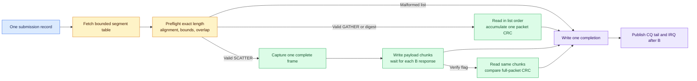
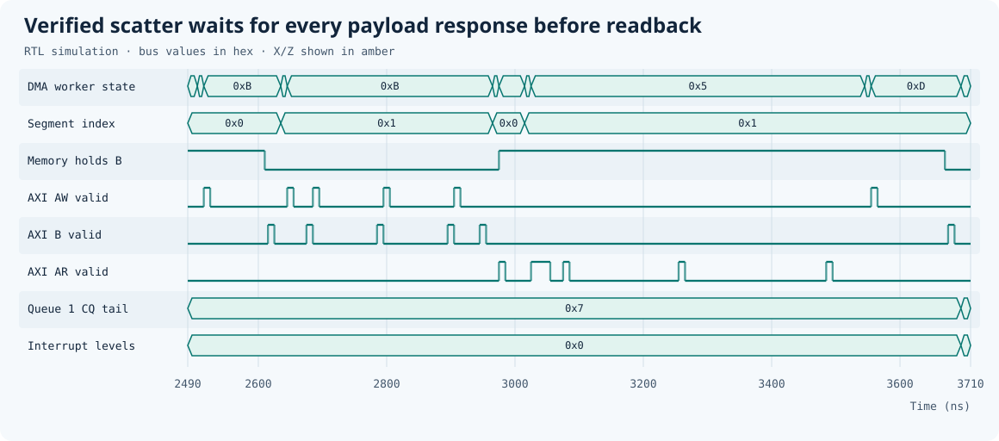

# Ordered scatter/gather DMA

The [host DMA worker](host_dma_queues.sv) accepts a memory-resident segment table for one logical packet. Use GATHER to combine a fixed transport header stored in one buffer with a separately generated order message. Use SCATTER to put a capture header and body into different destinations for a log writer. Use SEGMENT_DIGEST to check the same logical message before transfer or replay without consuming the device stream. AMD's AXI DMA guide illustrates the common use of separate header and payload blocks. [AMD AXI DMA scatter/gather guide](https://docs.amd.com/r/en-US/pg021_axi_dma/Scatter/Gather-Mode)



## Descriptor and list format

The submission and completion records remain 32 bytes. In opcodes 5, 6 and 7, the submission address points to a contiguous table, its length is the full logical payload byte count, and the high 32 bits of the final word contain the segment count. `MAX_SEGMENTS` defaults to eight. The expected CRC field, flags, tag and cookie have their ordinary lengths. The table address and every segment start must be aligned to eight bytes.

| Table byte offset | Field |
| ---: | --- |
| 0 | Segment base address as a little-endian unsigned 64-bit integer |
| 8 | Positive byte length as a little-endian unsigned 32-bit integer |
| 12 | Reserved unsigned 32-bit word, zero |

Each segment fits in the configured payload aperture after its byte footprint rounds up to bus beats. The rounded regions must be mutually disjoint and disjoint from the entire table. Regions may meet at an endpoint. Nonfinal lengths must be multiples of eight. The last length may have a partial final beat. Exact lengths sum to the descriptor's original byte count, which cannot exceed the staging buffer. The format preserves list order regardless of the physical address order.

Publish the descriptor, list and gather bytes before the host doorbell. Keep the list and referenced buffers owned by the worker through completion. The shared address aperture and optional cross-queue isolation apply to both metadata and payload operations. The host and memory adapter own bus mapping, synchronization and coherency.

## Transaction sequence and failure behavior

The worker fetches the complete table and preflights one segment per cycle against its previously validated entries. No packet offer, device capture or payload write starts on malformed metadata. The table and every segment use the existing AXI burst planner for the transfer limit, endpoint bounds and 4 KiB splitting.

GATHER stages all segments in stream order and computes CRC across the active byte lanes. A payload R error or expected-CRC mismatch suppresses the whole packet. A successful result follows the packet's final handshake. SEGMENT_DIGEST follows the same memory and CRC plan, with no packet emission and no increment to the PULL byte statistic.

SCATTER stages and optionally verifies the incoming CRC before writing segments. Each segment's write responses retire before the next segment issues. A failed B stops later payload writes and reports zero successful bytes. Earlier writes may already be visible and the failing segment's destination may also have changed. The host uses the completion status to validate buffer ownership. The optional verification flag waits for every payload B, rereads the same table order from its saved plan, and compares the aggregate digest before CQ publication. As with contiguous verified PUSH, a verification mismatch returns the observed digest.

An invalid table header reports BAD_DESC or ADDRESS. A list read response error reports READ_ERROR with the descriptor's identity. Invalid table rows report SEGMENT_ERROR. Malformed RLAST follows the existing fail-stop contract. The worker publishes the SQ head, CQ tail, byte counters and optional IRQ only after accepting the completion B response.

## Host-side planning

[dma_segment_tool.py](dma_segment_tool.py) reads a JSON specification and writes a new directory containing `descriptor.bin`, `segments.bin` and a checked manifest. The manifest records logical offsets, rounded footprints, default 16-beat AXI burst plans and binary SHA-256 identities. The inspect command revalidates the binary files against those fields. The files are ready for a simulator fixture or a platform-specific driver to place in its configured memory aperture.

```json
{
  "operation": "scatter",
  "table": "0x3ff8",
  "aperture": ["0x3000", "0x9000"],
  "tag": 97,
  "cookie": "0x1234",
  "verify": true,
  "segments": [
    {"address": "0x6ff8", "length": 16},
    {"address": "0x5000", "length": 13}
  ]
}
```

```sh
python3 -B dma_segment_tool.py build plan.json build/segment-plan
python3 -B dma_segment_tool.py inspect build/segment-plan
```

Supply `--payload FILE` with build to derive the expected CRC from the exact logical bytes, or provide `expected_crc` explicitly in the specification. The calculated CRC spans segments in list order.

## Verified waveform



In the checked fixture, the first segment's B response transfers at 2625 ns. The second segment spans four bursts and its final B transfers at 2955 ns. Verification reads start at 2985 ns after every payload response has transferred. The CQ B is held independently and transfers at 3685 ns. Queue 1's tail advances at 3695 ns. Interrupt and byte accounting follow that publication.

```sh
make test-scatter
make waveform-scatter
make lint synth
```

The RTL exercises real packet handshakes, page splits, ordering under stalls, a corrupted verification read, segment and table faults, invalid framing and fail-stop recovery. The external capture auditor independently reconstructs and checks all 20 completion byte records and both gathered packets. The independent transaction model verifies ordered bus effects, unchanged neighbor bytes, valid-area accounting and segmented verification.
