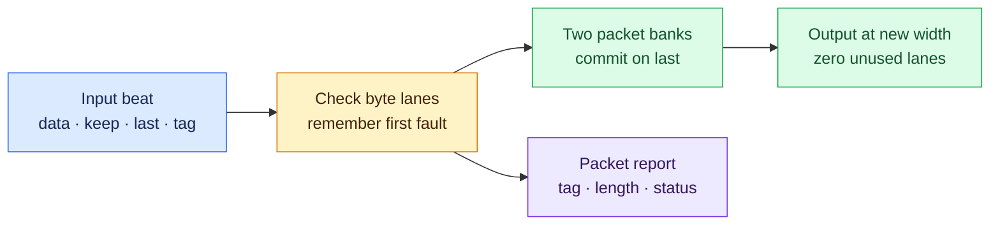
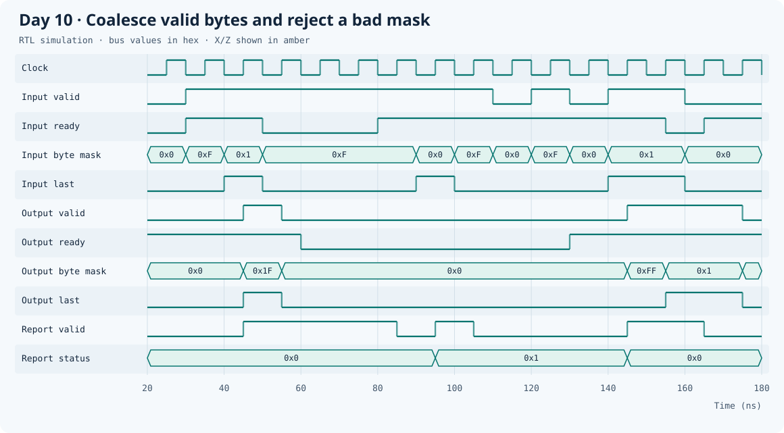

# Day 10 · Packet stream-width converter

Convert packets between two different bus widths while preserving byte order, the last marker, and the packet tag. The main top has two independent directions, 32 to 64 bits and 64 to 32 bits. Packet and report outputs can stall independently. Each direction can hold two complete packets, so a slow sink backpressures only its own direction.

The core teaching example is `packet_gearbox.sv`. It collects a frame before publishing it. The companion `streaming_gearbox.sv` demonstrates the smaller buffer needed when the upstream already guarantees framing.



## Byte and handshake rules

- Lane 0 holds the first byte. A displayed 32-bit word of `0x44332211` carries bytes `11 22 33 44` in that order.
- Data transfers on a rising edge when valid and ready are both high. A producer keeps data and flags stable while waiting for ready. The synchronous reset discards captured and committed packets, including a held report, and resets the counters.
- A non-final input beat must have all keep bits set. A final beat must have a nonempty low-lane prefix. Final output beats zero their unselected lanes.
- A packet's tag comes from its first beat and stays constant through its last beat. A failed frame consumes input through the real last marker and produces a report without payload output.
- A report returns selected-byte count, saturated at 65,535. Status 0 is OK, 1 is a bad keep mask, 2 is a changed tag, and 3 is frame size above the configured limit. An earlier beat's failure wins. On the same beat keep is checked before tag and length.
- The report slot is reserved before the hardware accepts the first beat of a new packet. A committed packet can drain while its report is held.

For `11 22 33 44 55` with tag 7, the 32-bit input transfers `0x44332211` with keep `0xf`, then `0x00000055` with keep `0x1` and last. The 64-bit output is `0x0000005544332211` with keep `0x1f` and last. The report has tag 7, length 5, status 0.

## Buffer choice

| Implementation | Upstream contract | Earliest output |
| --- | --- | --- |
| `packet_gearbox.sv` | Framing is validated at this block. A malformed packet has no output. | One unstalled cycle after the accepted final input beat. |
| `streaming_gearbox.sv` | Keep and identity are already validated upstream. The byte FIFO uses at least one complete input beat plus one complete output beat of storage. | Once enough bytes for an output beat, or a final byte, are in the FIFO. |

The default validated top has 128 bytes per bank. The Python reference and artifact encode 1–16 lane widths and packet capacity 1–65,535 bytes. Large buffers adversely affect generic mux-based synthesis. Hardware use needs a memory implementation suited to its clock and lane widths.

## Run it

```sh
make test
make lint
make synth
make formal
python3 width_campaign.py build/campaign
```

The default tests use 4→8, 8→4, 3→5, and 1→2 store-and-forward configurations, plus 4→8 and 5→3 cut-through configurations. The independent full-top test sent 190 frames in each direction and observed 677 cycles with both outputs transferring. The directed fault test checked all 256 eight-lane keep masks, report-length saturation after 65,609 input bytes, and reset with both banks occupied. The three-stage [chain workbench](width_chain.py) checks byte conservation, report order, backpressure and packet loss at each validation boundary. The small formal harness checks byte order and held outputs for 20 edges against a shift-register oracle.

The file workflow starts from [a cycle-scoreboard fixture](width_workload.py), [a small JSON recipe](width_recipe.py), or [Ethernet packet captures](width_pcap.py). The pcap importer reuses the repository's Day 04 capture reader. The [packet auditor](width_audit.py) reconstructs every RTL output from actual transfer logs. [WGC1](width_capture.py) adds a geometry header, 64-bit cycle number, exact record length, and per-record CRC. The [profile tool](width_profile.py) reports first-beat latency and packet completion separately and can compare payloads after repacking. The [excerpt tool](width_excerpt.py) clips at reset boundaries so an example retains the complete state needed for replay. [width_timing.py](width_timing.py) compares storage and model timing for identical legal traffic.

```sh
python3 width_capture.py check build/up.wgc
python3 width_profile.py build/up.wgc
python3 width_excerpt.py epochs build/up.wgc
```

All clocks and latencies in this project describe simulation handshakes. Generic synthesis checks elaboration and structure.

## Checked RTL waveform



The first two accepted input beats have masks `0xF` and `0x1`. They assemble a single five-byte output with mask `0x1F`. The empty final mask at 90 ns causes the report at 95 ns to carry status `0x1` (`BAD_KEEP`). That packet has no output; valid nine-byte and one-byte packets follow. The lesson checks packet order, exact bytes, and all four reports.

Run `make waveform` in this directory to regenerate the SVG. The raw VCD stays in the ignored build directory.
