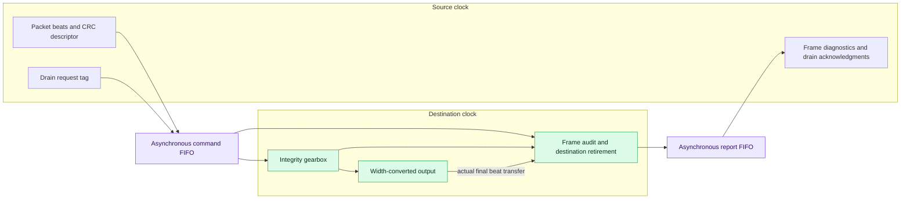
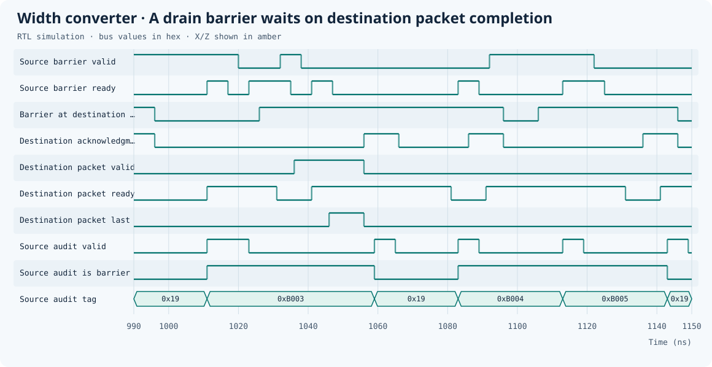

# Asynchronous integrity gearbox with ordered drain

[The dual-clock gearbox](../async_integrity_gearbox.sv) crosses an ingress
packet stream into a different clock domain, validates the recorded
length and CRC, and reformats passing packets at the destination bus
width. A separate return queue transfers ordered diagnostics to the
source clock. Use this when a capture DMA or packet source uses a
different clock from the FPGA's feed decoder. For example, a replay
controller can queue a barrier after its last archived frame and wait
for the matching acknowledgment before declaring the segment complete.

## Source and destination contracts

The ingress transfer and barrier ports use `source_clk`. Packet data
use the existing integrity-gearbox framing rules, including the tag
and CRC descriptor on the first beat and the final marker on the last
beat. A barrier carries a caller-owned 16-bit tag. It can be offered
while a frame is open, but transfers only at a frame boundary. At the
boundary a pending barrier takes priority over the next unaccepted
first beat. Already accepted packets retain their order. After a
barrier is queued, subsequent input can occupy free command entries.

The destination packet ready/valid interface uses `dest_clk`.
Packet output is independently backpressured. A complete
native audit records exactly one verdict for every accepted frame.
A failed frame is reported on the audit port and produces no output
packet. Passing packets can start before the source-clock consumer
has read their audit record.

When the destination reaches a barrier, it pauses later command
delivery. It waits until prior frame verdicts have entered the return
queue and every previously approved frame has transferred its last
output beat. The barrier acknowledgment enters the same return queue,
after all of those frame diagnostics. Later packets may flow once the
acknowledgment is queued. Source readiness for reading the report and
destination readiness for accepting packets both affect drain progress.

| Returned record | Fields |
| --- | --- |
| Frame, `audit_barrier=0` | Original packet tag, actual/declared length, actual/declared CRC, existing integrity status, destination diagnostic acceptance tick |
| Barrier, `audit_barrier=1` | Barrier tag, destination drain tick, cumulative counts of preceding audited/forwarded frames, and zero frame-specific fields |

The count fields wrap at `COUNT_W` bits. Internal comparisons use at
least four bits even when the reported width is smaller. The bounded
gearbox has at most two committed packet banks and a short report path,
so a wrap cannot conceal a nonzero backlog. Both FIFOs have
`2**ADDRESS_W` RAM entries plus a read skid slot. Each address width is
positive. Both clock domains must continue running for progress.

## Reset and implementation

Assert the shared asynchronous `power_reset` to abandon pending
packets, markers, and reports. The two local release synchronizers
deassert on their respective clocks, and the FIFOs wait for the peer
reset release. The producer and consumer discard any partially
assembled packet or unreplied barrier at the shared reset boundary.

The design reuses [the Day 06 asynchronous FIFO](../../day06-multiclock_latency_telemetry/latency_async_fifo.sv)
and its reset synchronizer. Map the memory and Gray-pointer paths
for the selected FPGA, and constrain delay and skew from Gray
registers into the first synchronizer stage using the actual clock
periods. The synthesis check is structural. Physical CDC timing
and metastability require the board implementation's constraints and
verification. [AMD Vivado CDC constraints](https://docs.amd.com/r/en-US/ug903-vivado-using-constraints/Constraining-Asynchronous-Signals)

## Checked simulation

A marker reaches the destination head at 1,026 ns. The preceding
packet's last beat transfers at 1,056 ns, permitting the marker to
enter the return FIFO. The subsequent barrier-tagged record becomes
visible in the source domain at 1,083 ns. The held status and
packet interfaces remain independent.

Run `make async-test async-lint async-synth async-waveform`. Three
asynchronous clock and lane ratios check 675 input packets, 258
forwarded packets, 83 barriers, and complete byte and audit identity.
The fixture exercises tiny FIFOs, modulo counter wrap, a barrier
offered while an input frame is open, a common reset with a held
packet, an unread audit and a queued barrier, and independent stalls
on both output paths.
