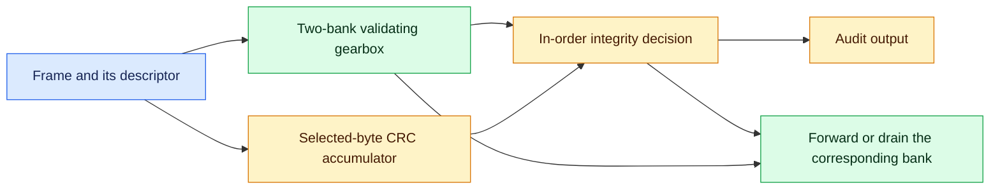
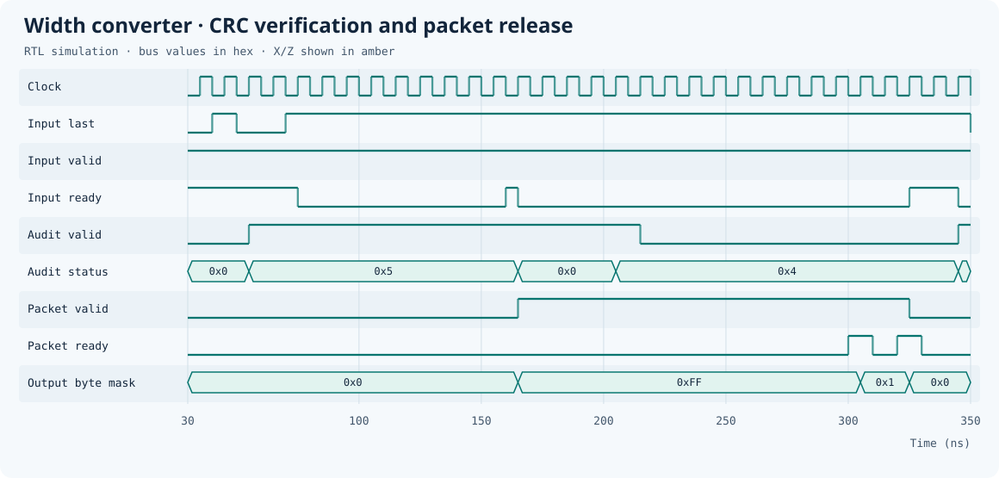

# Integrity-checked packet repacking

[The integrity gearbox](../integrity_gearbox.sv) adapts a packet stream to
another lane width after checking a declared byte count and CRC. A
market-data replay adapter can use it between a capture DMA engine and a
feed parser. The replay host supplies a packet descriptor with the recorded
count and CRC. A damaged or truncated buffer then produces a diagnostic
without feeding an incomplete message to the market state. Multiple
successive frames can reuse the same tag.

## Transfer contract

Instantiate `integrity_gearbox.sv` alongside `packet_gearbox.sv`. Geometry
follows the existing store-and-forward path. Supply `s_expected_bytes`
and `s_expected_crc` on the first accepted beat. The selected byte lanes
are fed in increasing order to reflected CRC-32/ISO-HDLC, with initial
state and final XOR both `0xffffffff`. The bytes `123456789` have the
standard digest `0xcbf43926`. Expected metadata remains independent of
the observed payload. Use a trusted descriptor source when corruption
could affect both signals.

On the rising edge with `audit_valid && audit_ready`, the report carries
the first beat's tag, actual byte count, expected count, actual CRC,
expected CRC, and result. The actual count saturates at 65,535. The actual
CRC includes every selected input byte, even when a sparse keep mask
causes structural rejection. One report is generated per completed input
frame.

| Status | Condition |
| ---: | --- |
| 0 | Length, CRC and framing passed |
| 1 | Keep mask violates the gearbox framing rules |
| 2 | Tag changes within a packet |
| 3 | Packet exceeds the configured capacity |
| 4 | Valid framed length differs from the expected byte count |
| 5 | Length is correct and the CRC differs |

Structural failures follow the original gearbox's first-fault priority.
A structurally valid but corrupt frame occupies a native bank while its
decision waits. The forwarding layer consumes and discards it internally
in packet order. Held audit and passing packet outputs each retain their
own stable fields. A valid frame's output can start once its audit record
has been staged, even while the audit sink is stalled. A prolonged stall
eventually fills the bounded storage and backpressures ingress.
Synchronous reset discards both banks, pending audit records and partial
checksum state.

## Simulation waveform

The first frame has a mismatched CRC. Its audit carries status 5 and no
packet beats leave the core for that frame. The next frame has the same
tag and correct integrity metadata. Its first output beat becomes valid
before the packet sink is ready and holds until the transfer. Run
`make integrity-waveform` to regenerate the checked waveform.

`make integrity-test` checks three lane ratios against an independent
byte-stream and Python CRC model with exact frame audit and payload
comparison. It includes empty and sparse keep masks, tag changes,
overlength frames, length and CRC corruption, multiple repeated tags,
and independently stalled packet and audit outputs. The default test,
lint and synthesis targets also check this top.
