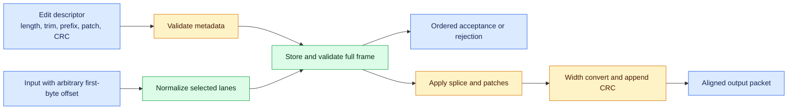
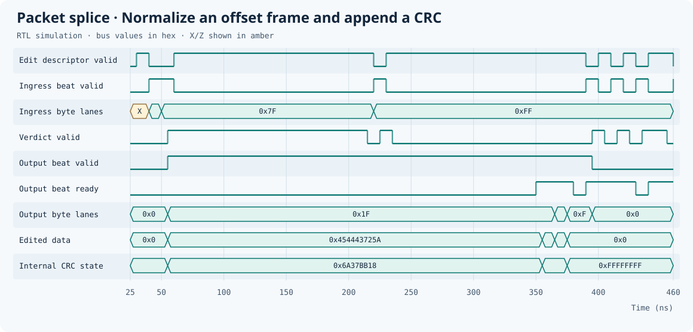

# Descriptor-driven packet splicing during width conversion

[The splice gearbox](../spliced_packet_gearbox.sv) accepts a packet whose
first byte may start at a nonzero bus lane. It validates and stores the
complete frame, removes selected head and tail bytes, adds a configurable
prefix, replaces up to four selected bytes, and optionally appends the
CRC of the edited result. While one accepted frame waits for its sink,
the other bank can collect and validate a successor.

A feed capture adapter can strip a private transport header and replace
it with the strategy's compact timestamp header before replay. A test
generator can patch a payload field and recalculate the application
record checksum during the same width conversion. The bytes here describe
a caller-supplied packet format. Any nested protocol fields that depend
on changed bytes require their own adjustment.

## Descriptor and input lanes

Transfer the descriptor before its packet. Supply the source byte count
and the head and tail trim lengths. The trims must fit within the source
length. The prefix length selects its valid low byte lanes. Patches use
offsets relative to the retained source bytes, before the prefix.
Bit `i` in `edit_patch_keep` enables byte `i` of `edit_patch_bytes` at
offset `edit_patch_offset+i`. Every enabled patch byte must be in range.

The first beat may use any contiguous range of lanes for a one-beat
packet. A nonfinal first beat must fill from its start lane through the
high lane. Intermediate beats use all lanes. Later final beats have a
nonempty low prefix. Only the first beat asserts `s_first`. Separate
`s_last` marks the real frame end. The source supplies that marker even
for a malformed or overlength frame, so the hardware can drain it.

## Output and CRC

The output begins in lane zero and clears unused byte lanes. Peeling the
entire input is allowed when a prefix or CRC still produces a nonempty
result. The optional trailer is reflected CRC-32/ISO-HDLC with initial
state and final XOR both all ones. It includes the prefix and the edited
body, with the low CRC byte first. It is an application trailer. The
CRC update takes place on accepted output beats, and the last body bytes
and first trailer byte can share a beat.

The packet verdict identifies the original descriptor tag, actual number
of selected input bytes saturated at 65,535, output byte count, and
status. Failed packets have zero output length and produce no payload
transfer. A bad metadata verdict takes precedence over later beat
checks. The first beat fault wins, and a declared-length mismatch is
checked after framing and capacity. Tags may repeat.

| Code | Meaning |
| ---: | --- |
| 0 | Valid packet and edits |
| 1 | Invalid first marker or byte-lane shape |
| 2 | Declared and observed byte counts differ |
| 3 | Declared or observed length exceeds the capture capacity |
| 4 | Invalid edit length, trims, prefix length, or empty result |
| 5 | An enabled patch byte falls outside the retained body |

Each new descriptor requires room for its eventual report. A valid
packet can drain while its report stays held. Packet and report fields
remain stable under backpressure. Synchronous reset abandons both
banks and the pending report. Use positive lane counts and capacities
and a prefix buffer of at least one byte. Valid outputs fit in a
16-bit byte count. The generic synthesis checks structure. The
parallel byte extraction and CRC unroll need device-specific timing
work for a chosen data width and clock.

## Verification

The first fixture puts `A` alone in ingress lane seven and finishes
with `BCDEFGH`. The descriptor removes `A`, changes `B` to `r`,
and starts the output with `Z`. The checked packet is
`ZrCDEFGH` with its four-byte CRC, transferred over a five-byte bus
while a second packet waits behind it.

`make splice-test` checks 747 reports, 499 emitted packets, and 1,322
exact output beats across 8→5, 3→7, and 1→2 lane profiles. Cases cover
invalid patches, bad masks and first markers, empty-body CRC, changed
length, dual-bank pressure, and repeated tags. The Python checks use
byte slices and a standard CRC implementation. `make splice-formal`
runs a 14-edge bounded hold and geometry check with covers for mixed
data/trailer output, invalid patches, and both output banks full.
`make splice-waveform` regenerates the measured figure.
