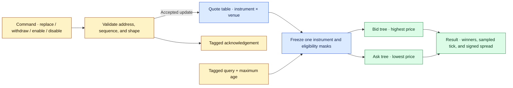

# Day 11 · Best Quote Selector

A quote says what one venue would currently buy and sell at. For each instrument, this circuit stores one quote per venue. On request it returns the highest current bid and the lowest current ask. Each side includes the originating venue, price, quantity, sequence, and age. This is a market-data block for synthetic feeds and offline playback.

## Follow one quote



A replacement at venue 0 posts a bid of 100 and offer of 106. Venue 1 then posts 102 and 105. A query sees a best bid of 102 and a best ask of 105, both from venue 1, so the spread is 3 ticks. If venue 0 improves its bid to 107 while venue 1 still offers 105, the consolidated result is crossed, with a signed spread of −2. Neither individual quote has to be crossed.

Run `make demo`. The actual simulation plays through these eight queries from a generated CSV file. The walkthrough verifies a fixed known-answer table independently of its comparison with the Python model.

| Query tag | What happened | Best bid | Best ask | Spread |
| ---: | --- | ---: | ---: | ---: |
| 11 | Query shares the edge of venue 1's first replacement | 100 | 106 | 6 |
| 12 | Both venues are visible | 102 | 105 | 3 |
| 13 | Query shares the edge of venue 0's improved bid | 102 | 105 | 3 |
| 14 | Improved bid is visible and the market crosses | 107 | 105 | −2 |
| 15 | Query shares the edge that disables venue 1 | 107 | 105 | −2 |
| 16 | Venue 1 is disabled and venue 0 is too old | — | — | — |
| 17 | A larger age window qualifies venue 0 | 107 | 110 | 3 |
| 18 | Venue 0 has withdrawn | — | — | — |

## Interface rules

| Signal group | Meaning |
| --- | --- |
| `cmd_valid / cmd_ready` | Send a command. It commits on the rising edge with both signals high and returns its tag and code. |
| `ack_valid / ack_ready` | Receive a command acknowledgement. A single retained acknowledgement blocks further writes until consumed. |
| `query_valid / query_ready` | Snapshot the pre-edge quote state for one instrument. The command path may transfer independently on the very same edge. |
| `result_valid / result_ready` | Receive snapshots in acceptance order. Once visible, the entire result stays stable through a stall. |
| `now_tick` | Supplied modular clock tick used at the command or query accepting edge. All ports are on the same clock. |
| `rst` | Synchronous reset. Clears buffered traffic, quote presence, sequence fences, and disabled flags. |

A blocked source must hold valid and payload until transfer. Valid outputs carry the only meaningful payloads. Reset cancels in-flight transactions. Generation of stimulus and trace files treats the reset edge as void on both channels.

| Opcode | Effect |
| ---: | --- |
| 0 | Replace both sides as one update. A missing side carries zero price and zero quantity. At least one side must be present. A positive bid must be at or below the ask when both are present. |
| 1 | Withdraw both sides and keep the accepted sequence as a fence. This works on an empty, enabled row too. |
| 2 | Enable this venue for this instrument. Previous quote content is cleared when disabled, and its retained sequence fence still applies. |
| 3 | Disable this venue for this instrument and drop its quote. |

Address checks precede opcode checks. Market-data operations next check enable state, sequence, and then any price/quantity conditions. Only valid market data changes a sequence fence. The first sequence can be any encoded value. From a known sequence, the next one must advance by at least one and less than half the modulus. A duplicate or a half-range distance is ambiguous and is rejected. Venue controls ignore unrelated payload fields.

For a query, the maximum age must be strictly below half the timestamp modulus. A quote qualifies when its modular age is at most the requested maximum and strictly below the half-range. The integration must manage the modular timestamp lifetime. Clear or refresh any record before it can survive a complete clock wrap. The block computes age from the external clock at query acceptance and does not infer expiry across additional wraps.

The result has separate masks for active and stale rows. Disabled or never-populated rows are absent from both. Equal prices use the lower venue index, independent of size, age, or arrival order. An absent side has an all-zero payload. The signed spread uses `PRICE_W+1` bits, equals ask minus bid when both exist, and is zero otherwise. The state is empty, bid-only, ask-only, open, locked, or crossed.

| Code | Meaning |
| ---: | --- |
| 0 | Success |
| 1 | Encoded instrument is outside the configured table |
| 2 | Encoded venue is outside the configured table |
| 3 | Unknown command opcode |
| 4 | Venue disabled for a market-data operation |
| 5 | Duplicate, backward, or half-range sequence |
| 6 | Invalid side shape or locally crossed update |
| 7 | Query maximum age reaches the ambiguous half-range |

Errored query responses carry the original tag and sampled tick, empty masks, and absent winners. A reset or disabled venue never exposes an earlier quote.

## Implementation and profiling

The quote store uses independent per-row metadata and quote payloads. A snapshot register retains candidate fields and eligibility calculated at the query edge. A second register captures two parallel tournament reductions. Each tree pads its leaves to a power of two with invalid candidates. The default has four instruments, four venues, 20-bit prices, 14-bit sizes, 16-bit timestamps, 12-bit sequences, and 16-bit tags. The tooling supports one to 24 instruments and venues with field widths from two to 28 bits.

| Profile | Instruments | Venues | Price bits |
| --- | ---: | ---: | ---: |
| default | 4 | 4 | 20 |
| solo | 1 | 1 | 8 |
| odd | 3 | 5 | 12 |
| wide | 6 | 8 | 28 |

The test bench measures one cycle from command acceptance to acknowledgement and two from query acceptance to an unstalled result. Every profile accepted one command and one query on each of 160 consecutive uncongested benchmark edges. These are simulation observations. The generic synthesis count is 7,085 cells, with area dominated by quote storage and read multiplexing. Clock frequency and board timing depend on implementation and constraints.

## Reproduce

Use Python 3.9+, Icarus Verilog, Verilator, and Yosys.

```bash
make test
make lint
make synth
make formal
make demo
```

- `make test` runs 136 Python tests, 32,768 exhaustive tournament vectors, and 32 co-simulation scenarios. The four geometry runs compare 15,564 sampled edges, 8,157 accepted commands, and 8,151 accepted queries. The scenarios cover every error code, reset while stalled, half-range checks, exact price extrema, and both output pipelines under backpressure. The demo adds a separately checked eight-query RTL replay.
- `make formal` uses Yosys SAT to prove ranking and forwarding for all five-candidate inputs and to check system flow and payload invariants through seven arbitrary input edges after a reset constraint.
- `make lint` checks the default and single-row geometries. `make synth` checks the default with generic synthesis.
- Reports and raw traces appear in ignored `build/` paths.

## Offline tools

| File | Where to start |
| --- | --- |
| [quote_store.sv](quote_store.sv) | Validation, mutation, acknowledgement |
| [quote_bbo.sv](quote_bbo.sv) | Ready/valid pipeline, timestamps, eligibility, signed spread |
| [quote_reduce_side.sv](quote_reduce_side.sv) | Reusable price-rank tree with consistent tie order |
| [quote_model.py](quote_model.py) | Independent dictionary book, ordered ranking, and cycle reference |
| [quote_workload.py](quote_workload.py) | Directed and seeded scenario generation |
| [quote_verify.py](quote_verify.py) | Cycle-specific differences and measured coverage |
| [quote_csv_tool.py](quote_csv_tool.py) | Convert named rows to clock-scheduled events |
| [quote_tool.py](quote_tool.py) | Replay, simulate, audit, and report |
| [quote_archive_tool.py](quote_archive_tool.py) | Pack and unpack sampled traces with a versioned profile header and row checksums |
| [quote_compare.py](quote_compare.py) | Compare two exported captures by reset epoch and channel, and evaluate paired latency changes |

For a complete workflow, first run `make demo` to produce a sample catalog and named CSV. You can rerun every stage individually.

```bash
python3 quote_csv_tool.py build/example/quotes.csv build/example/catalog.json build/custom/events.jsonl
python3 quote_tool.py replay build/custom/events.jsonl build/custom/drive.txt --window 3:7:result
python3 quote_tool.py simulate build/custom/drive.txt build/custom/trace.txt --image build/default.vvp
python3 quote_tool.py audit build/custom/drive.txt build/custom/trace.txt --capture build/custom/observed.jsonl --markdown build/custom/report.md
python3 quote_archive_tool.py pack build/custom/trace.txt build/custom/trace.bq --kind trace
python3 quote_archive_tool.py unpack build/custom/trace.bq build/custom/decoded.txt
```

The CSV takes integer nanosecond timestamps, instrument and venue names, and integer tick prices. The importer subtracts the first timestamp and rounds later dates up to the next whole edge. If the first row has data, it prepends a reset and shifts data by one cycle. A JSON-lines replay can supply several same-edge offers. Each channel sequences its offers in file order, and the side and price are sampled on the actual accepting edge. The result report includes active and stale counts, winning venues, crossing observations, and latency percentiles. A recorded market-state run represents the observations in the capture, including any unsampled gap between its endpoints.
