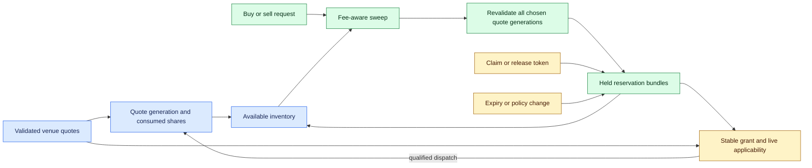
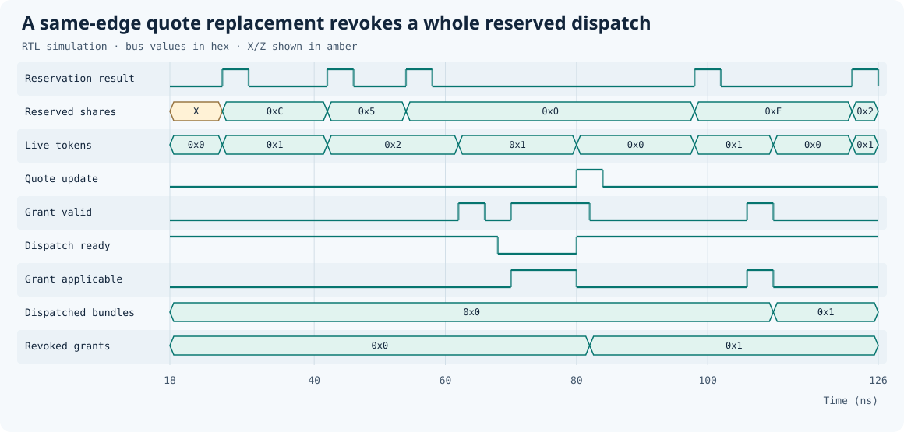

# Quote-generation reservations

A conventional sweep result is a snapshot. If two strategy lanes use the same snapshot, both can direct a child toward the same displayed shares. [quote_reserved_sweep.sv](quote_reserved_sweep.sv) couples the fee-aware sweep planner with bookable inventory, bounded tokens, and a qualified dispatch channel. It is useful in a gateway where several logical strategies share one local view of displayed venue liquidity.



## Snapshot, booking, and inventory

The quote and fee-policy interfaces match the existing fee-aware selector. The reserving top adds `query_ttl`, token fields on the planner result, and an action channel. All transfers are ready/valid on the rising edge. The existing BBO and snapshot sweep tops remain available.

Each instrument, venue, and side has local availability equal to displayed quantity minus both held reservation shares and shares already dispatched against the current quote. The planner uses this available amount with its existing quantity caps and signed fee ranking. Buy and sell inventory are independent. A successful quote replacement or withdrawal advances the row's internal nonwrapping revision. A real enable/disable change also advances it. Repeated enable on an already enabled row retains the same quote and its consumed shares. Rejected commands leave the row untouched. The external source sequence can wrap while the internal revision remains unique.

The query snapshots adjusted quantities and policy and then ranks the children. At booking, the controller checks freshness, all selected quote revisions, the absence of a concurrent selected-row mutation, and policy consistency. A new policy commit anywhere from query acceptance through booking fences the plan. A concurrent quote write or policy commit on the explicit booking edge has priority. The controller either books the whole selected bundle as one token or reports that the plan could not book. All-or-none queries also require sufficient available displayed quantity to satisfy the entire request.

| `result_reservation` | Outcome |
| ---: | --- |
| 0 · held | A token owns all returned children. |
| 1 · no plan | Sweep inputs were invalid or no plan had children. Consult `result_status` for the sweep's original outcome. |
| 2 · quote changed | A selected quote grew stale or its generation changed while the sweep was preparing. |
| 3 · policy changed | The fee/eligibility policy was committed during the query or its booking edge. |
| 4 · no token | Every usable slot is occupied or exhausted. |
| 5 · bad TTL | The lease duration is zero or reaches the timestamp half-range. |

A successful response adds `result_slot`, `result_generation`, and a modular deadline `result_expires`. The deadline starts at booking. A result that could not book has zero children, quantity, value, and token fields. A held ready/valid result remains an immutable description of its booking edge, including when a later event invalidates its token before the sink accepts the result.

Each slot's token generation advances without wrapping. An exhausted token slot retires until reset. A venue row similarly stops offering reservations after its internal quote revision runs out. Its displayed quote can still serve the independent snapshot selector. The tests use small geometry to exercise both exhaustion paths.

## Claim, release, and revocation

Present an `action_slot` and `action_generation` with the caller's tag. Set `action_claim=1` to obtain the reserved bundle, or zero to release it. One grant mailbox retains the result until `grant_ready`. A successful release frees the held shares on the action acceptance edge. A successful claim prepares a grant without spending the reservation.

**Dispatch only when `grant_valid && grant_ready && grant_applicable` are all high.** The grant's tag, token, instrument, side, and child records stay stable under backpressure. Applicability is a live qualifier and can fall while these fields stay held. The adapter accepts a revoked grant as discarded work so it can make progress. A qualified claim transfers all of its children and moves their shares from held to consumed in one edge. Resubmitting that token cannot spend the same amount again.

| `grant_status` | Meaning |
| ---: | --- |
| 0 | Claim queued or release committed. Only a claim can become applicable. |
| 1–2 | Slot address or token generation invalid. |
| 3 | Token already retired. |
| 4 | Token matched but was invalidated on the accepting edge. |

An entire held bundle invalidates on its lease deadline, when any included quote ages out or changes, or on any policy commit. Other quotes and instruments are unaffected. Same-edge quote and policy changes and expiry win over grant dispatch. Invalidating one child returns the holds for all children. Previously dispatched quantities remain consumed until the relevant quote itself changes.

The timestamp follows the base modular age contract. Use positive TTLs below half the counter range and clear or refresh quote state before a full timer wrap could make old timestamps alias current ones. Reset clears held tokens, counters, policy, and consumed quantities. A live gateway still needs adapter reconciliation after reset, including any message accepted for dispatch before the cut. This module accounts for local dispatch against displayed liquidity. Actual venue executions and cross-venue completion depend on the downstream adapters.

`reservation_count` reports currently usable tokens. Cumulative counters report bookings, dispatches, explicit releases, automatic invalidations, and previously successful grants that transferred after revocation. All cumulative counters saturate.

## Checked dispatch waveform



The first result reserves 12 shares across two venues at 26 ns. A competing query receives the remaining five shares at 42 ns. The first claim becomes applicable at 70 ns and waits through egress backpressure. At 80 ns the adapter asserts ready on the same cycle as venue 0's quote replacement. Applicability falls, and the grant transfers at 82 ns with no debit. A fresh plan reserves 14 shares at 98 ns. Its qualified claim debits the bundle at 110 ns and leaves two shares available for the next result.

```sh
make test-reservation lint-reservation synth-reservation formal-reservation reservation-waveform
```

[The independent reference](quote_reservation_model.py) scans logical tokens, adjusts displayed quantities, and uses the existing Python fee sort. The four RTL geometries compare 10,078 sampled edges, including simultaneous updates and booking, revocation on dispatch, wraparound expiry and source serial, idempotent venue controls, and identifier exhaustion. The host tests separately check known allocations and disposition. The reduced 12-edge SAT check verifies held grant data, nonrevival of waived grants, and exclusion of conflicting dispatches. Synthesis records generic structure before placement and device timing.
