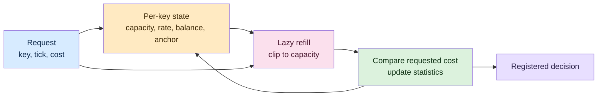
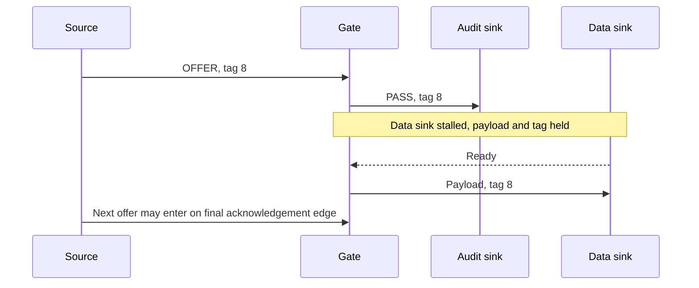
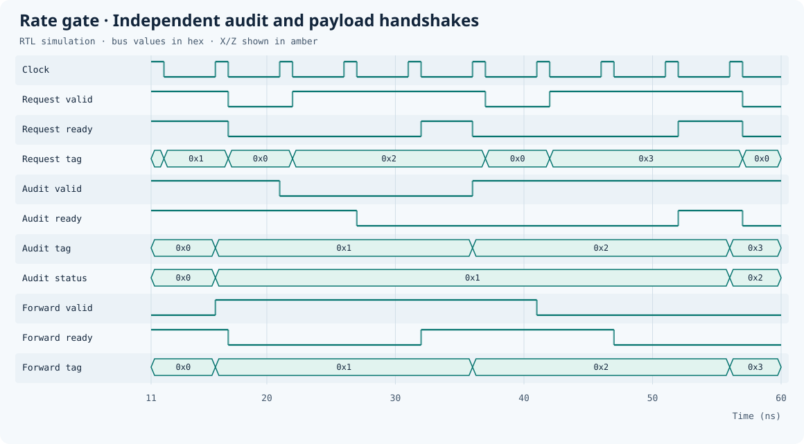

# Day 12 — Message Rate Limiter

A token bucket is a budget that refills over time. Each message specifies how much of the budget it needs. This SystemVerilog design accepts or limits it and reports the exact balance afterward. Five independent buckets are implemented by default. A wrapper can forward approved messages and deliver the audit record through a separate ready/valid port.

A key can represent a class of gateway traffic or an individual session. A configure command sets the maximum burst size and steady refill. Logical time is supplied by the caller, so a stalled bus does not silently advance a packet timestamp.

The [hierarchical limiter](hierarchical_limiter.md) adds atomic port, group and session budgets with protected capacity for authenticated control sessions. Its [RTL waveform](hierarchy_waveform.svg) shows how a control session uses group headroom after an ordinary offer is limited.

## Work through one bucket

Set capacity to four tokens and refill to one token per tick. Configuring the bucket starts it full.

| Tick | Command | Available before the charge | Decision | Balance afterward |
| ---: | --- | ---: | --- | ---: |
| 100 | Configure | 0 from the previous row | OK | 4 |
| 100 | Offer 3 tokens | 4 | PASS | 1 |
| 100 | Offer 2 tokens | 1 | LIMITED | 1 |
| 102 | Offer 2 tokens | 3 | PASS | 1 |
| 110 | Inspect | 4 after clipping the refill | OK | 4 |

The limited offer consumes nothing. A second key can receive an offer on the next clock cycle and uses its own policy, balance, and time anchor.

## Data path



`message_rate_limiter.sv` owns the state table, operation checks, output register, and counters. `rate_refill.sv` handles the arithmetic. If the bucket's last anchor is `a` and the offered tick is `t`, the block computes `elapsed = (t - a) mod 2^TICK_W`. A distance in the lower half of the range is forward, including zero. Other distances return `BAD_TICK` without changing state.

For forward time, the available balance is `min(capacity, balance + elapsed * rate)`. The multiplication and addition keep the full intermediate width. After the calculation, only a passing offer subtracts its cost. Inspection, clearing statistics, and both passing and limited offers advance the anchor to the command's tick.

The half-range rule assumes the time source advances each active key by less than half the tick space between observed anchors. A missed full wrap aliases to a smaller modular distance. The `bridge` tool demonstrates how to insert timestamped inspections into an offline trace to stay within the rule. A real deployment should maintain the same deadline in its clock source and account for any queue delays.

## Interface

All requests share one ready/valid input. On an edge with `s_valid && s_ready`, the design updates the addressed bucket and saves one result. While the result stalls, the hardware holds every output field stable and stops accepting requests. An edge may deliver the old result and accept a new request. With an open sink, the next edge delivers the result.

| Code | Operation | Request fields |
| ---: | --- | --- |
| 0 | Configure or disable | `s_amount` is the capacity, `s_rate` is tokens per tick, and `s_enable` selects enabled state. Enabled policies require nonzero capacity and refill no greater than capacity. Disable uses zero capacity and refill. |
| 1 | Offer | `s_amount` is a nonzero message cost. Rate and enable are zero. |
| 2 | Inspect | Amount, rate, and enable are zero. |
| 3 | Clear statistics | Amount, rate, and enable are zero. Keeps the policy and current balance after refill. |

The key and correlation tag are echoed along with the operation. Configuration replaces the full bucket and resets its statistics. Inspection and clear are accepted on disabled rows, where the stored anchor and zero token state are reported. A disabled offer returns `DISABLED`.

| `m_status` | Decision | Meaning |
| ---: | --- | --- |
| 0 | OK | Configuration, inspection, or statistics clear completed. |
| 1 | PASS | Offer was admitted and its full cost was charged. |
| 2 | LIMITED | Offer did not have enough available tokens. |
| 3 | BAD_KEY | Encoded key lies outside the implemented table. |
| 4 | BAD_FIELDS | An operation-specific field combination is invalid. |
| 5 | DISABLED | The offer targeted a disabled bucket. |
| 6 | BAD_TICK | The timestamp's modular delta is in the upper half of the range. |

Bad keys take precedence over bad fields. Bad fields are checked before configuration, disabled-offer handling, or age checks. Rejected keys and invalid fields leave state unchanged. `m_before` reports the refilled pre-charge balance for a valid timed request or the current stored balance for replacement and invalid requests. `m_balance` reports the committed balance. Counters independently track passing offers, limited offers, and tokens charged. Each saturates instead of wrapping. Its sticky flag records the first increment that would lose information.

Reset is active high and synchronous. It invalidates the result slot and resets every key. No request or result handshake counts on a reset edge, even if the base module's old result register was valid before that edge.

### Forwarding wrapper

`message_rate_gate.sv` captures one opaque `DATA_W`-bit message on the request handshake. Its audit interface receives every decision. Its data interface receives only passing offers. Either sink can accept first. The accepted half stops asserting valid while the pending half holds its original fields.



A reset cancels whichever half has yet to transfer. If one sink accepted before reset, it keeps that observation. Consumers can use the echoed tag and their own reset epoch to reconcile the streams.

## Run

```sh
make test
make lint synth
make formal
make test-netlist
```

Simulation uses Icarus and Python 3.9 or newer. Lint and synthesis use Verilator and Yosys with Slang. The formal target uses SymbiYosys with ABC and Boolector. Generated logs, vectors, and netlists appear under `build/`. The checked-in simulation driver normalizes inactive payload words to zero for trace comparisons.

```sh
python3 -B limiter_cli.py sample build/example
python3 -B limiter_cli.py prepare build/example/workload.csv build/replay \
    --stalls build/example/stalls.csv --run
python3 -B limiter_cli.py audit build/replay --key 0 --timeline build/key0.csv
python3 -B limiter_benchmark.py build/matrix/default/burst
```

CSV workloads have columns `cycle,action,key,tick,amount,rate,enable,tag`. The `cycle` is a producer arrival edge and the `tick` is the passed logical time. Stall files have half-open ready-low intervals `start,stop`. The host producer holds its pending request until hardware accepts it. Reset clears both its waiting queue and the accepted response slot. The generated summary counts these dispositions separately.

The `tune` subcommand takes a single-key `tick,cost` trace and evaluates explicit capacity and rate candidates, while `envelope` computes the smallest capacity needed for a fixed refill and reports the burst interval causing that requirement. The tuning calculations use software absolute time and describe the supplied finite lab trace. For multi-key absolute input, `bridge` accepts `tick,key,cost` and a JSON policy array with `key`, `capacity`, and `rate`. It writes modular fields to a standard workload CSV and retains absolute correlation in `clock-map.json`.

## Checked results

| Check | Result |
| --- | --- |
| Python | 122 unit and independent property tests passed. |
| Exhaustive arithmetic bench | 95,744 balance, rate, capacity, and timestamp cases. |
| Core Icarus matrix | 20 runs across five geometries, 20,810 sampled cycles, and 10,903 checked delivered decisions. All seven status classes and 8,711 result-stall cycles observed. |
| Forwarding bench | 734 cycles, 411 audited results, and 128 forwarded messages with both sink acknowledgement orders covered. |
| Synthesized netlist | 1,817 delivered decisions matched the same default-profile oracle. |
| Reduced formal | Safety proof passed and four cover goals reached. |
| Default generic synthesis | 3,846 primitive cells for the core and 3,848 for the forwarding wrapper with zero structural check problems. |

The unblocked default burst delivered 266 decisions in consecutive cycles after warm-up. Every decision in that run transferred one cycle after acceptance. Latency and throughput measurements come from RTL simulation. The resource report comes from generic synthesis. Increasing key count adds a table read mux and update decoding, while wider ticks and refill rates enlarge the refill arithmetic.

The source inventory counts 357 substantive RTL lines and 4,671 verification and tooling lines for a total of 5,028. It excludes comments and generated build outputs.

## Checked simulation waveform



For tag `0x01`, the audit sink finishes first while the payload is still stalled. For tag `0x02`, the payload sink finishes first and the audit record remains valid until its own sink is ready. Tag `0x03` produces a limited audit (`0x2`) with no forward transfer. The scoreboard checks that each ready branch sees its copy exactly once.

Run `make waveform` in this directory to rerun the checked bench and regenerate this cropped SVG. The full VCD is saved under `build/`.
