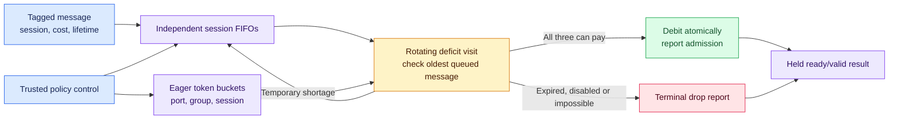
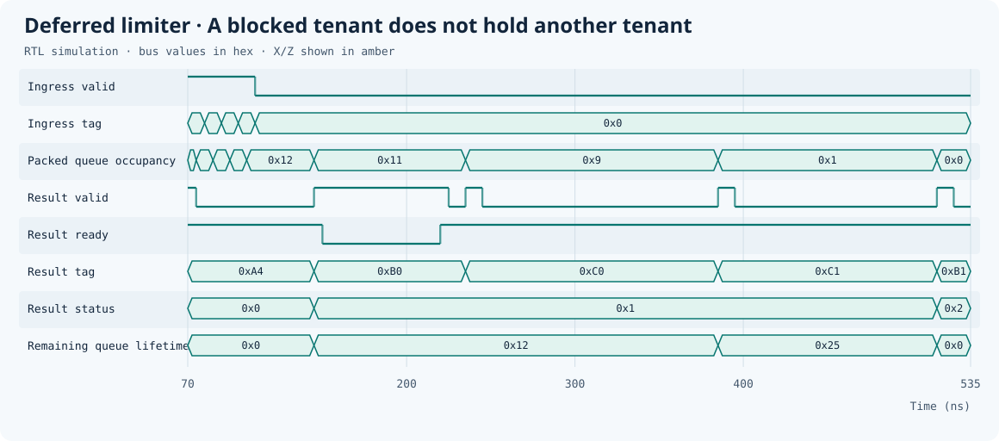

# Deferred admission with tenant deadlines

[deferred_rate_scheduler.sv](deferred_rate_scheduler.sv) is a queueing companion to the direct hierarchical limiter. Use it between a strategy merger and a shared venue encoder when briefly deferring an order is useful but forwarding a stale quote is harmful. Each session gets its own bounded FIFO. Shared port and group rates constrain aggregate traffic, while a configured control session can use protected reserve for cancels or recovery traffic. The scheduler adapts the deficit-round-robin algorithm to rate and deadline checks. [Shreedhar and Varghese, Efficient Fair Queuing Using Deficit Round-Robin](https://web.stanford.edu/class/ee384x/EE384X/papers/DRR.pdf)



## Contract

Instantiate with [rtl_deferred.f](rtl_deferred.f). The default has seven sessions, three groups, four entries per session and 12-bit costs and lifetimes. Port, group and session buckets refill once per core clock using the existing widened, saturating refill arithmetic. Admission uses the balance before the edge. It debits the charge first, then adds the next clock's refill. Supply clock frequency and an integer tokens-per-clock policy appropriate to the link.

The rotating selector visits one session on each available scheduling edge. At the start of a nonempty visit it credits that session's quantum once. If the head can be admitted, it charges its full cost and may stay for the next queued head. If either deficit or tokens are temporarily insufficient, it retains the deficit and rotates. Deficits saturate at the input cost width. The deficit resets when the old FIFO head is its final entry, including a full-replacement acceptance at depth one. A terminal drop incurs no token charge and rotates immediately. An empty visit advances the cursor without issuing a result.

Each accepted message loads a positive lifetime in core clocks. It first appears in the FIFO with that value, then its remaining budget decreases once per clock, including while the output is held. Zero is sticky. A lifetime that reaches zero before selection is reported as expired. An admitted result can wait for the sink with its original tag and payload. Consumers that require an external deadline after admission should check the application deadline at the final transmission stage.

An ordinary session must leave the configured protected floor at the port and group. A critical session stands on its provisioned session policy and can spend that shared headroom. All admitted messages still pay the same cost at all three scopes and against the session's deficit. Per-group or port changes can affect queued messages. A session policy cannot be replaced while that session's FIFO has entries.

## Ports and status

The input and admin streams can handshake on the same edge. Input checks session bounds and rejects zero cost or lifetime. `s_rejected` marks an accepted malformed input and the source receives no later result for it. An in-bounds full FIFO only backpressures offers for that session. If it removes a head on the same edge, it can accept its replacement. Occupancy is a packed vector with session zero in the low slice.

Management accepts set-port, set-group, set-session, get-port, get-group or get-session in `a_op` values 0 through 5. Configuration uses explicit capacity, refill and enable. Enabled buckets require positive capacity and a refill at or below it. The reserve field is legal only for port and group and cannot exceed capacity. Only session configuration accepts a positive quantum, parent group and critical flag. Disable and inspection use zero policy fields.

Results share one output. An accepted admin request takes priority over selection for that edge. The output record has `m_admin=1` for an admin response. For a deferred message it carries `m_admin=0`, opcode 6, original tag and data, cost, remaining queue lifetime, source session, routed group and a terminal status. Forward the data to the encoder only for ADMITTED.

| Code | Meaning |
| ---: | --- |
| 0 | Admin request completed |
| 1 | Admitted and charged at all three scopes |
| 2 | Queue lifetime expired before admission |
| 3 | Path includes disabled scopes |
| 4 | Message cost and protected floors cannot fit inside current configured capacities |
| 5 | Admin key is out of bounds |
| 6 | Invalid admin fields |
| 7 | Session cannot be reconfigured while it has queued messages |

For disabled and impossible, `m_detail` identifies the affected port, group and session in bits zero, one and two. For a data result, `m_depth` is the FIFO size before removing the head. `m_deficit` is the saved amount after the decision. `m_balances` packs three amounts after the charge and before that edge's refill with port at the low bits, group above it, and session above group. Admin inspection reports the selected pre-edge balance and session occupancy and deficit where applicable.

One held result blocks new decisions and admin acknowledgments until the sink is ready. Other FIFO entries may still be accepted and all stored lifetimes and bucket refills continue. Synchronous active-high reset suppresses handshakes and clears resident data, management policy, and any incomplete result. Restart the downstream session and apply policy at the corresponding reset boundary.

## Checked waveform



Tag `0xb0` uses the last of group 0's tokens. Its admission result is held until 225 ns. Group 0's subsequent message `0xb1` stays queued while group 1 admits `0xc0` at 245 ns and `0xc1` at 395 ns. The latter waits through multiple deficit visits for its cost of four. At 525 ns, `0xb1` transfers an expiration report with lifetime zero. The result slot's held record stays stable through the earlier stall.

```sh
make test-deferred
make formal-deferred
make waveform-deferred
```

The independent model uses software deques and absolute expiry edges. Four geometries check 18,294 cycles with 7,232 accepted messages, 6,951 terminal data results, 2,642 full-FIFO replacements and 5,283 held-output cycles. The reduced formal check covers a full replacement, held admission, deadline expiry, impossible costs and busy configuration. It checks the token and deficit conditions for every admitted head, ring occupancy, countdown, reset and stable output for 14 steps. Generic synthesis reported 12,132 cells and zero structural findings. Physical clock and area depend on target device geometry and placement.
