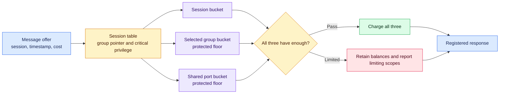
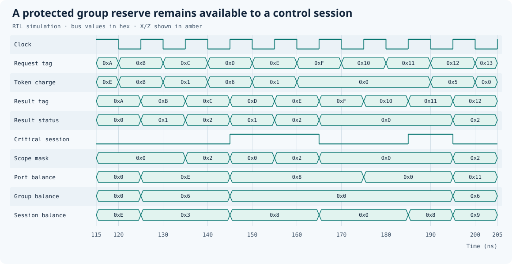

# Hierarchical rate limiter and protected control capacity

Instantiate [hierarchical_rate_limiter.sv](hierarchical_rate_limiter.sv) with [rtl_hierarchical.f](rtl_hierarchical.f). A single offer charges the port, one group and one session together. The default table has one port, three groups and seven sessions. The original [single-key and forwarding tops](README.md) remain available with their original interfaces.

A gateway can use the port bucket for its aggregate venue pacing, groups for policies shared across desks or message classes, and session buckets for per-strategy limits. Put cancellations and session-recovery control traffic on a trusted session with critical privileges. Ordinary traffic must leave a configured amount of capacity unspent at the port and group. The protection applies to those buckets and the critical session still has its own cap. Timed multi-bucket metering is specified in RFC 2698. This implementation uses group membership and a reserve floor to enforce a gateway-specific policy. [RFC 2698](https://www.rfc-editor.org/rfc/rfc2698.html)



## Admission and time

For each scope on a valid offer, the balance available at the supplied tick is the previous balance plus elapsed ticks times refill rate, clipped at the capacity. A session marked critical needs available tokens greater than or equal to the offered cost. An ordinary session needs available tokens greater than or equal to the cost plus protected floor at the port and group. Its own session floor is zero. The addition includes a carry bit for a threshold greater than the maximum representable capacity.

When all three pass, the full cost is debited from all three in one edge, and each pass count advances. When any scope limits, all three retain their refilled balances. Only the insufficient scopes increment their blocked counters. A disabled scope, invalid control field or stale tick prevents every path update. An enabled scope is stale when its modular elapsed tick distance reaches at least half the timestamp space. Install policy at a controlled configuration boundary and inspect idle scopes within the half-range deadline. As with the single-key top, configure replaces the selected row, resets its counters and starts it full at the supplied tick.

## Interface and wire widths

The top accepts one stream of tagged commands. Transfers occur on clock edges with ready and valid high. A result is offered the next cycle, and each complete result holds until transfer. The current result can transfer on the same edge that accepts its replacement. High reset suppresses both handshakes and its rising edge clears every policy and pending result.

| Opcode | Legal request fields in addition to timestamp and tag |
| ---: | --- |
| 0 | Configure port. `enable`, capacity in `amount`, `rate`, `reserve` |
| 1 | Configure group. `group`, `enable`, capacity, rate, reserve |
| 2 | Configure session. `session`, destination `group`, `enable`, capacity, rate, `critical` |
| 3 | Inspect port |
| 4 | Inspect group. `group` |
| 5 | Inspect session. `session` |
| 6 | Offer. `session`, positive cost in `amount` |

Every unspecified field must be zero. Disabling a row requires zero policy values. Use `group=0` to disable a session, and its route resets to zero. A group may be disabled while sessions refer to it, which blocks those offers. An enabled policy requires positive capacity, refill and reserve no greater than capacity, and a valid group selector. The critical bit is stored by a trusted configuration request. Callers must authenticate configuration separately from ordinary offers before feeding the shared port.

`m_scope` marks the selected rows using port, group and session in bits 0, 1 and 2. An offer reports all three. Configuration and inspection report only the named row, with zeros in the other positions. `m_group` reports the stored selected route for an offer or session inspection, and the supplied group for configuration. `m_critical` reports the selected session privilege. `m_op`, `m_session` and `m_tag` echo the command.

| Status | Result | Detail mask |
| ---: | --- | --- |
| 0 | Configuration or inspection OK | Zero |
| 1 | Offer passed | Zero |
| 2 | Valid offer was limited and no balance was charged | Insufficient scopes |
| 3 | Session selector out of bounds | Zero |
| 4 | Malformed fields or unsupported opcode | Zero |
| 5 | Offer targets a path with disabled scopes | Disabled scopes |
| 6 | At least one observed anchor is stale | Stale scopes |
| 7 | Group selector out of bounds | Zero |

Selector checks precede field checks, followed by disabled-path and anchor checks. Each of `m_port`, `m_group_state`, and `m_session_state` is the packed snapshot below. The pre-charge balance is the refilled quantity on a timed result and the previous stored balance on replacements and invalid commands. Both counters saturate and retain an overflow bit on a subsequent lost increment.

```text
MSB → LSB
before[TOKEN_W] enabled[1] anchor[TICK_W] capacity[TOKEN_W]
rate[TOKEN_W] reserve[TOKEN_W] balance[TOKEN_W]
passed[COUNT_W] blocked[COUNT_W] saturated[2]
```

`saturated[0]` is the passed overflow and `saturated[1]` is the blocked overflow. Selector widths are `clog2(dimension+1)` and include an invalid code. Set positive dimensions and widths.

## Reproduce the checked trace



On accepted tag `0x0b` at 125 ns, the ordinary offer spends 11 and leaves balances of 14, 6 and 3 for the port, group and session. Tag `0x0c` at 135 ns reports a group-only limitation and preserves those balances. Critical tag `0x0d` at 145 ns spends the last six group tokens and tag `0x0e` at 155 ns reaches the group cap. The waveform shows the registered result becoming visible at those edges. Transfers follow on the next rising edge with ready asserted.

```sh
make test-hierarchy
make waveform-hierarchy
make lint synth
```

The independent oracle uses Python integer arithmetic, associative keys and field-wise packed snapshots. The testbench compares every observed result, including stalls and reset flushes. The three simulation geometries cover 8,135 sampled cycles, 5,687 delivered decisions, 2,394 held-result cycles and three reset flushes. All eight statuses and seven nonempty limitation masks appeared. Ten additional host-side tests pin route changes, stale and disabled priorities, reserve overflow and counter saturation. Strict lint passed. Generic default synthesis produced 7,961 cells with zero structural problems. Clock frequency and platform-level traffic claims require a target place-and-route and measured workload.
