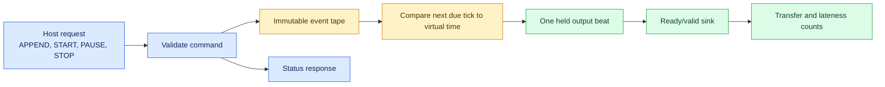

# Day 13 · Timestamped Stream Replayer

A replay tape is a short list of words saying *send these bytes at this tick*. Load the list on the configuration pins, start playback, and observe the 64-bit output. The same tape can be played several times. Software can build the list from a simple CSV or an offline Ethernet packet capture.

The core is useful for traffic-generator and timestamp-monitor exercises. Feed a known pattern into a pipeline, introduce stalls, and check whether the measured delays match the expected schedule.



## Walkthrough

Suppose offset 0 holds four bytes for tag 7 and offset 3 holds eight bytes for tag 11. With an always-ready sink, the replayer fills its output slot at tick 0 and transfers that first word at tick 1. It fills the slot with the second word at tick 3 and transfers it at tick 4. If the first word stays visible through tick 5 because the sink is stalled, it transfers at tick 5. The second word can fill the slot on that same edge and then transfer at tick 6. Its reported due tick remains 3 and its offered tick is 5.

The timer counts virtual active edges, excluding pause and stop-pending edges. Pause freezes scheduling immediately and lets an already visible beat transfer. Resume re-enables scheduling on the following edge. Stop also leaves any currently visible beat stable until it transfers. A stop can end a stream in the middle of a packet, so a downstream packet buffer needs to flush any unfinished packet when observing `done`. Synchronous reset clears the tape, control response, output slot, and counters.

A repeated pass is anchored at `last transfer tick + repeat gap + 1`. Add the programmed offset of each event to that anchor to get its due tick. Equal offsets are processed in insertion order. The 48-bit virtual time and 32-bit statistics saturate at their maximum values.

## Simulation waveform


The checked depth-16 simulation captures a beat with tag `0xA` held while the sink is blocked. The pause at 625 ns stops virtual time at tick `0x2`. Resume and stop follow. The sink raises ready at 930 ns, and the rising edge at 935 ns transfers the beat, clears valid, and pulses done. Run `make waveform` to regenerate the image and audit the entire capture against the Python model.

## Connections

| Interface | Contract |
|---|---|
| Clock and reset | One positive-edge clock and synchronous active-high reset. |
| Configuration | `cfg_valid/cfg_ready` accepts a request once. Keep all request fields stable during a stall. |
| Response | `rsp_valid/rsp_ready` returns a four-bit status and final tape length. One shared response slot can block a new request. |
| Output | `m_valid/m_ready` transfers one 64-bit beat. `m_keep` selects contiguous low lanes, with lane 0 at bits 7:0, and `m_last` closes the packet. A 16-bit tag is constant within each packet. |
| Output timing | `m_pass` is one-based. `m_due` is the planned tick and `m_offered` is when the core first filled the output slot. Actual acceptance is sampled at `now_tick` on the transfer edge. |
| Lifecycle | `active` and `paused` describe the run. `done` pulses for one edge after normal completion or a graceful stop. |
| Counts | Beats, packet endings, late offers and complete passes count accepted handshakes. They clear on every accepted start and reset. |

| Code | Request | Data fields used |
|---|---|---|
| 0 | Append | `cfg_tick`, `cfg_data`, `cfg_keep`, `cfg_last`, `cfg_tag` |
| 1 | Clear | Removes programmed tape while idle. |
| 2 | Start | `cfg_repeats` must be nonzero. `cfg_gap` inserts repeat separation. |
| 3 | Pause | Valid while playing and neither paused nor stopping. |
| 4 | Resume | Valid while paused and neither idle nor stopping. |
| 5 | Stop | Valid in an active run. Let a held output transfer before terminating. |

The append checks run in capacity, timestamp, mask, then tag order. A partial low-lane mask is allowed on a final beat only. Appends are refused while active. Offsets must be monotonic and a start requires a nonempty tape ending at a packet boundary. Configure a positive `DEPTH`. The default 16-entry tape fits small simulation exercises, and regression also uses depths 1, 3, and 32.

| Status | Value | When reported |
|---|---:|---|
| OK | 0 | Accepted operation |
| BAD_OP | 1 | Opcode 6 or 7 |
| BUSY | 2 | Active clear, append, or start |
| FULL | 3 | Append exceeds tape depth |
| BAD_TIME | 4 | Append timestamp moves backwards |
| BAD_KEEP | 5 | Empty, gapped or partial nonfinal mask |
| BAD_TAG | 6 | Tag changes inside an open packet |
| EMPTY | 7 | Start without an image |
| OPEN_PACKET | 8 | Start before closing the final programmed packet |
| BAD_REPEAT | 9 | Start with zero passes |
| BAD_STATE | 10 | Pause, resume, or stop conflicts with lifecycle |

## Run and check

With Icarus Verilog, Python 3.9 or later, Verilator, and Yosys with the Slang plugin available:

```sh
make test
make lint
make synth
make formal   # Optional bounded checks with SymbiYosys and Boolector
```

The simulator saves every observed pin snapshot under `build/`. The independent Python oracle checks all accepted programming responses, output and counter values cycle by cycle over **31,220 clocks** across four geometries. Those campaigns transferred **5,579 beats** and **2,576 packet endings**. Three additional dense, sparse, and mixed profiles compare **112 accepted beats** against an analytical scheduler with periodic sink stalls. A separate limits bench injects near-maximum state to check 48-bit time and 32-bit counter saturation. The formal target checks output and response hold, tape stability, tag framing and counter behavior for 22 edges with arbitrary legal requests and sink stalls. Cover witnesses exercise valid replay after a malformed append, a second pass, a hold through pause, and normal end of two passes.

The core can offer one beat per clock within a pass when consecutive events are due and the sink stays ready. This is a simulated interface throughput. Default-depth generic Yosys synthesis produced 6,815 cells before FPGA mapping and is used as a structural check.

## Make your own replay tape

Create `build/packets.csv` with a header and exact decimal nanosecond timestamps. The payload field is unseparated hexadecimal.

```csv
time_ns,tag,payload
12.5,7,01020304
42.5,11,1122334455667788
```

```sh
python3 replay_cli.py compile-csv build/packets.csv build/image.trp --depth 16
python3 replay_cli.py inspect build/image.trp --repeats 2 --gap 3 --verbose
```

The default compiler uses a 100 MHz conversion rate, ceiling rounding, and one tick between serialized beats. It subtracts the first packet's timestamp before converting to virtual ticks. Set `--clock-hz`, `--lead`, `--beat-spacing`, `--packet-gap`, or `--speed` to change the schedule. Use `--collision fail` to reject times that the configured spacing cannot accommodate. `compile-pcap` accepts classic Ethernet PCAP with either byte order and either time resolution. It supports EtherType, VLAN, and time filters.

Use the following lines as `build/control.txt`:

```text
load image.trp
start 2 3 -> OK
await_done 60
```

```sh
python3 replay_cli.py script build/control.txt build/user.stim --depth 16
vvp build/depth-16.vvp +stim=build/user.stim +trace=build/user.trace
python3 replay_cli.py audit build/user.stim build/user.trace --depth 16
python3 replay_cli.py compare build/image.trp build/user.stim build/user.trace --repeats 2 --gap 3
python3 replay_cli.py metrics build/user.stim build/user.trace --verbose
python3 replay_cli.py export build/user.stim build/user.trace build/accepted.csv --reference accepted
```

A script can also use `sink off/on`, `responses off/on`, `pause`, `resume`, `stop`, `idle N`, `await_offer N`, and `reset`. Use an optional `-> STATUS` on configuration commands to assert acceptance or expected rejection. `transform` crops, rebases, and scales timestamps while preserving complete packets. If a capture is larger than the on-chip tape, `python3 replay_partition.py split build/image.trp build/parts --depth 16` writes independently loadable tape images and a checked manifest. Images are loaded and run one at a time by the host. The manifest retains their source offsets for comparison and merging offline.

A TRP image begins with a little-endian header containing magic `TRP1`, a 16-bit version, 16-bit record size, 32-bit record count, and CRC-32 of the records. Each 16-byte record has offset, data, tag, keep, and last fields in that order with widths 32, 64, 16, 8, and 8 bits. The last byte is either 0 or 1. The relative timestamps are 32-bit so the capture compiler rejects inputs that cannot fit in one virtual epoch.
