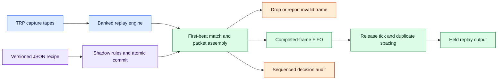
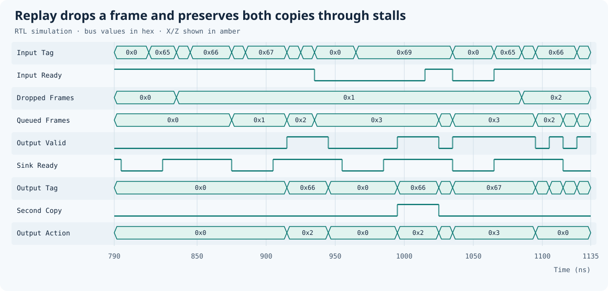

# Deterministic replay impairment

The [packet impairment stage](replay_impairment.sv) sits between a replay engine and a test consumer. A versioned recipe can drop complete packets, delay them with repeatable jitter, duplicate them with independent spacing or flip selected payload bits. Completed packets enter a bounded in-order queue. Each packet keeps the rule, revision and run identity selected when its first beat transferred.

Use the stage to validate a market-data gateway or capture pipeline under controlled replay faults. For example, drop the packet that advances a feed sequence, duplicate the recovery payload, then corrupt a later payload byte to exercise parser diagnostics. Repeat the same tape, run identity, seed and recipe to reproduce the actions. Keep the ingress trace when comparing wall-clock latency because upstream stalls change when a packet reaches the stage.



## Connect the hardware

Use a common positive-edge reference clock and saturating 64-bit `wall_tick`. The banked replayer supplies that clock count directly. Connect its stream fields to the matching input fields. In an adapter, derive `s_first` from the absence of a previously admitted unfinished packet, and reset the adapter's open flag after a final beat or matching truncated retirement. Connect `abort_valid = done && done_truncated` with the retiring bank and run. A matching abort discards only the unfinished capture. Completed packets and held output remain valid through any later source retirement.

Each frame begins with `s_first`, consists of one or more beats, and ends on `s_last`. Every nonfinal beat uses all eight lanes. A final beat must select a nonempty contiguous low-byte prefix. Bank, run ID, pass and tag must remain constant over the frame. The stage holds every output field while `m_valid && !m_ready`. The source must do the same while its input is stalled. An invalid length, marker, or metadata change discards the entire frame. Keep supplying bytes to the actual last marker for a malformed input. The explicit abort signal covers a run stopped before its last marker.

Packet ordinals begin at zero and increase for each new capture, including packets that are dropped, malformed, or later aborted. A new source bank/run pair restarts the sequence. Ordinals continue across passes and saturate. The source must serialize runs, as the existing banked top does. Timing and data sidebands are original per-beat fields. Mutated payloads retain their byte counts and masks. Invalid lanes are zero on the output.

Defaults are four frame locations of up to 16 beats, four rules, a 32-bit run ID, and a 16-bit revision. The run width can be one through 32 bits. A packet in capture holds a reserved write location, so that location cannot also contain a queued frame. A planned drop needs no write bank, so it can drain while the completed queue is full. A completed packet cannot overtake the head while the head waits for its eligibility tick or second copy. After release is qualified, data can transfer at one beat per clock within a packet. The queue has a registered launch between frames. The current implementation uses register-based packet storage. Device timing and area require a mapped flow.

## Configure and reproduce a recipe

The compiler accepts a JSON object with `version: 1`, `seed`, and a list of `rules`. Integer fields accept JSON integers and Python-style explicit radix strings. Missing constraints are wildcards. An explicit tag defaults to an exact 16-bit mask. A rule can constrain tag bits, bank, run ID, and an inclusive ordinal range. The lowest numbered matching enabled rule wins. The compiler identifies rules completely shadowed by an earlier rule.

| Rule action | Effect on a valid frame |
| --- | --- |
| `pass` | Emit the original complete frame after any configured timing delay. |
| `drop` | Consume the complete packet and write a drop audit. |
| `duplicate` | Emit two identical copies. Retain the same origin metadata and distinguish the second with `m_copy`. |
| `corrupt` | XOR a nonzero 8-bit mask into the zero-based byte offset. An offset miss emits the original frame and records its own verdict. |

The first eligibility tick is the saturating sum of the first accepted ingress tick, `delay`, and a seeded jitter value masked by `jitter_mask`. The generator applies 32-bit xorshift with shifts 13, 17 and 5 to the policy seed folded with run, bank, pass, tag and ordinal. Capture timing and backpressure influence eligibility through the ingress timestamp, while the selected jitter and packet action remain deterministic. The second copy becomes eligible at the saturating sum of the first copy's final transfer tick, `copy_gap` and one. The output arbiter still has to launch and reach a ready sink.

```json
{
  "version": 1,
  "seed": "0xdb70f10a",
  "rules": [
    {"tag": 101, "action": "drop"},
    {"tag": 102, "action": "duplicate", "delay": 6, "jitter_mask": 3, "copy_gap": 4},
    {"tag": 103, "action": "corrupt", "flip_offset": 8, "flip_mask": "0x80"},
    {"bank": 1, "first": 1, "last": 3, "action": "pass", "delay": 10}
  ]
}
```

| Command | Meaning |
| ---: | --- |
| 0 WRITE | Update an addressed rule in the inactive bank. |
| 1 READ | Inspect an addressed rule. `cfg_read_active` chooses the active or inactive bank. |
| 2 CLEAR | Clear every rule in the inactive bank. |
| 3 COMMIT | Swap banks, install the selected seed and increment the revision. The previous active bank becomes the inactive bank. |

Commands other than READ compare `cfg_expected_revision` with the active revision. The response echoes opcode and slot and returns current seed and revision, or the newly installed seed and revision on successful COMMIT. WRITE and READ also return the selected pre-edge rule. A packet beginning on the commit edge uses the previous active policy. The affected packet records its revision and its complete treatment through all subsequent beats and queued copies. The revision counter saturates. A new commit at its terminal value requires reset.

Status values are 0 OK, 1 stale revision, 2 slot out of range, 3 invalid enabled rule, and 4 exhausted revision. Invalid enabled rules include reversed ordinal ranges or a corruption action with zero mask. A disabled rule can carry zeroed fields. The packed `cfg_rule` fields run from most to least significant in this order.

| Field group | Widths |
| --- | --- |
| Enabled, tag, tag mask | 1, 16, 16 |
| Run wildcard, run ID, bank wildcard, bank | 1, RUN_W, 1, 1 |
| First ordinal, last ordinal, action | 32, 32, 2 |
| Delay ticks, jitter mask, copy gap | 32, 8, 32 |
| Byte offset, XOR mask | 16, 8 |

## Audit and verification

The decision audit starts at sequence zero. It reports bank, run, tag, pass, ordinal, revision, rule slot, planned action, actual verdict, arrival, terminal and eligible ticks, and byte count. An unmatched packet reports rule slot `RULES`. The received frame verdicts 0 through 3 mean forwarded, dropped, duplicated, and corrupted. Codes 4 through 7 report malformed framing, excessive capacity, source abort, and out-of-bounds flip. The audit stage can drop a report while it is full. `lost_audits` counts these misses and `audit_cursor` advances for every attempted frame report until saturation. The output path proceeds independently. Save the terminal cursor and loss count after draining the audit to check for gaps. Counters for verdicts, emitted copies, stalls and queue peak are readable as live outputs.

```sh
make test-impairment
make lint-impairment synth-impairment formal-impairment waveform-impairment
python3 replay_impairment_recipe.py build/impairment-demo/recipe.json compile
python3 replay_impairment_recipe.py build/impairment-demo/recipe.json \
    predict build/impairment-demo/bank-0.trp --run 1 --bank 0 --passes 2
```

The [recipe compiler](replay_impairment_recipe.py) produces ordered inactive-bank writes and a commit. Its prediction operates on the original packet bytes and per-pass ordinal, and emits one entry per frame. The [audit reader](replay_impairment_audit.py) decodes live words and validates the recorded sequence. The [native integration](tb_banked_impairment_demo.sv) loads two CRC-checked TRP files and the compiled recipe, then exercises both banks under a periodic sink stall. The host compares every input and output payload, run, mask, eligible tick, source timing field and decision with the original inputs. The test checks 14 source packets and 14 output packets, including three drops, three duplicated frames, two byte flips, two offset misses and the pass-through frames.

The separate cycle scoreboard uses independent packet assembly and a deque. Three profiles check 22,974 clock edges over one-, three-, and four-entry packet queues. They compare all valid payloads and handshakes, including 2,282 emitted copies and all eight frame verdicts. The cases include saturation, abort, loss while the audit is stalled, full-queue drops, low-lane masking, and a mid-packet revision change. The seven host tests check rules, JSON geometry, repeatability, and malformed audit histories. The bounded formal harness checks hold and packet geometry for 15 edges and covers duplicate replay, corruption, truncation, and a drop with the queue occupied. That target uses the Slang plugin, ABC, and Z3.



The tag-101 frame is dropped at 835 ns and never appears at the sink. Tag 102 first becomes valid at 915 ns and repeats with its copy bit set at 995 ns. The queue reaches three frames while that packet remains at its head. The tag-103 corruption appears at 1,035 ns while the sink is stalled. The test holds its data and metadata until ready returns and checks the exact byte flip.
