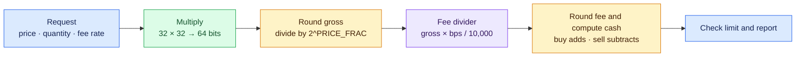

# Day 14 · Fixed-point notional calculator

Compute the gross amount of an order, its fee, and the cash amount. A fixed-point price represents an integer numerator scaled by `2**PRICE_FRAC`. This example shows where rounding occurs and why the hardware widens an addition before checking overflow.



## Worked example

With eight fractional bits, raw price 3,200 represents 12.5 units. Buying two gives gross 25. A fee of 400 basis points gives fee 1, so the buy debit is 26. The same inputs on the sell side give proceeds of 24. A buy limit of 26 passes and 25 fails. A sell limit of 24 passes and 25 fails.

The rounding mode is used twice, first for gross and then for the fee computed from the rounded gross. Modes are floor, ceiling, and nearest with ties to even. The inexact flag means either division had a nonzero remainder, even when it rounded down. The output fields use whole caller-defined cash units.

## Interface and errors

| Group | Fields |
| --- | --- |
| Request | Ready/valid, 16-bit tag, 32-bit price and quantity, 16-bit fee in basis points, two-bit rounding mode, sell flag, and optional 64-bit limit. |
| Response | Ready/valid, tag, sell flag, status, 64-bit gross, 64-bit fee, 64-bit cash, and inexact flag. |
| Reset | Synchronous reset aborts pending arithmetic and releases the calculators for new input. |

Status 0 means success. Statuses 1–4 report zero quantity, zero price, fee greater than 10,000 basis points, and an unsupported rounding mode, in that order. Those replies leave the numeric result fields at zero. Status 5 marks cash overflow and reports saturated cash with the computed gross and fee. Status 6 marks an inclusive-limit failure and preserves the computed amounts.

`fixed_point_notional.sv` runs one in-flight transaction at a time. `notional_divide.sv` consumes one numerator bit each clock and can hold its result until ready. `notional_pair.sv` dispatches to two independent calculators and retires in request order. The two-entry queue means a short error reply may wait behind an earlier full calculation.

## Verification and practice

```sh
make test
make lint
make synth
make formal
```

The scalar simulation compared 3,822 complete replies at fractional widths 0, 8, and 31 under output stalls and nine busy resets. The first visible reply was one cycle after a field-error request and 85 cycles after a full arithmetic request. The two-lane test checked 1,024 replies in admission order. Its [cycle campaign](notional_pair_campaign.py) checked 2,255 additional replies over 89,492 edges, with 136 cancellations by reset. The standalone divider checked every 9-bit numerator and 265 80-bit values. A 7-bit formal profile proves division identity, remainder bounds, output stability, and request acceptance timing.

[notional_model.py](notional_model.py) is the exact integer oracle. [notional_batch.py](notional_batch.py) compiles decimal CSV input into a simulator tape and itemized report. [notional_capture.py](notional_capture.py) checks replays against captured request and reply edges. [notional_wire.py](notional_wire.py) provides an ordered, CRC-protected NOM1 encoding with an exact result check. `make demo` compiles the [example CSV](fixtures/first_orders.csv), simulates it, and [reconciles](notional_reconcile.py) the actual replies with the planned orders. The [price-grid tool](notional_quantizer.py) finds a fraction width under a user-supplied error budget. The [limit planner](notional_limits.py), [rounding study](notional_study.py), and [aggregation study](notional_aggregation.py) use synthetic inputs to make edge cases reproducible.

```sh
python3 notional_limits.py buy 12.5 26 --fee-bps 400
```

Cash limits and fee rates are local model inputs. The project measures digital arithmetic, simulation timing, and generic structural synthesis.
