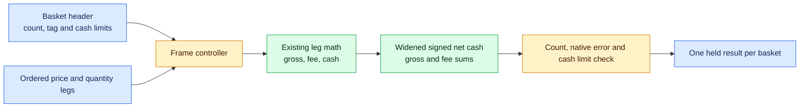
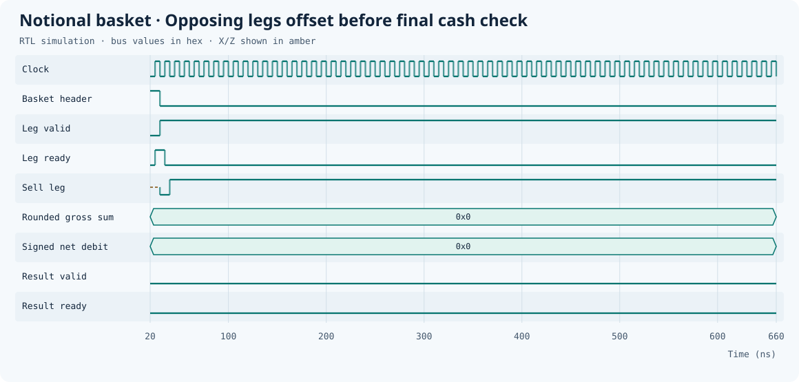

# Multi-leg basket notional and cash limits

[The basket calculator](notional_basket.sv) evaluates a package of orders
quoted in a common cash unit. A spread-order gateway can run a buy leg and
a sell leg through the block and check whether their combined net debit
stays within a client limit. For a credit spread, it can require minimum
net proceeds. A cash check on the package does not reserve exposure or
guarantee that the legs execute together. The downstream execution
adapter owns those decisions.

## Frame and arithmetic

Accept one header on `req_valid && req_ready`. The source then sends
one or more legs and asserts `leg_last` on the last accepted leg.
Only one basket may be active. The block uses the existing notional
calculator for per-leg price and fee rounding and serializes accepted
arithmetic operations through that unit. A header declaring an invalid
count, or a stream with too many legs, drains through the actual last
beat before returning a count error. The sender must terminate the frame.

Net cash is the sum of rounded buy debits minus rounded sell proceeds.
Debits are positive, credits negative, and flat baskets are zero.
The signed accumulator is `65 + clog2(MAX_LEGS)` bits. Unsigned gross
and fee sums use one fewer bit. The width covers the sum of any
`MAX_LEGS` native unsigned 64-bit outputs. A single native leg overflow
remains an error. Each leg can choose its own supported rounding mode.

| Status | Decision |
| ---: | --- |
| 0 | Count, all legs, and enabled cash checks passed |
| 1 | Declared count was outside 1 through MAX_LEGS or differed from the accepted frame length |
| 2 | At least one evaluated leg failed its native notional check |
| 3 | Signed net debit exceeded the enabled maximum debit |
| 4 | Signed net cash exceeded the negative of the enabled minimum credit |

The table gives status priority from framing through the two cash
checks. Equality at either enabled limit passes. A minimum credit of
zero requires a flat or net-credit basket. For rejected frames, the
totals describe successfully calculated legs only. Use the status
before acting on the totals. The result carries the first native leg
error and zero-based index, or an all-ones index when no native leg
failed. The observed count saturates at `MAX_LEGS+1`. `rsp_inexact`
combines the flags from all successfully evaluated legs. Result fields
hold under backpressure. Synchronous reset flushes the in-flight basket.

## Simulation waveform

The first package buys and sells the same quantity at the same price
with zero fees. The gross sum rises after each accepted arithmetic
reply, while the signed net debit returns to zero and meets both
configured zero limits. The final checked response then holds until
its consumer is ready.

Run `make basket-test basket-lint basket-synth basket-waveform` to
reproduce the tests. Three width profiles exercise fractional and
integer prices, native overflow, both limit directions, count errors,
saturated drain counts, and held responses against a Python model
that sums exact rounded leg results.
