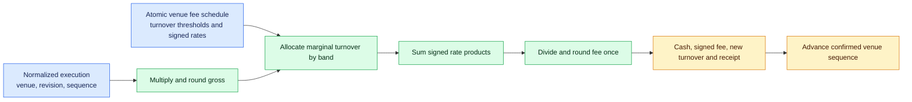
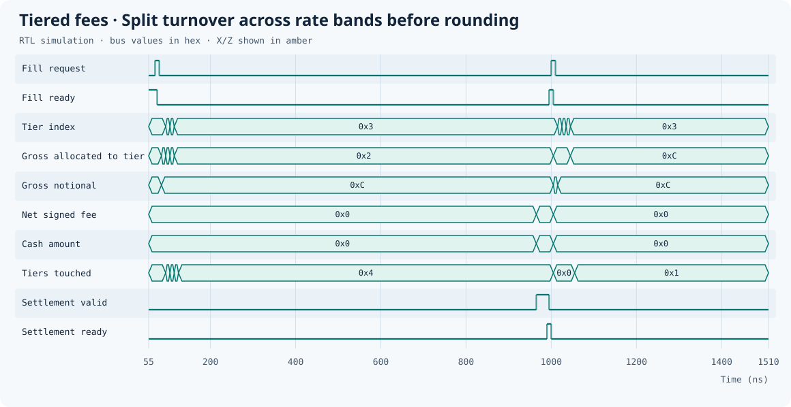

# Marginal maker and taker fee settlement

[The fee engine](tiered_fee_settlement.sv) computes the fee for an
execution whose notional touches one or more cumulative venue turnover
tiers. Each venue has its own installed thresholds, signed maker/taker
rates, and accepted fill sequence. A trading system can use it to check
expected settlement against a configured exchange schedule. A replay
operator can restore a venue's known cumulative volume and reproduce an
execution's fee evidence in sequence.

## Venue profiles

Install a profile with command 0 and the expected current revision.
It supplies the authoritative prior turnover, next fill sequence,
ascending positive interior thresholds, and the complete maker and
taker rates. Its accepted revision advances once. Thresholds and rate
rows start at the least significant bits. A threshold value marks where
the next rate starts. The final band extends to the largest representable
turnover without requiring a final threshold field value. A one-tier
configuration ignores the threshold port.

Configure signed rates between −10,000 and +10,000 basis points. A
positive rate is a fee and a negative rate is a rebate. Command 1
inspects the addressed venue, and command 2 fences it. Changing a
profile follows a compare-and-set revision check and occurs only
between settlements. At the final revision, further installs fail
until coordinated reset. The control reply shows the resulting
revision, next sequence, turnover, and armed flag.

## Arithmetic and settlement

The input execution price is an unsigned fixed-point numerator with
`PRICE_FRAC` fractional bits. The 32-bit quantity must be positive.
The engine rounds the product to one gross cash amount, then widens
the turnover addition. Gross zero can be a valid rounded result and
touches no fee tiers. The running total counts gross amount before fees.

A fill starting at turnover 2 and adding 12 units crosses thresholds 3,
8, and 12. Its corresponding slices are 1, 5, 4, and 2 units. With rates
10,000, −2,000, 3,000, and −100 basis points, the signed numerator is
11,800. Nearest-even rounding gives a one-unit fee. Buys add the fee
and sells subtract it, so this buy reports 13 units of cash debit.

The divider rounds the magnitude of the signed fee once after summing
every tier. Mode 0 truncates the magnitude, 1 rounds the magnitude up,
and 2 rounds to nearest with even ties. The sign is applied afterward.
The output fee is signed 65-bit and the cash result is unsigned 65-bit.
Cash represents buy debit or sell proceeds according to the request.
The inexact flag covers the remainder at either rounding point.

Only the exact next execution sequence in the current armed revision
can change ledger state. A successful result advances turnover and
sequence before publication. Accepting the final representable
sequence fences the venue. A rejected operation leaves turnover and
sequence intact. Result and control channels retain their fields
through output stalls. A synchronous reset clears both channels and
the venue profiles. A caller resumes by installing authoritative
turnover and sequence from its durable trade ledger.

| Status | Meaning |
| ---: | --- |
| 0 | Accepted |
| 1–4 | Invalid venue, stale revision, invalid profile, exhausted revision |
| 5–8 | Venue fenced, old sequence, sequence gap, invalid execution fields |
| 9 | Gross addition would overflow cumulative turnover |
| 10 | Invalid control operation |

## Checked waveform and tests

At 85 ns the gross is 12 units. Four cycles allocate 1, 5, 4, and
2 units. At 965 ns the divider publishes the net one-unit fee and
13-unit cash debit. The result stays valid until the consumer's
transfer. The latency is measured in simulated cycles.

Run `make fee-tier-test fee-tier-lint fee-tier-synth fee-tier-waveform`.
The width matrix covers fractional prices with 0, 8, and 31 fractional
bits and one, three, or four bands. The checked RTL compares 257 control
receipts and 640 fill results, with 30 positive fees, nine rebates,
13 multi-tier settlements, and 3,890 held response cycles. It covers
every response status, native turnover overflow, exhausted revision,
final sequence, and separate maker/taker policies.
