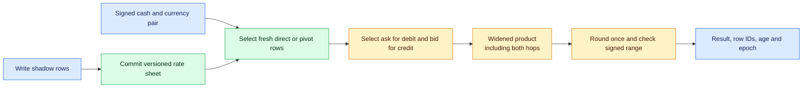
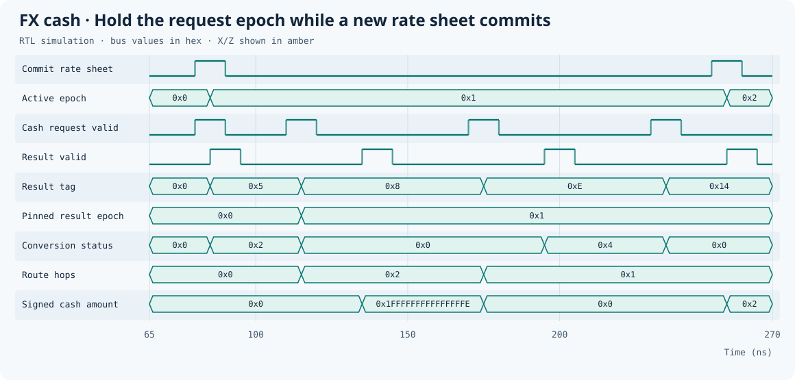

# Direct and two-hop FX conversion for signed cash

[The FX converter](fx_cash_converter.sv) translates normalized cash
units between currencies using an atomic snapshot of a bid/ask rate
sheet. A settlement or risk adapter can convert a local-currency debit
or credit to a reporting currency while retaining the exact quote rows
used. The adapter can supply a specific pivot currency to use when a
fresh direct quote is unavailable.

## Rate-table and request contract

Rows store a directed source currency, target currency, bid, ask, and
observation tick. Rates use unsigned `RATE_FRAC` fractional bits,
where `0 <= RATE_FRAC < RATE_W`. Supply rates in the caller's input
and output cash units. The block validates positive bid, ask at
least bid, distinct legal currencies, and a valid row index. A disabled
row skips rate validation. Invalid accepted writes pulse `cfg_error`
and retain the preceding row.

Writes edit the shadow bank. A commit swaps the banks and increments
the modulo epoch. Commit takes priority over writes. A request
accepted on the commit edge sees the pre-edge active bank. Each
conversion captures its rates before arithmetic, so commits during
calculation or a held result do not change the output. The old
active bank becomes the next shadow bank. Hold a blocked configuration
word through commit so it writes the new shadow bank on transfer.

Fresh quotes have observation ticks at or before the supplied `tick`
and age no higher than the request's maximum age. Use a monotonically
increasing tick during a running instance. A future quote is stale.
A direct request uses the first fresh matching row. If none is fresh
and the requested pivot is permitted, the converter uses the first
fresh row for each of the two directed legs. When neither path is
available, a configured path with stale hops yields STALE. An
incomplete or absent path yields MISS. The converter does not infer
inverse rates or choose an arbitrary intermediate currency.

## Signed arithmetic and results

Positive cash is a debit and uses asks. Negative cash is a credit and
uses bids. An equal source and target currency passes the amount
through directly. The converter multiplies the magnitude by the
selected rates using a widened intermediate. A direct conversion
supplies unity for its second rate. It rounds the magnitude once
and then reapplies the sign. Modes 0, 1, and 2 truncate, round
magnitude up, or round to nearest-even.

For example, five debit units with pivot asks of 1.5 and 0.75 have
an exact converted magnitude of 5.625. Nearest-even returns six.
A credit of five units against bids of 1.0 and 0.5 returns −2.
The result carries the selected row IDs, hop count, maximum used
quote age, pinned epoch, and inexact flag. The epoch counter wraps.
For historical provenance across wraps, the caller keeps rate-sheet
history and associates accepted requests with a wider commit ordinal.

Input and successful output amounts fit a signed 65-bit word.
When connecting the [tiered settlement engine](fee-tiers.md), check
its unsigned cash magnitude against that signed range before
forming the debit or credit. A conversion overflow produces a
zero result and retains its path metadata for diagnosis. The
caller chooses the reporting currency, price-unit normalization,
and applicable FX policy before submission.

| Status | Meaning |
| ---: | --- |
| 0 | Converted or equal-currency pass-through |
| 1 | Invalid currency, pivot, or rounding field |
| 2 | No configured complete path |
| 3 | Matching path exists but lacks fresh quote rows |
| 4 | Rounded result is outside the signed 65-bit range |

## Verification

The first request transfers on the epoch-1 commit edge at 85 ns and
returns a miss under the prior empty epoch 0. The next request uses
a fresh two-hop path in epoch 1 and returns at 135 ns. A later request
captures epoch 1 at 235 ns and returns at 255 ns while epoch 2
commits. The retained epoch identifies the earlier sheet in this trace.

`make fx-test` checks 5,700 exact RTL cycles and 2,102 results
against Python rational arithmetic. The profiles cover three rate
precisions, identity, positive and negative cash, stale and future
quotes, overflow, malformed rows, coincident commits, and held output.
The 12-edge formal check covers simultaneous lookup and commit, pivots
and overflow while checking held outputs and epoch capture.
Use `make fx-waveform` to regenerate the trace. Synthesis checks
generic structure.
