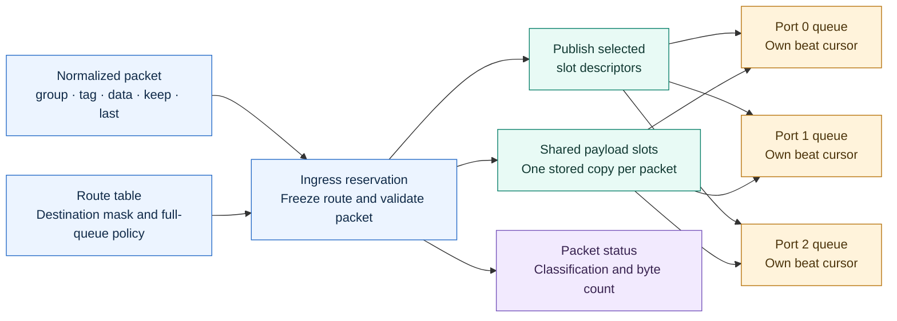
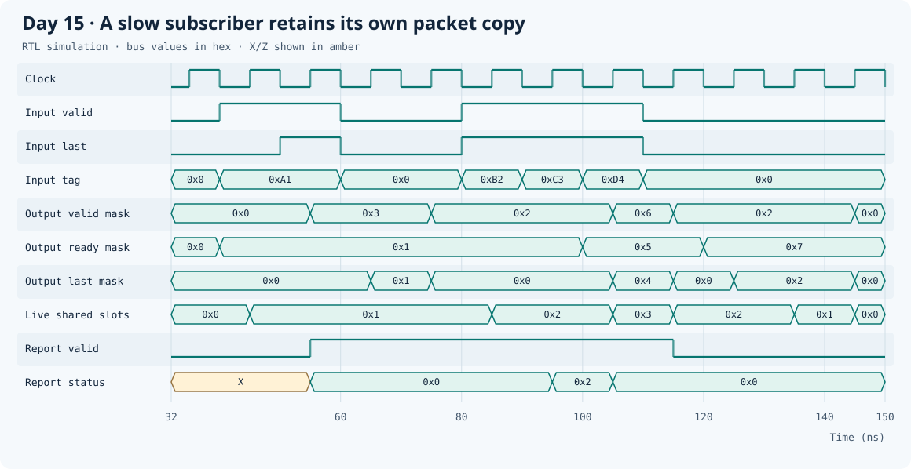

# Day 15 · Multicast Packet Fanout

A SystemVerilog packet distributor that lets several consumers receive the same
bytes without buffering a separate payload for each one. A packet can go to one
or more destination ports. Each port advances at its own rate, and the shared
payload remains live until its last subscriber finishes.

The [subscriber-policy top](subscriber_policy.md) adds per-group mandatory and optional destinations, independent credit thresholds, versioned route snapshots, and explicit reports for partial delivery. The [checked waveform](docs/policy_waveform.svg) shows a slow recorder losing optional copies while a required consumer continues.

The [sequenced replay journal](replay_journal.md) retains a bounded packet history and lets independent subscribers catch up or receive precise gap notices. Its [checked waveform](docs/replay_waveform.svg) shows a held packet surviving journal eviction while a healthy subscriber continues.

## Where it fits

An FPGA market-data path can classify an incoming packet and send a copy of the
normalized payload to a book builder and a recording pipeline. A separate
packet group can send instrument messages to a strategy input only. Each pool
of consumers can have different flow-control requirements. For example, a
book builder and a recorder intended to stay synchronized may use a blocking
route, while a best-effort observability group can request congestion reports
instead of holding the entire ingress.

Nasdaq publishes multicast addresses for U.S. market-data products, and
TotalView-ITCH describes sequenced market-data messages and MoldUDP64 as a
transport option. The incoming group here is an internal index produced by an
upstream Ethernet/IP classifier or message parser. The fanout interface carries
normalized packet payloads. Network transport, feed recovery, and multicast
membership management belong to the surrounding system.
[Nasdaq feed addresses](https://nasdaqtrader.com/Trader.aspx?id=FeedMIPs) ·
[TotalView-ITCH 5.0 specification](https://www.nasdaqtrader.com/content/technicalsupport/specifications/dataproducts/NQTVITCHSpecification_5.0.pdf)

## Datapath



1. On an accepted first beat, the fanout samples the group, packet tag, route
   mask, and congestion policy. If the selected queues each have a free
   descriptor and a payload slot is free, it reserves a slot. A configuration
   write on that same rising edge applies to future first beats.
2. Incoming beats go into the slot and are checked. No output can see an
   unfinished packet. On a valid final beat, every selected queue gets the
   same slot index. Any input fault prevents every copy.
3. Each port reads the packet at the head of its queue with its own beat
   cursor. Transferring a last beat clears that port's reference to the shared
   slot. The slot becomes reusable once all its references are gone.

Each output preserves packet order among the packets routed to it. Ports can
emit different packets simultaneously. An output that keeps `ready` low holds
its current valid beat steady, including `last` and the packet tag. A held port
eventually consumes its descriptor credits and may cause a stall at ingress
for groups that select it. It can also hold a shared slot after another port
has consumed its copy. Unrelated traffic can continue while it has room in
its own queues and in the shared pool.

## Interface and timing

| Signals | Contract |
| --- | --- |
| `cfg_valid`, `cfg_ready`, `cfg_group`, `cfg_destinations`, `cfg_drop_on_congestion` | A rising edge with both handshake bits high replaces the group's mask and congestion policy. Out-of-range group writes have no effect. Reset clears every route to an empty mask. |
| `s_valid`, `s_ready`, `s_data`, `s_keep`, `s_last`, `s_group`, `s_tag` | One ingress beat per accepted edge. The source holds the whole offer until accepted. The first beat sets the group and tag. Later `s_group` values are ignored and later tags must match. |
| `m_valid`, `m_ready`, `m_data`, `m_keep`, `m_last`, `m_tag` | Independent handshake for each port. Port 0 occupies the low slice of each packed bus. For example, port 2's data is `m_data[2*DATA_W+:DATA_W]`. |
| `report_valid`, `report_ready`, `report_status`, `report_tag`, `report_group`, `report_destinations`, `report_bytes` | One terminal report per accepted complete input packet. The mask shows the first-beat route snapshot, including for drops. Bytes count asserted input lanes and saturate at 65,535. Drain the report to allow future packets to start. |
| `forwarded_packets`, `filtered_packets`, `congested_packets`, `invalid_packets` | Global 32-bit saturating counters for mutually exclusive terminal outcomes. |
| `delivered_packets`, `port_occupancy`, `resident_slots` | Per-port 32-bit saturating count of actual last-beat transfers, per-port queue occupancy, and occupied payload slots including an assembling reservation. |
| `rst` | Active-high synchronous reset clears packet state, route configuration, report validity, and counters. Reconfigure routes after reset. Payload bits lose their ownership on reset. |

Lane zero is `data[7:0]`. Every nonfinal beat uses every byte lane. The
final beat uses a nonempty contiguous prefix of low byte lanes, so a
four-byte data word can end with keep `0001`, `0011`, `0111`, or `1111`.
Unused output lanes are cleared. A producer must terminate each frame with
`s_last`. A watchdog or reset policy for a producer that never terminates a
frame belongs at the system level.

Readiness uses resources available just before a rising edge. A last-beat
output handshake that frees a full queue or the last slot enables admission
on a later edge. After admission the single ingress has no resource-induced
stall within the frame. The report register can retire one report and accept
a new one at the same edge. With a free output queue, the first output beat
is visible after the ingress's final beat transfers and can transfer on the
following rising edge. That gives an ideal one-cycle final-input-to-first-output
latency in the RTL and independent one-beat-per-cycle egress read paths.

| Code | Name | Meaning |
| ---: | --- | --- |
| 0 | `FORWARDED` | Packet committed to every selected output queue. |
| 1 | `FILTERED` | The group's mask was empty. |
| 2 | `CONGESTED` | The group allowed drops and a selected queue or the shared slot pool was full at admission. The entire packet was drained without forwarding. |
| 3 | `BAD_BEAT` | Empty, sparse, or nonfinal partial byte mask. |
| 4 | `BAD_TAG` | A tag changed within the frame. |
| 5 | `TOO_LONG` | The packet exceeded `MAX_BEATS`. |
| 6 | `BAD_GROUP` | The first beat named a group outside the table. |

Invalid group has highest priority. Otherwise the first malformed beat wins.
On a single beat with several faults, byte mask is checked before tag and tag
before length. The retained format error takes precedence over a previously
decided filter or congestion disposition. With congestion drops disabled,
a first beat that needs unavailable resources waits and reevaluates the route
until it transfers.

## Checked RTL waveform



- The first beat of `0xA1` transfers at **45 ns** while group 0 is reconfigured.
  Its last beat transfers at **55 ns**, and output valid becomes `0x3` because
  the previous route selected ports 0 and 1.
- At **65 ns** and **75 ns**, port 0 consumes both beats. Port 1 keeps its
  first beat ready to read, and the packet still occupies the shared slot.
- At **85 ns**, `0xB2` fills the second descriptor for port 1. The following
  packet `0xC3` receives report code `0x2` at **95 ns**. It produces no output
  descriptor. The next group-0 packet, `0xD4`, uses the updated route and is
  consumed by port 2 at **115 ns**.
- Port 1 starts consuming `0xA1` at **125 ns**, releases its final reference
  at **135 ns**, and transfers `0xB2` at **145 ns**. Resident slots return to
  zero.

The clock is a simulated 10 ns clock. This chart records RTL behavior at
rising edges. The example independently checks all report tags and packet
payloads before regenerating the SVG.

```sh
make waveform
```

## Build and verify

Run from this folder with Python 3.9 or later, Icarus Verilog, Verilator, and
Yosys on `PATH`.

```sh
make test lint synth formal
```

| Profile | Bytes per beat | Ports | Groups | Shared slots | Queue depth | Beats per packet |
| --- | ---: | ---: | ---: | ---: | ---: | ---: |
| Default | 4 | 3 | 4 | 4 | 2 | 8 |
| Odd sizes | 3 | 5 | 3 | 5 | 3 | 5 |
| Single entry | 1 | 1 | 1 | 1 | 1 | 1 |

- `make test` compares 20 pre-edge observables per cycle against an independent
  Python model that represents packets as immutable objects in deques. Directed
  and randomized workloads cover route changes, reset, malformed beats, policy
  precedence, shared-slot exhaustion, and independent receiver stalls. The
  default random suite generates 1,200 packet plans per profile at seed 27115.
- `make lint` runs Verilator with warnings enabled. `make synth` checks the
  synthesized Yosys netlist and prints generic mapped cells. Timing closure,
  inferred memories, and FPGA resource use depend on the target and the
  memory implementation. The portable multi-read payload array can become a
  substantial register and mux network as the geometry grows.
- `make formal` checks nine cycles after a reset in a reduced two-port model.
  It checks queue and slot bounds, exact per-port descriptor accounting,
  delivery and classification counters, and stable stalled outputs and
  reports. The proof covers arbitrary peer signals within the bound.
- The Python verifier leaves reference and RTL traces in `build/`. The
  separate capture auditor follows observed RTL handshakes, reconstructs every
  subscribed byte stream, and writes packet ordinals, reset epochs, per-port
  timings, and content hashes to `audit.json`. Mutation tests challenge it
  with bad payloads, mask changes, missing subscribers, and truncated traces.
  Hexadecimal
  fields are ordered as listed in `fanout_verify.py` and the checked testbench.
  To run a new seed and keep its artifacts in a separate directory, use the
  command below.

```sh
make build/odd.vvp
python3 -B fanout_verify.py check --profile odd --image build/odd.vvp \
    --seed 71113 --packets 1500 --directory build/seed-71113
```

To inspect a trace without re-running simulation or the reference model, open
the JSON packet delivery report or regenerate it from the captured edges.

```sh
python3 -B fanout_audit.py --profile odd build/odd/inputs.hex \
    build/odd/observed.hex --output build/odd/audit.json
```
