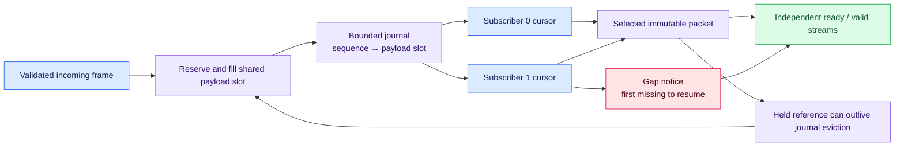
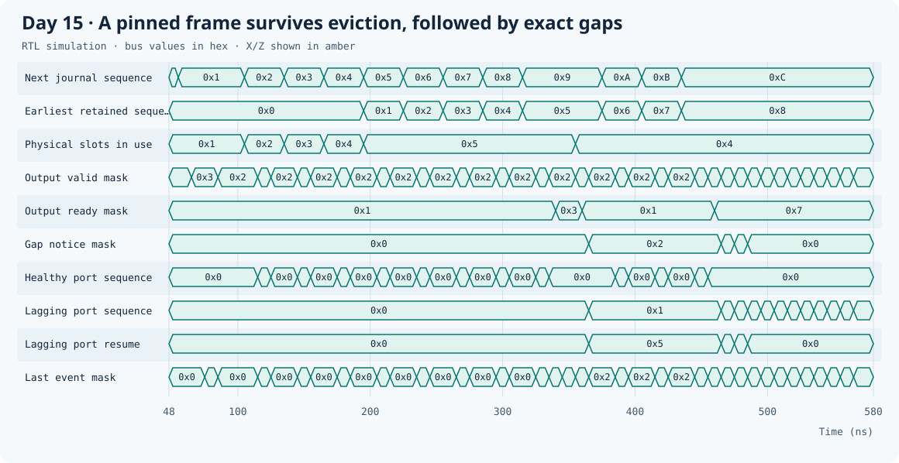

# Sequenced multicast replay journal

Instantiate [multicast_replay_buffer.sv](multicast_replay_buffer.sv) as a separate top with [rtl_replay.f](rtl_replay.f). It publishes a sequence for each validated packet, retains a bounded window, and lets each receiver follow live data or catch up from its own bookmark. A normalized market-data path can put a recorder and a book builder on separate receive cursors. After a short consumer stall, the book builder can replay from its last acknowledged packet. After a longer stall it receives the exact missed interval and can request an upstream snapshot or retransmission. Nasdaq's MoldUDP64 specifies epoch-like session identity, sequence gaps and recovery requests for an example exchange transport. This project operates on already-normalized packets inside the device. [Nasdaq MoldUDP64 protocol](https://www.nasdaqtrader.com/content/technicalsupport/specifications/dataproducts/moldudp64.pdf)



## Ownership and retention

The input reserves a free slot at the beginning of a frame. A valid final beat publishes the slot under the next sequence. Invalid masks, inconsistent tags or excess beats drain the frame and produce a terminal input report without advancing the journal. The base fanout's nonempty, contiguous low-byte mask rules apply here. Nonfinal beats use all lanes.

The retention index points to the newest `RETAIN` published packets. Once full, each new packet evicts the oldest index. A reader that already selected a packet pins its physical slot independently. The shared payload stays immutable until that reader consumes its final beat, even if the sequence has left the history. Space for `RETAIN + PORTS + 1` physical frames bounds the retained rows, one pin per port and a frame under assembly. It guarantees a free slot on a new frame's first edge. Ingress can still stall on a held input report or an exhausted sequence range.

The default has three ports, four retained packets, eight beats per frame, four byte lanes, 48-bit sequence numbers, and 16-bit epoch and packet-tag fields. Use positive geometry and a retention depth at most `2**SEQUENCE_W - 1`. Independent read multiplexers sustain one beat per port per cycle within a frame. A port spends a selection cycle between frames. The portable shared array synthesizes to registers and read multiplexers in the generic flow.

## Subscriber and epoch protocol

Set `reset_epoch` and `reset_sequence` while synchronous active-high reset is asserted. The reset clears all ownership and subscriber cursors and starts an empty journal with the supplied next sequence. Use a fresh epoch to distinguish old buffered traffic. The all-ones sequence word is reserved as an exhausted sentinel. The last published packet is one below that sentinel. Restart from a newly provisioned epoch before more packets are accepted. Already published packets remain readable after exhaustion.

| `cfg_op` | Behavior |
| ---: | --- |
| 0 | FOLLOW from the next sequence as observed before the handshake |
| 1 | REPLAY from the supplied sequence. A cursor older than retention receives a gap. A cursor equal to the next sequence waits for a new frame |
| 2 | DETACH an idle subscriber and reset its cursor |
| 3 | QUERY the current subscription state and cursor without changing either |

The configuration carries a port, current epoch, client tag and sequence. Use a zero sequence for operations other than REPLAY. A change when the port already presents a packet or gap returns BUSY, including when that record completes on the same edge. The configuration status is OK, BAD_PORT, BAD_EPOCH, BAD_FIELDS, FUTURE or BUSY at values 0 through 5. The held configuration result echoes the operation, port and tag and provides its subscription state and cursor.

A packet beat has `m_gap=0`, an assigned sequence, the original tag and the frame's byte mask and first/last markers. A gap is a single held beat with zero data and keep and both markers set. Its `m_sequence` is the first missing sequence and `m_resume` is the first sequence available when the notice was constructed. On acceptance the cursor moves to the advertised resume. If the journal moved again while the gap was held, a later gap begins at that resume. Subscribe to replay a previously delivered range only when the downstream consumer can reconcile duplicates.

Port zero occupies the least significant slice of the packed output fields. The common exported epoch applies to all outputs. Per-port packet and gap event counters saturate at 32 bits. The lost-packet counter saturates at sequence width and sums acknowledged missing spans, including repeated notices after an explicit backward seek. The independent input report identifies the tag, status and proposed sequence. Only a status-zero report commits that sequence. All reports stay stable under ready backpressure.

## Capture and restore handoff

```sh
make waveform-replay
python3 -B replay_checkpoint.py extract build/replay/example/inputs.hex \
    build/replay/example/observed.hex build/replay/window.mrj
python3 -B replay_checkpoint.py restore build/replay/window.mrj \
    build/replay/restore.hex --epoch 10 --port 0
```

Run `make waveform-replay` to generate the example input and output captures used above. The archive tool audits the cycle-level RTL trace against the independent protocol model, including held ingress and configuration pins. It extracts only the retained history and requires the last input report to have been acknowledged. The CRC-protected MRJ1 format includes geometry, epoch, next sequence and canonical masked bytes, with contiguous sequence order implicit in file position.

Restore emits a new reset with the archive's earliest sequence, then republishes the retained frames in order. It can attach one subscriber for immediate replay once the table has been refilled. The handoff is an offline simulator workflow. Live consumer state and frames pinned outside the retained window belong to their original epoch and are reconciled by the surrounding system. The integration fixture recovers retained sequences 8 through 11 under epoch 10 and verifies rejection of an epoch-9 request.

## Checked waveform



The healthy port receives all 12 frames. The stalled port consumes the final beat of sequence 0 at 355 ns, after that packet has left the journal. Its first gap `[1,5)` transfers at 465 ns and a second gap `[5,8)` transfers at 485 ns. It then receives retained sequences 8, 9, 10 and 11 in order.

Four geometries verify 18,821 cycles, 1,940 successful publications, 4,555 packet deliveries, 784 transferred gaps, 10,034 held data beats and 1,301 held gap cycles. The bounded formal run checks occupancy, immutable pins, ready stability, sequence generation and gap cursors through 18 edges. Seven reachability goals cover pinned eviction, advancing gaps, a busy configuration, malformed tag and sequence exhaustion. Default generic synthesis reported 18,071 cells and zero structural findings. Run `make lint synth formal-replay` to reproduce these checks.
