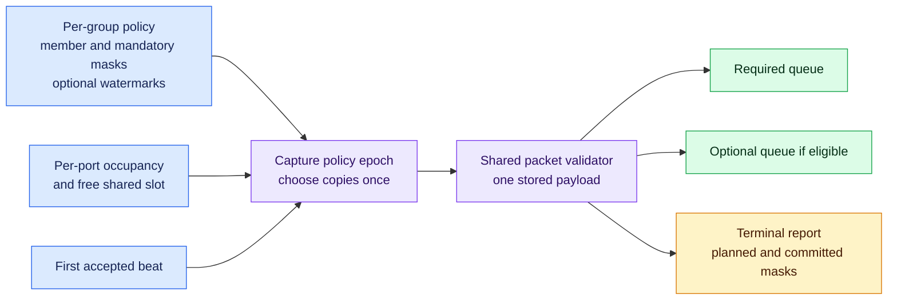
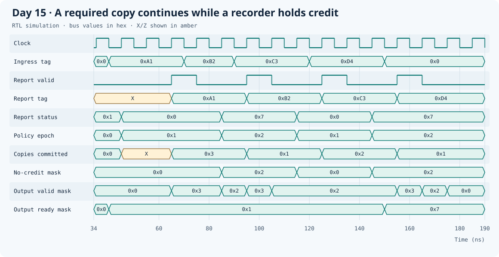

# Mandatory and optional multicast subscribers

Instantiate [multicast_policy_fanout.sv](multicast_policy_fanout.sv) with [rtl_policy.f](rtl_policy.f). It uses the base core's shared payload slots, packet validation, per-port cursors and last-reference release. The original [group fanout interface](README.md) remains available.

A market-data system can make its book builder a mandatory consumer and give an observability or recording copy a lower descriptor watermark. An optional subscriber that stops draining can then be omitted from newer packets on that group. Reports identify the omitted copies so the recorder can track gaps. A regulatory capture subject to completeness requirements can instead use the mandatory policy and propagate congestion upstream. A passive monitoring group can make all copies optional.



## Admission policy

- A mandatory destination needs one physical descriptor credit. An optional destination needs occupancy strictly below its configured watermark. A watermark of zero requests an observable optional subscriber whose copies are always omitted. Unrequested ports have no effect.
- Every nonempty selected mask also needs one free shared slot. With mandatory subscribers configured, unavailable mandatory credit or a full slot pool blocks the entire mask. The group can stall the first beat or accept and drain the entire packet as congested.
- With mandatory resources available, optional subscribers are selected independently. If no destination can be selected, the frame drains as congested. If all subscribers are optional, exhausted slots or a full queue never block the first beat for credit. A pending report or router staging can still stall it.
- On the first accepted beat, the chosen mask, group epoch and resource diagnostics are fixed. Concurrent configuration and egress transfers affect later first beats. Format faults observed later suppress all copies. An invalid group keeps its highest-priority error status. Changing a route leaves previously committed copies on their original queues.

The wrapper buffers the first beat while programming a private route in the existing packet bank. It injects that beat on a later edge and passes subsequent accepted beats directly. The chosen credits can only improve before the private route takes effect because the wrapper admits just one frame at a time. After its final input, the next first beat waits until the current report transfers. In the unblocked single-beat case there is a three-edge interval between first-beat acceptances. Egress receivers remain independent, capable of one beat per cycle each when ready. An optional copy already queued can retain its shared slot. All traffic remains subject to the shared pool's capacity.

## Configuration, output and reports

Write a valid group, the requested mask, its mandatory subset, a packed watermark per port and the mandatory congestion flag. Watermark field width is `clog2(PORT_DEPTH+1)`, with port 0 in the low bits. Required and unrequested ports must set their watermark to zero. An optional watermark may be any value from zero through physical depth. After the handshake, `cfg_ack` indicates the sampled request and `cfg_ok` indicates acceptance. A bad configuration leaves the existing policy and epoch intact. Valid writes increment the per-group epoch modulo `2**EPOCH_W`, including a write using the previous fields.

Ingress and per-port output payloads use the original data, keep, last, and tag format. The first accepted beat supplies the group. Port 0 occupies the low bits of each packed egress signal. Each packet yields one held-valid terminal report with the original tag, consumed byte count, group and first-beat policy epoch. Reserved diagnostics show what caused the initial admission decision even when malformed input later overrides the disposition.

| Report field | Meaning |
| --- | --- |
| `report_requested`, `report_mandatory` | Masks from the accepted route snapshot |
| `report_no_credit` | Requested ports with occupancy too high for their policy |
| `report_no_slot` | A nonempty request faced a full shared pool |
| `report_enqueued` | Subset that actually committed. Zero for malformed, filtered and wholly congested packets |
| `report_status` | Original meanings for 0 through 6, plus status 7 for a valid packet committed to a strict nonempty subset |

`delivered_packets` increments per port at an accepted last beat. `omitted_optional_packets` increments per optional port on a transferred congested or partial report if the port was requested and not enqueued. Both counters saturate at 32 bits. They track different boundaries because delivery can precede acknowledgement of a held report. Synchronous reset clears policy epochs, output references, the assembly path, reports and counters together.

## Checked waveform



The first beat of `0xa1` transfers at 45 ns on the same edge as a group-0 configuration update. Its report first becomes valid at 65 ns and shows epoch 1 and both copies. Tag `0xb2` reports epoch 2, no credit on port 1 and a committed mask of port 0 at 95 ns. Tag `0xc3` explicitly places a mandatory copy into port 1's remaining physical credit on another group. Tag `0xd4` again reports a partial commit at 155 ns. The optional watermark prevents this slow port from taking another optional descriptor from group 0 while its existing copies wait to drain.

```sh
make test-policy
make waveform-policy
make lint synth
```

The independent model represents queued copies by object references and computes eligible subscribers from queue lengths. The RTL comparison checks every active output payload, report field, occupancy, credit-derived acceptance and counter. At the default seed, three geometries produced 14,571 checked random cycles, 2,532 transferred reports, 6,649 delivered output beats and 433 held report cycles. All eight statuses appeared across the profiles, including 259 partial reports. The directed waveform adds 36 checked cycles. Default generic synthesis produced 10,846 cells through the wrapper and shared datapath with zero structural findings. A deployed design still needs a throughput and resource evaluation at its selected geometry.
