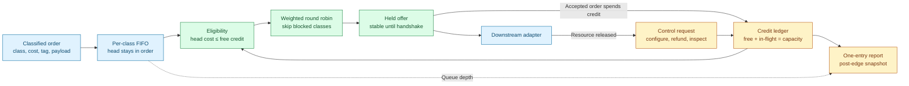
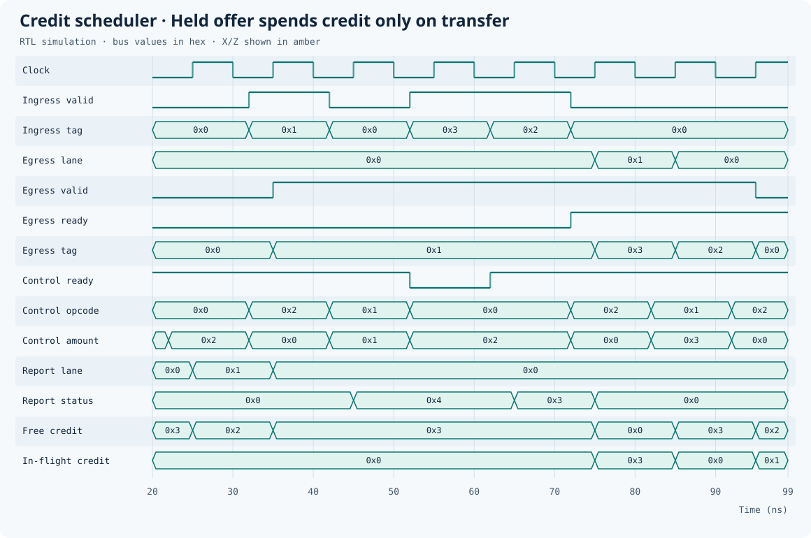

# Day 16 · Credit-aware order egress scheduler

This RTL block arbitrates traffic from several classes onto a shared order egress. Each class has its own FIFO and a budget for work the downstream adapter can hold. The scheduler spends credit when an order transfers. When the adapter releases the corresponding resource, it returns credit and makes that budget available again.

## Where it fits

- **Cancel and new-order traffic on one transmit path.** Give cancels a small independent queue and credit budget. If the new-order lane runs out of capacity, a queued cancel with available credit can still compete for the next opportunity. The classifier and session sequencer remain outside the core. Keep dependent messages in the same FIFO or explicitly sequence them upstream. CME Group documents separate cancel and common application message controls on iLink sessions. Those time-window policies belong in the session’s rate controls. The example here budgets local adapter capacity. [CME Group iLink messaging controls](https://cmegroupclientsite.atlassian.net/wiki/spaces/EPICSANDBOX/pages/457317540/)
- **Two venue sessions sharing an encoder.** Assign each session a class. A stalled session exhausts only its own pool of transmit descriptors. Release credit when the corresponding descriptor recycles or its local processing slot closes. The other session can keep sending head entries while it has credit. This arrangement still shares the final ready/valid output, so a stalled physical sink freezes any already offered transfer.

An adapter picks what one unit represents and applies it consistently to enqueue costs and refunds. One integration might use one unit per descriptor. An adapter with separate fragment buffers might charge two units for a two-fragment message, returning each unit as its local buffer frees. Credits carry no order identity, so the adapter tracks which resource allocation was previously charged and returns it once to the same class. The core checks the class-wide balance. It cannot associate a return with an individual order.

## Design



1. A legal ingress handshake appends to the FIFO named by `s_class`. The scheduler reads only each FIFO's oldest entry. Zero cost and unimplemented class encodings are consumed with `s_rejected` asserted on that handshake.
2. A FIFO head becomes eligible when its entire cost fits in the class's free credit. An entry queued on this edge becomes visible in the following cycle. The scheduler skips every empty or credit-blocked lane.
3. Arbitration starts from the current cursor. A class can transmit up to its configured number of consecutive entries while it stays eligible. The cursor advances when the quota is spent. If it encounters an ineligible class, the next eligible class starts a fresh visit. With stable weights, all classes continuously eligible, and a ready sink, configured weights describe the number of **orders** sent in a round.
4. Once the output asserts valid, its class, cost, tag and payload stay fixed until the sink accepts the offer. New traffic and credit returns can make a different class eligible during a stall. The offer remains locked to its original FIFO head. A simultaneous pop and push on a full FIFO frees and replaces an entry on the same edge.
5. The transfer edge subtracts the order's cost from free credit and adds it to in-flight credit. The control port accepts returns against the pre-edge in-flight amount. A valid return and a send on the same edge are applied together. The next cycle sees the updated eligibility.

### Follow one lane

| Action | Free credit | In-flight credit | Result |
| --- | ---: | ---: | --- |
| Configure capacity to 3 | 3 | 0 | Start with a full budget |
| Offer the FIFO head with cost 3 during a stall | 3 | 0 | Hold the offer |
| Accept the head | 0 | 3 | A new head with cost 1 must wait |
| Return 2 previously used units | 2 | 1 | The next cycle can offer the new head |
| Accept that head | 1 | 2 | The remaining free budget is 1 |

Within each class, an expensive head can hold up younger orders even when a younger entry would fit. A head larger than the entire configured capacity stays queued until an allowed capacity increase or a reset. Software can bound normal enqueue costs against the class's configured capacity. A capacity of zero admits entries into the FIFO and keeps that lane ineligible. Day 12 replenishes tokens with time. This scheduler replenishes credits when the adapter returns them.

## Interface contract

All channels are sampled on the rising edge. A producer holds `valid` and payload while waiting for `ready`. The synchronous active-high reset clears the FIFOs, credit budgets, weights and held transfers. Weights restart at one and capacities at zero. The handshake pins are inactive while reset is asserted. Restart the adapter and credit accounting at the same boundary so old resource returns cannot be applied to a new epoch.

| Channel | Signals and meaning |
| --- | --- |
| Ingress | `s_valid/s_ready`, `s_class`, nonzero `s_cost`, `s_tag`, `s_payload`. `s_rejected` qualifies a malformed input handshake. |
| Egress | `m_valid/m_ready`, `m_class`, `m_cost`, `m_tag`, `m_payload`. One selected FIFO entry per transfer. |
| Control request | `ctl_valid/ctl_ready`, `ctl_op`, `ctl_class`, `ctl_amount`, `ctl_weight`. Accepted commands produce one ordered report. |
| Control report | `report_valid/report_ready`, echoed opcode and class, status, capacity, available credit, in-flight credit, queued entries and weight. |

| Opcode | Required fields | Effect |
| --- | --- | --- |
| 0 `CONFIGURE` | Capacity in `ctl_amount`, nonzero weight 1–15 | Replace capacity and weight when the class has neither in-flight credit nor a visible egress offer. Queued entries stay in place. |
| 1 `REFUND` | Positive `ctl_amount`, zero `ctl_weight` | Release that amount from the credit charged before this edge. |
| 2 `INSPECT` | Zero amount and weight | Sample the addressed class after any ingress or egress activity on this edge. |
| 3 reserved | Any | Report `BAD_FIELDS`. |

Status encodings are `OK=0`, `BAD_CLASS=1`, `BAD_FIELDS=2`, `BUSY=3`, and `OVER_REFUND=4`. Class decoding precedes field validation. A bad class echoes the invalid class code and reports zero state fields. Other reports describe post-edge class state, so an error response can still describe a simultaneous data enqueue or transfer. The stalled report is immutable. Once its consumer is ready, a new accepted control request can replace it on that edge. Egress scheduling can continue while a report is stalled.

The default has three classes and four entries per FIFO with 8-bit credit amounts, 16-bit tags and 32-bit payloads. Set `CLASSES`, `DEPTH`, `CREDIT_W`, `TAG_W`, and `PAYLOAD_W` to positive values. `CLASS_W` and `COUNT_W` are derived port widths. The small FIFO storage and combinational class scan target a shallow shared egress. Larger lane counts and deeper queues increase the selection and storage cost.

## Checked simulation waveform



The directed bench configures lane 0 with three credits and lane 1 with two. At 35 ns, tag `0x1` becomes valid on lane 0 while the sink is stalled. An early refund reports `OVER_REFUND` (`0x4`) at 45 ns because lane 0 still has its three free units. A resize reports `BUSY` (`0x3`) at 65 ns. The sink accepts tag `0x1` at 75 ns and lane 0’s report shows three in-flight credits. Lane 1 transfers tag `0x3` at 85 ns as a valid refund restores lane 0’s free credit. Its queued tag `0x2` transfers at 95 ns.

`make waveform` reruns the checked directed bench and regenerates the SVG. The complete VCD is in `build/egress.vcd`.

## Reproduce and verify

Use Python 3, Icarus Verilog, Verilator, Yosys with its Slang plugin, and SymbiYosys with ABC and Boolector. An OSS CAD Suite installation provides the hardware tools. Put its tools on PATH and run each target from this directory.

```sh
make test
make lint
make synth
make formal
make waveform
```

- `make test` runs seven short contract cases and compiles the SystemVerilog bench for three profiles. The Python reference uses a deque per class and derives free credit from capacity and in-flight debt. The bench checks all handshake pins each sampled cycle and compares fields on valid channels. Directed cases cover FIFO wrap and replacement, early and simultaneous refunds, head-of-line blocking, stable offers, resets, weighted service and a 128-cycle burst with a returning adapter. The seed and random cycle count are configurable with `make test SEED=0x161cee CYCLES=3500`.
- `make lint` elaborates all three profiles. `make synth` runs structural checks and stores the default generic JSON netlist in `build/scheduler.json`. The generic netlist has 3,097 cells with the pinned suite used here. This is a structural count. Physical frequency and area require a device-specific place-and-route run.
- `make formal` proves held-offer and held-report stability, accepted command reporting, reset, bounded occupancy and pointer ranges, and per-class credit conservation for two classes with two entries and three-bit credit amounts. The cover task reaches full replacement, refund-plus-send, a refund after exhaustion, and concurrent report and egress stalls.

### Files

| File | Purpose |
| --- | --- |
| [credit_order_scheduler.sv](credit_order_scheduler.sv) | Synthesizable data and control paths, with optional formal properties |
| [tb_credit_order_scheduler.sv](tb_credit_order_scheduler.sv) | Cycle-exact SystemVerilog checker and VCD capture |
| [scheduler_model.py](scheduler_model.py) | Executable ready/valid and credit contract |
| [scheduler_regress.py](scheduler_regress.py) | Directed and seeded differential workloads |
| [test_scheduler.py](test_scheduler.py) | Short contract checks with explicit expected outcomes |
| [scheduler.sby](scheduler.sby) | Reduced-geometry safety and bounded-cover runs |
