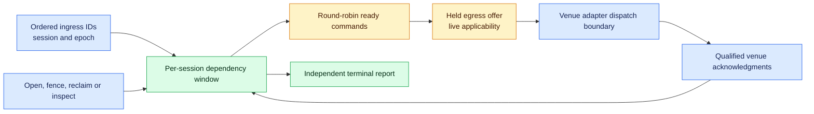
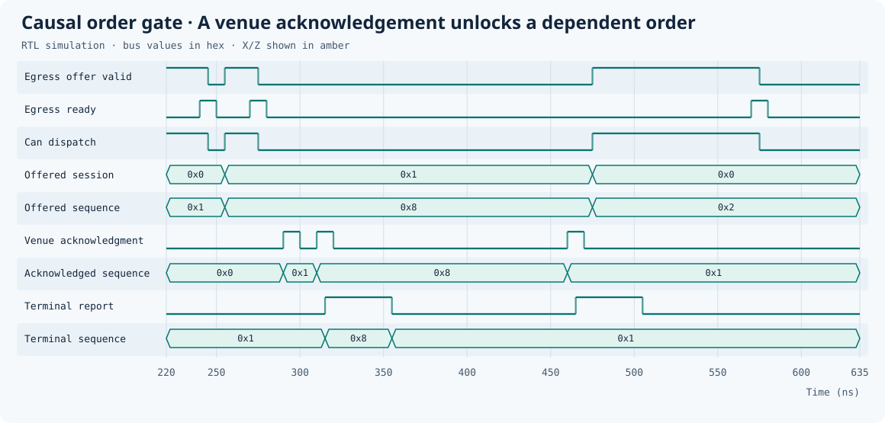

# Causal order admission across venue sessions

[The causal order gate](causal_order_gate.sv) retains a bounded set of
commands per venue session. An order referencing an earlier command
waits for successful evidence from the venue adapter. An independent
session can still dispatch. A gateway can use this for an operation
that must follow a known accepted order, such as a dependent replace,
while routing unrelated work through a shared egress.

## Identity and control

The upstream source assigns exactly increasing unsigned sequence IDs
per session and uses the epoch from a successful OPEN. A dependent
command supplies a strictly earlier sequence in the same session and
epoch. The predecessor must still be resident. Acknowledgments carry
the same session, epoch, and sequence. They are valid starting after
the egress transfer. The authoritative adapter supplies success only
after the required venue condition has actually completed.

Each control operation returns its session, observed epoch, next
sequence, row state, armed flag, and exhaustion flag. These fields
reflect the control command's effect. An acknowledgment on the same
edge may produce a subsequent state change.

| Control | Behavior |
| --- | --- |
| 0 OPEN | Compare the current epoch and require an empty retained window. Install the starting sequence and advance the epoch without wrapping. |
| 1 FENCE | Compare the current epoch and suspend new dispatch. Previously handed-off orders can still be acknowledged. |
| 2 RECLAIM | Compare the epoch and release a terminal row after its diagnostic is accepted. A waiting child or held egress can still pin the row. |
| 3 INSPECT | Read session state and the named row without an epoch compare. |

Row states 0–3 indicate empty, queued, handed off, or terminal. Control
status 0 means success. Codes 1–5 report invalid session, stale epoch,
busy state, exhausted epoch, or missing entry. An input that qualifies
for a full session is backpressured while queued work and pending
results continue. A malformed input transfers with a nonzero
`s_status`, leaves sequence and capacity unchanged, and produces no
terminal event. Input statuses 1–7 identify invalid session, stale
epoch, fenced session, sequence mismatch, malformed cost or lifetime,
unavailable predecessor, and exhausted sequence.

## Scheduling and terminal evidence

A queued command with no predecessor is eligible immediately. A
dependent command becomes eligible after its predecessor records
success. A session may contain independent commands that dispatch
out of sequence. The round-robin selector visits eligible rows. A
positive lifetime starts at admission and counts down each clock while
the command is queued, including during a held offer. With no held
offer, a selected command can transfer on its first eligible edge.
A lifetime of one can transfer on that edge when the sink is ready.
If the sink stalls on that edge, the offer stays visible and loses
applicability once the lifetime reaches zero.

**Hand off only when `m_valid && m_ready && m_applicable`.** The
offer locks a stable tuple after publication. Expiry, a same-edge
fence, or conflicting venue evidence can remove applicability without
changing the held tuple. The adapter drains this offer without
sending it. Once *applicable* work transfers, the adapter owns it
and must supply authoritative terminal evidence. This gate cannot
withdraw a packet that the adapter has already accepted. The
existing credit scheduler can account for shared transport resources,
while its descriptor refunds alone do not supply the venue evidence
needed here.

A submitted row accepts one outcome. Repeated identical acknowledgments
increase the duplicate counter. A conflicting success bit for a
retained submitted row fences that session. Out-of-epoch, unknown, and
early acknowledgments increment the stale counter. These counters are
saturating. The last representable sequence can be admitted and still
dispatch, but later inputs report exhaustion until the host reclaims retained
rows and opens a new epoch.

| Terminal code | Meaning |
| ---: | --- |
| 0 | Adapter confirmed success |
| 1 | Adapter reported terminal failure |
| 2 | A predecessor failed |
| 3 | Lifetime elapsed before egress handoff |
| 4 | Session fenced before egress handoff |

The independent terminal output retains its fields until transfer.
A terminal record can be read before its revoked egress offer has
drained. Explicit reclaim prevents that storage from being reused
while either interface holds a reference. A reset clears epochs,
queued work, and retained evidence. Coordinate reset with adapter
reconciliation and invalidate old identifiers before starting a new
epoch. The upstream system owns durable session and order history.

## Verification

The first session sends sequence 1 at 235 ns. The second session
sends sequence 8 at 255 ns while the first session's child still
waits. The predecessor's successful acknowledgment transfers at
445 ns. The held child then transfers at 555 ns. Later cases check
a child rejected after parent failure, an expired held offer, a
conflict competing with egress on the same edge, safe reclamation,
epoch and sequence exhaustion, and lifetime-one offers with ready
and stalled sinks.

`make causal-test` checks seven dispatches, three revoked offers, eleven
terminal results, full-window pressure, and wrong-epoch, duplicate,
and conflicting acknowledgments. The independent host trace audit
checks that every dependent transmission has an earlier successful
predecessor acknowledgment and every venue result has matching
evidence. The linked-credit fixture checks three physical sends through
the actual leased scheduler. Refunding a descriptor's lease leaves
its dependent command blocked until the separate venue acknowledgment.
The 18-edge reduced formal check proves the held-port,
dependency, lifetime, and retained-row assertions over its bound,
with five reachability scenarios. Use `make causal-waveform` to
reproduce the checked trace and figure.
