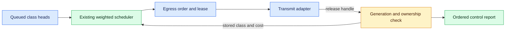
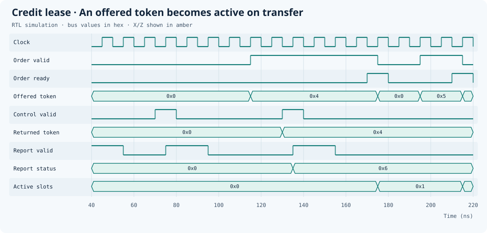

# Single-use credit refunds

[The leased scheduler](leased_credit_scheduler.sv) wraps the
credit-aware scheduler with a bounded table of outstanding resource
allocations. A transmit adapter saves the returned lease with its
descriptor. When the descriptor completes or is explicitly abandoned,
the adapter returns that lease. The scheduler recovers the original
class and cost from the table. A delayed or duplicated completion
therefore cannot release credit charged to another order, even if both
orders have the same client tag.

## Allocation and return

Every output transfer registers its class and cost and makes
`m_lease` active. The low bits select a table slot, and the upper bits
give its generation. The offer holds the same slot, generation, and
order through a stall. Returned handles are valid only after the order
transfer. The table prevents additional transfers when every usable
slot is occupied. The scheduler can already hold its internal head at
that point. Configuration of that class can report BUSY even before
the wrapper asserts public `m_valid`.

| Control opcode | Inputs and behavior |
| ---: | --- |
| 0 | Configure a class using the underlying capacity and weight rules |
| 1 | Return `ctl_lease`. The recorded class and cost specify the exact refund |
| 2 | Inspect a class using the underlying snapshot rules |
| 3 | Reserved |

Each accepted control emits one ordered response echoing `ctl_tag`.
A return echoes its handle. An out-of-range slot gives status 5.
A stale or inactive lease gives status 6. Invalid returns have zero
ledger fields and do not change credit. The wrapper accepts the next
control after the current report transfers. A valid return makes the
credit available after the command edge, and its slot remains reserved
until the report transfers. Another available slot may therefore use
the returned credit while the report is stalled.

The default eight-slot table uses a 48-bit generation per slot.
A slot issues at most `2**GEN_W - 1` leases per reset epoch.
Generation exhaustion permanently prevents reuse of that slot for
new work until reset, while existing leases can still be returned.
The integrator should size generations for the busiest slot's expected
lifetime allocations. A coordinated reset clears budgets, pending
orders and all generations. The adapter must discard every old-epoch
handle and drain or cancel outstanding resource work before reusing
the interface.

## Simulation waveform

The fixture sends a refund for an advertised lease before the order
transfers. The control report rejects it, and the egress lease stays
stable. Once the sink accepts the order, the slot becomes active and
can be returned. Regenerate with `make lease-waveform`.

The bench also checks expired generations, repeated client tags,
out-of-range slots, command report backpressure, full tables, and
reuse of credit ahead of report retirement. `make lease-formal` checks
16 reduced-geometry cycles and covers order acceptance, a successful
retirement and stale-handle rejection.
