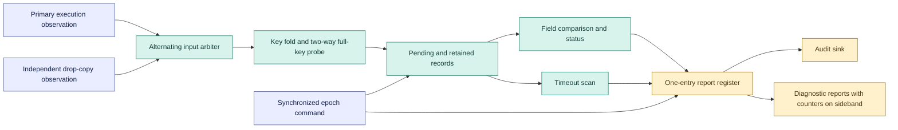
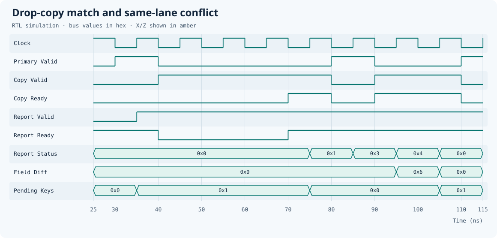

# Day 17 · FPGA Drop-Copy Reconciliation

A trading gateway receives execution reports on its order-entry connection. A separate drop-copy connection can deliver another observation of the same execution. Either can arrive first and either can repeat during recovery. This core holds the first observation, joins by full execution identity, checks price and quantity alongside order reference and side, and emits a diagnostic for each change it sees.

CME Globex Drop Copy can deliver iLink acknowledgments and Execution Reports over a separate connection for real-time monitoring. An upstream adapter must map the source identifiers, both protocol layouts and price units onto the same normalized fields before feeding this design. For example, Cboe describes Execution ID uniqueness within a trading day for its equities FIX execution messages, so a deployment must retain the appropriate identity namespace and handle its boundary. [CME Group Drop Copy FAQ](https://www.cmegroup.com/solutions/market-access/globex/trade-on-globex/faq-drop-copy.html) · [Cboe Titanium U.S. Equities FIX specification](https://cdn.cboe.com/resources/membership/US-Equities-FIX-Specification.pdf)

## Three situations it helps investigate

- **The gateway misses a fill during a reconnect.** The independent copy reports a 60-share fill. If the gateway never reports that identity before the configured timeout, the reconciler emits `MISSING_PRIMARY` with the copy payload. A gateway replay that subsequently supplies the execution generates `LATE` with both payloads. An operator can investigate both observations and any sequence gaps.
- **Two paths disagree on a partial fill.** The gateway reports 60 shares and the drop path reports 61 shares for the same identity. The second observation generates `PAIR_CONFLICT` with both payloads and difference mask `0b0100`. The report identifies a specific mismatch to compare with venue records.
- **A recovery stream repeats an observed fill.** The host sees `DUPLICATE` for an identical same-lane replay. If the payload changed instead, `DUP_CONFLICT` reports the changed fields and preserves the original two lane observations. A bust is a separate normalized event kind that can be reconciled independently against its own drop copy.

## How the circuit works



Each set has two ways. The XOR fold routes a key to a set. Both ways compare the full key, so a hash collision can exhaust one set and produce a `FULL` report without confusing two different identities. Open entries reserve the way until paired, expired or flushed. Closed entries retain their observations for `HISTORY_CYCLES` so duplicates and late mates remain recognizable. Closed entries age out even while idle or stalled, and are reusable at the exact history boundary.

A synchronous rising-edge handshake transfers when `valid && ready`. Accepted source observations, restart commands and expirations each create one registered report. The register can retire the prior report and accept a replacement in the same cycle. An occupied, stalled report register holds all fields and stops both ingress and maintenance. The wall tick still runs. This makes sink capacity part of the system budget.

When room is available, the operation priority is epoch command, due timeout, then one observation. A timeout becomes eligible when its unsigned modular age reaches `WAIT_CYCLES`. A rotating scan resolves multiple due entries one at a time, and a mate offered on the threshold cycle waits behind maintenance. A due entry can therefore report an age above the threshold after earlier maintenance, restart commands or a stalled sink. Once maintenance and commands are clear, competing valid observations alternate at each accepted beat.

## Interface and defaults

| Channel | Contract |
| --- | --- |
| `s_primary_*`, `s_copy_*` | Independent ready/valid observations. Hold key and payload while waiting. At most one transfers each clock. |
| `s_epoch_*` | Ready/valid command with a 16-bit new epoch. On successful restart the epoch increases, pending and closed entries flush, and the report states how many pending entries were abandoned. The counters and tick remain live. |
| `m_*` | Ready/valid diagnostic. `m_key` and the payloads are meaningful when valid. `m_source` is 0 primary, 1 copy, 2 scan, 3 epoch. |
| `active_epoch`, `pending_count`, `tick` | Current generation, waiting entries and 32-bit wall-cycle timestamp. |
| `*_count` | Nine 32-bit saturating counters. `observed_count` counts both data-lane handshakes including invalid, stale and full. Conflict counts both kinds of conflict. Rejected counts invalid observations, stale epochs and bad restart requests. Flushed counts abandoned pending entries. |
| `rst` | Active-high synchronous reset discards retained records, any held report, epoch and counters. Coordinate it with the upstream replay and audit consumer before resuming. |

The packed key is `{epoch[15:0], venue[7:0], original_session[15:0], execution_id[31:0], kind[1:0]}`. Both paths carry the original execution identity and session. Kind 0 is fill, kind 1 is bust. Zero execution ID, other kinds and zero quantity are rejected. The packed payload is `{order_reference[31:0], quantity[23:0], price[31:0], side}`. Both adapters must agree on raw price and quantity scaling, order-reference namespace, and side encoding.

`m_diff[3:0]` means order, quantity, price, side in descending bit order. `m_expected` is the saved payload when a comparison or expiry is possible. `m_observed` is the accepted input payload for data-lane reports. When no such payload exists, the field is zero. Ages are in cycles since the first accepted observation while waiting or since closure for later duplicates and mates. Non-comparison input results and epoch reports carry zero age. An epoch report embeds the requested epoch in the high key bits and zeroes the remaining bits.

| Code | Status | State update |
| --- | --- | --- |
| 0 | STAGED | Retain the first observation for this identity. |
| 1 | MATCH | Close the waiting record and retain both observations. |
| 2 | PAIR_CONFLICT | Close the record and retain both distinct observations. |
| 3 | DUPLICATE | Preserve the saved observation and record lifetime. |
| 4 | DUP_CONFLICT | Preserve the saved observation and report field differences. |
| 5 | MISSING_COPY | Close a primary-only event as timed out. |
| 6 | MISSING_PRIMARY | Close a copy-only event as timed out. |
| 7 | LATE | Compare an opposite-lane arrival to a timed-out record and leave that incident open for the host to resolve. |
| 8 | FULL | Target set has no reusable way. Accept the observation and report it without evicting a record. |
| 9 | STALE_EPOCH | Reject an observation outside the active epoch. |
| 10 | BAD_EVENT | Reject an invalid execution ID, kind or quantity. |
| 11 | RESTART | Advance the epoch and report the number of abandoned pending observations. |
| 12 | BAD_RESTART | Reject a repeated or decreasing generation. |

Default capacity is `SETS=4` for eight records including retained history. `SETS` must be a positive power of two. `WAIT_CYCLES=24` and `HISTORY_CYCLES=40` are positive integer cycle counts intended for the demonstration. Set them from measured source skew, maximum retained replay time and available capacity. Duplicates do not extend history. Events replayed after history has elapsed can stage as new, so retain durable audit state upstream or downstream across that boundary. Use a monotonically increasing epoch and a coordinated reset after reaching 65535. Ingress for one logical generation must use the same epoch on both lanes. The modular age contract requires a waiting entry to get sweep service before a complete 32-bit tick revolution elapses, including any stalled report or continuous configuration traffic.

## From the RTL simulation



The primary transfers at 35 ns. Pending count becomes 1 and the report carries `STAGED` (0). The copy holds valid while the audit sink stalls from 40 ns to 70 ns. Both the old report and the waiting copy then transfer at 75 ns. Pending becomes 0 and the replacement report is `MATCH` (1). The primary replay yields `DUPLICATE` (3) at 85 ns. A changed copy yields `DUP_CONFLICT` (4) and field mask `0x6` at 95 ns because the quantity and price disagree.

## Verify and reproduce

```sh
make test
make lint
make synth
make formal
make waveform
```

`make test` runs the Python unit tests and an exhaustive pin comparison for each cycle of the generated scenarios at one, four and eight sets. The directed cases require all 13 report codes, both arrival orders, multiple timeouts due together, per-set saturation, late arrival, held output across timeout, stale epochs, epoch flush counts and rollover of the 32-bit tick. The seeded workload issues independent observations with stable ready/valid backpressure, mixed skew, connection-generation changes and report stalls. The testbench checks held values on both inputs, epoch and report. The independently structured dictionary model checks the full report body and every counter for each sampled cycle.

`make formal` uses a 16-cycle bounded model check at one set, with a three-cycle wait and five-cycle history. It checks held output and pending count, arbitration, modular tick, monotonic epoch, restart/flush and report payload propagation. Cover traces demonstrate a match across tick wrap, a two-entry flush and a late arrival. These checks operate over an unconstrained input alphabet after initial reset.

`make waveform` reruns the directed scenario and its independent capture check before rendering the SVG. Open the full `build/wave/reconcile.vcd` with a waveform viewer or inspect the expected and actual traces beside it.

`make synth` checks the generic netlist. It provides a baseline for cell counts before FPGA placement. Throughput of one observation or maintenance operation per clock requires an accepting sink and depends on table contention. The parallel timeout scan and the combinational set selection increase fanout and logic as sets grow. An integration will also need PHY/protocol decoders, clock-domain crossings where appropriate, buffering sized for both sessions, recovery from feed gaps and an external audit store. The project implements a single-clock two-lane comparator and publishes simulation and synthesis evidence.
