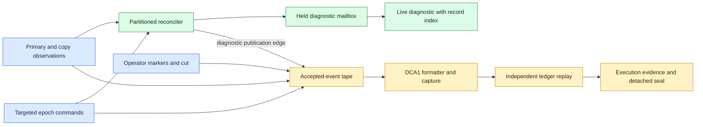
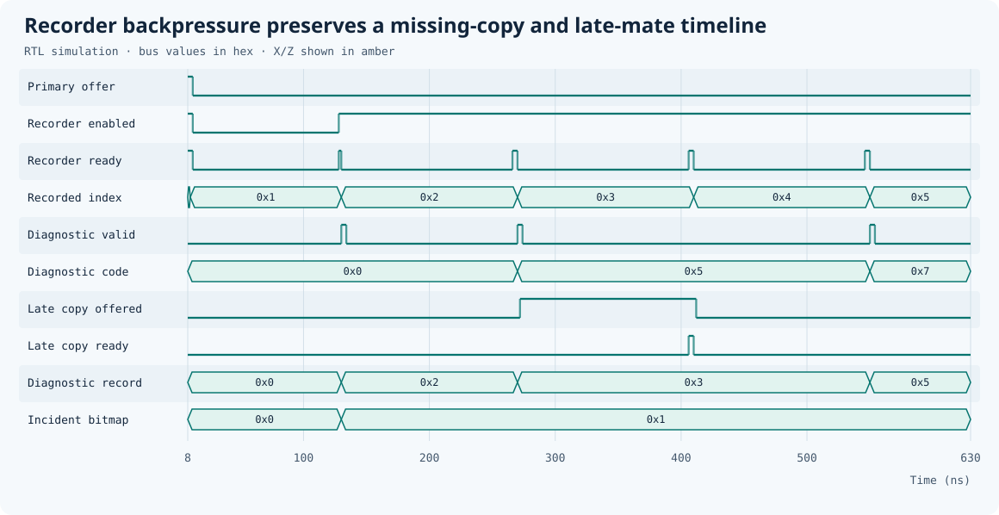

# Lossless drop-copy investigation

A late copy can reach the reconciler after a timeout has been detected and before an operator receives the timeout diagnostic. The distinction between when the event arrived, when the circuit resolved it, and when a record moved into the audit sink matters during incident reconstruction. The investigator exposes a chronological tape that an independent model can replay from reset.

[drop_copy_investigator.sv](drop_copy_investigator.sv) wraps the partitioned ledger in a lossless tap. [drop_copy_audit_frame.sv](drop_copy_audit_frame.sv) serializes the accepted wide records. Deploy the wide interface with a parallel recorder, or use the 32-bit formatter when narrower transport is more useful than throughput. The same diagnostic identity links the live output and the offline report.



## Capture and cutoff

Sample a nonzero 64-bit `run_identity` on synchronous reset. Use a new value for each externally managed capture. The hardware retains that value until the next reset. A zero run identity keeps audit admission closed. The original `drop_copy_partitions` interface remains available for users with separate capture machinery.

| Interface | Contract |
| --- | --- |
| Primary, copy, and epoch inputs | The original namespace and ready/valid payloads. Any subset that transfers on one edge is stored in one journal record. |
| `m_*` diagnostic | The held public report and `m_record_index` of the tape record where it entered this mailbox. A stalled public consumer does not withdraw an offered report. |
| `audit_valid / audit_ready` | Transfer a complete held wide record over a lossless capture interface. The reconciliation tick and 64-bit recorder cycle advance even when a sink stalls. |
| `mark_valid / mark_ready` | Capture an operator tag and the current pre-edge tick, local epochs, pending counts, incident bits and invalid-address count. |
| `mark_terminal` and `sealed` | A transferred terminal mark takes the edge's capture opportunity and prevents any new ingress or report publication. Already published diagnostic and tape data can still drain. |

Every accepted data operation or journaled diagnostic has a record. Removing availability at the audit sink eventually stops new inputs and new diagnostic publication. Local timeout clocks and available internal reconciliation state still advance. A report enters the public mailbox on the same edge as its journal record is captured. Its later external transfer can wait independently. Use the underlying index to correlate the report with the saved tape.

A terminal marker denotes the point where recording stopped. It can preserve pending entries and unresolved incidents. Read the marker's per-namespace state before deciding whether the incident was resolved at cutoff. Reset can discard an unfinished mailbox or frame. A complete verifier requires a terminal marker and rejects a missing or truncated tail. Retain the terminal seal independently to verify a particular prior capture.

## DCA1 framing and replay

The formatter emits little-endian 32-bit words. Word 0 is `0x31414344`. Word 1 holds version 1 in the high byte and payload bit width in its low 24 bits. Packed records follow in least-significant-word order with canonical zero padding. The checksum word is CRC-32C over the preceding words' bytes. The default goes through 35 transferred words per frame, including header and checksum. The serializer and wide tap each hold one record. A slow audit path therefore limits long-run admission rate.

The wide packed DCA1 body contains the run identity, one-based record index, zero-based cycle since reset, five presence bits, primary/copy records, epoch request, diagnostic record and marker. The presence bits from bit 0 to 4 correspond to primary, copy, epoch, diagnostic and marker. Their payloads contain the original key, quantity and price representation. The format makes missing channels unambiguous by requiring canonical zero bits in absent groups. Default body width is 1,005 bits with three namespaces and four sets.

The host replays accepted operations at their recorded edges and reconstructs idle edges between them. Autonomous expiry, retention, and arbiter state are replayed even when no frame was emitted. Long quiet spans skip only clocks without an eligible new transition. Each captured diagnostic must match the replayed source, complete key, expected and observed fields, difference mask, age and abandoned count. A checkpoint marker must match the replayed state at its own edge. The terminal seal includes a whole-tape SHA-256 and geometry. Hold it in a separate trusted record to catch traces edited and checksummed after capture.

```sh
make test-investigator
python3 -B audit_tape.py check build/investigator-3/hardware.dca \
  --seal build/investigator-3/hardware.seal.json --namespace 0 --execution 0x917
```

In a gateway that sees a missing execution observation, filter the tape by namespace and execution ID. A later `LATE` report can show matching quantity and price for the copy that eventually arrived. A later `STALE_EPOCH` report can distinguish delayed replay traffic after recovery moved that namespace to a new epoch. This diagnostic confirms what the reconciler accepted and reported. It preserves enough state to investigate a feed or adapter gap without guessing from wall-clock print order.

## Checked waveform



The primary transfers at 10 ns. Recorder transport is inhibited from 12 to 128 ns. The initial diagnostic becomes public with record 2 at 130 ns, and the namespace incident bit rises. The replayed `MISSING_COPY` report becomes public with record 3 at 270 ns. A copy held after 272 ns eventually transfers at 410 ns. Its `LATE` disposition becomes public with record 5 at 550 ns. The independent replay derives the same missing and late ages from the captured edges.

The three geometries compare 31,968 sampled edges and 669 complete frames, replay 637 published diagnostics, and compare 93,580 emitted bytes. Host fault tests cover torn frames, correct CRCs around false diagnostics, edited markers, spliced records, a missing terminal marker, and edits that remain semantically valid but fail the independent seal. Reduced formal checks verify held payloads and terminal exclusion. Run `make investigation-waveform` to regenerate the verified timing capture.
