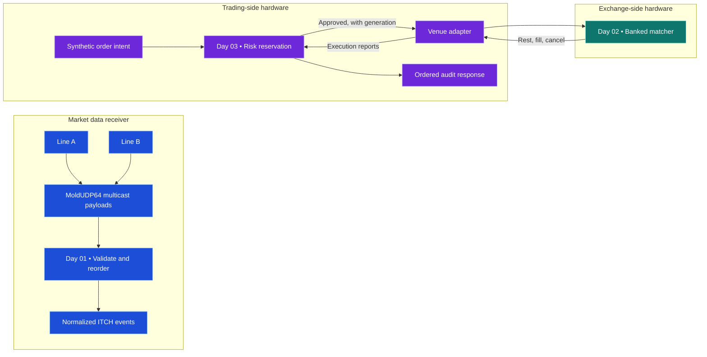

# System boundaries and offline integration

These are three complementary hardware designs. The first consumes a public-style market data feed and emits typed market events. The second is an exchange-side matching engine. The third is a trading-side authorization ledger. A deployed market data path would feed an external market state and strategy, while order entry and execution reports would cross a session boundary between the strategy and the venue.

The integration test uses SystemVerilog tasks as the venue adapter. It checks the crossing of two synthetic orders, conversion of a matching-engine fill into two independently sequenced execution updates, and risk ledger conservation after a cancel. Ethernet MAC and PHY, UDP/IP routing, exchange connectivity, policy administration, persistence and host software are outside this boundary.

## Reading latency results

- **Input acceptance** is the rising edge with both ready and valid asserted. An input blocked before acceptance adds source wait time.
- **Output availability** is when valid and payload are stable. **Output transfer** requires a later rising edge with both ready and valid asserted.
- **Per-event throughput** and **per-command throughput** can differ. A sweeping order can generate many fill events. A datagram can contain several market messages.
- **Routed clock frequency** estimates a register-to-register path for a placed core. The out-of-context ECP5 flow excludes physical pin timing and board or link latency.
