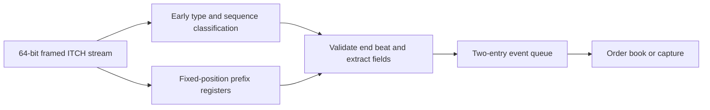

# 01 · Streaming Nasdaq ITCH decoder

Turn message-aligned TotalView-ITCH 5.0 bytes into fixed-width order events for an FPGA order book. The decoder accepts a 64-bit beat every cycle when downstream has capacity and validates frame boundaries before emitting an event. Every accepted end beat produces one completion, including unsupported messages and malformed frames.



## Run

Icarus Verilog, GNU Make, and Python 3 are sufficient for the simulation. Use Verilator for RTL lint and Yosys for generic synthesis and structural checks.

```sh
make test
make test SEED=39119
make lint
make synth
```

`make synth` creates a generic-cell netlist and a log in `build/`. The supplied [clock constraint](constraints/itch_decode.sdc) sets a 6.4 ns target for device integration. Source RTL is in [itch_decode.sv](rtl/itch_decode.sv).

## Stream contract

- All interfaces use `clk` and rising-edge ready/valid transfers. Synchronous active-high `rst` flushes the assembler, event queue and sequence state.
- Start each message at byte lane zero, where lane `n` is `s_data[8*n +: 8]` and `s_keep[n]` indicates validity. ITCH integer fields are in network byte order. Each frame contains one ITCH payload, starting at the type byte. Sample `s_sequence` on the beat with `s_first`.
- Assert `s_first` on the initial beat and `s_last` on the final beat. A non-final beat requires `s_keep=0xff`. The final mask is a nonempty contiguous prefix starting from the least significant bit. The source holds the entire beat stable while `s_valid && !s_ready`.
- `m_valid` qualifies all output fields. The sink may stall for any number of cycles and the queued completion remains stable. If the event queue is full, leading beats can still enter the assembler. Final beats wait for a free entry. Ingress has no combinational dependency on `m_ready`.
- This interface starts after Ethernet/UDP and MoldUDP64 or other transport processing. Supply per-message sequence numbers and present all messages, including types outside the decode subset, to keep the sequence tracker continuous. Handle redundant feeds and retransmission upstream.

## Supported ITCH messages

| Type | ITCH meaning | Bytes | Additional decoded fields |
| --- | --- | ---: | --- |
| `A` | Add Order | 36 | Side, shares, stock, display price |
| `F` | Add Order with MPID | 40 | Side, shares, stock, display price, MPID |
| `E` | Order Executed | 31 | Executed shares, match number |
| `C` | Order Executed with Price | 36 | Executed shares, match number, printable flag, execution price |
| `X` | Order Cancel | 23 | Canceled shares |
| `D` | Order Delete | 19 | Common fields only |
| `U` | Order Replace | 35 | Replacement reference, shares, display price |

Decoded events carry the raw type, stock locate, tracking number, 48-bit timestamp in nanoseconds since midnight, and original 64-bit order reference. Price is an unsigned integer in units of 1/10,000 of a dollar, and text fields are ASCII with the first byte at the most significant end. Inapplicable fields are zero. For `U`, the consumer must retain the previous order's side, stock and MPID. [Nasdaq TotalView-ITCH 5.0, sections 3, 4.3 and 4.4](https://www.nasdaqtrader.com/content/technicalsupport/specifications/dataproducts/NQTVITCHSpecification_5.0.pdf)

### Results and sequence disposition

| `m_result` | Meaning |
| --- | --- |
| 0 | Decoded order event |
| 1 | Unsupported type with well-formed input framing |
| 2 | Malformed frame, including a wrong known message length, invalid keep mask, missing or repeated first marker, invalid add side, or invalid priced-execution printable flag |

Unsupported frames are drained and their ITCH fields are left unparsed. For either diagnostic result, decoded fields other than the raw type are zero. An orphan frame has no usable type or sequence. A nested first marker marks the current frame malformed and decoding resumes after the next accepted end beat.

Each completion also has `m_sequence`, `m_expected_sequence` and an independent `m_seq_status`.

| `m_seq_status` | Meaning | Tracker action at frame end |
| --- | --- | --- |
| 0 | In order | Expect observed sequence plus one |
| 1 | Unseeded, or an orphan frame | Learn from a frame with an initial marker |
| 2 | Forward gap | Report prior expectation and expect observed sequence plus one |
| 3 | Stale or duplicate | Preserve prior expectation |

The tracker uses modulo 2⁶⁴ arithmetic, treating distances from 2⁶³ through 2⁶⁴−1 as stale. An unseeded or orphan completion reports expected sequence zero. Unsupported and malformed messages with an initial marker still participate in sequence accounting. The order-book consumer should apply only usable decoded events, reject stale events, and trigger its recovery policy when a gap or malformed frame invalidates local state.

A control-plane handshake on `seed_valid && seed_ready` sets the sequence expected from the next frame. This handshake is available after the assembler and completion queue drain. When both valid inputs compete on that edge, the seed handshake wins; the source must hold its beat until a later transfer.

## Cycle budget and verification

Output fields are registered when the final input beat is accepted. With an empty output queue and a ready sink, the result transfers on the next rising edge. From first beat to result, that is three cycles for `X/D`, four for `E`, and five for `A/F/C/U`, assuming continuous input.

At the 156.25 MHz design target the theoretical data bus capacity is 10 Gb/s and the message interval is three to five cycles (31.25–52.08 Mmsg/s). Partial final beats reduce useful payload throughput. These figures describe the clock target. The reproducible repository-level `make route` flow reported **150.94 MHz** post-route at a 100 MHz constraint on ECP5-85K speed grade 8, seed 1, using 2,098 combinational cells and 1,651 flip-flops. A separate run constrained at 156.25 MHz closed at **157.26 MHz** with seed 2. See the [seed sweep and commands](../../docs/performance.md). Both runs exclude board I/O timing.

The [vector generator](tb/gen_vectors.py) uses Python network-endian packing and computes expected normalized records independently of the RTL. The [scoreboard](tb/itch_decode_tb.sv) compares all 588 output bits. The default run checked 1,544 completions, including 1,058 decoded, 31 unsupported and 455 malformed records. It observed 347 gaps, 353 stale records and 989 output stall cycles. A directed block checked 90 consecutive input beats and 21 next-edge completions. Directed scenarios also cover queue saturation, intake of leading beats while full, sequence wrap, idle reseed, a reset during assembly, and framing recovery.

## Design reading

Morris, Thomas and Luk separate the line-rate feed path from downstream processing. Denholm et al. examine A/B arbitration and show how 64-bit sequence comparisons affect timing. Here the sequence check is captured on the first beat, while the final beat drives constant-position field extraction and emits normalized order fields only for valid, supported frames. [HOTI 2009](https://www.doc.ic.ac.uk/~wl/papers/09/hoti09dt.pdf), [ASAP 2014](https://www.doc.ic.ac.uk/~wl/papers/14/asap14sd.pdf)

Optiver's hardware roles call for high-speed network design, timing constraints and self-checking test benches. Jane Street's ASIC role spans RTL design and verification. This block exercises each of those skills with a byte-level protocol, an elastic interface and a transaction scoreboard. [Optiver FPGA Engineer](https://www.optiver.com/join-us/jobs/technology/chicago/fpga-engineer/), [Jane Street ASIC Engineer](https://www.janestreet.com/join-jane-street/position/8233259002/)
