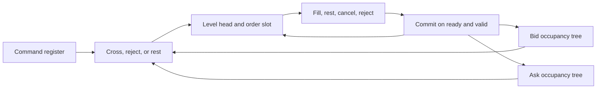

# 02 · Price-time matching engine

A synthesizable SystemVerilog limit order book for one instrument on a bounded price grid. It accepts limit orders and cancels, matches both sides at the resting order's price, and emits an ordered stream of fills and terminal outcomes. Orders at the same price execute oldest first. A partially executed resting order keeps its position.

| Parameter | Default | Meaning |
| --- | ---: | --- |
| `PRICE_LEVELS` | 16 | Number of legal tick indices per side, from 0 through `PRICE_LEVELS-1` |
| `ORDER_SLOTS` | 16 | Number of reusable ID slots shared by both sides, from 0 through `ORDER_SLOTS-1` |
| `QTY_W` | 16 | Unsigned quantity width in bits |

The parameters are positive integers. The derived price and ID widths are `$clog2(PRICE_LEVELS+1)` and `$clog2(ORDER_SLOTS+1)`. Each width can represent at least one out-of-range value. The caller manages ID assignment and reuse. A new command needs a free ID even if it would execute in full. With one order slot, the core can rest and cancel, and no second ID is available to cross.

## Interface

Commands transfer on rising edges with `s_valid && s_ready`. Events transfer on rising edges with `m_valid && m_ready`. The producer holds its payload stable while valid is high and ready is low. The core latches one command at a time.

| Input | Meaning |
| --- | --- |
| `s_cancel` | 0 for a new limit order, 1 to cancel a live ID |
| `s_is_ask` | 0 for bid, 1 for ask. Ignored for cancel |
| `s_order_id` | New order ID or cancel target |
| `s_price` | New order limit price, expressed as a tick index. Ignored for cancel |
| `s_qty` | Positive new order quantity. Ignored for cancel |

`m_order_id` always identifies the command. `m_last` marks its final event.

| `m_kind` | Event | Payload |
| ---: | --- | --- |
| 0 | Fill | `m_is_ask` is the incoming side, `m_maker_id` identifies the resting order, `m_price` is the resting price, `m_qty` is the fill size, and `m_remaining` is the incoming quantity left. `m_last` is high when the incoming order is fully filled |
| 1 | Rest | `m_is_ask` and `m_price` identify the incoming order's side and limit price. `m_qty` and `m_remaining` are the quantity inserted. Terminal |
| 2 | Cancel | `m_is_ask`, `m_price`, and `m_qty` describe the removed order. Terminal |
| 3 | Reject | `m_reject` gives the reason. Terminal |

Event fields without a meaning for the selected kind are zero. The rejection reasons, in validation order, are given below.

| `m_reject` | Reason |
| ---: | --- |
| 1 | ID outside the configured range |
| 5 | Cancel target is absent |
| 2 | New order price outside the configured range |
| 3 | New order has zero quantity |
| 4 | New order ID is already live |

`bid_valid/bid_price` and `ask_valid/ask_price` expose the highest occupied bid and lowest occupied ask. A side's price is zero when its valid flag is low. The active-high synchronous `rst` clears the book and discards the in-flight command at a rising edge. Both interfaces suppress transfers while reset is high.

## Architecture and timing

An occupancy bitmap tracks which price levels on each side are nonempty. A balanced tree picks the highest bid or lowest ask in `ceil(log2(PRICE_LEVELS))` selection stages. The tree carries the winning level and its FIFO head together, avoiding a second level-indexed lookup after finding the price. For non-power-of-two grids the unused leaves are invalid. Each price level owns a FIFO of resting order IDs. The global slot table holds quantity and the previous and next links, so cancel can splice any live order without walking the FIFO. Best-price selection is independent of the number of resting orders.



With an unstalled sink, an input accepted at edge E0 produces an event that can transfer at E1. If quantity remains and the next price is eligible, another fill can transfer at E2. Each continuing fill exhausts one distinct maker. Because the incoming ID was free when accepted, at most `ORDER_SLOTS-1` makers can be encountered, followed by at most one rest event. Cancellation and rejection each take one event. A new command can transfer on the first edge after a terminal event. The peak rate is one event per cycle during a sweep and one single-event command per two cycles.

The book commits on the corresponding output transfer. A stalled event holds its payload and leaves the book unchanged, including the quoted top. During a sweep, earlier transferred fills are already reflected in the book. For example, asks 0 and 1 can rest at tick 4 with quantities 5 and 7, then a bid of 6 at tick 4 fills 5 against maker 0 and 1 against maker 1. Maker 1 remains at the same queue position with quantity 6.

The critical path candidate runs through priority selection, the order slot read, quantity arithmetic, and queue update. Taker and maker residuals are calculated in parallel, and a maker fill reuses the selected price and side for its write addresses. Carrying heads through the selection tree adds selection logic but removes a serial read. At larger capacities, a registered head cache or banked table could shorten the path. An extra pipeline cycle would require forwarding or a throughput tradeoff for consecutive fills.

The design models a single instrument with integer ticks, one outstanding command, shared ID slots, and persistent limit orders. It has no participant identity, self-trade prevention, replace, market or conditional orders, or gateway protocol. The engine can serve as a deterministic exchange-side model for replay and testing.

## Reproduce

From this project directory, run the simulation with Icarus Verilog and the generic synthesis with Yosys.

```sh
make test
make synth
```

The scoreboard independently scans a flat reference book and resolves FIFO ties using insertion timestamps. It compares each event, verifies that the book only changes on a transfer, checks the top of book, and walks the DUT queues to check pointer integrity and reachability. Directed coverage includes both sweep directions, a sweep that reaches the event bound, partial maker fills, fills followed by rest, reset during a stalled cancel, invalid commands, ID reuse, and cancel at the head, tail, middle, and sole position. Seeded traffic and output stalls exercise a seven-level, five-slot instance and the default book dimensions. A separate run checks the one-level, one-slot boundary.

`make synth` runs structural checks and writes `build/matcher.json` and `build/synth.log`. The repository's `make route` target reports timing and resource usage for the default instance on an ECP5 device. The [reference run](../../docs/performance.md) reached **82.19 MHz**, below its 100 MHz target, using 1,556 combinational cells and 321 flip-flops. Clock rate and physical latency depend on the target, constraints, placement, and routing.
